# 第 1 章 · 使用 Three.js 创建你的第一个 3D 场景

<!-- pdf-page: 22 -->
## 创建你的第一个 3D 场景

## 使用 Three.js

现代浏览器正逐渐提供更加强大的功能，并且可以直接从 JavaScript 访问这些功能。你可以使用新的 HTML5 标签轻松添加视频和音频，还可以通过 HTML5 canvas 创建交互式组件。在支持 HTML5 的同时，现代浏览器也开始支持 WebGL。借助 WebGL，你可以直接利用显卡的处理资源，创建高性能的 2D 和 3D 计算机图形。直接使用 JavaScript 编写 WebGL 程序来创建三维场景（3D Scene）并为其制作动画，是一个非常复杂且容易出错的过程。Three.js 是一个能让这项工作变得简单许多的库。下面列出了 Three.js 能够简化的一些工作：

- 创建简单和复杂的 3D 几何体（Geometry）

- 在 3D 场景中为对象制作动画（Animation）并移动对象

- 为对象应用纹理（Texture）和材质（Material）

- 使用不同的光源（Light Source）照亮场景

- 从 3D 建模软件中加载对象

- 为 3D 场景添加高级后期处理（Postprocessing）效果

- 使用你自己的自定义着色器（Shader）

- 创建点云（Point Cloud）

<!-- pdf-page: 23 -->
使用 Three.js 创建你的第一个 3D 场景

只需几行 JavaScript，你就可以创建任何东西，从简单的 3D 模型到照片级逼真的实时场景，如下面的屏幕截图所示（可在浏览器中观看[眼球渲染演示视频](https://www.youtube.com/watch?v=jRtvze-4R9E)）：

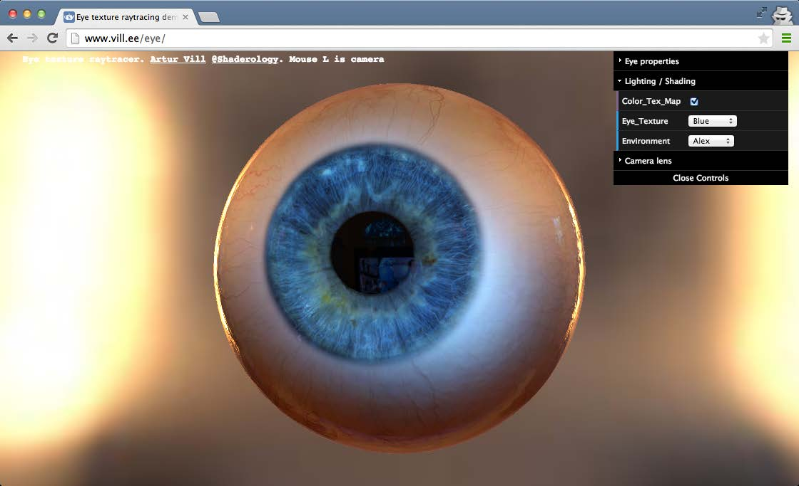

在本章中，我们将直接深入学习 Three.js，并创建几个示例来展示 Three.js 的工作方式，你也可以用这些示例进行尝试。我们暂时不会深入所有技术细节；这些内容将在后续章节中学习。本章将介绍以下几点：

- 使用 Three.js 所需的工具

- 下载本书使用的源代码和示例

- 创建你的第一个 Three.js 场景

- 使用材质、光源和动画改进第一个场景

- 介绍几个用于统计信息和控制场景的辅助库

本书将先简要介绍 Three.js，然后很快进入第一批示例和代码示例。在开始之前，让我们先快速了解一下最重要的几款浏览器及其对 WebGL 的支持情况。

<!-- pdf-page: 24 -->
在撰写本书时，WebGL 可用于以下桌面浏览器：

**浏览器支持情况**

- **Mozilla Firefox**：从 4.0 版开始支持 WebGL。
- **Google Chrome**：从第 9 版开始支持 WebGL。
- **Safari**：安装在 Mac OS X Mountain Lion、Lion 或 Snow Leopard 上的 Safari 5.1 及更新版本支持 WebGL。请确保在 Safari 中启用 WebGL。你可以依次进入 Preferences | Advanced（偏好设置 | 高级），勾选 Show develop menu in menu bar（在菜单栏中显示“开发”菜单）。然后，进入 Develop | Enable WebGL（开发 | 启用 WebGL）。
- **Opera**：从 12.00 版开始支持 WebGL。你仍然需要打开 opera:config，并将 WebGL 和 Enable Hardware Acceleration 的值设为 1，才能启用它。之后，重新启动浏览器。
- **Internet Explorer**：在很长一段时间里，Internet Explorer 是唯一不支持 WebGL 的主流浏览器。从 IE11 开始，Microsoft 添加了 WebGL 支持。

基本上，除了旧版 IE 之外，Three.js 可以在任何现代浏览器上运行。因此，如果你想使用旧版 IE，就需要额外采取一个步骤。对于 IE 10 及更早版本，可以使用 iewebgl 插件，从 https://github.com/iewebgl/iewebgl 获取。该插件安装在 IE 10 及更早版本中，并为这些浏览器启用 WebGL 支持。

Three.js 也可以在移动设备上运行；WebGL 的支持情况和你能获得的性能会有所不同，但二者都在迅速改善：

**设备支持情况**

- **Android**：Android 原生浏览器不支持 WebGL，通常也缺乏对现代 HTML5 功能的支持。如果你想在 Android 上使用 WebGL，可以使用最新版 Chrome、Firefox 或 Opera 移动版本。
- **Windows Mobile**：从 8.1 版开始支持 WebGL。
- **iOS**：从 iOS 8 开始，iOS 设备也支持 WebGL。iOS Safari 第 8 版对 WebGL 有很好的支持。

<!-- pdf-page: 25 -->
使用 Three.js 创建你的第一个 3D 场景

借助 WebGL，你可以创建交互式 3D 可视化内容，它们在桌面设备和移动设备上都能很好地运行。

本书将主要关注 Three.js 提供的基于 WebGL 的渲染器（Renderer）。不过，Three.js 还有一个基于 CSS 3D 的渲染器，它提供了易于使用的 API，可以创建基于 CSS 3D 的 3D 场景。使用基于 CSS 3D 的方法有一个很大的优势：几乎所有移动和桌面浏览器都支持这一标准，而且它还允许你在 3D 空间中渲染 HTML 元素。我们将在第 7 章“粒子、精灵和点云”中展示如何使用 CSS 3D 浏览器。

在第一章中，你将直接创建自己的第一个 3D 场景，并能够在前面提到的任何浏览器中运行它。我们暂时不会介绍太多复杂的 Three.js 功能，但在本章结束时，你将创建出如下屏幕截图所示的 Three.js 场景：

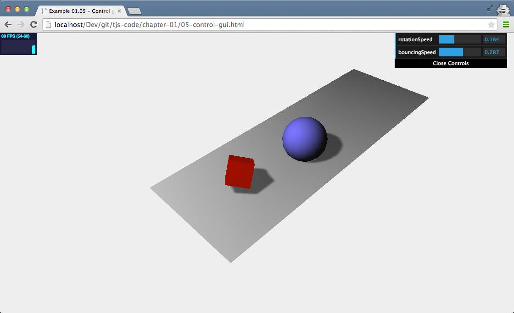

通过这个第一个场景，你将学习 Three.js 的基础知识，并创建自己的第一个动画。在开始制作这个示例之前，接下来的几节会先介绍轻松使用 Three.js 所需的工具，以及如何下载本书展示的示例。

<!-- pdf-page: 26 -->
## 使用 Three.js 的要求

Three.js 是一个 JavaScript 库，因此，要创建 Three.js WebGL 应用程序，你只需要一个文本编辑器和一个受支持的浏览器来渲染结果。我想推荐两款 JavaScript 编辑器，过去几年里我已经完全改用它们：

- WebStorm：JetBrains 推出的这款编辑器对 JavaScript 编辑有很好的支持。它支持代码补全、自动部署，以及直接在编辑器中进行 JavaScript 调试。此外，WebStorm 对 GitHub（及其他版本控制系统）有出色的支持。你可以从 http://www.jetbrains.com/webstorm/ 下载试用版。

- Notepad++：Notepad++ 是一款通用编辑器，支持多种编程语言的代码高亮。它可以轻松排版和格式化 JavaScript。请注意，Notepad++ 仅适用于 Windows。你可以从 http://notepad-plus-plus.org/ 下载 Notepad++。

- Sublime Text Editor：Sublime 是一款出色的编辑器，对 JavaScript 编辑有非常好的支持。此外，它还提供许多非常实用的选择功能（例如多行选择）和编辑选项，一旦习惯使用，就能构成非常好的 JavaScript 编辑环境。Sublime 也可以免费试用，并可从 http://www.sublimetext.com/ 下载。

即使你不使用这些编辑器，也有许多开源和商业编辑器可供选择，用它们编辑 JavaScript 并创建 Three.js 项目。你可能还想了解一个有趣的项目：http://c9.io。这是一个基于云的 JavaScript 编辑器，可以连接到 GitHub 账户。这样，你就可以直接访问本书的所有源代码和示例，并对它们进行试验。

除了这些可用于编辑和试验本书源代码的文本编辑器之外，Three.js 目前自己也提供了一个在线编辑器。

你可以在 http://threejs.org/ editor/ 找到这个编辑器，使用图形化方式创建 Three.js 场景。

<!-- pdf-page: 27 -->
使用 Three.js 创建你的第一个 3D 场景

我提到过，大多数现代 Web 浏览器都支持 WebGL，可以用来运行 Three.js 示例。我通常在 Chrome 中运行代码。原因是 Chrome 往往对 WebGL 有最好的支持和性能，而且它有一个非常出色的 JavaScript 调试器。使用如下屏幕截图所示的调试器，你可以通过断点和控制台输出等方式快速定位问题。下面的屏幕截图举例说明了这一点。在本书中，我会提供一些关于调试器用法以及其他调试技巧的提示。

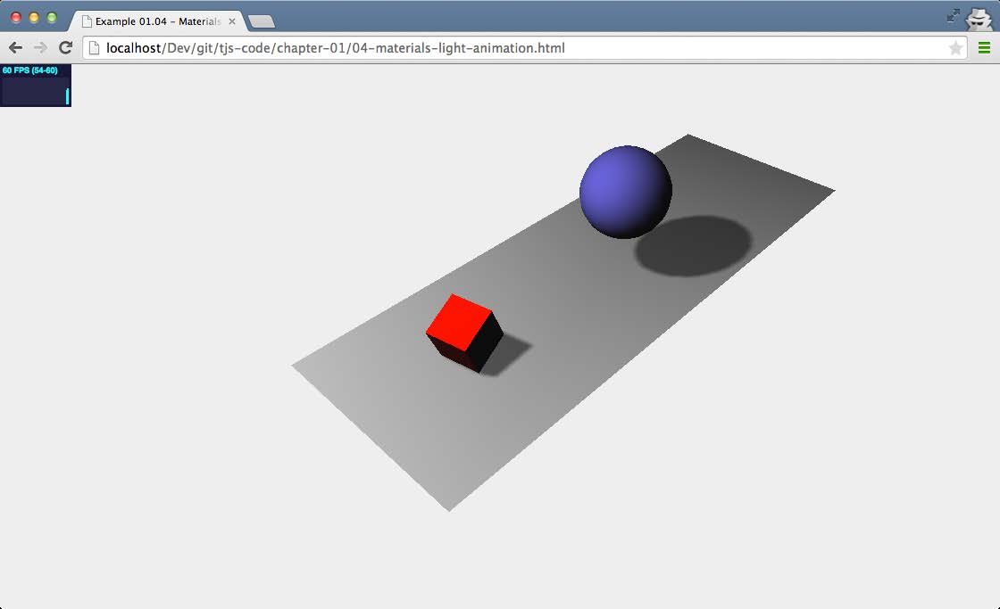

目前对 Three.js 的介绍已经足够；让我们获取源代码，开始创建第一个场景吧。

## 获取源代码

本书的所有代码都可以从 GitHub（https://github.com/）获取。GitHub 是一个基于 Git 的在线仓库，可以用它存储、访问源代码并管理源代码版本。你可以通过以下几种方式自行获取源代码：

- 克隆 Git 仓库

- 下载并解压归档文件

<!-- pdf-page: 28 -->
在下面两段中，我们将更详细地探讨这些方式。

### 使用 Git 克隆仓库

Git 是一个开源的分布式版本控制系统，我用它创建本书的所有示例并管理其版本。为此，我使用了 GitHub，一个免费的在线 Git 仓库。你可以通过 https://github.com/josdirksen/ learning-threejs 浏览这个仓库。

要获取所有示例，可以使用 git 命令行工具克隆这个仓库。为此，你首先需要下载适用于自己操作系统的 Git 客户端。对于大多数现代操作系统，都可以从 http://git-scm.com 下载客户端，也可以使用 GitHub 自己提供的客户端（适用于 Mac 和 Windows）。安装 Git 后，就可以用它获取本书仓库的副本。打开命令提示符，进入希望下载源代码的目录。在该目录中运行以下命令：

```text
# git clone https://github.com/josdirksen/learning-threejs
```

这将开始下载所有示例，如下面的屏幕截图所示：

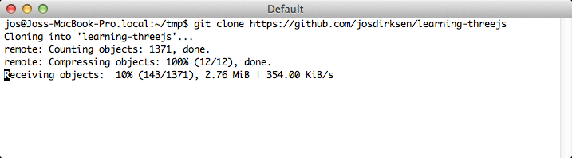

现在，learning-three.js 目录将包含本书中使用的所有示例。

<!-- pdf-page: 29 -->
使用 Three.js 创建你的第一个 3D 场景

### 下载并解压归档文件

如果你不想使用 Git 直接从 GitHub 下载源代码，也可以下载归档文件。在浏览器中打开 https://github.com/josdirksen/learning-threejs，然后点击右侧的 Download ZIP 按钮，如下所示：

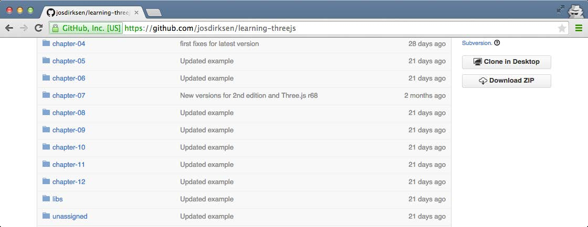

将其解压到你选择的目录中，就可以获得所有示例。

### 测试示例

现在你已经下载或克隆了源代码，让我们快速检查一下一切是否正常，并熟悉目录结构。代码和示例按章节组织。查看示例有两种不同的方式。你可以直接在浏览器中打开解压或克隆得到的文件夹，查看并运行某个特定示例；也可以安装一个本地 Web 服务器。第一种方式适用于大多数基础示例，但当我们开始加载外部资源（例如模型或纹理图像）时，仅仅打开 HTML 文件是不够的。在这种情况下，我们需要一个本地 Web 服务器，以确保正确加载外部资源。下一节将介绍几种设置简单本地 Web 服务器进行测试的方法。如果你无法设置本地 Web 服务器，但使用 Chrome 或 Firefox，我们也会说明如何禁用某些安全功能，这样即使没有本地 Web 服务器也能进行测试。

设置本地 Web 服务器非常简单，具体取决于你已经安装了什么。这里列举几个设置方法的示例。根据系统上已安装的软件，可以采用许多不同的方式。

<!-- pdf-page: 30 -->
#### 基于 Python 的 Web 服务器应适用于大多数 Unix/Mac 系统

大多数 Unix/Linux/Mac 系统已经安装了 Python。在这些系统上，你可以非常轻松地启动本地 Web 服务器：

```text
 > python -m SimpleHTTPServer
```

```text
 Serving HTTP on 0.0.0.0 port 8000 ...
```

请在签出／下载源代码的目录中执行此操作。

#### 如果你使用过 Node.js，可以使用基于 npm 的 Web 服务器

如果你已经用 Node.js 做过一些开发，那么很可能已经安装了 npm。使用 npm，有两种简单的选择可以快速设置用于测试的本地 Web 服务器。第一种选择使用 http-server 模块，如下所示：

```text
 > npm install -g http-server
```

```text
 > http-server
```

```text
Starting up http-server, serving ./ on port: 8080
```

```text
Hit CTRL-C to stop the server
```

或者，你也可以使用 simple-http-server 选项，如下所示：

```text
> npm install -g simple-http-server
```

```text
> nserver
```

```text
simple-http-server Now Serving: /Users/jos/git/Physijs at http://
localhost:8000/
```

不过，第二种方法的缺点是它不会自动显示目录列表，而第一种方法会。

#### 适用于 Mac 和／或 Windows 的 Mongoose 便携版

如果你没有安装 Python 或 npm，可以使用一个名为 Mongoose 的简单便携式 Web 服务器。首先，从 https://code.google.com/p/mongoose/downloads/list 下载适用于你特定平台的二进制文件。如果你使用 Windows，请将它复制到包含示例的目录，然后双击可执行文件，启动一个 Web 浏览器来提供其启动目录中的内容。

<!-- pdf-page: 31 -->
使用 Three.js 创建你的第一个 3D 场景

对于其他操作系统，你也必须将可执行文件复制到目标目录，但不是双击可执行文件，而必须从命令行启动它。在这两种情况下，本地 Web 服务器都会在 8080 端口上启动。下面的屏幕截图概括了本段讨论的内容：

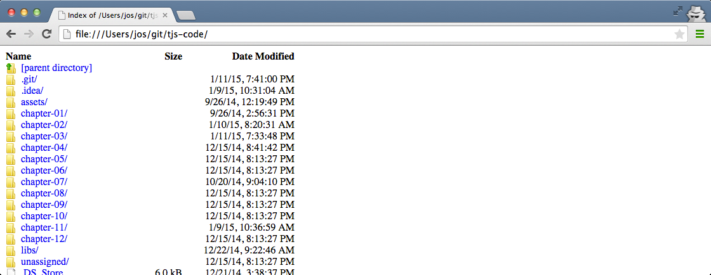

只需点击某一章，我们就可以显示并访问该章的所有示例。本书讨论某个示例时，我会指明具体的名称和文件夹，以便你直接测试和试验代码。

#### 在 Firefox 和 Chrome 中禁用安全限制

如果你使用 Chrome 运行示例，可以禁用一些安全设置，这样无需 Web 服务器就能使用 Chrome 查看示例。为此，必须按以下方式启动 Chrome：

- 对于 Windows，调用以下命令：

```text
chrome.exe --disable-web-security
```

- 在 Linux 上，执行以下操作：

```text
google-chrome --disable-web-security
```

- 在 Mac OS 上，通过如下方式启动 Chrome 来禁用这些设置：

```text
open -a Google\ Chrome --args --disable-web-security
```

以这种方式启动 Chrome 后，你就可以直接从本地文件系统访问所有示例。

<!-- pdf-page: 32 -->
对于 Firefox 用户，我们需要采取几个不同的步骤。打开 Firefox，在 URL 地址栏中输入 about:config。你会看到如下内容：

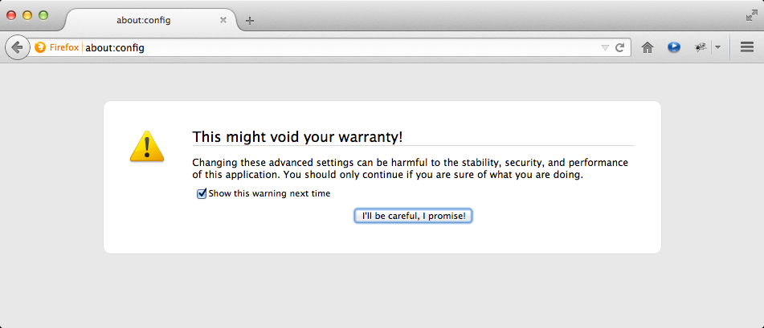

在此屏幕上，点击 I'll be careful, I promise! 按钮。这会显示所有可用于微调 Firefox 的属性。在此屏幕的搜索框中，输入 security.fileuri.strict\_origin\_policy，并将其值改为 false，正如下面的屏幕截图所示：

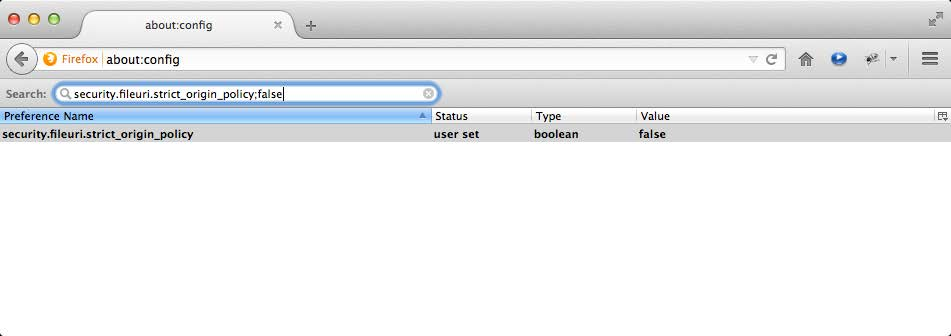

此时，你也可以使用 Firefox 直接运行本书提供的示例。

现在，你已经安装了 Web 服务器，或者禁用了必要的安全设置，是时候开始创建我们的第一个 Three.js 场景了。

<!-- pdf-page: 33 -->
使用 Three.js 创建你的第一个 3D 场景

## 创建 HTML 骨架

我们需要做的第一件事，是创建一个空的骨架页面，作为所有示例的基础，如下所示：

```html
<!DOCTYPE html>
```

```html
<html>
```

```html
  <head>
    <title>Example 01.01 - Basic skeleton</title>
    <script src="../libs/three.js"></script>
    <style>
      body{
        /* set margin to 0 and overflow to hidden, to use the
          complete page */
```

```text
        margin: 0;
        overflow: hidden;
      }
    </style>
  </head>
  <body>
```

```text
    <!-- Div which will hold the Output -->
    <div id="WebGL-output">
    </div>
```

```html
    <!-- Javascript code that runs our Three.js examples -->
    <script>
```

```javascript
      // once everything is loaded, we run our Three.js stuff.
      function init() {
        // here we'll put the Three.js stuff
      };
      window.onload = init;
```

```text
    </script>
  </body>
</html>
```

<!-- pdf-page: 34 -->
下载示例代码

对于你已经购买的所有 Packt Publishing 图书，都可以从你在 http://www.packtpub.com 的账户下载示例代码文件。如果你在其他地方购买了本书，可以访问 http://www.packtpub.com/support 并注册，以便通过电子邮件直接接收这些文件。

从这个代码清单可以看出，骨架是一个非常简单的 HTML 页面，只包含几个元素。在 \<head\> 元素中，我们加载示例将使用的外部 JavaScript 库。对于所有示例，我们至少需要加载 Three.js 库 three.js。在 \<head\> 元素中，我们还添加了几行 CSS。当我们创建全页 Three.js 场景时，这些样式元素会移除所有滚动条。在此页面的 \<body\> 元素中，你可以看到一个单独的 \<div\> 元素。编写 Three.js 代码时，我们会将 Three.js 渲染器的输出指向该元素。在此页面的底部，你已经能看到一点 JavaScript。通过将 init 函数赋给 window.onload 属性，我们确保 HTML 文档加载完毕后会调用此函数。在 init 函数中，我们将插入所有 Three.js 专用的 JavaScript。

Three.js 有两个版本：

- Three.min.js：这是在 Internet 上部署 Three.js 网站时通常会使用的库。这是使用 UglifyJS 创建的 Three.js 压缩版本，大小是普通 Three.js 库的四分之一。本书使用的所有示例和代码都基于 Three.js r69，该版本于 2014 年 10 月发布。

- Three.js：这是普通的 Three.js 库。我们在示例中使用这个库，因为当你能够阅读并理解 Three.js 源代码时，调试会容易得多。

如果在浏览器中查看此页面，结果并不会多么令人吃惊。如你所料，你看到的只是一个空白页面。

在下一节中，你将学习如何添加第一批 3D 对象，并将它们渲染到我们在 HTML 骨架中定义的 \<div\> 元素。

<!-- pdf-page: 35 -->
使用 Three.js 创建你的第一个 3D 场景

## 渲染和查看 3D 对象

在这一步中，你将创建第一个场景，并添加几个对象和一台相机（Camera）。我们的第一个示例将包含以下对象：

对象 说明 平面（Plane） 这是一个二维矩形，用作我们的地面区域。在本章的第二张屏幕截图中，它被渲染为场景中间的灰色矩形。立方体（Cube） 这是一个三维立方体，我们将把它渲染为红色。球体（Sphere） 这是一个三维球体，我们将把它渲染为蓝色。相机（Camera） 相机决定你将在输出中看到什么。坐标轴（Axes） 这些是 x、y 和 z 轴。这是一个很有用的调试工具，可以查看对象在 3D 空间中的渲染位置。x 轴为红色，y 轴为绿色，z 轴为蓝色。

我会先向你展示它在代码中的样子（带注释的源代码可在 chapter-01/02-first-scene.html 中找到），然后解释发生了什么：

```javascript
function init() {
  var scene = new THREE.Scene();
  var camera = new THREE.PerspectiveCamera(45, window.innerWidth
    /window.innerHeight, 0.1, 1000);
```

```javascript
  var renderer = new THREE.WebGLRenderer();
  renderer.setClearColorHex(0xEEEEEE);
  renderer.setSize(window.innerWidth, window.innerHeight);
```

```javascript
  var axes = new THREE.AxisHelper(20);
  scene.add(axes);
```

```javascript
  var planeGeometry = new THREE.PlaneGeometry(60, 20, 1, 1);
  var planeMaterial = new THREE.MeshBasicMaterial({color:
    0xcccccc});
  var plane = new THREE.Mesh(planeGeometry, planeMaterial);
```

```text
  plane.rotation.x = -0.5 * Math.PI;
  plane.position.x = 15
  plane.position.y = 0
  plane.position.z = 0
```

<!-- pdf-page: 36 -->
```text
  scene.add(plane);
```

```javascript
  var cubeGeometry = new THREE.BoxGeometry(4, 4, 4)
  var cubeMaterial = new THREE.MeshBasicMaterial({color: 0xff0000,
    wireframe: true});
  var cube = new THREE.Mesh(cubeGeometry, cubeMaterial);
```

```text
  cube.position.x = -4;
  cube.position.y = 3;
  cube.position.z = 0;
```

```text
  scene.add(cube);
```

```javascript
  var sphereGeometry = new THREE.SphereGeometry(4, 20, 20);
  var sphereMaterial = new THREE.MeshBasicMaterial({color:
    0x7777ff, wireframe: true});
  var sphere = new THREE.Mesh(sphereGeometry, sphereMaterial);
```

```text
  sphere.position.x = 20;
  sphere.position.y = 4;
  sphere.position.z = 2;
```

```text
  scene.add(sphere);
```

```text
  camera.position.x = -30;
  camera.position.y = 40;
  camera.position.z = 30;
  camera.lookAt(scene.position);
```

```text
  document.getElementById("WebGL-output")
    .appendChild(renderer.domElement);
    renderer.render(scene, camera);
};
window.onload = init;
```

<!-- pdf-page: 37 -->
使用 Three.js 创建你的第一个 3D 场景

如果在浏览器中打开这个示例，我们会看到与目标相似的效果（参见本章开头的屏幕截图），但仍有很大差距，如下所示：

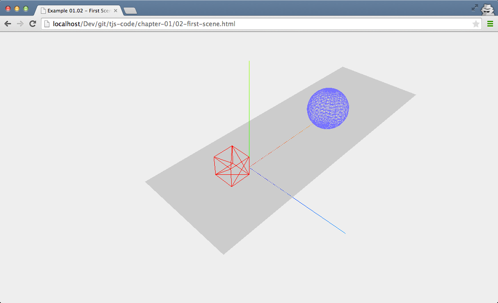

在开始让它变得更美观之前，我会先逐步带你了解代码，让你明白代码的作用：

```javascript
var scene = new THREE.Scene();
var camera = new THREE.PerspectiveCamera(45, window.innerWidth /
  window.innerHeight, 0.1, 1000);
var renderer = new THREE.WebGLRenderer();
renderer.setClearColorHex()
renderer.setClearColor(new THREE.Color(0xEEEEEE));
renderer.setSize(window.innerWidth, window.innerHeight);
```

<!-- pdf-page: 38 -->
在示例顶部，我们定义了 scene、camera 和 renderer。场景对象是一个容器，用于存储并跟踪我们想要渲染的所有对象和想要使用的所有光源。没有 THREE.Scene 对象，Three.js 就无法渲染任何内容。有关 THREE.Scene 对象的更多信息，请参见下一章。我们希望渲染的球体和立方体将在示例稍后添加到 scene 中。在这第一段代码中，我们还创建了一个相机对象。相机对象定义了渲染场景时我们将看到的内容。在第 2 章“构成 Three.js 场景的基本组件”中，你将进一步了解可以传递给相机对象的参数。接下来我们定义 renderer。渲染器对象负责根据相机对象的角度，计算场景对象在浏览器中的样子。在本例中，我们创建了使用你的显卡来渲染场景的 WebGLRenderer。

如果浏览 Three.js 的源代码和文档（可在 http://threejs.org/ 找到），你会注意到，除了基于 WebGL 的渲染器之外，还有其他不同的渲染器可用。Three.js 有一个基于 canvas 的渲染器，甚至还有一个基于 SVG 的渲染器。尽管它们可以工作并渲染简单场景，但我不建议使用它们。它们非常耗费 CPU，而且缺乏良好的材质支持和阴影（Shadow）等功能。

在这里，我们使用 setClearColor 函数将 renderer 的背景色设置为接近白色（new THREE.Color(0XEEEEEE)），并使用 setSize 函数告诉 renderer 需要渲染多大的场景。

到目前为止，我们已经有了一个基本的空场景、一个渲染器和一台相机。不过，还没有任何可渲染的内容。以下代码添加了辅助坐标轴和平面：

```javascript
  var axes = new THREE.AxisHelper( 20 );
  scene.add(axes);
```

```javascript
  var planeGeometry = new THREE.PlaneGeometry(60,20);
  var planeMaterial = new THREE.MeshBasicMaterial({color:
    0xcccccc});
  var plane = new THREE.Mesh(planeGeometry,planeMaterial);
```

```text
  plane.rotation.x=-0.5*Math.PI;
  plane.position.x=15
  plane.position.y=0
  plane.position.z=0
  scene.add(plane);
```

<!-- pdf-page: 39 -->
使用 Three.js 创建你的第一个 3D 场景

如你所见，我们创建了一个 axes 对象，并使用 scene.add 函数将这些坐标轴添加到场景中。接下来，我们创建平面。这分两步完成。首先，使用 new THREE.PlaneGeometry(60,20) 代码定义平面的外观。在本例中，它的宽度为 60，高度为 20。我们还需要告诉 Three.js 这个平面看起来是什么样（例如它的颜色和透明度）。在 Three.js 中，我们通过创建材质对象来实现这一点。对于第一个示例，我们将创建颜色为 0xcccccc 的基础材质（THREE.MeshBasicMaterial）。接下来，将二者组合成一个名为 plane 的网格（Mesh）对象。在将 plane 添加到场景之前，我们需要把它放到正确的位置；为此，先让它绕 x 轴旋转 90 度，然后使用 position 属性定义它在场景中的位置。如果你已经对其中的细节感兴趣，请查看第 2 章“构成 Three.js 场景的基本组件”代码文件夹中的 06-mesh-properties. html 示例，其中展示并解释了旋转和定位。然后，我们需要做的就是将 plane 添加到 scene，就像之前对 axes 所做的那样。

cube 和 sphere 对象以相同的方式添加，但 wireframe 属性被设为 true，这会告诉 Three.js 渲染线框（Wireframe），而不是实体对象。现在，让我们继续看这个示例的最后一部分：

```text
  camera.position.x = -30;
  camera.position.y = 40;
  camera.position.z = 30;
  camera.lookAt(scene.position);
```

```text
  document.getElementById("WebGL-output")
    .appendChild(renderer.domElement);
    renderer.render(scene, camera);
```

此时，我们想要渲染的所有元素都已添加到场景中的正确位置。我已经提到过，相机决定了将渲染什么内容。在这段代码中，我们使用 x、y 和 z 位置属性来定位相机，使其悬停在场景上方。为确保相机看向我们的对象，我们使用 lookAt 函数将它指向场景中心，该中心默认位于 position (0, 0, 0)。剩下要做的就是把渲染器的输出追加到 HTML 骨架的 \<div\> 元素。我们使用标准 JavaScript 选择正确的输出元素，并用 appendChild 函数将其追加到我们的 div 元素。最后，我们让 renderer 使用提供的 camera 对象来渲染 scene。

在接下来的几节中，我们将通过添加光源、阴影、更多材质甚至动画，让这个场景更加美观。

<!-- pdf-page: 40 -->
## 添加材质、光源和阴影

在 Three.js 中添加新材质和光源非常简单，其方式与上一节介绍的基本相同。我们首先向场景添加一个光源（完整源代码请参见 03-materials-light. html），如下所示：

```javascript
  var spotLight = new THREE.SpotLight( 0xffffff );
  spotLight.position.set( -40, 60, -10 );
  scene.add( spotLight );
```

THREE.SpotLight 从它所在的位置（spotLight.position. set( -40, 60, -10 )）照亮我们的场景。不过，如果这次渲染场景，你不会看到与之前有任何不同。原因是不同材质对光的响应方式不同。我们在上一个示例中使用的基础材质（THREE.MeshBasicMaterial）不会对场景中的光源作出任何反应。它们只会按指定颜色渲染对象。因此，我们必须将 plane、sphere 和 cube 的材质改为以下材质：

```javascript
var planeGeometry = new THREE.PlaneGeometry(60,20);
var planeMaterial = new THREE.MeshLambertMaterial({color:
  0xffffff});
var plane = new THREE.Mesh(planeGeometry, planeMaterial);
...
var cubeGeometry = new THREE.BoxGeometry(4,4,4);
var cubeMaterial = new THREE.MeshLambertMaterial({color:
  0xff0000});
var cube = new THREE.Mesh(cubeGeometry, cubeMaterial);
...
var sphereGeometry = new THREE.SphereGeometry(4,20,20);
var sphereMaterial = new THREE.MeshLambertMaterial({color:
  0x7777ff});
var sphere = new THREE.Mesh(sphereGeometry, sphereMaterial);
```

在这段代码中，我们将对象的材质改为 MeshLambertMaterial。在 Three.js 提供的材质中，这种材质和 MeshPhongMaterial 会在渲染时考虑光源。

<!-- pdf-page: 41 -->
使用 Three.js 创建你的第一个 3D 场景

然而，如下面的屏幕截图所示，结果仍然不是我们要找的效果：

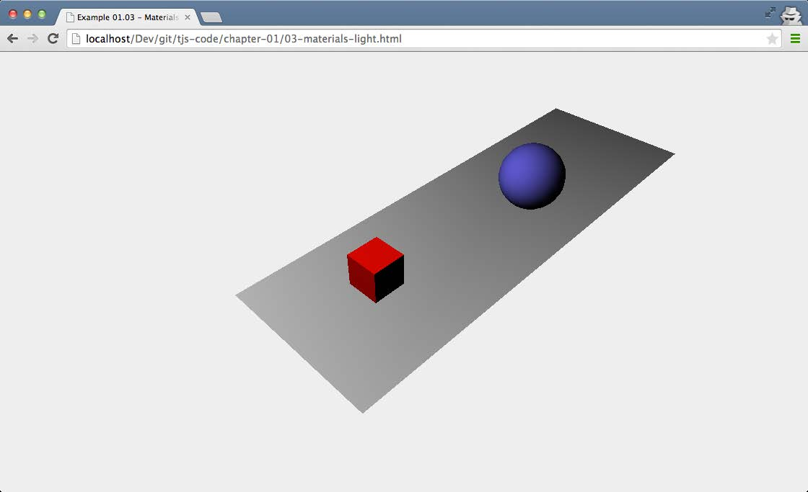

我们正在接近目标，cube 和 sphere 看起来已经好了很多。不过，仍然缺少阴影。

渲染阴影需要大量计算能力，因此，Three.js 默认禁用阴影。不过，启用阴影非常简单。为了使用阴影，我们需要在几个地方修改源代码，如下所示：

```javascript
renderer.setClearColor(new THREE.Color(0xEEEEEE, 1.0));
renderer.setSize(window.innerWidth, window.innerHeight);
renderer.shadowMapEnabled = true;
```

我们需要做的第一项修改是告诉 renderer 我们想要阴影。为此，将 shadowMapEnabled 属性设为 true。如果查看这项修改后的结果，你还不会注意到任何不同。这是因为我们需要明确指定哪些对象投射阴影、哪些对象接收阴影。在本例中，我们希望球体和立方体将阴影投射到地面上。为此，需要设置这些对象上的相应属性：

<!-- pdf-page: 42 -->
```text
plane.receiveShadow = true;
...
cube.castShadow = true;
...
sphere.castShadow = true;
```

现在，要得到阴影，只剩一件事要做。我们需要定义场景中的哪些光源会产生阴影。并非所有光源都能投射阴影，你将在下一章进一步了解这一点，但本例使用的 THREE.SpotLight 可以。我们只需设置正确的属性，如下面这行代码所示，阴影最终就会被渲染出来：

```text
spotLight.castShadow = true;
```

这样，我们就得到了一个完整场景，其中包含光源投射的阴影，如下所示：


我们将添加到这个第一个场景的最后一项功能是一些简单的动画。在第 9 章“动画和移动相机”中，你将学习更高级的动画选项。

<!-- pdf-page: 43 -->
使用 Three.js 创建你的第一个 3D 场景

## 用动画扩展你的第一个场景

如果想让场景动起来，我们需要做的第一件事是找到某种按特定时间间隔重新渲染场景的方法。在 HTML5 和相关 JavaScript API 出现之前，实现这一点的方法是使用 setInterval(function,interval) 函数。使用 setInterval，我们可以指定一个函数，例如每 100 毫秒调用一次。这个函数的问题是它不考虑浏览器中正在发生什么。如果你正在浏览另一个标签页，这个函数仍会每隔几毫秒触发一次。此外，setInterval 不会与屏幕重绘同步。这可能导致更高的 CPU 使用率和糟糕的性能。

### requestAnimationFrame 简介

幸运的是，现代浏览器通过 requestAnimationFrame 函数为此提供了解决方案。使用 requestAnimationFrame，你可以指定一个由浏览器定义的时间间隔来调用的函数。你在提供的函数中执行所需的任何绘制，浏览器会确保尽可能流畅、高效地进行绘制。使用它非常简单（完整源代码可在 04-materials-light-animation.html 文件中找到），只需创建一个处理渲染的函数：

```javascript
function renderScene() {
  requestAnimationFrame(renderScene);
  renderer.render(scene, camera);
}
```

在这个 renderScene 函数中，我们再次调用 requestAnimationFrame，使动画持续运行。代码中唯一需要修改的是：创建完整场景后，不再调用 renderer.render，而是调用一次 renderScene 函数来启动动画：

```text
...
document.getElementById("WebGL-output")
  .appendChild(renderer.domElement);
renderScene();
```

如果运行此代码，与上一个示例相比，你还不会看到任何变化，因为我们尚未让任何对象运动起来。不过，在添加动画之前，我想介绍一个小型辅助库，它可以提供动画运行帧率（Frame Rate）的信息。这个库与 Three.js 出自同一位作者，它会渲染一个小图表，显示此动画达到的每秒帧数（Frames Per Second，fps）。

<!-- pdf-page: 44 -->
要添加这些统计信息，我们首先需要在 HTML 的 \<head\> 元素中包含该库，如下所示：

```html
<script src="../libs/stats.js"></script>
```

然后添加一个 \<div\> 元素，用作统计图表的输出，如下所示：

```text
<div id="Stats-output"></div>
```

剩下唯一要做的就是初始化统计信息，并将其添加到这个 \<div\> 元素中，如下所示：

```javascript
function initStats() {
  var stats = new Stats();
  stats.setMode(0);
  stats.domElement.style.position = 'absolute';
  stats.domElement.style.left = '0px';
  stats.domElement.style.top = '0px';
  document.getElementById("Stats-output")
    .appendChild( stats.domElement );
     return stats;
}
```

此函数会初始化统计信息。有趣的部分是 setMode 函数。如果将其设为 0，我们将测量每秒帧数（fps）；如果设为 1，则可以测量渲染时间。对于这个示例，我们关注 fps，因此设为 0。在 init() 函数的开头，我们将调用此函数，这样就启用了统计功能，如下所示：

```javascript
function init(){
```

```javascript
  var stats = initStats();
  ...
}
```

剩下唯一要做的就是告诉 stats 对象我们何时进入新的渲染周期。为此，在 renderScene 函数中添加对 stats.update 函数的调用，如下所示。

```javascript
function renderScene() {
  stats.update();
  ...
  requestAnimationFrame(renderScene);
  renderer.render(scene, camera);
}
```

<!-- pdf-page: 45 -->
使用 Three.js 创建你的第一个 3D 场景

如果运行添加这些内容的代码，你会在左上角看到统计信息，如下面的屏幕截图所示：

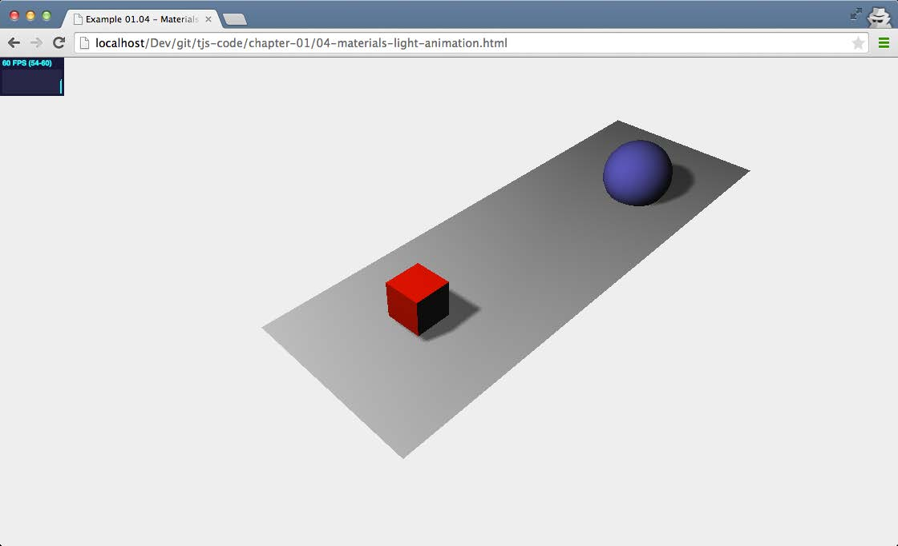

### 让立方体动起来

配置好 requestAnimationFrame 和统计信息后，我们就有了放置动画代码的位置。在本节中，我们将扩展 renderScene 函数，添加使红色立方体绕其所有轴旋转的代码。先来看一下代码：

```javascript
function renderScene() {
  ...
  cube.rotation.x += 0.02;
  cube.rotation.y += 0.02;
  cube.rotation.z += 0.02;
  ...
  requestAnimationFrame(renderScene);
  renderer.render(scene, camera);
}
```

<!-- pdf-page: 46 -->
这看起来很简单，对吧？我们所做的就是每次调用 renderScene 函数时，将每个轴的 rotation 属性增加 0.02，这就表现为立方体绕其所有轴平滑旋转。让蓝色球体弹跳也不难。

### 让球体弹跳

为了让球体弹跳，我们再次向 renderScene 函数添加几行代码，如下所示：

```javascript
  var step=0;
  function renderScene() {
    ...
    step+=0.04;
    sphere.position.x = 20+( 10*(Math.cos(step)));
    sphere.position.y = 2 +( 10*Math.abs(Math.sin(step)));
    ...
    requestAnimationFrame(renderScene);
    renderer.render(scene, camera);
  }
```

对于立方体，我们修改的是 rotation 属性；对于球体，我们将修改它在场景中的 position 属性。我们希望球体以一条优美、平滑的曲线，从场景中的一个点弹跳到另一个点。如下图所示：

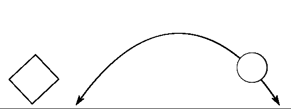

<!-- pdf-page: 47 -->
使用 Three.js 创建你的第一个 3D 场景

为此，我们需要改变它在 x 轴上的位置和在 y 轴上的位置。Math.cos 和 Math.sin 函数帮助我们使用 step 变量创建平滑的轨迹。这里不详细说明其工作原理。目前，你只需要知道 step+=0.04 定义了球体弹跳的速度。在第 8 章“创建和加载高级网格与几何体”中，我们将更详细地介绍如何在动画中使用这些函数，并解释所有内容。下面是球体弹跳中途的样子：

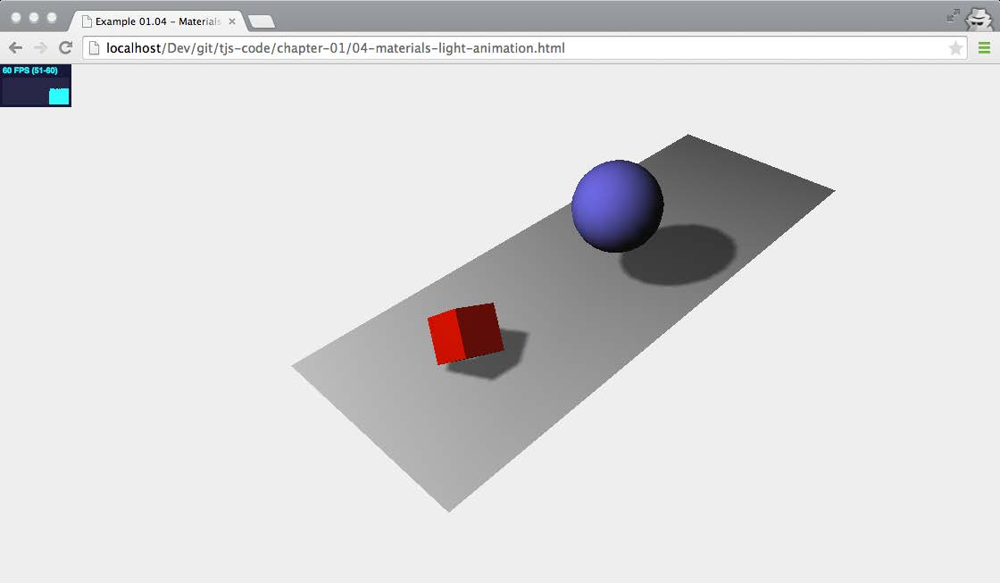

在结束本章之前，我想再向基础场景添加一个元素。在处理 3D 场景、动画、颜色和类似属性时，往往需要做一些试验，才能得到正确的颜色或速度。如果能有一个简单的 GUI，让你随时更改这类属性，就会非常方便。幸运的是，确实有这样的工具！

## 使用 dat.GUI 让试验更轻松

Google 的几名员工创建了一个名为 dat.GUI 的库（其在线文档位于 http://code.google.com/p/dat-gui/），它让你能够非常轻松地创建简单的用户界面组件，用来更改代码中的变量。在本章的最后一部分，我们将使用 dat.GUI 为示例添加一个用户界面，以便更改以下内容：

<!-- pdf-page: 48 -->
- 控制球体弹跳的速度

- 控制立方体的旋转

就像添加统计信息时所做的那样，我们先将这个库添加到 HTML 页面的 \<head\> 元素中，如下所示：

```html
<script src="../libs/dat.gui.js"></script>
```

接下来需要配置一个 JavaScript 对象，用来保存我们想通过 dat.GUI 更改的属性。在 JavaScript 代码的主体部分，添加以下 JavaScript 对象：

```javascript
var controls = new function() {
  this.rotationSpeed = 0.02;
  this.bouncingSpeed = 0.03;
}
```

在这个 JavaScript 对象中，我们定义了两个属性——this.rotationSpeed 和 this.bouncingSpeed——及其默认值。接下来，将此对象传入一个新的 dat.GUI 对象，并定义这两个属性的范围，如下所示：

```javascript
var gui = new dat.GUI();
gui.add(controls, 'rotationSpeed', 0, 0.5);
gui.add(controls, 'bouncingSpeed', 0, 0.5);
```

rotationSpeed 和 bouncingSpeed 属性的范围都设为 0 到 0.5。现在，我们只需确保在 renderScene 循环中直接引用这两个属性，这样，通过 dat.GUI 用户界面进行更改时，就会立即影响对象的旋转和弹跳速度，如下所示：

```javascript
function renderScene() {
  ...
  cube.rotation.x += controls.rotationSpeed;
  cube.rotation.y += controls.rotationSpeed;
  cube.rotation.z += controls.rotationSpeed;
  step += controls.bouncingSpeed;
  sphere.position.x = 20 +(10 * (Math.cos(step)));
  sphere.position.y = 2 +(10 * Math.abs(Math.sin(step)));
  ...
}
```

<!-- pdf-page: 49 -->
使用 Three.js 创建你的第一个 3D 场景

现在，当你运行这个示例（05-control-gui.html）时，会看到一个简单的用户界面，可以用它控制弹跳和旋转速度。下面是弹跳球体和旋转立方体的屏幕截图：

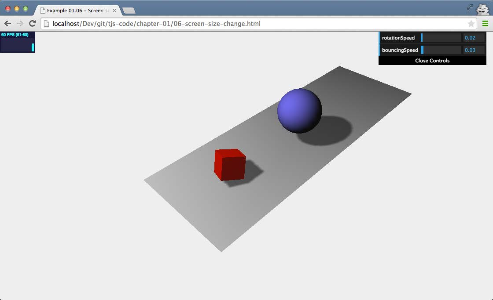

如果你已经在浏览器中查看过这些示例，可能会注意到，当你更改浏览器的大小时，场景不会自动缩放。在下一节中，我们将添加这项功能，作为本章的最后一项功能。

## 浏览器大小改变时自动调整输出大小

浏览器大小调整时更改相机非常简单。我们需要做的第一件事是注册一个事件监听器，如下所示：

```text
window.addEventListener('resize', onResize, false);
```

现在，每当浏览器窗口调整大小时，就会调用接下来指定的 onResize 函数。在这个 onResize 函数中，我们需要更新相机和渲染器，如下所示：

```javascript
function onResize() {
  camera.aspect = window.innerWidth / window.innerHeight;
```

<!-- pdf-page: 50 -->
```text
  camera.updateProjectionMatrix();
  renderer.setSize(window.innerWidth, window.innerHeight);
}
```

对于相机，我们需要更新保存屏幕宽高比的 aspect 属性；对于渲染器，我们需要更改它的大小。最后一步是将 camera、renderer 和 scene 的变量定义移到 init() 函数之外，以便从不同函数（例如 onResize 函数）中访问它们，如下所示：

```javascript
var camera;
var scene;
var renderer;
```

```javascript
function init() {
  ...
  scene = new THREE.Scene();
  camera = new THREE.PerspectiveCamera(45, window.innerWidth /
    window.innerHeight, 0.1, 1000);
  renderer = new THREE.WebGLRenderer();
  ...
}
```

要查看此效果的实际运行情况，请打开 06-screen-size-change.html 示例并调整浏览器窗口的大小。

## 小结

第一章到此结束。在本章中，我们向你展示了如何设置开发环境、如何获取代码，以及如何开始使用本书提供的示例。你还了解到，要使用 Three.js 渲染场景，首先必须创建一个 THREE.Scene 对象，添加相机、光源和想要渲染的对象。我们还展示了如何通过添加阴影和动画来扩展这个基础场景。最后，我们添加了几个辅助库。我们使用 dat.GUI，它能让你快速创建控制用户界面；还添加了 stats.js，它可以提供场景渲染帧率的反馈。

在下一章中，我们将扩展本章创建的示例。你将进一步了解 Three.js 中可以使用的最重要的构建模块。

<!-- pdf-page: 51 -->
