# 第 2 章 · 构成 Three.js 场景的基本组件

<!-- pdf-page: 52 -->
## 构成 Three.js 场景的基本组件

在上一章中，你学习了 Three.js 的基础知识。我们展示了几个示例，你还创建了自己的第一个完整 Three.js 场景。在本章中，我们将进一步深入学习 Three.js，解释构成 Three.js 场景的基本组件。本章将探讨以下主题：

- Three.js 场景中使用的组件

- 你可以用 THREE.Scene 对象做什么

- 几何体和网格之间的关系

- 正交相机（Orthographic Camera）和透视相机（Perspective Camera）之间的区别

我们先来看看如何创建场景并添加对象。

## 创建场景

在上一章中，你创建了 THREE.Scene，因此已经了解 Three.js 的基础知识。我们已经看到，要让场景显示任何内容，需要三种类型的组件：

| 组件 | 说明 |
| --- | --- |
| 相机 | 它决定屏幕上渲染的内容。 |
| 光源 | 它们会影响材质的显示方式，并用于创建阴影效果（在第 3 章“使用 Three.js 中可用的不同光源”中详细讨论）。 |
| 对象 | 这些是从相机视角渲染的主要对象：立方体、球体等。 |

<!-- pdf-page: 53 -->
构成 Three.js 场景的基本组件

THREE.Scene 用作所有这些不同对象的容器。这个对象本身没有那么多选项和函数。

THREE.Scene 是一种有时也被称为场景图（Scene Graph）的结构。场景图是一种可以保存图形场景全部必要信息的结构。在 Three.js 中，这意味着 THREE.Scene 包含渲染所需的所有对象、光源和其他对象。值得注意的是，顾名思义，场景图并不只是一个对象数组；场景图由树结构中的一组节点组成。在 Three.js 中，每个可以添加到场景的对象，甚至 THREE.Scene 本身，都扩展自一个名为 THREE.Object3D 的基础对象。THREE.Object3D 对象也可以有自己的子对象，你可以用它创建对象树，Three.js 将解释并渲染这棵树。

### 场景的基本功能

探索场景功能的最佳方式是查看示例。在本章的源代码中，你可以找到 01-basic-scene.html 示例。我将使用这个示例来解释场景具有的各种函数和选项。当我们在浏览器中打开这个示例时，输出将有些像下一张屏幕截图所示：

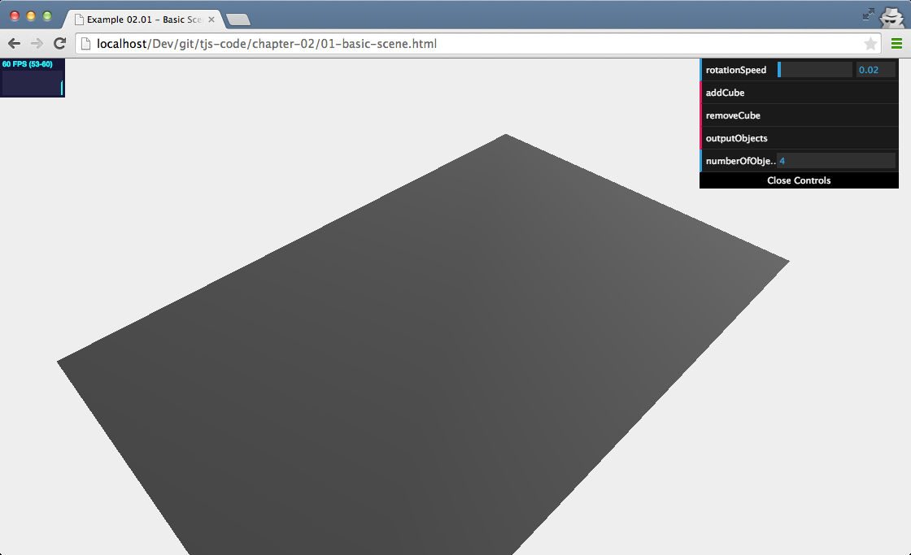

<!-- pdf-page: 54 -->
这看起来很像我们在上一章看到的示例。尽管场景看起来很空，但它已经包含了几个对象。查看下面的源代码，可以看到我们使用 THREE.Scene 对象的 scene.add(object) 函数添加了 THREE.Mesh（你看到的地面）、THREE.SpotLight 和 THREE.AmbientLight。渲染场景时，Three.js 会自动添加 THREE.Camera 对象，但最好手动将相机添加到场景中，尤其是在使用多台相机时。请查看这个场景的以下源代码：

```javascript
var scene = new THREE.Scene();
var camera = new THREE.PerspectiveCamera(45, window.innerWidth
  / window.innerHeight, 0.1, 1000);
scene.add(camera);
...
var planeGeometry = new THREE.PlaneGeometry(60,40,1,1);
var planeMaterial = new THREE.MeshLambertMaterial({color:
  0xffffff});
var plane = new THREE.Mesh(planeGeometry,planeMaterial);
...
scene.add(plane);
var ambientLight = new THREE.AmbientLight(0x0c0c0c);
scene.add(ambientLight);
...
var spotLight = new THREE.SpotLight( 0xffffff );
...
scene.add( spotLight );
```

<!-- pdf-page: 55 -->
构成 Three.js 场景的基本组件

在深入研究 THREE.Scene 对象之前，我先解释一下你可以在演示中做什么，然后再看一些代码。在浏览器中打开 01-basic-scene.html 示例，查看右上角的控件，如下面的屏幕截图所示：

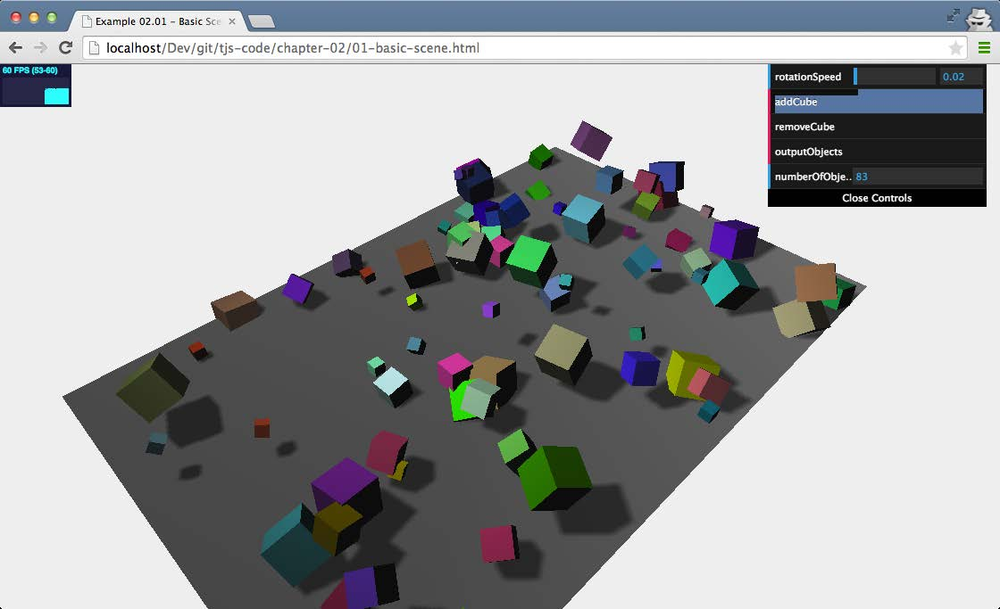

使用这些控件，你可以向场景添加立方体、移除最后添加到场景的立方体，并在浏览器控制台中显示场景当前包含的所有对象。控件部分的最后一项显示场景中当前的对象数量。启动场景时，你可能会注意到场景中已经有四个对象。它们是地面、环境光、聚光灯，以及前面提到的相机。我们将逐一查看控制部分的各个函数，从最简单的 addCube 开始，如下所示：

```javascript
this.addCube = function() {
  var cubeSize = Math.ceil((Math.random() * 3));
  var cubeGeometry = new THREE.BoxGeometry
    (cubeSize,cubeSize,cubeSize);
  var cubeMaterial = new THREE.MeshLambertMaterial({color:
    Math.random() * 0xffffff });
  var cube = new THREE.Mesh(cubeGeometry, cubeMaterial);
  cube.castShadow = true;
  cube.name = "cube-" + scene.children.length;
  cube.position.x=-30 + Math.round(Math.random() *
    planeGeometry.width));
```

<!-- pdf-page: 56 -->
```text
  cube.position.y= Math.round((Math.random() * 5));
  cube.position.z=-20 + Math.round((Math.random() *
    planeGeometry.height));
```

```text
  scene.add(cube);
  this.numberOfObjects = scene.children.length;
};
```

现在，这段代码应该已经很容易阅读了。这里没有引入多少新概念。当你点击 addCube 按钮时，会创建一个新的 THREE.BoxGeometry 对象，其宽度、高度和深度设为 1 到 3 之间的随机值。除了随机大小之外，立方体还会获得随机颜色和随机位置。

我们在这里引入的一个新元素是，还使用立方体的 name 属性为它命名。它的名称设为 cube-，后面附加场景当前的对象数量（scene.children.length）。名称对调试非常有用，也可以用于直接从场景访问对象。如果使用 THREE.Scene.getObjectByName(name) 函数，就可以直接检索特定对象，例如更改它的位置，而不必将 JavaScript 对象设为全局变量。你可能想知道最后一行有什么作用。numberOfObjects 变量供我们的控制 GUI 使用，用于列出场景中的对象数量。因此，每当添加或移除对象时，我们都会将此变量设为更新后的数量。

我们可以从控制 GUI 调用的下一个函数是 removeCube。顾名思义，点击 removeCube 按钮会从场景中移除最后添加的立方体。代码如下所示：

```javascript
  this.removeCube = function() {
    var allChildren = scene.children;
    var lastObject = allChildren[allChildren.length-1];
    if (lastObject instanceof THREE.Mesh) {
      scene.remove(lastObject);
      this.numberOfObjects = scene.children.length;
    }
  }
```

要向场景添加对象，我们使用 add 函数。要从场景中移除对象，我们使用 remove 函数，这一点并不令人意外。由于 Three.js 将子对象存储为列表（新对象添加到末尾），我们可以使用 THREE.Scene 对象的 children 属性获取最后添加的对象，该属性包含场景中所有对象的数组。我们还需要检查该对象是否为 THREE.Mesh 对象，以避免移除相机和光源。移除对象后，我们再次更新保存场景对象数量的 GUI 属性 numberOfObjects。

<!-- pdf-page: 57 -->
构成 Three.js 场景的基本组件

GUI 上的最后一个按钮标记为 outputObjects。你可能已经点击过它，但似乎什么都没有发生。这个按钮会将场景中当前的所有对象输出到 Web 浏览器控制台，如下面的屏幕截图所示：

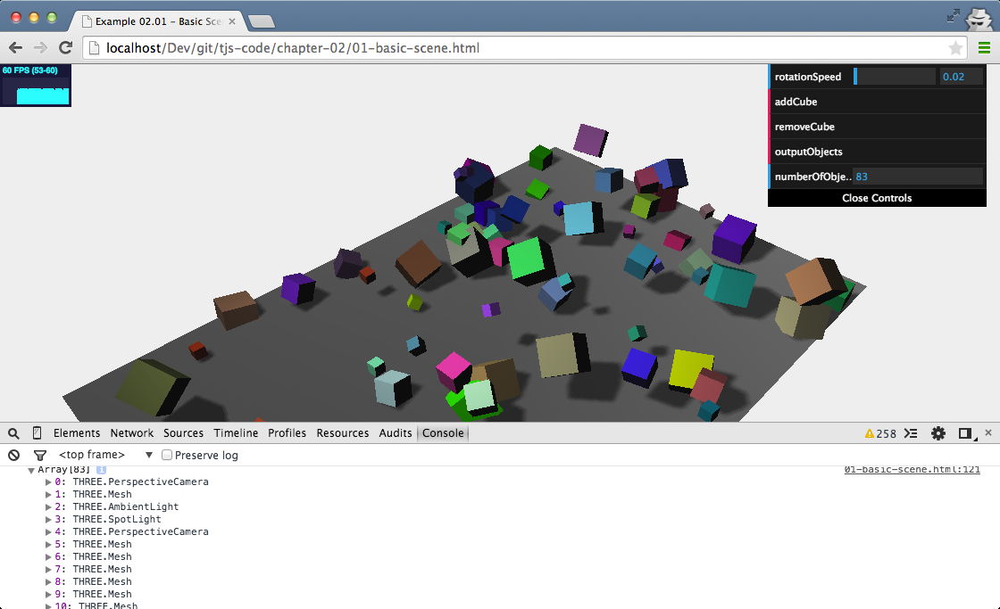

将信息输出到控制台日志的代码使用内置的 console 对象：

```javascript
  this.outputObjects = function() {
    console.log(scene.children);
  }
```

这对调试非常有帮助，尤其是当你为对象命名后，它非常有助于发现场景中特定对象的问题。例如，cube-17 的属性如下所示（如果你事先已经知道名称，也可以使用 console.log(scene.getObjectByName("cube-17")，只输出那一个对象）：

```javascript
__webglActive: true
__webglInit: true
_listeners: Object
_modelViewMatrix: THREE.Matrix4
```

<!-- pdf-page: 58 -->
```javascript
_normalMatrix: THREE.Matrix3
castShadow: true
children: Array[0]
eulerOrder: (...)
frustumCulled: true
geometry: THREE.BoxGeometryid: 8
material: THREE.MeshLambertMaterial
matrix: THREE.Matrix4
matrixAutoUpdate: true
matrixWorld: THREE.Matrix4
matrixWorld
NeedsUpdate: false
name: "cube-17"
parent: THREE.Scene
position: THREE.Vector3
quaternion: THREE.Quaternion
receiveShadow: false
renderDepth: null
rotation: THREE.Euler
rotationAutoUpdate: true
scale: THREE.Vector3
type: "Mesh"
up: THREE.Vector3
useQuaternion: (...)
userData: Object
uuid: "DCDC0FD2-6968-44FD-8009-20E9747B8A73"
visible: true
```

到目前为止，我们已经看到以下与场景相关的功能：

- THREE.Scene.Add：将对象添加到场景中

- THREE.Scene.Remove：从场景中移除对象

- THREE.Scene.children：获取场景中所有子对象的列表

- THREE.Scene.getObjectByName：按名称从场景中获取特定对象

这些是最重要的场景相关函数，大多数情况下，你不需要更多功能。不过，还有几个可能派上用场的辅助函数，我想通过处理立方体旋转的代码来展示它们。

<!-- pdf-page: 59 -->
构成 Three.js 场景的基本组件

如你在上一章所见，我们使用渲染循环来渲染场景。让我们看看这个示例中的循环：

```javascript
function render() {
  stats.update();
  scene.traverse(function(obj) {
    if (obj instanceof THREE.Mesh && obj != plane ) {
      obj.rotation.x+=controls.rotationSpeed;
      obj.rotation.y+=controls.rotationSpeed;
      obj.rotation.z+=controls.rotationSpeed;
   }
  });
```

```text
  requestAnimationFrame(render);
  renderer.render(scene, camera);
}
```

在这里，我们看到使用了 THREE.Scene.traverse() 函数。我们可以向 traverse() 函数传递一个函数，场景中的每个子对象都会调用该函数。如果某个子对象本身还有子对象，请记住，THREE.Scene 对象可以包含一棵对象树。traverse() 函数也会针对该对象的所有子对象调用。这样可以遍历整个场景图。

我们使用 render() 函数更新每个立方体的旋转（请注意，我们明确忽略了地面）。由于我们只向 THREE.Scene 添加了对象，尚未创建嵌套结构，因此也可以使用 for 循环自行迭代 children 属性数组来完成这项工作。

在深入研究 THREE.Mesh 和 THREE.Geometry 的细节之前，我想展示可以在 THREE.Scene 对象上设置的两个有趣属性：fog 和 overrideMaterial。

### 向场景添加雾效

fog 属性让你能够为整个场景添加雾效（Fog）；对象距离越远，就越容易被遮挡而看不见，如下面的屏幕截图所示：

<!-- pdf-page: 60 -->
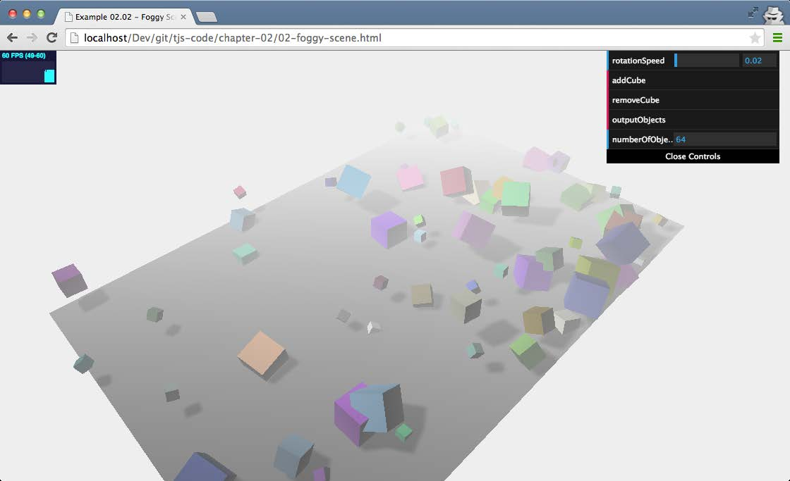

在 Three.js 中启用雾效非常简单。定义场景后，只需添加以下代码行：

```javascript
scene.fog=new THREE.Fog( 0xffffff, 0.015, 100 );
```

在这里，我们定义了白雾（0xffffff）。前面的两个属性可用于调整雾的呈现方式。0.015 这个值设置 near 属性，100 这个值设置 far 属性。利用这些属性，你可以决定雾从哪里开始，以及它变浓的速度。使用 THREE.Fog 对象时，雾会线性增加。还有一种不同的场景雾效设置方式；为此，使用以下定义：

```javascript
scene.fog=new THREE.FogExp2( 0xffffff, 0.01 );
```

这次，我们不指定 near 和 far，只指定颜色（0xffffff）和雾的密度（0.01）。最好对这些属性做一些试验，以获得想要的效果。请注意，使用 THREE.FogExp2 时，雾不会线性增加，而会随距离呈指数级变浓。

<!-- pdf-page: 61 -->
构成 Three.js 场景的基本组件

### 使用 overrideMaterial 属性

我们讨论的场景最后一个属性是 overrideMaterial。使用此属性时，场景中的所有对象都将使用 overrideMaterial 属性所设置的材质，而忽略对象自身设置的材质。

可以这样使用它：

```javascript
scene.overrideMaterial = new THREE.MeshLambertMaterial({color:
  0xffffff});
```

按照前面的代码使用 overrideMaterial 属性后，场景将渲染为下面的屏幕截图所示：

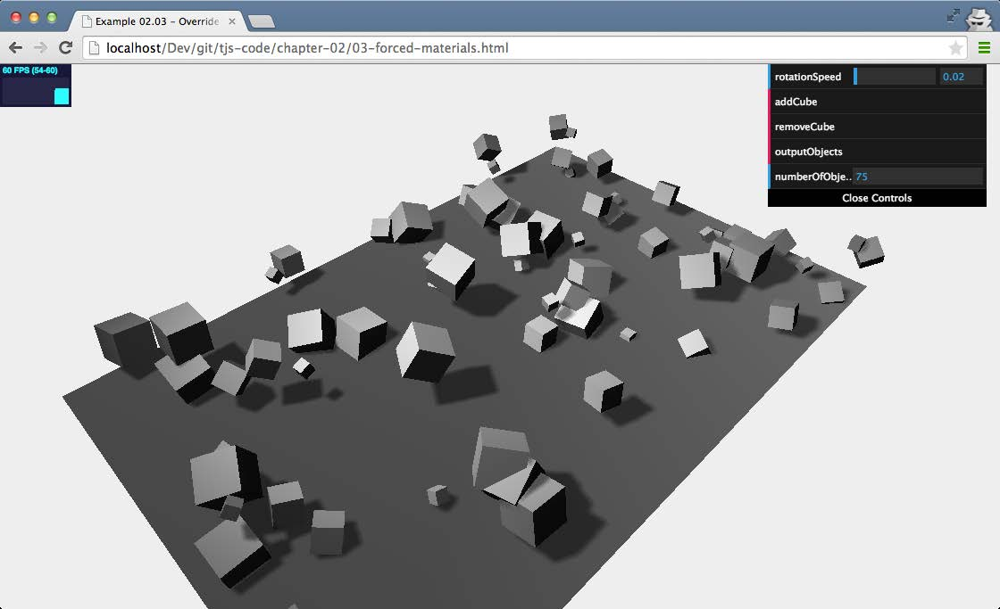

在前面的图中，你可以看到所有立方体都使用相同的材质和相同的颜色进行渲染。在这个示例中，我们使用 THREE.MeshLambertMaterial 对象作为材质。使用这种材质类型，我们可以创建看起来没有光泽、并会响应场景中光源的对象。在第 4 章“使用 Three.js 材质”中，你将进一步了解这种材质。

在本节中，我们研究了 Three.js 的第一个核心概念：THREE.Scene。关于场景，最需要记住的是，它基本上是一个容器，容纳渲染时想要使用的所有对象、光源和相机。下表总结了 THREE.Scene 对象最重要的函数和属性：

<!-- pdf-page: 62 -->
| 函数／属性 | 说明 |
| --- | --- |
| `add(object)` | 用于向场景添加对象。如后文所示，你也可以使用这个函数创建对象组。 |
| `children` | 返回已添加到场景的所有对象的列表，包括相机和光源。 |
| `getObjectByName(name, recursive)` | 创建对象时，你可以为它指定一个独特的名称。场景对象有一个函数，可用于直接返回具有特定名称的对象。如果将 `recursive` 参数设为 `true`，Three.js 还会搜索完整的对象树，以查找具有指定名称的对象。 |
| `remove(object)` | 如果持有场景中某个对象的引用，也可以使用此函数将其从场景中移除。 |
| `traverse(function)` | `children` 属性返回场景中所有子对象的列表。使用 `traverse` 函数，我们也可以访问这些子对象。使用 `traverse` 时，所有子对象会逐一传入所提供的函数。 |
| `fog` | 此属性允许你设置场景的雾效。雾会渲染出一层薄雾，隐藏远处的对象。 |
| `overrideMaterial` | 使用此属性，可以强制场景中的所有对象使用相同的材质。 |

在下一节中，我们将更仔细地研究可以添加到场景中的对象。

## 几何体和网格

到目前为止，在每个示例中，你都看到了几何体和网格的使用。例如，为了向场景添加球体，我们执行了以下操作：

```javascript
var sphereGeometry = new THREE.SphereGeometry(4,20,20);
var sphereMaterial = new THREE.MeshBasicMaterial({color:
  0x7777ff);
var sphere = new THREE.Mesh(sphereGeometry,sphereMaterial);
```

我们定义了对象的形状及其几何体（THREE.SphereGeometry），定义了此对象的外观（THREE.MeshBasicMaterial）及其材质，并将二者组合在一个可以添加到场景中的网格（THREE.Mesh）里。在本节中，我们将更仔细地研究几何体是什么、网格是什么。先从几何体开始。

<!-- pdf-page: 63 -->
构成 Three.js 场景的基本组件

### 几何体的属性和函数

Three.js 开箱即用地提供了大量可在 3D 场景中使用的几何体。只需添加材质、创建网格，就差不多完成了。下面的屏幕截图来自示例 04-geometries，展示了 Three.js 中可用的一些标准几何体：

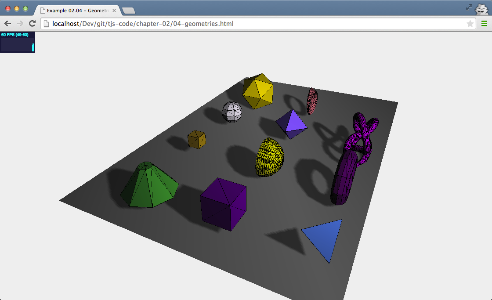

在第 5 章“学习使用几何体”和第 6 章“高级几何体和二元运算”中，我们将探讨 Three.js 提供的所有基础和高级几何体。现在，我们将更详细地了解几何体究竟是什么。

在 Three.js 以及大多数其他 3D 库中，几何体基本上是 3D 空间中的一组点，即顶点（Vertex），以及将这些点连接起来的一些面（Face）。以立方体为例：

- 立方体有八个角。每个角都可以定义为一个 x、y 和 z 坐标。因此，每个立方体在 3D 空间中都有八个点。在 Three.js 中，这些点称为顶点，单个点称为一个顶点。

- 立方体有六个侧面，每个角上都有一个顶点。在 Three.js 中，一个面始终由三个组成三角形的顶点构成。因此，对于立方体，每个侧面都由两个三角形组成完整的侧面。

<!-- pdf-page: 64 -->
使用 Three.js 提供的几何体时，你不必自己定义所有顶点和面。对于立方体，只需定义宽度、高度和深度。Three.js 使用这些信息创建一个几何体，其中八个顶点位于正确位置，并具有正确数量的面（立方体为 12 个）。尽管你通常会使用 Three.js 提供的几何体或自动生成几何体，但仍然可以使用顶点和面完全手动创建几何体。以下代码行展示了这一点：

```javascript
var vertices = [
  new THREE.Vector3(1,3,1),
  new THREE.Vector3(1,3,-1),
  new THREE.Vector3(1,-1,1),
  new THREE.Vector3(1,-1,-1),
  new THREE.Vector3(-1,3,-1),
  new THREE.Vector3(-1,3,1),
  new THREE.Vector3(-1,-1,-1),
  new THREE.Vector3(-1,-1,1)
];
```

```javascript
var faces = [
  new THREE.Face3(0,2,1),
  new THREE.Face3(2,3,1),
  new THREE.Face3(4,6,5),
  new THREE.Face3(6,7,5),
  new THREE.Face3(4,5,1),
  new THREE.Face3(5,0,1),
  new THREE.Face3(7,6,2),
  new THREE.Face3(6,3,2),
  new THREE.Face3(5,7,0),
  new THREE.Face3(7,2,0),
  new THREE.Face3(1,3,4),
  new THREE.Face3(3,6,4),
];
```

```javascript
var geom = new THREE.Geometry();
geom.vertices = vertices;
geom.faces = faces;
geom.computeFaceNormals();
```

<!-- pdf-page: 65 -->
构成 Three.js 场景的基本组件

这段代码展示了如何创建一个简单的立方体。我们在 vertices 数组中定义组成立方体的点。这些点连接起来形成三角面，并存储在 faces 数组中。例如，new THREE.Face3(0,2,1) 使用 vertices 数组中的点 0、2 和 1 创建一个三角面。请注意用于创建 THREE.Face 的顶点顺序。它们的定义顺序决定 Three.js 将其视为正面朝向的面（面向相机的面）还是背面朝向的面。如果创建面，正面朝向的面应使用顺时针顺序，而要创建背面朝向的面，则应使用逆时针顺序。

在这个示例中，我们使用 THREE.Face3 元素定义立方体的六个侧面，每个面由两个三角形组成。在 Three.js 的早期版本中，也可以使用四边形（Quad）代替三角形。四边形使用四个顶点而不是三个顶点来定义面。使用四边形还是三角形更好，是 3D 建模界激烈争论的话题。不过基本上，在建模过程中通常更倾向于使用四边形，因为它们比三角形更容易增强和平滑。但对于渲染引擎和游戏引擎，使用三角形通常更容易，因为每种形状都可以作为三角形进行非常高效的渲染。

使用这些顶点和面，我们现在可以创建 THREE.Geometry 的新实例，并将顶点赋给 vertices 属性，将面赋给 faces 属性。我们需要采取的最后一步，是在创建的几何体上调用 computeFaceNormals()。调用此函数时，Three.js 会确定每个面的法向量（Normal Vector）。Three.js 使用这些信息，根据场景中的各种光源确定如何为面着色。

有了这个几何体，我们现在就可以像之前看到的那样创建网格。我创建了一个示例，你可以用它试验顶点的位置，它还会显示各个面。在示例 05-custom-geometry 中，你可以更改立方体所有顶点的位置，并查看面如何响应。如下面的屏幕截图所示（如果控制 GUI 挡路，可以按 H 将其隐藏）：

<!-- pdf-page: 66 -->
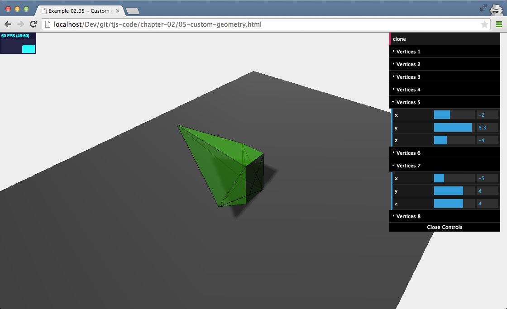

这个示例采用与我们所有其他示例相同的设置，具有一个渲染循环。每当你更改下拉控制框中的某个属性时，立方体就会根据某个顶点更改后的位置进行渲染。这并不是开箱即用就能实现的。出于性能原因，Three.js 假定网格的几何体在其生命周期内不会改变。对于大多数几何体和用例，这是一个非常合理的假设。不过，为了让我们的示例正常工作，需要确保将以下内容添加到渲染循环的代码中：

```javascript
mesh.children.forEach(function(e) {
  e.geometry.vertices=vertices;
  e.geometry.verticesNeedUpdate=true;
  e.geometry.computeFaceNormals();
});
```

在第一行中，我们将屏幕上所显示网格的顶点指向更新后的顶点数组。我们不需要重新配置面，因为它们仍然连接到与之前相同的点。设置更新后的顶点后，我们需要告诉几何体顶点需要更新。为此，将几何体的 verticesNeedUpdate 属性设为 true。最后，我们使用 computeFaceNormals 函数重新计算面法线，以更新整个模型。

<!-- pdf-page: 67 -->
构成 Three.js 场景的基本组件

我们要看的最后一项几何体功能是 clone() 函数。我们提到过，几何体定义对象的形态和形状，与材质结合后，就能创建一个可添加到场景中、由 Three.js 渲染的对象。顾名思义，使用 clone() 函数，我们可以复制几何体，例如用它创建具有不同材质的另一个网格。在同一个示例 05-custom-geometry 中，你可以在控制 GUI 顶部看到一个 clone 按钮，如下面的屏幕截图所示：

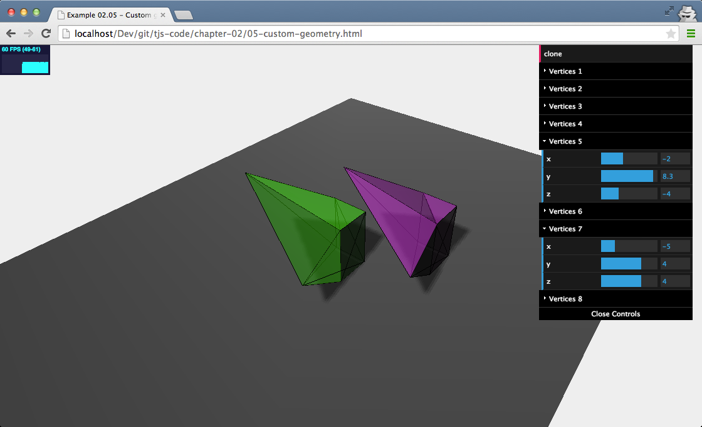

如果点击此按钮，将复制几何体当前的状态，使用不同材质创建一个新对象，并将其添加到场景中。这部分代码相当简单，但由于我使用的材质，它变得稍微复杂一些。让我们先退一步，看看如何创建立方体的绿色材质，如以下代码所示：

```javascript
var materials = [
  new THREE.MeshLambertMaterial( { opacity:0.6, color: 0x44ff44,
    transparent:true } ),
  new THREE.MeshBasicMaterial( { color: 0x000000, wireframe: true
    } )
];
```

<!-- pdf-page: 68 -->
如你所见，我没有使用单一材质，而是使用了包含两种材质的数组。原因是除了显示透明的绿色立方体之外，我还想向你展示线框，因为线框可以非常清楚地显示顶点和面的位置。

当然，Three.js 支持在创建网格时使用多种材质。你可以使用 SceneUtils.createMultiMaterialObject 函数来实现，如以下代码所示：

```javascript
var mesh = THREE.SceneUtils.createMultiMaterialObject( geom,
  materials);
```

Three.js 在此函数中所做的，不是创建一个 THREE.Mesh 对象，而是为你指定的每种材质各创建一个，并将这些网格放入一个组（一个 THREE.Object3D 对象）中。这个组可以像你使用场景对象那样使用。你可以添加网格、按名称获取对象，等等。例如，要确保组的所有子对象都投射阴影，可以执行以下操作：

```javascript
mesh.children.forEach(function(e) {e.castShadow=true});
```

现在，让我们回到刚才讨论的 clone() 函数：

```javascript
this.clone = function() {
```

```javascript
  var clonedGeom = mesh.children[0].geometry.clone();
  var materials = [
    new THREE.MeshLambertMaterial( { opacity:0.6, color: 0xff44ff,
      transparent:true } ),
    new THREE.MeshBasicMaterial({ color: 0x000000, wireframe: true
      } )
  ];
```

```javascript
  var mesh2 = THREE.SceneUtils.createMultiMaterialObject
    (clonedGeom, materials);
  mesh2.children.forEach(function(e) {e.castShadow=true});
  mesh2.translateX(5);
  mesh2.translateZ(5);
  mesh2.name="clone";
  scene.remove(scene.getObjectByName("clone"));
  scene.add(mesh2);
}
```

<!-- pdf-page: 69 -->
构成 Three.js 场景的基本组件

点击 clone 按钮时，会调用这段 JavaScript。在这里，我们克隆立方体第一个子对象的几何体。请记住，mesh 变量包含两个子对象；它包含两个网格，分别对应我们指定的一种材质。基于这个克隆的几何体，我们创建了一个新网格，并恰当地将其命名为 mesh2。我们使用 translate 函数移动这个新网格（更多信息见第 5 章“学习使用几何体”），移除之前的克隆（如果存在），并将克隆添加到场景中。

在上一节中，我们使用 THREE.SceneUtils 对象的 createMultiMaterialObject 为创建的几何体添加线框。Three.js 还提供了另一种使用 THREE.WireFrameHelper 添加线框的方式。要使用此辅助对象，先像这样实例化它：

```javascript
var helper = new THREE.WireframeHelper(mesh, 0x000000);
```

你提供想要显示线框的网格和线框的颜色。Three.js 随后会创建一个可添加到场景中的辅助对象，即 scene.add(helper)。由于此辅助对象内部只是一个 THREE.Line 对象，因此你可以设置线框的外观样式。例如，要设置线框线条的宽度，使用 helper.material. linewidth = 2;。

关于几何体，目前介绍这些就足够了。

### 网格的函数和属性

我们已经了解到，要创建网格，需要一个几何体和一种或多种材质。有了网格后，我们将它添加到场景中，它就会被渲染。有几个属性可用于更改此网格在场景中出现的位置和方式。在第一个示例中，我们将研究以下一组属性和函数：

| 函数／属性 | 说明 |
| --- | --- |
| `position` | 确定此对象相对于其父对象的位置。大多数情况下，对象的父对象是 `THREE.Scene` 对象或 `THREE.Object3D` 对象。 |
| `rotation` | 使用此属性，可以设置对象绕其任意轴的旋转。Three.js 还提供了绕轴旋转的专用函数：`rotateX()`、`rotateY()` 和 `rotateZ()`。 |
| `scale` | 此属性允许你沿对象的 x、y 和 z 轴缩放对象。 |
| `translateX(amount)` | 此属性将对象沿 x 轴移动指定距离。 |

<!-- pdf-page: 70 -->
| 函数／属性 | 说明 |
| --- | --- |
| `translateY(amount)` | 此属性将对象沿 y 轴移动指定距离。 |
| `translateZ(amount)` | 此属性将对象沿 z 轴移动指定距离。 |
| `translateOnAxis(axis, distance)` | 对于 `translate` 函数，你也可以使用 `translateOnAxis(axis, distance)` 函数，它允许你沿特定轴将网格平移一段距离。 |
| `visible` | 如果将此属性设为 `false`，`THREE.Mesh` 就不会由 Three.js 渲染。 |

与往常一样，我们准备了一个示例，让你可以试验这些属性。如果在浏览器中打开 06-mesh-properties.html，会看到一个下拉菜单，你可以在其中更改所有这些属性并直接查看结果，如下面的屏幕截图所示：

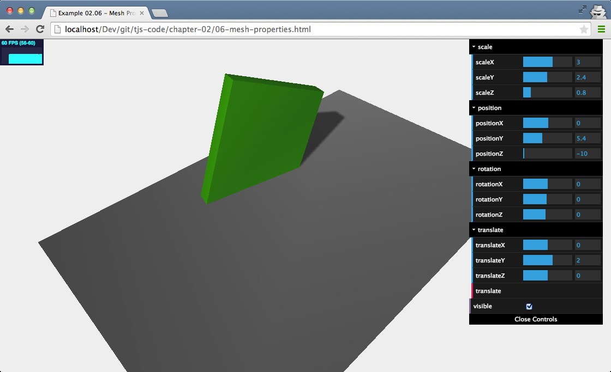

<!-- pdf-page: 71 -->
构成 Three.js 场景的基本组件

让我带你逐一了解它们，先从 position 属性开始。我们已经多次见过这个属性，因此快速说明一下。使用此属性，可以设置对象的 x、y 和 z 坐标。此位置相对于其父对象，父对象通常是你添加对象的场景，但也可以是 THREE.Object3D 对象或另一个 THREE.Mesh 对象。在第 5 章“学习使用几何体”研究对象分组时，我们会再讨论这一点。我们可以通过三种不同方式设置对象的 position 属性。可以直接设置每个坐标：

```text
cube.position.x=10;
cube.position.y=3;
cube.position.z=1;
```

不过，也可以一次设置所有坐标，如下所示：

```text
cube.position.set(10,3,1);
```

还有第三种选择。position 属性是一个 THREE.Vector3 对象。这意味着，我们也可以执行以下操作来设置此对象：

```javascript
cube.postion=new THREE.Vector3(10,3,1)
```

在查看此网格的其他属性之前，我想先稍微岔开一下。我提到过，此位置相对于其父对象的位置设置。在上一节关于 THREE.Geometry 的内容中，我们使用 THREE.SceneUtils.createMultiMaterialObject 创建了一个多材质对象。我解释过，它实际上返回的不是单个网格，而是一个组，其中包含基于同一几何体、对应每种材质的网格；在我们的例子中，这个组包含两个网格。如果更改所创建的其中一个网格的位置，你可以清楚地看到，它们确实是两个不同的 THREE.Mesh 对象。不过，如果现在移动整个组，偏移量将保持不变，如下面的屏幕截图所示。在第 5 章“学习使用几何体”中，我们将深入研究父子关系，以及分组如何影响缩放、旋转和平移等变换（Transformation）。

<!-- pdf-page: 72 -->
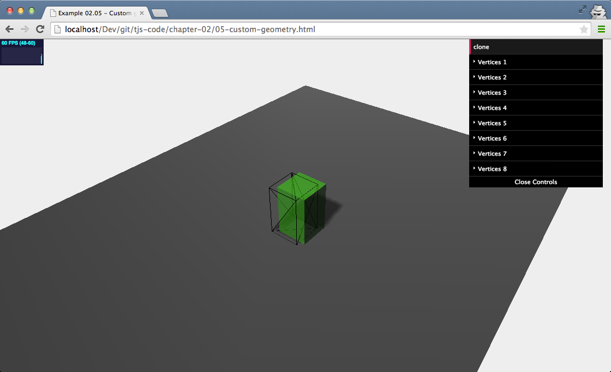

好的，列表中的下一项是 rotation 属性。在本章和上一章中，你已经多次见过这个属性的使用。使用此属性，可以设置对象绕其某一轴的旋转。可以用与 position 相同的方式设置此值。你可能还记得数学课上学过，完整旋转一周是 2 x π。在 Three.js 中，可以通过几种不同方式进行配置：

```javascript
cube.rotation.x = 0.5*Math.PI;
cube.rotation.set(0.5*Math.PI, 0, 0);
cube.rotation = new THREE.Vector3(0.5*Math.PI,0,0);
```

如果你想改用角度（0 到 360），就必须将其转换为弧度（Radian）。可以很容易地这样做：

```javascript
Var degrees = 45;
Var inRadians = degrees * (Math.PI / 180);
```

你可以使用 06-mesh-properties.html 示例来试验此属性。

<!-- pdf-page: 73 -->
构成 Three.js 场景的基本组件

列表中的下一个属性是我们尚未讨论过的 scale。这个名称很好地概括了你可以用此属性做什么。你可以沿特定轴缩放对象。如果将缩放值设为小于 1，对象将缩小，如下面的屏幕截图所示：

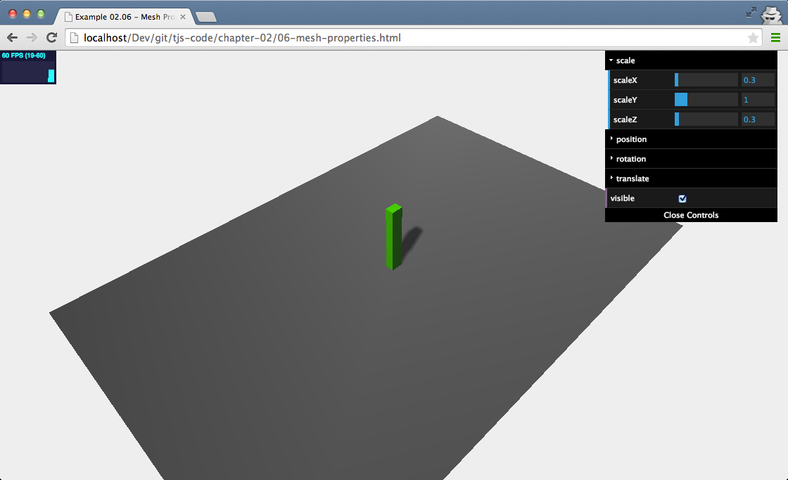

使用大于 1 的值时，对象将变大，如下面的屏幕截图所示：

<!-- pdf-page: 74 -->
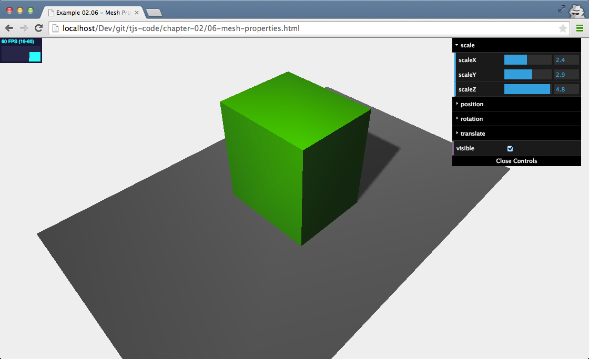

本章要研究的网格下一部分是 translate 功能。使用 translate，你也可以更改对象的位置，但它不是定义对象要处于的绝对位置，而是定义对象应相对于当前位置移动到哪里。例如，我们有一个添加到场景中的球体，其位置已设为 (1,2,3)。接下来，我们沿其 x 轴平移对象：translateX(4)。它现在的位置将是 (5,2,3)。如果想将对象恢复到原始位置，可以这样做：translateX(-4)。在 06-mesh-properties.html 示例中，有一个名为 translate 的菜单选项卡。你可以从那里试验此功能。只需设置 x、y 和 z 的 translate 值，然后点击 translate 按钮。你会看到对象根据这三个值移动到新位置。

<!-- pdf-page: 75 -->
构成 Three.js 场景的基本组件

你可以通过右上角菜单使用的最后一个属性是 visible 属性。如果点击 visible 菜单项，你会看到立方体变得不可见，如下所示：

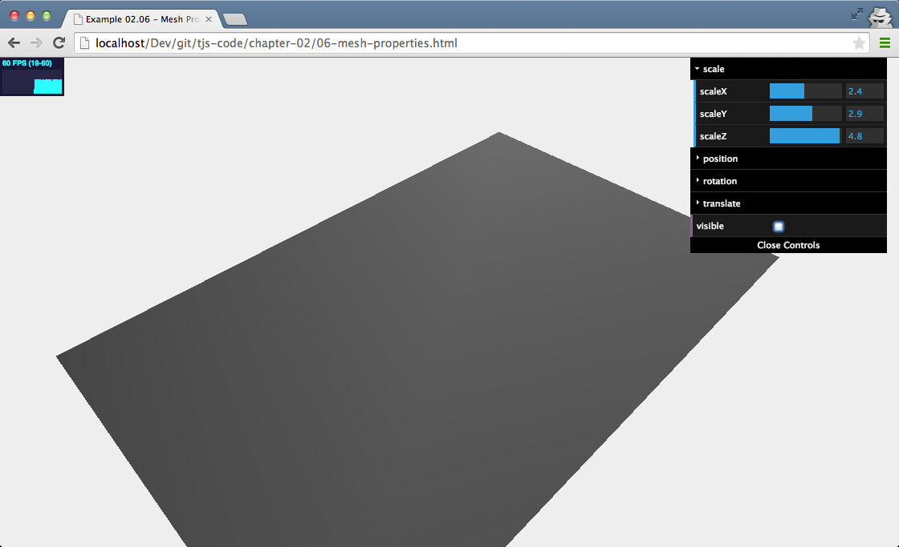

再次点击它，立方体就会重新可见。有关网格、几何体以及可以用这些对象做什么的更多信息，请参见第 5 章“学习使用几何体”和第 7 章“粒子、精灵和点云”。

## 适用于不同用途的不同相机

Three.js 中有两种不同的相机类型：正交相机和透视相机。在第 3 章“使用 Three.js 中可用的不同光源”中，我们将更详细地研究如何使用这些相机，因此本章只介绍基础知识。解释这些相机之间区别的最佳方式是查看几个示例。

<!-- pdf-page: 76 -->
### 正交相机与透视相机

在本章的示例中，你可以找到一个名为 07-both-cameras.html 的演示。打开此示例时，你会看到类似这样的内容：

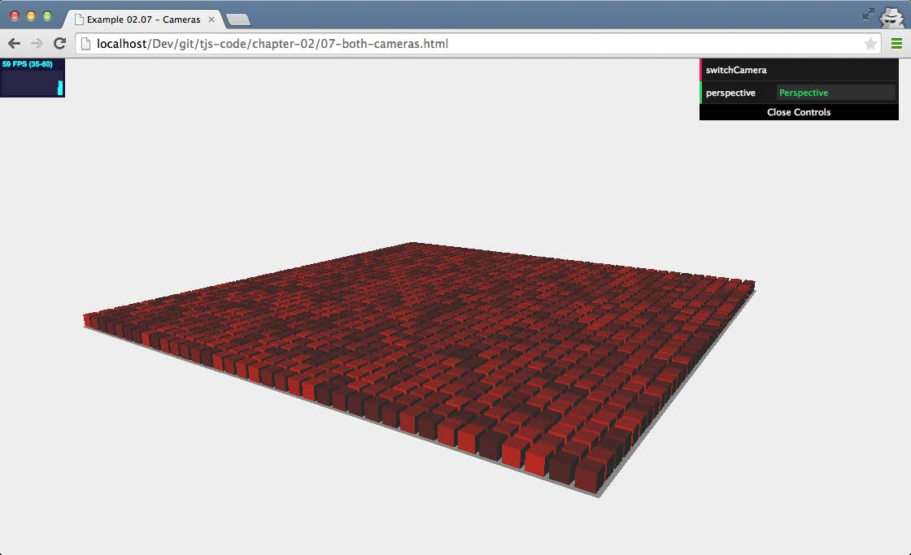

这称为透视视图（Perspective View），也是最自然的视图。从此图可以看出，立方体离相机越远，渲染得越小。

<!-- pdf-page: 77 -->
构成 Three.js 场景的基本组件

如果将相机更改为 Three.js 支持的另一种类型——正交相机，你会看到同一场景的以下视图：

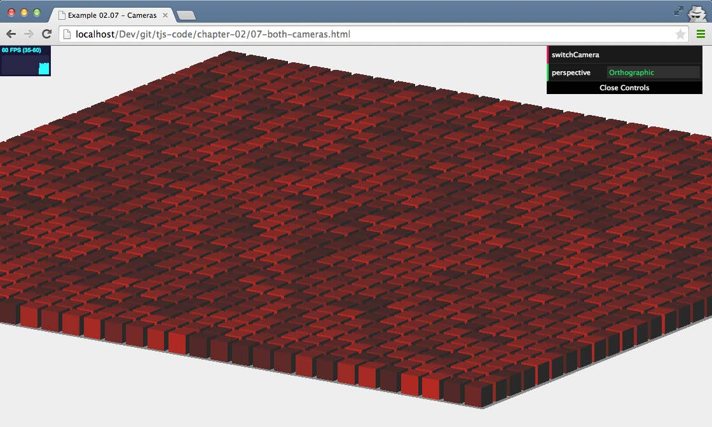

使用正交相机时，所有立方体都渲染为相同大小；对象与相机之间的距离无关紧要。这通常用于 SimCity 4 和旧版 Civilization 等 2D 游戏。

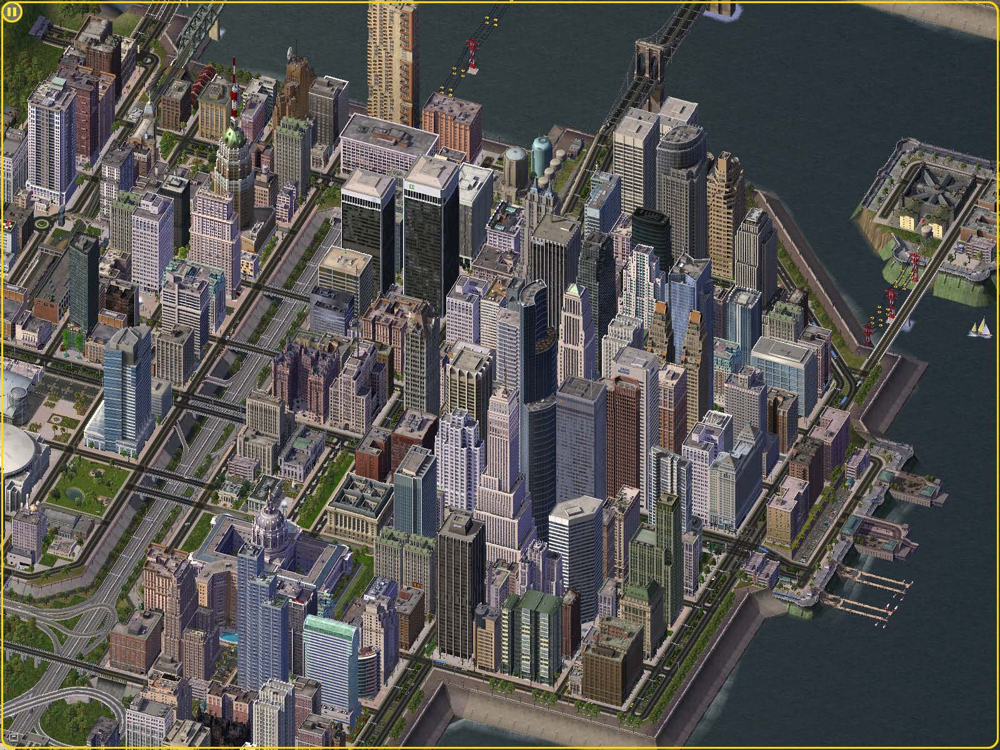

<!-- pdf-page: 78 -->
在我们的示例中，最常使用透视相机，因为它最接近真实世界。切换相机非常简单。每次点击 07-both-cameras 示例中的 switch camera 按钮时，都会调用以下代码：

```javascript
this.switchCamera = function() {
  if (camera instanceof THREE.PerspectiveCamera) {
    camera = new THREE.OrthographicCamera( window.innerWidth / -
      16, window.innerWidth / 16, window.innerHeight / 16,
      window.innerHeight / - 16, -200, 500 );
    camera.position.x = 120;
    camera.position.y = 60;
    camera.position.z = 180;
    camera.lookAt(scene.position);
    this.perspective = "Orthographic";
  } else {
    camera = new THREE.PerspectiveCamera(45, window.innerWidth /
      window.innerHeight, 0.1, 1000);
```

```text
    camera.position.x = 120;
    camera.position.y = 60;
    camera.position.z = 180;
```

```text
    camera.lookAt(scene.position);
    this.perspective = "Perspective";
  }
};
```

在此表中，你可以看到我们创建相机的方式有所不同。我们先来看 THREE.PerspectiveCamera。此相机接受以下参数：

| 参数 | 说明 |
| --- | --- |
| `fov` | FOV 表示视场（Field Of View）。这是从相机位置可以看到的场景部分。例如，人类具有接近 180 度的 FOV，而某些鸟类甚至可能具有完整的 360 度 FOV。<br><br>但由于普通计算机屏幕不会完全填满我们的视野，通常会选择较小的值。对于游戏，最常选择 60 到 90 度之间的 FOV。<br><br>推荐默认值：50 |

<!-- pdf-page: 79 -->
构成 Three.js 场景的基本组件

| 参数 | 说明 |
| --- | --- |
| `aspect` | 这是我们将渲染输出的区域水平尺寸与垂直尺寸之间的宽高比（Aspect Ratio）。在本例中，由于使用整个窗口，所以直接使用该窗口的宽高比。宽高比决定水平 FOV 与垂直 FOV 之间的差异，如下图所示。<br><br>推荐默认值：`window.innerWidth / window.innerHeight` |
| `near` | `near` 属性定义 Three.js 应从离相机多近的位置开始渲染场景。通常，我们将其设为非常小的值，以便直接渲染从相机位置开始的所有内容。<br><br>推荐默认值：0.1 |
| `far` | `far` 属性定义相机从所在位置可以看到多远。如果设得太低，部分场景可能不会被渲染；如果设得太高，在某些情况下可能会影响渲染性能。<br><br>推荐默认值：1000 |
| `zoom` | `zoom` 属性允许你放大和缩小场景。使用小于 1 的数字时，会缩小场景；使用大于 1 的数字时，会放大场景。请注意，如果指定负值，场景将上下颠倒渲染。<br><br>推荐默认值：1 |

下图很好地概述了这些属性如何协同工作，决定你所看到的内容：

<!-- pdf-page: 80 -->
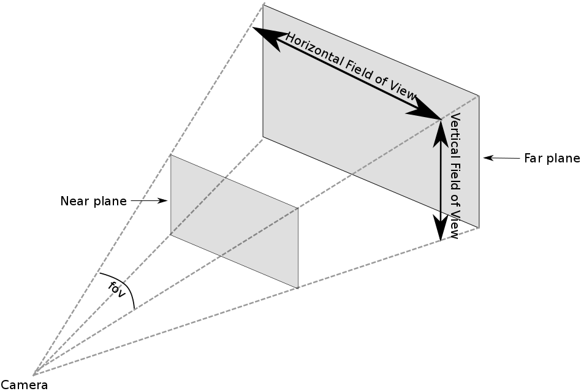

相机的 fov 属性决定水平 FOV。基于 aspect 属性，可以确定垂直 FOV。near 属性用于确定近平面（Near Plane）的位置，far 属性确定远平面（Far Plane）的位置。近平面与远平面之间的区域将被渲染。

要配置正交相机，我们需要使用其他属性。正交投影（Orthographic Projection）既不关心使用什么宽高比，也不关心以什么 FOV 查看场景，因为所有对象都以相同大小渲染。定义正交相机时，你要做的是定义需要渲染的长方体区域。正交相机的属性反映了这一点，如下所示：

| 参数 | 说明 |
| --- | --- |
| `left` | 在 Three.js 文档中，此项描述为 Camera frustum left plane（相机视锥体左平面）。你应将其理解为将被渲染内容的左侧边界。如果将此值设为 -100，就不会看到更靠左的任何对象。 |
| `right` | `right` 属性的工作方式与 `left` 属性相似，但这次针对屏幕的另一侧。更靠右的任何内容都不会被渲染。 |
| `top` | 这是要渲染的顶部位置。 |
| `bottom` | 这是要渲染的底部位置。 |

<!-- pdf-page: 81 -->
| 参数 | 说明 |
| --- | --- |
| `near` | 从这一点开始，根据相机的位置渲染场景。 |
| `far` | 到这一点为止，根据相机的位置渲染场景。 |
| `zoom` | 此属性允许你放大和缩小场景。使用小于 1 的数字时，会缩小场景；使用大于 1 的数字时，会放大场景。请注意，如果指定负值，场景将上下颠倒渲染。默认值为 1。 |

下图总结了所有这些属性：

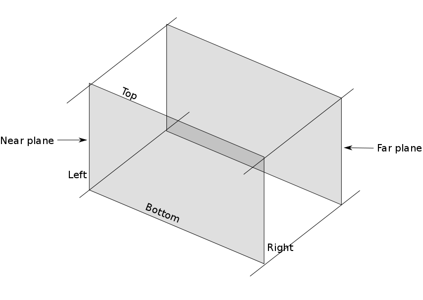

<!-- pdf-page: 82 -->
### 看向特定点

到目前为止，你已经了解了如何创建相机以及各种参数的含义。在上一章中，你还看到需要将相机定位在场景中的某处，并渲染来自该相机的视图。通常，相机指向场景中心：position (0,0,0)。不过，我们可以轻松更改相机看向的内容，如下所示：

```javascript
camera.lookAt(new THREE.Vector3(x,y,z));
```

我添加了一个示例，其中相机会移动，而它看向的点用一个红点标记，如下所示：

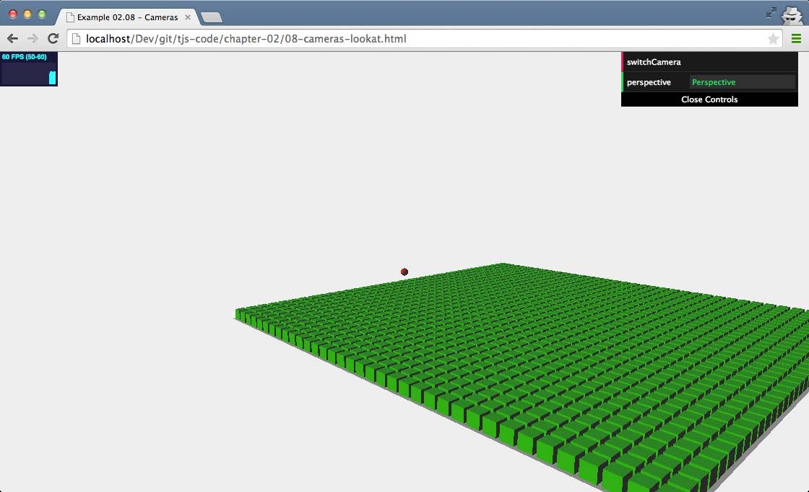

<!-- pdf-page: 83 -->
构成 Three.js 场景的基本组件

如果打开 08-cameras-lookat 示例，你会看到场景从左向右移动。场景实际上并没有移动。相机看向不同的点（参见中心的红点），这就产生了场景从左向右移动的效果。在这个示例中，你也可以将相机切换为正交相机。在那里，你会看到改变相机看向的点，其效果与使用 THREE.PerspectiveCamera 时几乎相同。不过，值得注意的是，使用 THREE.OrthographicCamera 时，无论相机看向哪里，你都可以清楚地看到所有立方体的大小保持不变。

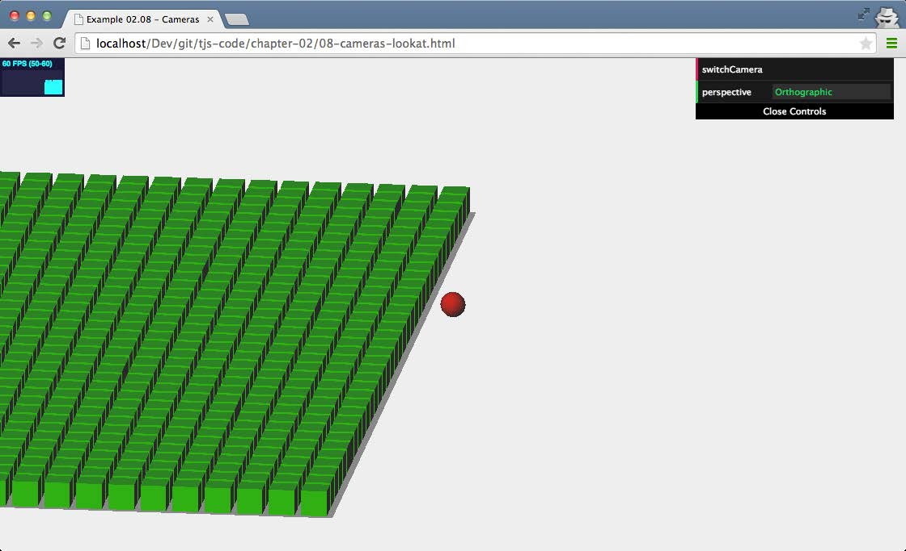

使用 lookAt 函数时，你将相机指向特定位置。还可以用它让相机跟随对象在场景中移动。由于每个 THREE.Mesh 对象都有一个 THREE.Vector3 类型的 position 属性，因此你可以使用 lookAt 函数指向场景中的特定网格。你只需这样做：camera.lookAt(mesh.position)。如果在渲染循环中调用它，就能让相机跟随对象在场景中移动。

<!-- pdf-page: 84 -->
## 小结

在这第二章介绍性章节中，我们讨论了许多内容。我们展示了 THREE.Scene 的所有函数和属性，并解释了如何使用这些属性配置主场景。我们还展示了如何创建几何体。你可以使用 THREE.Geometry 对象从头创建几何体，也可以使用 Three.js 提供的任何内置几何体。最后，我们展示了如何配置 Three.js 提供的两种相机。THREE.PerspectiveCamera 使用真实世界的透视效果渲染场景，而 THREE.OrthographicCamera 提供游戏中常见的伪 3D 效果。我们还介绍了几何体在 Three.js 中的工作方式。现在，你可以轻松创建自己的几何体。

在下一章中，我们将研究 Three.js 中可用的各种光源。你将了解各种光源的行为方式、如何创建和配置它们，以及它们如何影响特定材质。

<!-- pdf-page: 85 -->
