# 第 3 章 · 使用 Three.js 中提供的各种光源（Light Sources）

<!-- pdf-page: 86 -->
## 使用

## Three.js 中提供的

## 各种光源

在第一章中，你学习了 Three.js 的基础知识；在上一章中，我们更深入地探讨了场景（Scene）中最重要的部分：几何体（Geometry）、网格（Mesh）和相机（Camera）。你可能已经注意到，我们在那一章略过了光源，尽管它们是每个 Three.js 场景的重要组成部分。没有光源，我们将看不到任何渲染出来的内容。由于 Three.js 包含大量光源，而且每种光源都有特定用途，我们将用整整一章来解释各种光源的细节，并为你学习下一章的材质（Material）用法做好准备。

WebGL 本身并不内在支持光照。如果没有 Three.js，你就必须编写特定的 WebGL 着色器（Shader）程序来模拟这些光源。关于如何从零开始在 WebGL 中模拟光照，可以在 https://developer.mozilla. org/en-US/docs/Web/WebGL/Lighting\_in\_WebGL 找到一篇很好的入门介绍。

在本章中，你将学习以下主题：

- Three.js 中可用的光源

- 何时应当使用某种特定的光源

- 如何调整和配置所有这些光源的行为

- 作为额外内容，我们还会快速了解如何创建镜头光晕（Lens Flare）

与所有章节一样，我们提供了大量示例，供你用来试验光源的行为。本章展示的示例可以在所提供源码的 chapter-03 文件夹中找到。

<!-- pdf-page: 87 -->
使用 Three.js 中提供的各种光源

## Three.js 提供的不同光照类型

Three.js 中有许多不同的光源，它们都有各自特定的行为和用途。在本章中，我们将讨论下面这组光源：

| 名称 | 描述 |
| --- | --- |
| 环境光（Ambient Light，THREE.AmbientLight） | 这是一种基础光源，其颜色（Color）会叠加到场景中物体当前的颜色上。 |
| 点光源（Point Light，THREE.PointLight） | 这是空间中的一个单点，光从该点向所有方向扩散。这种光源不能用于创建阴影（Shadow）。 |
| 聚光灯（Spot Light，THREE.SpotLight） | 这种光源具有类似台灯、天花板射灯或手电筒的锥形效果。这种光源可以投射阴影。 |
| 平行光（Directional Light，THREE.DirectionalLight） | 这也称为无限光（Infinite Light）。从这种光源发出的光线可以看作相互平行，例如太阳光。这种光源也可以用于创建阴影。 |
| 半球光（Hemisphere Light，THREE.HemisphereLight） | 这是一种特殊光源，通过模拟反射面和微微发亮的天空，可以用于创建看起来更加自然的室外光照。这种光源同样不提供任何与阴影相关的功能。 |
| 区域光（Area Light，THREE.AreaLight） | 使用这种光源时，你可以指定一个发光区域，而不是空间中的单个点。THREE.AreaLight 不投射任何阴影。 |
| 镜头光晕（THREE.LensFlare） | 这不是一种光源，但使用 THREE.LensFlare，可以为场景中的光源添加镜头光晕效果。 |

本章分为两个主要部分。首先，我们会介绍基础光源：THREE.AmbientLight、THREE.PointLight、THREE.SpotLight 和 THREE.DirectionalLight。所有这些光源都扩展了基础 THREE.Light 对象，该对象提供共享功能。这里提到的光源都很简单，只需很少的设置，就可以用于重建大多数所需的光照场景。在第二部分，我们将介绍几种特殊用途的光源和效果：THREE.HemisphereLight、THREE.AreaLight 和 THREE.LensFlare。你可能只会在非常特定的情况下需要这些光源。

## 基础光源

我们将从最基础的光源 THREE.AmbientLight 开始。

<!-- pdf-page: 88 -->
### THREE.AmbientLight

创建 THREE.AmbientLight 时，颜色会全局应用。这种光并非来自某个特定方向，而且 THREE.AmbientLight 不会产生任何阴影。通常不会把 THREE.AmbientLight 用作场景中唯一的光源，因为它会不考虑形状地以相同颜色为所有物体着色。你可以将它与其他光源（如 THREE.SpotLight 或 THREE.DirectionalLight）结合使用，以柔化阴影或为场景添加一些额外的颜色。理解这一点最简单的方法，是查看 chapter-03 文件夹中的 01-ambient-light.html 示例。通过这个示例，你会得到一个简单的用户界面，可用于修改该场景中的 THREE.AmbientLight。请注意，这个场景中还有 THREE.SpotLight，它会提供额外的光照并产生阴影。

在下面的屏幕截图中，可以看到我们使用了第一章的场景，并将 THREE.AmbientLight 的颜色设为可配置。在这个示例中，你还可以关闭聚光灯，看看 THREE.AmbientLight 单独使用时的效果：

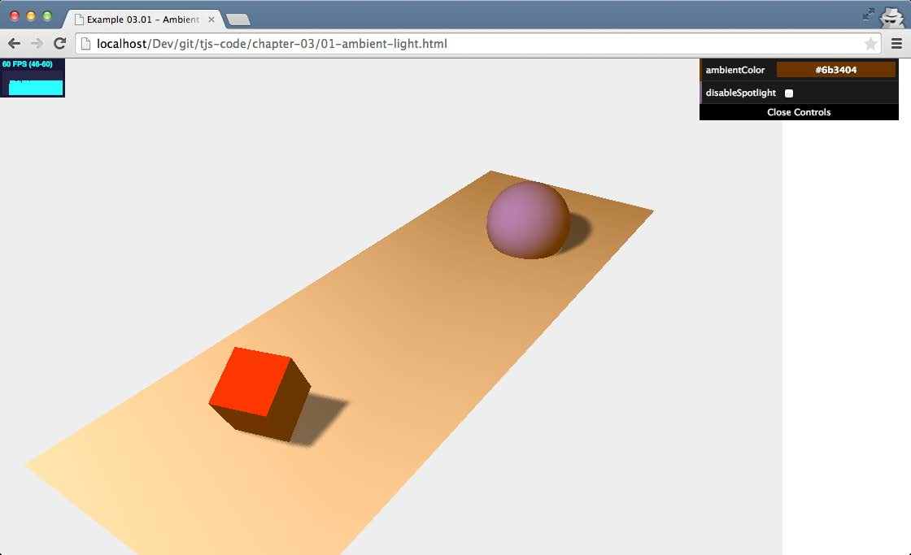

我们在这个场景中使用的标准颜色是 #0c0c0c。这是颜色的十六进制表示。前两个值指定颜色中的红色部分，接下来两个值指定绿色部分，最后两个值指定蓝色部分。

<!-- pdf-page: 89 -->
使用 Three.js 中提供的各种光源

在这个示例中，我们使用了一种非常暗的浅灰色，主要用来柔化网格投射到地面上的生硬阴影。你可以通过右上角的菜单将颜色改为更明显的黄/橙色（#523318），随后物体就会笼罩上一层类似太阳的光辉。如下面的屏幕截图所示：

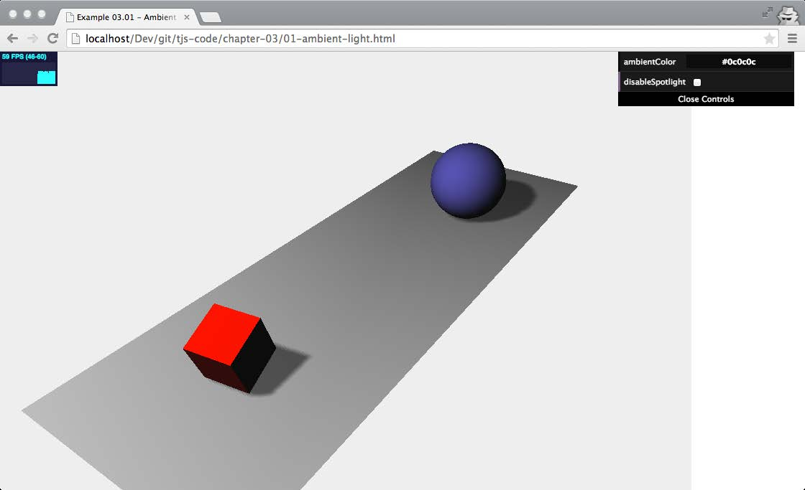

如上图所示，黄/橙色被应用到所有物体上，并为整个场景笼罩上一层绿色光辉。使用这种光源时，你应当记住，指定颜色时一定要非常保守。如果指定的颜色太亮，很快就会得到完全过饱和的图像。

现在我们已经了解了它的作用，接下来看看如何创建和使用 THREE.AmbientLight。下面几行代码展示了如何创建 THREE.AmbientLight，还展示了如何将其连接到 GUI 控制菜单；我们将在第 11 章“自定义着色器与渲染后期处理”中介绍该菜单：

```javascript
var ambiColor = "#0c0c0c";
var ambientLight = new THREE.AmbientLight(ambiColor);
scene.add(ambientLight);
...
```

```javascript
var controls = new function() {
  this.ambientColor = ambiColor  ;
```

<!-- pdf-page: 90 -->
```text
}
```

```javascript
var gui = new dat.GUI();
gui.addColor(controls, 'ambientColor').onChange(function(e) {
  ambientLight.color = new THREE.Color(e);
});
```

创建 THREE.AmbientLight 非常简单，只需几个步骤。THREE.AmbientLight 没有位置，并且会全局应用，所以我们只需要指定颜色（十六进制），即 new THREE.AmbientLight(ambiColor)，然后使用 scene.add(ambientLight) 将此光源添加到场景中。在示例中，我们将 THREE.AmbientLight 的颜色绑定到控制菜单。为此，可以使用与此前两章相同类型的配置。唯一的变化是，不再使用 gui.add(...) 函数，而是使用 gui.addColor(...) 函数。这会在控制菜单中创建一个选项，通过它可以直接更改变量传入的颜色。在代码中可以看到，我们使用了 dat.GUI 的 onChange 功能：gui.addColor(...).onChange(function(e){...})。通过这个函数，我们告诉 dat.GUI 在颜色每次发生变化时调用传入的函数。在这个特定示例中，我们将 THREE.AmbientLight 的颜色设置为一个新值。

#### 使用 THREE.Color 对象

在继续介绍下一种光源之前，先简要说明如何使用 THREE.Color 对象。在 Three.js 中构造对象时，通常可以将颜色指定为十六进制字符串（"#0c0c0c"）或十六进制值（0x0c0c0c，这是首选方式），也可以通过在 0 到 1 的范围内分别指定 RGB 值（0.3、0.5、0.6）来设置颜色。如果要在构造之后更改颜色，就必须创建一个新的 THREE.Color 对象，或者修改当前 THREE.Color 对象的内部属性。THREE.Color 对象提供了以下函数，用于设置和获取当前对象的信息：

| 名称 | 描述 |
| --- | --- |
| set(value) | 将此颜色的值设为所提供的十六进制值。该十六进制值可以是字符串、数字或现有的 THREE.Color 实例。 |
| setHex(value) | 将此颜色的值设为所提供的数字型十六进制值。 |
| setRGB(r,g,b) | 根据所提供的 RGB 值设置此颜色的值。这些值的范围为 0 到 1。 |

<!-- pdf-page: 91 -->
使用 Three.js 中提供的各种光源

| 名称 | 描述 |
| --- | --- |
| setHSL(h,s,l) | 根据所提供的 HSL 值设置此颜色的值。这些值的范围为 0 到 1。关于 HSL 如何配置颜色，可以在 http://en.wikibooks.org/wiki/Color\_ Models:\_RGB,\_HSV,\_HSL 找到很好的解释。 |
| setStyle(style) | 根据 CSS 指定颜色的方式设置此颜色的值。例如，可以使用 "rgb(255,0,0)"、"#ff0000"、"#f00"，甚至 "red"。 |
| copy(color) | 从所提供的 THREE.Color 实例复制颜色值到此颜色。 |
| copyGammaToLinear(color) | 这主要在内部使用。<br><br>根据所提供的 THREE.Color 实例设置此对象的颜色。颜色会首先从伽马颜色空间（Gamma Color Space）转换到线性颜色空间（Linear Color Space）。伽马颜色空间也使用 RGB 值，但采用指数刻度而不是线性刻度。 |
| copyLinearToGamma(color) | 这主要在内部使用。<br><br>根据所提供的 THREE.Color 实例设置此对象的颜色。颜色会首先从线性颜色空间转换到伽马颜色空间。 |
| convertGammaToLinear() | 将当前颜色从伽马颜色空间转换到线性颜色空间。 |
| convertLinearToGamma() | 将当前颜色从线性颜色空间转换到伽马颜色空间。 |
| getHex() | 以数字形式返回此颜色对象的值：435241。 |
| getHexString() | 以十六进制字符串形式返回此颜色对象的值："0c0c0c"。 |
| getStyle() | 以基于 CSS 的值返回此颜色对象的值："rgb(112,0,0)"。 |
| getHSL(optionalTarget) | 以 HSL 值返回此颜色对象的值。如果提供 optionalTarget 对象，Three.js 将在该对象上设置 h、s 和 l 属性。 |
| offsetHSL(h, s, l) | 将所提供的 h、s 和 l 值添加到当前颜色的 h、s 和 l 值上。 |
| add(color) | 将所提供颜色的 r、g 和 b 值添加到当前颜色中。 |

<!-- pdf-page: 92 -->
| 名称 | 描述 |
| --- | --- |
| addColors(color1, color2) | 这主要在内部使用。<br><br>将 color1 和 color2 相加，并将当前颜色的值设为所得结果。 |
| addScalar(s) | 这主要在内部使用。<br><br>将一个值添加到当前颜色的 RGB 分量中。请记住，内部值使用 0 到 1 的范围。 |
| multiply(color) | 这主要在内部使用。<br><br>将当前 RGB 值与 THREE.Color 中的 RGB 值相乘。 |
| multiplyScalar(s) | 这主要在内部使用。<br><br>将当前 RGB 值与所提供的值相乘。请记住，内部值使用 0 到 1 的范围。 |
| lerp(color, alpha) | 这主要在内部使用。<br><br>查找位于此对象颜色与所提供颜色之间的颜色。alpha 属性定义所得结果在当前颜色与所提供颜色之间的位置。 |
| equals(color) | 如果所提供的 THREE.Color 实例的 RGB 值与当前颜色的值相匹配，则返回 true。 |
| fromArray(array) | 其功能与 setRGB 相同，但现在 RGB 值可以作为数字数组提供。 |
| toArray | 返回包含三个元素的数组 \[r, g, b\]。 |
| clone() | 创建此颜色的精确副本。 |

从这张表中可以看到，更改当前颜色的方法有很多。其中许多函数由 Three.js 在内部使用，但它们也提供了一种轻松更改光源和材质颜色的好方式。

<!-- pdf-page: 93 -->
使用 Three.js 中提供的各种光源

在继续讨论 THREE.PointLight、THREE.SpotLight 和 THREE.DirectionalLight 之前，我们先强调一下它们的主要区别，也就是它们发出光线的方式。下图展示了这三种光源如何发出光线：

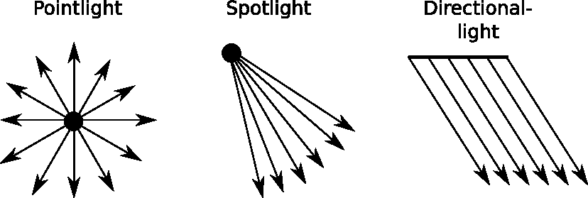

从这张图中可以看出以下几点：

- THREE.PointLight 从一个特定点向所有方向发光

- THREE.SpotLight 从一个特定点以锥形发光

- THREE.DirectionalLight 不是从单个点发光，而是从一个 2D 平面发出光线，这些光线彼此平行

接下来的几段将更详细地介绍这些光源；让我们从 THREE.PointLight 开始。

### THREE.PointLight

Three.js 中的 THREE.PointLight 是一种从单个点向所有方向发光的光源。夜空中发射的信号弹就是点光源的一个很好的例子。与所有光源一样，我们提供了一个专门的示例，供你用来试验 THREE.PointLight。如果查看 chapter-03 文件夹中的 02-point-light.html，就能找到一个 THREE.PointLight 光源围绕简单 Three.js 场景移动的示例。下面的屏幕截图展示了该示例：

<!-- pdf-page: 94 -->
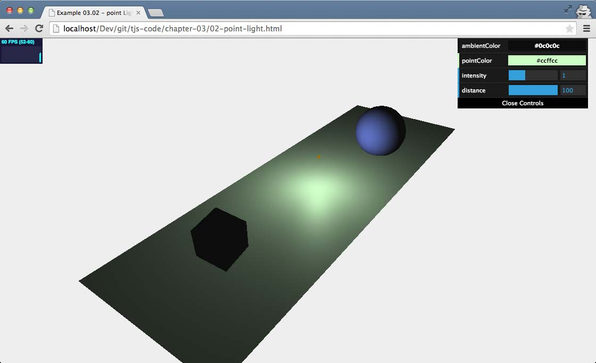

在这个示例中，THREE.PointLight 围绕我们已经在第 1 章“使用 Three.js 创建你的第一个 3D 场景”中见过的场景移动。为了更清楚地显示 THREE.PointLight 的位置，我们让一个小小的橙色球体沿相同路径移动。当此光源四处移动时，你会看到红色立方体和蓝色球体的不同侧面被它照亮。

你可能注意到，这个示例中看不到任何阴影。在 Three.js 中，THREE.PointLight 不投射阴影。由于 THREE.PointLight 向所有方向发光，计算阴影对 GPU 来说是一个非常繁重的过程。

使用我们先前看到的 THREE.AmbientLight 时，你只需提供 THREE.Color 并将光源添加到场景中。不过，对于 THREE.PointLight，我们还有几个额外的配置选项：

| 属性 | 描述 |
| --- | --- |
| color | 这是光源的颜色。 |
| distance | 这是光照耀的距离。默认值为 0，表示光强不会根据距离而降低。 |
| intensity | 这是光源发光时的强度。默认值为 1。 |

<!-- pdf-page: 95 -->
使用 Three.js 中提供的各种光源

| 属性 | 描述 |
| --- | --- |
| position | 这是光源在 THREE.Scene 中的位置。 |
| visible | 如果此属性设为 true（默认值），此光源就会开启；如果设为 false，光源就会关闭。 |

接下来的几个示例和屏幕截图将解释这些属性。首先，让我们看看如何创建 THREE.PointLight：

```javascript
var pointColor = "#ccffcc";
var pointLight = new THREE.PointLight(pointColor);
pointLight.position.set(10,10,10);
scene.add(pointLight);
```

我们创建一个具有特定 color 属性的光源（这里使用字符串值；也可以使用数字或 THREE.Color），设置其 position 属性，再将它添加到场景中。

我们要介绍的第一个属性是 intensity。使用此属性，可以设置光源发光的亮度。如果将其设为 0，你将看不到任何东西；设为 1，就是默认亮度；设为 2，就会得到亮度为两倍的光；依此类推。例如，在下面的屏幕截图中，我们将光的 intensity 设为 2.4：

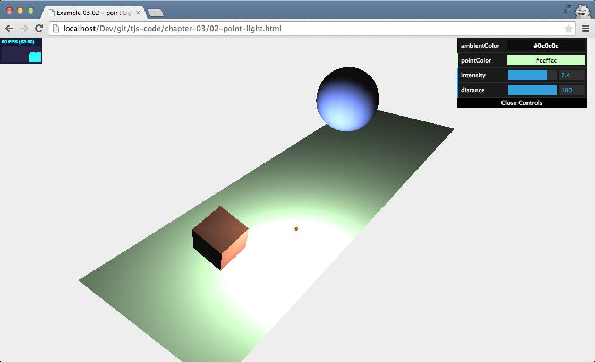

<!-- pdf-page: 96 -->
要更改光强，只需使用 THREE.PointLight 的 intensity 属性，如下所示：

```text
pointLight.intensity = 2.4;
```

或者，也可以像这样使用 dat.GUI 监听器：

```javascript
var controls = new function() {
  this.intensity = 1;
}
var gui = new dat.GUI();
  gui.add(controls, 'intensity', 0, 3).onChange(function (e) {
    pointLight.intensity = e;
  });
```

PointLight 的 distance 属性非常有趣，最好通过示例来解释。在下面的屏幕截图中，你会再次看到相同的场景，但这一次 intensity 属性非常高（我们的光非常亮），而 distance 很小：

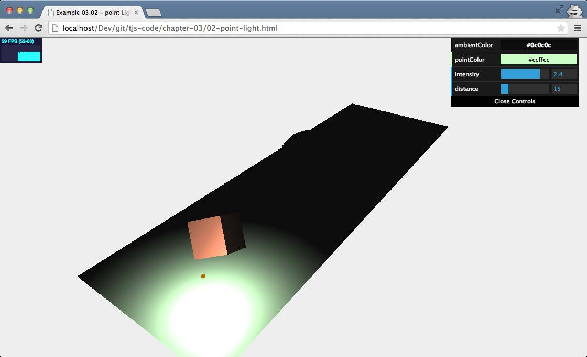

<!-- pdf-page: 97 -->
使用 Three.js 中提供的各种光源

PointLight 的 distance 属性决定了光从光源传播多远之后，其 intensity 属性变为 0。可以这样设置此属性：pointLight.distance = 14。在前面的屏幕截图中，光的亮度逐渐降低，并在距离为 14 时降至 0。这就是为什么在示例中你仍能看到被明亮照亮的立方体，但光无法到达蓝色球体。distance 属性的默认值为 0，表示光不会随距离衰减。

### THREE.SpotLight

THREE.SpotLight 是你最常使用的光源之一（尤其是在想要使用阴影时）。THREE.SpotLight 是一种具有锥形效果的光源。可以将其比作手电筒或提灯。这种光具有方向以及产生光线的角度。下表列出了适用于 THREE.SpotLight 的所有属性：

| 属性 | 描述 |
| --- | --- |
| angle | 这决定了此光源发出光束的宽度。该值以弧度为单位，默认为 Math.PI/3。 |
| castShadow | 如果设为 true，此光源将投射阴影。 |
| color | 这是光源的颜色。 |
| distance | 这是光照耀的距离。默认值为 0，表示光强不会根据距离而降低。 |
| exponent | 对于 THREE.SpotLight，距离光源越远，所发出光的强度就越低。exponent 属性决定这种强度降低的速度。值较低时，此光源发出的光会到达远处的物体；值较高时，光只能到达离 THREE.SpotLight 非常近的物体。 |
| intensity | 这是光源发光时的强度。默认值为 1。 |
| onlyShadow | 如果此属性设为 true，此光源将只投射阴影，而不会向场景添加任何光。 |
| position | 这是光源在 THREE.Scene 中的位置。 |
| shadowBias | 阴影偏移会使投射的阴影远离或朝向投射阴影的物体移动。在处理非常薄的物体时，可以用它来解决一些奇怪的效果（http://www.3dbuzz.com/ training/view/unity-fundamentals/lights/8- shadows-bias 上有一个很好的示例）。如果看到奇怪的阴影效果，为此属性设置较小的值（例如 0.01）通常可以解决问题。此属性的默认值为 0。 |

<!-- pdf-page: 98 -->
| 属性 | 描述 |
| --- | --- |
| shadowCameraFar | 这决定了应在离光源多远的位置创建阴影。默认值为 5,000。 |
| shadowCameraFov | 这决定了用于创建阴影的视场大小（参见第 2 章“构成 Three.js 场景的基本组件”中“不同用途使用不同相机”一节）。默认值为 50。 |
| shadowCameraNear | 这决定了应在离光源多远的位置创建阴影。默认值为 50。 |
| shadowCameraVisible | 如果设为 true，就可以看到此光源如何以及在何处投射阴影（参见下一节的示例）。默认值为 false。 |
| shadowDarkness | 这定义了阴影渲染的深浅程度。场景渲染后便无法更改。默认值为 0.5。 |
| shadowMapWidth and shadowMapHeight | 这决定了使用多少像素来创建阴影。当阴影边缘呈锯齿状或看起来不平滑时，请增大此值。场景渲染后便无法更改。这两个属性的默认值均为 512。 |
| target | 对于 THREE.SpotLight，其指向的方向很重要。使用 target 属性，可以让 THREE.SpotLight 指向场景中的特定对象或位置。请注意，此属性需要一个 THREE.Object3D 对象（例如 THREE.Mesh）。这与上一章介绍的相机不同，相机的 lookAt 函数使用 THREE.Vector3。 |
| visible | 如果设为 true（默认值），此光源就会开启；如果设为 false，光源就会关闭。 |

创建 THREE.SpotLight 非常容易。只需指定颜色、设置所需的属性，再将它添加到场景中，如下所示：

```javascript
var pointColor = "#ffffff";
var spotLight = new THREE.SpotLight(pointColor);
spotLight.position.set(-40, 60, -10);
spotLight.castShadow = true;
spotLight.target = plane;
scene.add(spotLight);
```

<!-- pdf-page: 99 -->
使用 Three.js 中提供的各种光源

THREE.SpotLight 与 THREE.PointLight 并没有很大区别。唯一的区别是，我们将 castShadow 属性设为 true，因为想要阴影；此外，还需要为这个 SpotLight 设置 target 属性。target 属性决定光瞄准的位置。在这个示例中，我们让它指向名为 plane 的对象。运行示例（03-spot-light.html）时，你会看到如下面的屏幕截图所示的场景：

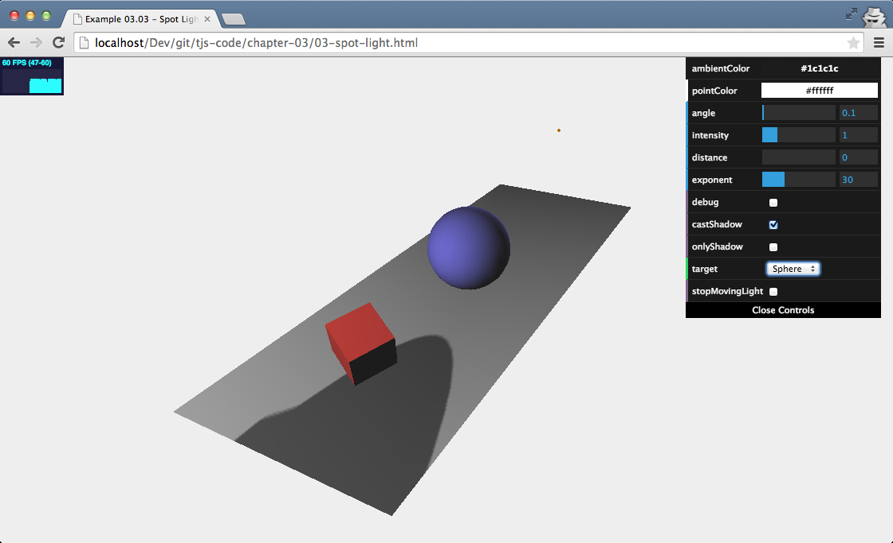

在这个示例中，你可以设置许多 THREE.SpotLight 特有的属性，其中之一就是 target 属性。如果将此属性设为蓝色球体，即使球体在场景中四处移动，光也会聚焦在球体中心。创建光源时，我们让它指向地面；在示例中，也可以让它指向另外两个物体。但是，如果你不想让光瞄准某个特定物体，而是瞄准空间中的任意一点，该怎么办？可以像这样创建一个 THREE.Object3D() 对象来实现：

```javascript
var target = new THREE.Object3D();
target.position = new THREE.Vector3(5, 0, 0);
```

然后，设置 THREE.SpotLight 的 target 属性：

```text
spotlight.target = target
```

<!-- pdf-page: 100 -->
在本节开头的表格中，我们展示了几个可用于控制 THREE.SpotLight 发光方式的属性。distance 和 angle 属性定义光锥的形状。angle 属性定义光锥的宽度，而 distance 属性用于设置光锥的长度。下图解释了这两个值如何共同定义接收 THREE.SpotLight 光照的区域：

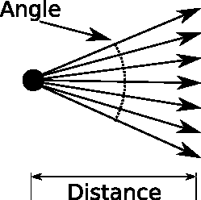

通常，你并不需要真正设置这些值，因为它们有合理的默认值；但举例来说，可以使用这些属性创建一个光束非常窄或光强迅速降低的 THREE.SpotLight。最后一个可用于改变 THREE.SpotLight 发光方式的属性是 exponent。使用此属性，可以设置光强从光锥中心向光锥边缘降低的速度。在下图中，可以看到 exponent 属性的实际效果。我们有一束非常亮的光（高 intensity），当它从中心向光锥两侧移动时，强度迅速降低（高 exponent）：

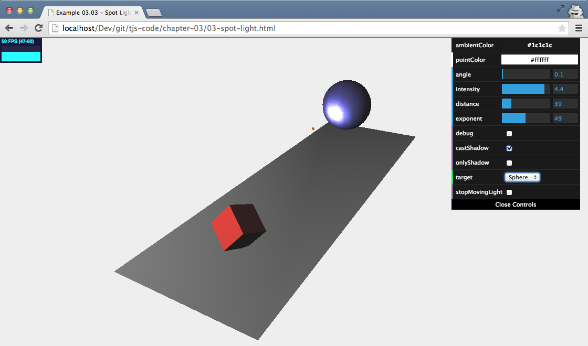

<!-- pdf-page: 101 -->
使用 Three.js 中提供的各种光源

你可以用它来突出显示某个特定物体，或者模拟小型手电筒。我们也可以使用较小的 exponent 值和 angle 值来创建同样的聚焦光束效果。对于第二种方法，需要提醒注意的是，非常小的 angle 很快就会导致各种渲染伪影（Artifact，指图形学中非预期的扭曲和屏幕上的异常渲染区域）。

在继续介绍下一种光源之前，我们先快速看看 THREE.SpotLight 可用的阴影相关属性。你已经了解到，将 THREE.SpotLight 的 castShadow 属性设为 true 就能得到阴影（当然，还要确保为应当投射阴影的对象设置 castShadow 属性，并为场景中应当显示阴影的 THREE.Mesh 对象设置 receiveShadow 属性）。Three.js 还允许你非常精细地控制阴影的渲染方式。这是通过我们在本节开头表格中解释的几个属性实现的。使用 shadowCameraNear、shadowCameraFar 和 shadowCameraFov，可以控制此光源如何以及在何处投射阴影。其工作方式与上一章解释的透视相机（Perspective Camera）的视场相同。要查看实际效果，最简单的方法是将 shadowCameraVisible 设为 true；你可以通过勾选菜单中的 debug 复选框来实现。如下面的屏幕截图所示，这会显示用于确定此光源阴影的区域：

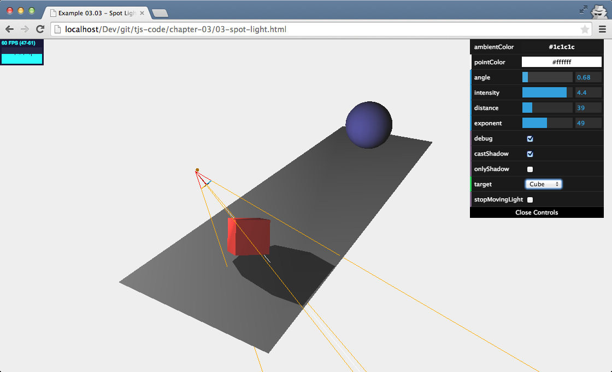

<!-- pdf-page: 102 -->
本节最后提供几个提示，以防你在使用阴影时遇到问题：

- 启用 shadowCameraVisible 属性。这会显示出于阴影计算目的而受此光源影响的区域。

- 如果阴影看起来呈块状，可以增大 shadowMapWidth 和 shadowMapHeight 属性，或者确保用于计算阴影的区域紧密包围物体。可以使用 shadowCameraNear、shadowCameraFar 和 shadowCameraFov 属性来配置此区域。

- 请记住，你不仅要告诉光源投射阴影，还必须通过设置 castShadow 和 receiveShadow 属性，告诉每个几何体是否接收和/或投射阴影。

- 如果在场景中使用薄物体，渲染阴影时可能会看到奇怪的伪影。可以使用 shadowBias 属性稍微偏移阴影，这通常能修复此类问题。

- 可以通过设置 shadowDarkness 属性来更改所投射阴影的深浅。如果阴影太暗或不够暗，更改此属性可以精细调整阴影的渲染效果。

- 如果想要更柔和的阴影，可以在 THREE.WebGLRenderer 上设置不同的 shadowMapType 值。默认情况下，此属性设为 THREE.PCFShadowMap；如果将此属性设为 THREE.PCFSoftShadowMap，就会得到更柔和的阴影。

### THREE.DirectionalLight

我们要介绍的最后一种基础光源是 THREE.DirectionalLight。这种类型的光可以看作来自非常远的地方的光。它发出的所有光线都彼此平行。太阳就是很好的例子。太阳距离我们如此遥远，以至于地球上接收到的光线（几乎）彼此平行。THREE.DirectionalLight 与 THREE.SpotLight（上一节介绍过）的主要区别在于，此光不会像 THREE.SpotLight 那样，随着离 THREE.DirectionalLight 的 target 越来越远而减弱（可以通过 distance 和 exponent 参数精细调整）。THREE.DirectionalLight 照亮的整个区域都会接收到相同强度的光。

<!-- pdf-page: 103 -->
使用 Three.js 中提供的各种光源

要查看实际效果，请看此处展示的 04-directional-light 示例：

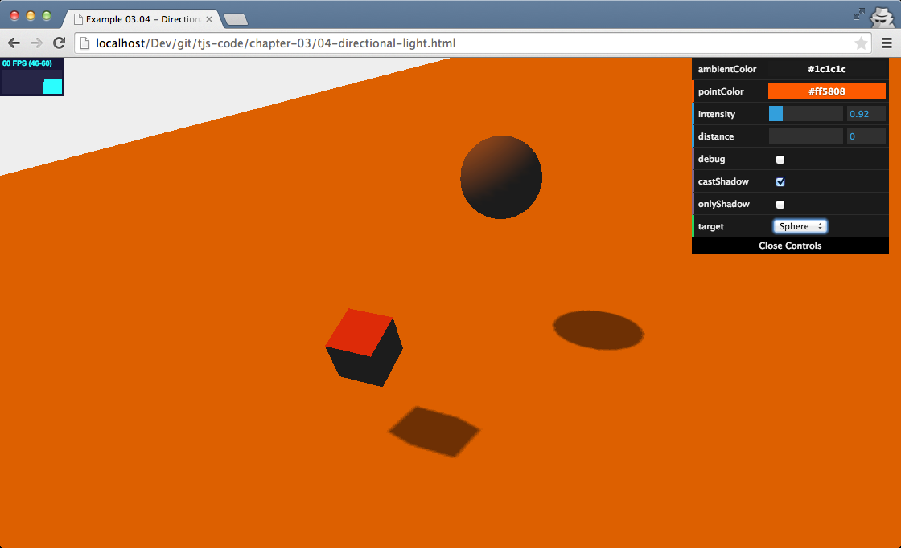

如上图所示，场景中并没有应用光锥。所有物体都接收到相同的光量。计算颜色和阴影时，只使用光的方向、颜色和强度。

与 THREE.SpotLight 一样，这里也有几个可以设置的属性，用于控制光强及其投射阴影的方式。THREE.DirectionalLight 有许多属性与 THREE.SpotLight 相同：position、target、intensity、distance、castShadow、onlyShadow、shadowCameraNear、shadowCameraFar、shadowDarkness、shadowCameraVisible、shadowMapWidth、shadowMapHeight 和 shadowBias。有关这些属性的信息，可以查看前面关于 THREE.SpotLight 的一节。接下来的几段将讨论为数不多的几个额外属性。

<!-- pdf-page: 104 -->
如果回顾 THREE.SpotLight 的示例，可以看到我们必须定义应用阴影的光锥。由于 THREE.DirectionalLight 的所有光线都彼此平行，因此我们没有光锥，而是拥有一个长方体区域，如下面的屏幕截图所示（如果想亲自查看，请将相机移到离场景更远的位置）：

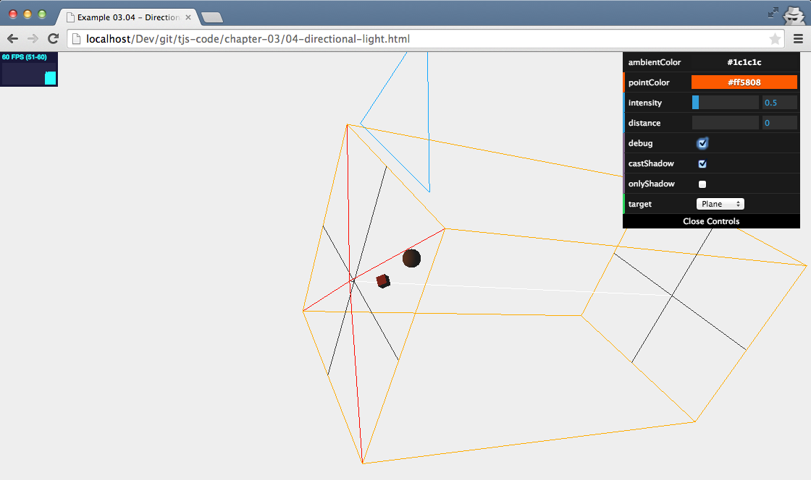

位于此立方体内的一切物体都可以投射和接收此光源的阴影。与 THREE.SpotLight 一样，在物体周围将此区域定义得越紧密，阴影效果就越好。使用以下属性定义此立方体：

```text
directionalLight.shadowCameraNear = 2;
directionalLight.shadowCameraFar = 200;
directionalLight.shadowCameraLeft = -50;
directionalLight.shadowCameraRight = 50;
directionalLight.shadowCameraTop = 50;
directionalLight.shadowCameraBottom = -50;
```

<!-- pdf-page: 105 -->
使用 Three.js 中提供的各种光源

可以将其与第 2 章“构成 Three.js 场景的基本组件”中相机一节配置正交相机（Orthographic Camera）的方式进行比较。

THREE.DirectionalLight 还有一个我们尚未讨论的属性：shadowCascade。当想在大面积区域中使用 THREE.DirectionalLight 的阴影时，此属性可用于创建更好的阴影。如果将此属性设为 true，Three.js 将使用另一种方法来生成阴影。它会根据 shadowCascadeCount 指定的值拆分阴影生成过程。这样，靠近相机视点的位置会得到更精细的阴影，而远处的阴影则不那么精细。要使用此功能，必须试验 shadowCascadeCount、shadowCascadeBias、shadowCascadeWidth、shadowCascadeHeight、shadowCascadeNearZ 和 shadowCascadeFarZ 的设置。可以在 http://alteredqualia.com/ three/examples/webgl\_road.html 找到使用此配置的示例。

## 特殊光源

在这一节关于特殊光源的内容中，我们将讨论 Three.js 提供的另外两种光源。首先讨论 THREE.HemisphereLight，它有助于为室外场景创建更自然的光照；然后介绍 THREE.AreaLight，它从一个大区域而不是单个点发光；最后，我们会展示如何为场景添加镜头光晕效果。

### THREE.HemisphereLight

我们要介绍的第一种特殊光源是 THREE.HemisphereLight。使用 THREE.HemisphereLight，可以创建看起来更加自然的室外光照。如果没有这种光，我们可以通过创建模拟太阳的 THREE.DirectionalLight，并可能添加额外的 THREE.AmbientLight 为场景提供一些整体颜色，来模拟室外环境。然而，这样看起来并不会真正自然。身处室外时，并非所有光都直接来自上方：大量光会被大气散射，并被地面和其他物体反射。Three.js 中的 THREE.HemisphereLight 正是为这种场景创建的。这是获得更加自然的室外光照的一种简单方法。要查看示例，请看 05-hemisphere-light.html：

<!-- pdf-page: 106 -->
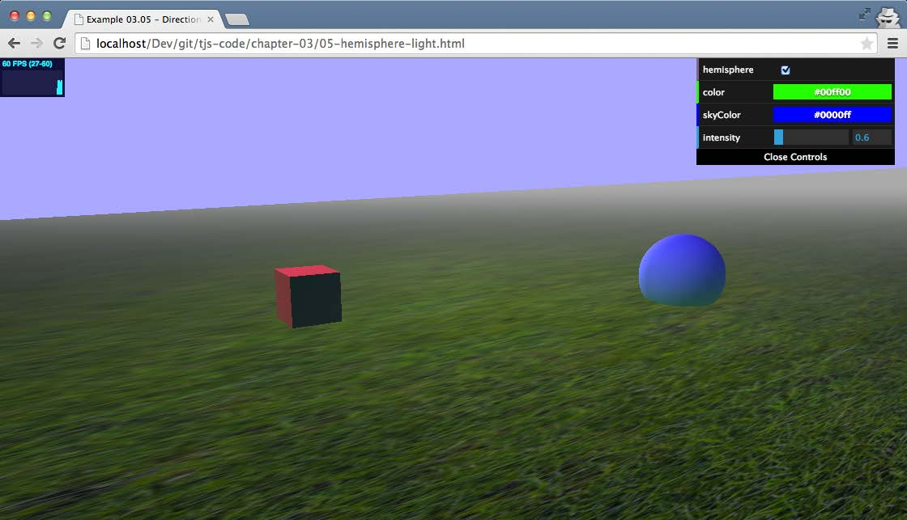

请注意，这是第一个会加载额外资源且无法直接从本地文件系统运行的示例。因此，如果你还没有这样做，请查看第 1 章“使用 Three.js 创建你的第一个 3D 场景”，了解如何设置本地 Web 服务器，或如何禁用浏览器中的安全设置，以便加载外部资源。

在这个示例中，你可以开启和关闭 THREE.HemisphereLight，并设置颜色和强度。创建半球光与创建任何其他光源一样简单：

```javascript
var hemiLight = new THREE.HemisphereLight(0x0000ff, 0x00ff00,
  0.6);
hemiLight.position.set(0, 500, 0);
scene.add(hemiLight);
```

只需指定从天空接收的颜色、从地面接收的颜色以及这些光的强度。如果以后要更改这些值，可以通过以下属性访问它们：

| 属性 | 描述 |
| --- | --- |
| groundColor | 这是从地面发出的颜色 |
| color | 这是从天空发出的颜色 |
| intensity | 这是光源发光时的强度 |

<!-- pdf-page: 107 -->
使用 Three.js 中提供的各种光源

### THREE.AreaLight

我们要介绍的最后一种真正的光源是 THREE.AreaLight。使用 THREE.AreaLight，可以定义一个发光的矩形区域。THREE.AreaLight 并未包含在标准 Three.js 库中，而是包含在其扩展中，因此在使用此光源之前，我们必须执行几个额外步骤。在介绍细节之前，先看看我们要实现的结果（打开 06-area-light.html 即可打开此示例）；下面的屏幕截图概括了我们希望看到的结果：

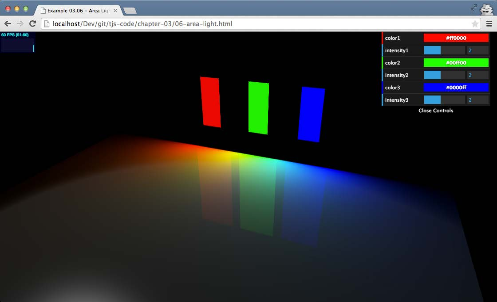

从这张屏幕截图中可以看到，我们定义了三个 THREE.AreaLight 对象，每个对象都有自己的颜色。你还可以看到这些光源如何影响整个区域。

想要使用 THREE.AreaLight 时，不能使用此前示例中一直使用的 THREE.WebGLRenderer。原因是，THREE.AreaLight 是一种非常复杂的光源，在普通的 THREE.WebGLRenderer 对象中会造成非常严重的性能损失。它在渲染场景时采用了不同的方法（将渲染拆分为多个步骤），并且比标准 THREE.WebGLRenderer 对象更能处理复杂光源（或者非常多的光源）。

<!-- pdf-page: 108 -->
要使用延迟渲染器（Deferred Renderer，THREE.WebGLDeferredRenderer），必须包含 Three.js 提供的几个额外 JavaScript 源文件。在 HTML 骨架的 head 中，确保定义了下面这组 \<script\> 源文件：

```html
<head>
  <script type="text/javascript" src="../libs/three.js"></script>
  <script type="text/javascript" src="../libs/stats.js"></script>
  <script type="text/javascript" src="../libs/dat.gui.js">
    </script>

  <script type="text/javascript" src="../libs/
    WebGLDeferredRenderer.js"></script>
  <script type="text/javascript" src="../libs/ShaderDeferred.js">
    </script>
  <script type="text/javascript" src="../libs/RenderPass.js">
    </script>
  <script type="text/javascript" src="../libs/EffectComposer.js">
    </script>
  <script type="text/javascript" src="../libs/CopyShader.js">
    </script>
  <script type="text/javascript" src="../libs/ShaderPass.js">
    </script>
  <script type="text/javascript" src="../libs/FXAAShader.js">
    </script>
  <script type="text/javascript" src="../libs/MaskPass.js">
    </script>
</head>
```

包含这些库之后，就可以使用 THREE.WebGLDeferredRenderer。此渲染器的使用方式与其他示例中讨论的渲染器几乎相同，只是需要几个额外参数：

```javascript
var renderer = new THREE.WebGLDeferredRenderer({width:
  window.innerWidth,height: window.innerHeight,scale: 1,
  antialias: true,tonemapping: THREE.FilmicOperator, brightness:
  2.5 });
```

目前不必太担心所有这些属性的含义。在第 10 章“加载和使用纹理（Texture）”中，我们将更深入地探讨 THREE.WebGLDeferredRenderer 并解释这些属性。有了正确的 JavaScript 库和不同的渲染器，就可以开始添加 THREE.AreaLight。

<!-- pdf-page: 109 -->
使用 Three.js 中提供的各种光源

其操作方式与所有其他光源几乎相同：

```javascript
var areaLight1 = new THREE.AreaLight(0xff0000, 3);
areaLight1.position.set(-10, 10, -35);
areaLight1.rotation.set(-Math.PI / 2, 0, 0);
areaLight1.width = 4;
areaLight1.height = 9.9;
scene.add(areaLight1);
```

在这个示例中，我们创建了一个新的 THREE.AreaLight。此光源的颜色值为 0xff0000，强度值为 3。与其他光源一样，我们可以使用 position 属性设置它在场景中的位置。创建 THREE.AreaLight 时，它会创建为一个水平面。在我们的示例中，创建了三个垂直放置的 THREE.AreaLight 对象，因此需要让光源绕其 x 轴旋转 -Math.PI/2。最后，使用 width 和 height 属性设置 THREE.AreaLight 的大小，并将它们添加到场景中。如果你第一次亲自尝试，可能会疑惑为什么在放置光源的位置看不到任何东西。这是因为你看不到光源本身，只能看到它发出的光，而且只有光照射到物体上时才能看见。如果想重现我在示例中展示的效果，可以在相同位置（areaLight1.position）添加 THREE.PlaneGeometry 或 THREE.BoxGeometry 来模拟发光区域，如下所示：

```javascript
var planeGeometry1 = new THREE.BoxGeometry(4, 10, 0);
var planeGeometry1Mat = new THREE.MeshBasicMaterial({color:
  0xff0000})
var plane = new THREE.Mesh(planeGeometry1, planeGeometry1Mat);
plane.position = areaLight1.position;
scene.add(plane);
```

<!-- pdf-page: 110 -->
使用 THREE.AreaLight 可以创建非常漂亮的效果，但可能需要进行一些试验才能获得所需的效果。如果拉下右上角的控制面板，就会看到一些控件，可以用来设置此场景中三个光源的颜色和强度并立即查看效果，如下所示：

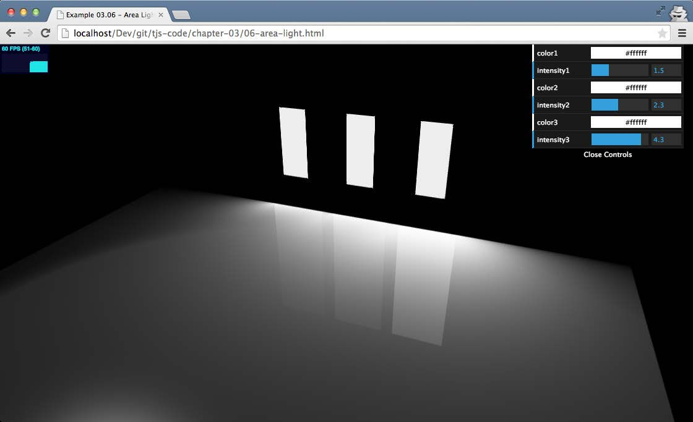

### 镜头光晕（LensFlare）

本章要探讨的最后一个主题是镜头光晕。你可能已经熟悉镜头光晕。例如，直接对着太阳或其他明亮光源拍照时，就会出现镜头光晕。在大多数情况下，你会希望避免这种现象，但对于游戏和 3D 生成图像，它提供了一种不错的效果，能让场景看起来更加真实。

<!-- pdf-page: 111 -->
使用 Three.js 中提供的各种光源

Three.js 也支持镜头光晕，并且可以非常轻松地将它们添加到场景中。在最后一节中，我们将向场景添加镜头光晕，并创建如下面的屏幕截图所示的输出；你可以打开 07-lensflares.html 亲自查看：

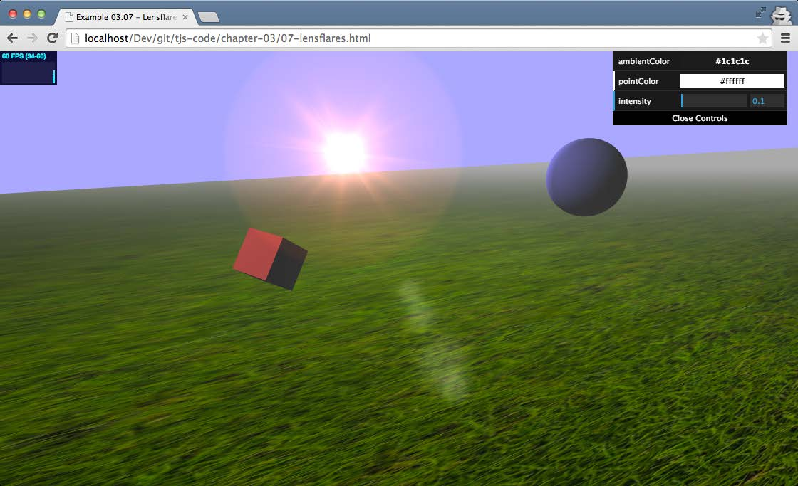

我们可以通过实例化 THREE.LensFlare 对象来创建镜头光晕。首先需要做的就是创建此对象。THREE.LensFlare 接受以下参数：

```javascript
flare = new THREE.LensFlare(texture, size, distance, blending,
  color, opacity);
```

下表解释了这些参数：

| 参数 | 描述 |
| --- | --- |
| texture | 纹理是决定光晕形状的图像。 |
| size | 我们可以指定光晕的大小。这是以像素（Pixel）为单位的尺寸。如果指定 -1，则使用纹理本身的尺寸。 |
| distance | 这是从光源（0）到相机（1）的距离。用它将镜头光晕定位在正确的位置。 |

<!-- pdf-page: 112 -->
| 参数 | 描述 |
| --- | --- |
| blending | 我们可以为光晕指定多个纹理。混合模式决定这些纹理如何混合在一起。LensFlare 默认使用 THREE.AdditiveBlending。下一章将介绍更多有关混合的内容。 |
| color | 这是光晕的颜色。 |

让我们看看用于创建此对象的代码（参见 07-lensflares.html）：

```javascript
var textureFlare0 = THREE.ImageUtils.loadTexture
      ("../assets/textures/lensflare/lensflare0.png");
```

```javascript
var flareColor = new THREE.Color(0xffaacc);
var lensFlare = new THREE.LensFlare(textureFlare0, 350, 0.0,
  THREE.AdditiveBlending, flareColor);
```

```text
lensFlare.position = spotLight.position;
scene.add(lensFlare);
```

首先加载一个纹理。对于这个示例，我使用了 Three.js 示例提供的镜头光晕纹理，如下所示：

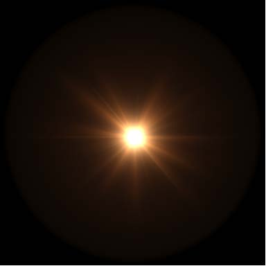

如果将这幅图像与本节开头的屏幕截图进行比较，可以看到它决定了镜头光晕的外观。接下来，我们使用 new THREE.Color( 0xffaacc ); 定义镜头光晕的颜色，这会使镜头光晕发出红色光辉。有了这两个对象，就可以创建 THREE.LensFlare 对象。在这个示例中，我们将光晕大小设为 350，将 distance 设为 0.0（直接位于光源处）。

<!-- pdf-page: 113 -->
使用 Three.js 中提供的各种光源

创建 LensFlare 对象后，我们将它定位在光源所在位置并添加到场景中，如下面的屏幕截图所示：

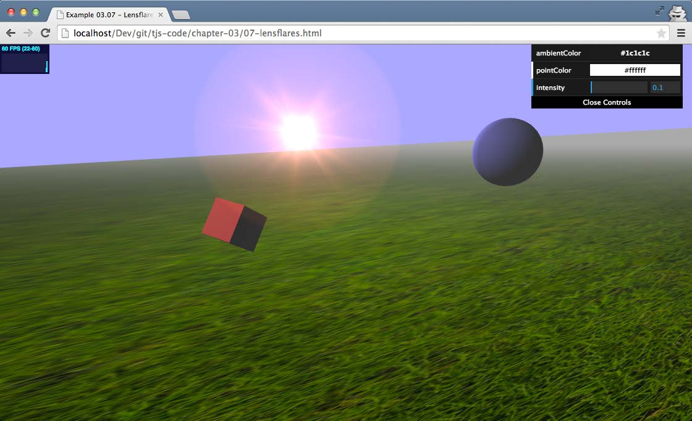

看起来已经很不错，但如果将它与本章开头的图像进行比较，你会注意到页面中央还缺少一些小小的圆形伪影。我们创建这些伪影的方式与创建主光晕几乎相同，如下所示：

```javascript
var textureFlare3 = THREE.ImageUtils.loadTexture
      ("../assets/textures/lensflare/lensflare3.png");
```

```javascript
lensFlare.add(textureFlare3, 60, 0.6, THREE.AdditiveBlending);
lensFlare.add(textureFlare3, 70, 0.7, THREE.AdditiveBlending);
lensFlare.add(textureFlare3, 120, 0.9, THREE.AdditiveBlending);
lensFlare.add(textureFlare3, 70, 1.0, THREE.AdditiveBlending);
```

不过，这次我们不是创建新的 THREE.LensFlare，而是使用刚刚创建的 LensFlare 所提供的 add 函数。在此方法中，需要指定纹理、大小、距离和混合模式，仅此而已。请注意，add 函数还可以接受两个额外参数。你也可以设置要添加的新光晕的 color 和 opacity 属性。这些新光晕使用的纹理是一个非常浅的圆形，如下面的屏幕截图所示：

<!-- pdf-page: 114 -->
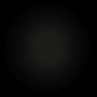

再次查看场景，你会看到伪影出现在通过 distance 参数指定的位置。

## 总结

本章介绍了 Three.js 中可用的各种光源的大量信息。在本章中，你了解到配置光源、颜色和阴影并不是一门精确的科学。要获得正确的结果，应当试验不同的设置，并使用 dat.GUI 控件精细调整配置。不同光源的行为方式不同。THREE.AmbientLight 的颜色会叠加到场景中每一种颜色上，通常用于柔化生硬的色彩和阴影。THREE.PointLight 向所有方向发光，但不能用于创建阴影。THREE.SpotLight 是一种类似手电筒的光源。它呈锥形，可以配置为随距离衰减，并且能够投射阴影。我们还介绍了 THREE.DirectionalLight。这种光可以比作太阳等遥远的光源，其光线彼此平行传播，强度不会随着与所配置 target 的距离增加而降低。除了标准光源，我们还介绍了几种更专业的光源。要获得更自然的室外效果，可以使用 THREE.HemisphereLight，它会考虑地面和天空的反射；THREE.AreaLight 不是从单个点发光，而是从一个大区域发光。我们展示了如何使用 THREE.LensFlare 对象添加摄影镜头光晕。

到目前为止的章节中，我们已经介绍了几种不同的材质；在本章中，你也看到并非所有材质对可用光源的响应方式都相同。在下一章，我们将概述 Three.js 中可用的材质。

<!-- pdf-page: 115 -->
