# 第 4 章 · 使用 Three.js 材质（Materials）

<!-- pdf-page: 116 -->
## 使用 Three.js

## 材质

在前几章中，我们简单讨论过材质。你已经了解到，材质与 THREE.Geometry 一起构成 THREE.Mesh。材质就像物体的皮肤，定义了几何体外部的外观。例如，这层皮肤决定几何体看起来是否具有金属质感、是否透明，或者是否以线框（Wireframe）显示。随后，可以将得到的 THREE.Mesh 对象添加到场景中，由 Three.js 进行渲染。到目前为止，我们还没有真正详细地研究材质。在本章中，我们将深入探讨 Three.js 提供的所有材质，你将学习如何使用这些材质创建美观的 3D 物体。本章将探讨的材质如下表所示：

| 名称 | 描述 |
| --- | --- |
| 网格基础材质（Mesh Basic Material，THREE.MeshBasicMaterial） | 这是一种基础材质，可以用来为几何体赋予简单的颜色（Color），或者显示几何体的线框。 |
| 网格深度材质（Mesh Depth Material，THREE.MeshDepthMaterial） | 这种材质根据与相机的距离来确定如何为网格着色。 |
| 网格法线材质（Mesh Normal Material，THREE.MeshNormalMaterial） | 这是一种简单的材质，根据面的法向量来确定其颜色。 |
| 多面材质（Mesh Face Material，THREE.MeshFaceMaterial） | 这是一个容器，允许你为几何体的每个面指定独特的材质。 |
| 网格兰伯特材质（Mesh Lambert Material，THREE.MeshLambertMaterial） | 这种材质会考虑光照，用于创建暗淡、无光泽外观的物体。 |
| 网格冯氏材质（Mesh Phong Material，THREE.MeshPhongMaterial） | 这种材质同样会考虑光照，可用于创建有光泽的物体。 |

<!-- pdf-page: 117 -->
使用 Three.js 材质

| 名称 | 描述 |
| --- | --- |
| 着色器材质（Shader Material，THREE.ShaderMaterial） | 这种材质允许你指定自己的着色器程序，直接控制顶点（Vertex）的定位方式和像素（Pixel）的着色方式。 |
| 线条基础材质（Line Basic Material，THREE.LineBasicMaterial） | 这种材质可用于 THREE.Line 几何体，以创建彩色线条。 |
| 虚线材质（Line Dashed Material，THREE.LineDashedMaterial） | 这与线条基础材质相同，但这种材质还允许你创建虚线效果。 |

如果浏览 Three.js 的源代码，可能会遇到 THREE.RawShaderMaterial。这是一种特殊材质，只能与 THREE.BufferedGeometry 一起使用。这种几何体是一种特殊形式，针对静态几何体进行了优化（例如，顶点和面不会发生变化）。本章不会探讨这种材质，但在第 11 章“自定义着色器与渲染后期处理”中讨论创建自定义着色器时会使用它。在代码中，还可以找到 THREE.SpriteCanvasMaterial、THREE.SpriteMaterial 和 THREE.PointCloudMaterial。这些材质用于设置各个点的样式。本章不会讨论它们，但会在第 7 章“粒子、精灵和点云”中进行探讨。

材质有许多共同属性，因此在介绍第一种材质 MeshBasicMaterial 之前，我们先看看所有材质共享的属性。

## 了解材质的共同属性

你可以快速亲自查看所有材质之间共享哪些属性。Three.js 提供了一个材质基类 THREE.Material，其中列出了所有共同属性。我们将这些共同的材质属性分为以下三类：

- 基本属性：这些是你最常使用的属性。例如，可以使用这些属性控制物体的透明度、是否可见，以及如何引用它（通过 ID 或自定义名称）。

- 混合属性：每个对象都有一组混合（Blending）属性。这些属性定义对象如何与其背景组合。

- 高级属性：有许多高级属性控制底层 WebGL 上下文如何渲染对象。在大多数情况下，你不需要改动这些属性。

<!-- pdf-page: 118 -->
请注意，在本章中，我们会跳过所有与纹理（Texture）和贴图相关的属性。大多数材质都允许你将图像用作纹理（例如，类似木材或石材的纹理）。在第 10 章“加载和使用纹理”中，我们将深入探讨各种可用的纹理和映射选项。某些材质还具有与动画（Animation）相关的特定属性：蒙皮（skinning）和变形目标（morphTargets）；我们也会跳过这些属性。它们将在第 9 章“动画与移动相机”中介绍。

我们从列表中的第一类开始：基本属性。

### 基本属性

下表列出了 THREE.Material 对象的基本属性（可以在关于 THREE.MeshBasicMaterial 的一节中看到这些属性的实际效果）：

| 属性 | 描述 |
| --- | --- |
| id | 用于标识材质，在创建材质时分配。第一个材质从 0 开始，之后每创建一个材质，该值就增加 1。 |
| uuid | 这是唯一生成的 ID，在内部使用。 |
| name | 可以通过此属性为材质指定名称。它可用于调试。 |
| opacity | 定义对象的透明程度。请与 transparent 属性一起使用。此属性的范围为 0 到 1。 |
| transparent | 如果设为 true，Three.js 将按照设定的 opacity 渲染此对象。如果设为 false，对象将不会透明，只是颜色更浅。如果使用带 alpha（透明度）通道的纹理，也应将此属性设为 true。 |
| overdraw | 使用 THREE.CanvasRenderer 时，多边形会渲染得稍大一些。如果使用此渲染器时看到缝隙，请将其设为 true。 |
| visible | 定义此材质是否可见。如果设为 false，你将看不到场景中的对象。 |
| side | 使用此属性，可以定义将材质应用到几何体的哪一侧。默认为 THREE.FrontSide，即将材质应用到对象的正面（外侧）。也可以设为 THREE.BackSide，将材质应用到背面（内侧）；或者设为 THREE.DoubleSide，将其应用到两侧。 |
| needsUpdate | 对于某些材质更新，需要告诉 Three.js 材质已更改。如果此属性设为 true，Three.js 将使用新的材质属性更新其缓存。 |

对于每种材质，还可以设置许多混合属性。

<!-- pdf-page: 119 -->
使用 Three.js 材质

### 混合属性

材质有几个通用的混合相关属性。混合决定了我们渲染的颜色如何与其后方的颜色相互作用。在讨论组合材质时，我们会稍微涉及这个主题。混合属性如下表所示：

| 名称 | 描述 |
| --- | --- |
| blending | 这决定了此对象上的材质如何与背景混合。正常模式为 THREE.NormalBlending，只显示顶层。 |
| blendSrc | 除了使用标准混合模式，还可以通过设置 blendSrc、blendDst 和 blendEquation 来创建自定义混合模式。此属性定义此对象（源）如何混合到背景（目标）中。默认设置 THREE.SrcAlphaFactor 使用 alpha（透明度）通道进行混合。 |
| blendDst | 此属性定义背景（目标）在混合中的使用方式，默认为 THREE.OneMinusSrcAlphaFactor，这意味着此属性也使用源的 alpha 通道进行混合，但使用 1 减去源的 alpha 通道值作为混合因子。 |
| blendEquation | 这定义了如何使用 blendSrc 和 blendDst 值。默认是将它们相加（THREE.AddEquation）。使用这三个属性，可以创建自己的自定义混合模式。 |

最后一组属性主要在内部使用，用于控制如何使用 WebGL 渲染场景的具体细节。

### 高级属性

我们不会深入介绍这些属性的细节。它们与 WebGL 的内部工作方式有关。如果确实想了解更多有关这些属性的信息，OpenGL 规范是一个很好的起点。可以在 http:// www.khronos.org/registry/gles/specs/2.0/es\_full\_spec\_2.0.25.pdf 找到此规范。下表简要描述了这些高级属性：

| 名称 | 描述 |
| --- | --- |
| depthTest | 这是一个高级 WebGL 属性。使用此属性，可以启用或禁用 GL\_DEPTH\_TEST 参数。此参数控制是否使用像素的深度来确定新像素的值。通常不需要更改它。更多信息可以在前面提到的 OpenGL 规范中找到。 |

<!-- pdf-page: 120 -->
| 名称 | 描述 |
| --- | --- |
| depthWrite | 这是另一个内部属性。此属性可用于确定此材质是否影响 WebGL 深度缓冲区。如果将对象用于平视显示界面（Head-Up Display，HUD）等 2D 叠加层，应将此属性设为 false。不过，通常不需要更改此属性。 |

```text
polygonOffset,
polygonOffsetFactor,
and
polygonOffsetUnits
```

| 名称 | 描述 |
| --- | --- |
| polygonOffset, polygonOffsetFactor, and polygonOffsetUnits | 使用这些属性，可以控制 POLYGON\_ OFFSET\_FILL WebGL 功能。通常不需要这些属性。有关其具体作用的解释，可以查看 OpenGL 规范。 |
| alphaTest | 此值可以设为特定值（0 到 1）。每当像素的 alpha 值小于此值时，就不会绘制该像素。可以使用此属性消除一些与透明度相关的伪影。 |

现在，让我们看看所有可用的材质，以便了解这些属性对渲染输出的影响。

## 从简单的网格开始

在本节中，我们将介绍几种简单的材质：MeshBasicMaterial、MeshDepthMaterial、MeshNormalMaterial 和 MeshFaceMaterial。我们从 MeshBasicMaterial 开始。

在研究这些材质的属性之前，先简要说明如何传入属性来配置材质。有两种方式：

- 可以在构造函数中以参数对象的形式传入参数，如下所示：

```javascript
var material = new THREE.MeshBasicMaterial(
{
  color: 0xff0000, name: 'material-1', opacity: 0.5,
    transparency: true, ...
});
```

- 或者，也可以创建一个实例并分别设置属性，如下所示：

```javascript
var material = new THREE.MeshBasicMaterial();
material.color = new THREE.Color(0xff0000);
material.name = 'material-1';
material.opacity = 0.5;
material.transparency = true;
```

<!-- pdf-page: 121 -->
使用 Three.js 材质

通常，如果在创建材质时已经知道所有属性的值，最好的方式是使用构造函数。这两种方式使用的参数格式相同。此规则唯一的例外是 color 属性。在第一种方式中，可以直接传入十六进制值，Three.js 会自行创建 THREE.Color 对象。在第二种方式中，则必须显式创建 THREE.Color 对象。本书会同时使用这两种方式。

### THREE.MeshBasicMaterial

MeshBasicMaterial 是一种非常简单的材质，不会考虑场景中可用的光源。使用此材质的网格会渲染成简单的平面多边形，你也可以选择显示几何体的线框。除了前面关于此材质的一节中看到的共同属性外，还可以设置以下属性：

| 名称 | 描述 |
| --- | --- |
| color | 此属性允许你设置材质的颜色。 |
| wireframe | 此属性允许你将材质渲染为线框。这非常适用于调试。 |
| wireframeLinewidth | 如果启用线框，此属性定义线框中线条的宽度。 |
| wireframeLinecap | 此属性定义线框模式下线条末端的外观。可能的值为 butt、round 和 square。默认值为 round。在实践中，更改此属性的效果很难看出。WebGLRenderer 不支持此属性。 |
| wireframeLinejoin | 这定义线条连接处的显示方式。可能的值为 round、bevel 和 miter。默认值为 round。如果仔细观察，可以在示例中使用较低的 opacity 和非常大的 wireframeLinewidth 值看到这一点。WebGLRenderer 不支持此属性。 |

<!-- pdf-page: 122 -->
| 名称 | 描述 |
| --- | --- |
| shading | 这定义如何应用着色。可能的值为 THREE.SmoothShading、THREE.NoShading 和 THREE.FlatShading。默认值为 THREE.SmoothShading，这会得到平滑的物体，不会看到各个面。此材质的示例中未启用此属性。示例请参见关于 MeshNormalMaterial 的一节。 |
| vertexColors | 使用此属性，可以定义应用到每个顶点的单独颜色。默认值为 THREE.NoColors。如果将此值设为 THREE.VertexColors，渲染器将考虑 THREE.Geometry 的 colors 属性上设置的颜色。此属性在 CanvasRenderer 上不起作用，但在 WebGLRenderer 上有效。请查看 LineBasicMaterial 示例，其中我们使用此属性为线条的各个部分着色。还可以使用此属性为此材质类型创建渐变效果。 |
| fog | 此属性决定此材质是否受全局雾效设置影响。这里没有展示其实际效果，但如果设为 false，第 2 章“构成 Three.js 场景的基本组件”中介绍的全局雾效就不会影响此对象的渲染方式。 |

在前几章中，我们已经了解了如何创建材质并将其赋给对象。对于 THREE.MeshBasicMaterial，可以这样做：

```javascript
var meshMaterial = new THREE.MeshBasicMaterial({color: 0x7777ff});
```

这会创建一个新的 THREE.MeshBasicMaterial，并将 color 属性初始化为 0x7777ff（即紫色）。

<!-- pdf-page: 123 -->
使用 Three.js 材质

我添加了一个示例，供你试验 THREE.MeshBasicMaterial 的属性和上一节讨论的基本属性。如果打开 chapter-04 文件夹中的 01-basic-mesh-material.html 示例，就会看到一个旋转的立方体，如下面的屏幕截图所示：

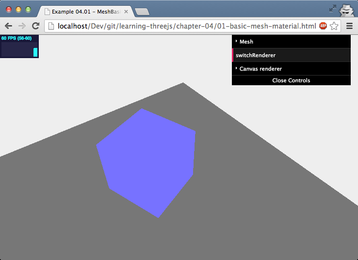

这是一个非常简单的对象。使用右上角的菜单，可以试验这些属性并选择不同的网格（也可以更改渲染器）。例如，一个 opacity 为 0.2、transparent 设为 true、wireframe 设为 true、wireframeLinewidth 为 9 且使用 CanvasRenderer 的球体，会渲染成这样：

<!-- pdf-page: 124 -->
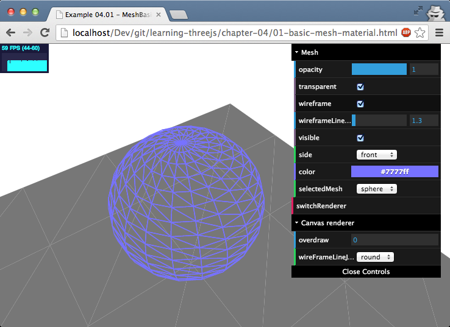

可以在此示例中设置的属性之一是 side 属性。使用此属性，可以定义将材质应用到 THREE.Geometry 的哪一侧。选择平面网格时，可以测试此属性的工作方式。由于材质通常只应用到几何体的正面，旋转的平面会有一半时间不可见（当它把背面朝向你时）。如果将 side 属性设为 double，平面就会始终可见，因为材质应用到了几何体的两侧。不过请注意，当 side 属性设为 double 时，渲染器需要做更多工作，因此可能会影响场景的性能。

<!-- pdf-page: 125 -->
使用 Three.js 材质

### THREE.MeshDepthMaterial

列表中的下一种材质是 THREE.MeshDepthMaterial。使用此材质时，物体的外观不是由光源或某个特定的材质属性决定，而是由物体到相机的距离决定。可以将其与其他材质组合，轻松创建渐隐效果。此材质唯一相关的属性是下面两个用于控制是否显示线框的属性：

| 名称 | 描述 |
| --- | --- |
| wireframe | 这确定是否显示线框。 |
| wireframeLinewidth | 这确定线框的宽度。 |

为了演示这一点，我们修改了第 2 章“构成 Three.js 场景的基本组件”中的立方体示例（chapter-04 文件夹中的 02-depth-material）。请记住，必须单击 addCube 按钮来填充场景。下面的屏幕截图展示了修改后的示例：

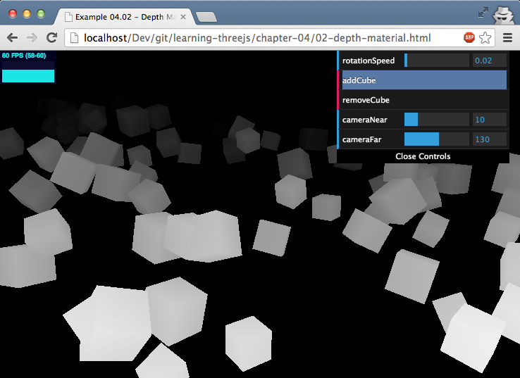

<!-- pdf-page: 126 -->
尽管此材质没有太多用于控制物体渲染方式的额外属性，但我们仍可控制物体颜色消退的速度。在这个示例中，我们公开了相机的 near 和 far 属性。你可能还记得第 2 章“构成 Three.js 场景的基本组件”中的内容，通过这两个属性，可以设置相机的可见区域。任何比 near 属性更靠近相机的对象都不会显示，任何比 far 属性更远的对象也会落在相机的可见区域之外。

相机 near 和 far 属性之间的距离决定了物体的亮度及其消退的速度。如果距离很大，物体在远离相机时只会稍微消退。如果距离很小，消退就会明显得多（如下面的屏幕截图所示）：

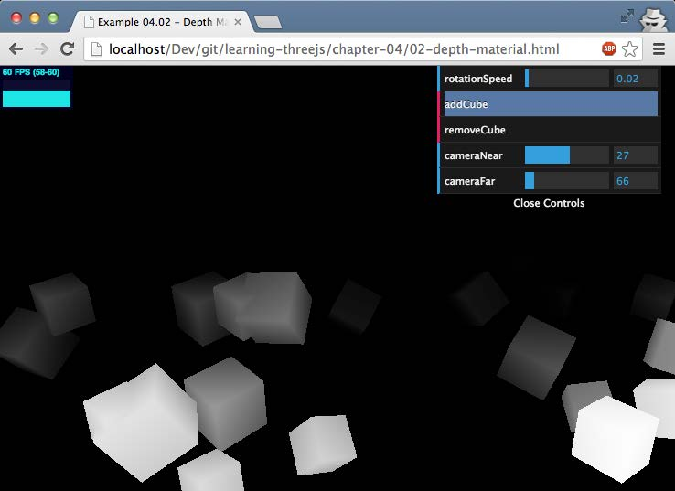

创建 THREE.MeshDepthMaterial 非常容易，而且该对象不需要任何参数。在这个示例中，我们使用了 scene.overrideMaterial 属性，以确保场景中的所有对象都使用此材质，而不必为每个 THREE.Mesh 对象显式指定：

```javascript
var scene = new THREE.Scene();
scene.overrideMaterial = new THREE.MeshDepthMaterial();
```

<!-- pdf-page: 127 -->
使用 Three.js 材质

本章的下一部分并不真正针对某种特定材质，而是展示一种将多种材质组合在一起的方法。

### 组合材质

如果回顾 THREE.MeshDepthMaterial 的属性，可以看到没有设置立方体颜色的选项。一切都由材质的默认属性决定。不过，Three.js 提供了将材质组合在一起以创建新效果的选项（混合也是在这里发挥作用）。以下代码展示了我们如何将材质组合在一起：

```javascript
var cubeMaterial = new THREE.MeshDepthMaterial();
var colorMaterial = new THREE.MeshBasicMaterial({color: 0x00ff00,
  transparent: true, blending: THREE.MultiplyBlending})
var cube = new THREE.SceneUtils.createMultiMaterialObject
  (cubeGeometry, [colorMaterial, cubeMaterial]);
cube.children[1].scale.set(0.99, 0.99, 0.99);
```

我们得到了以下绿色的立方体，它们使用 THREE.MeshDepthMaterial 的亮度和 THREE.MeshBasicMaterial 的颜色（打开 03-combined-material.html 查看此示例）。下面的屏幕截图展示了该示例：

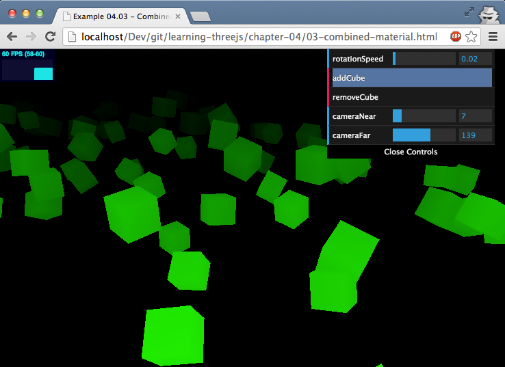

<!-- pdf-page: 128 -->
让我们看看获得这一特定结果需要执行的步骤。

首先，需要创建两种材质。对于 THREE.MeshDepthMaterial，我们不做任何特殊处理；但对于 THREE.MeshBasicMaterial，我们将 transparent 设为 true 并定义一种混合模式。如果不将 transparent 属性设为 true，就只会得到实心的绿色物体，因为 Three.js 不知道要考虑已经渲染的颜色。将 transparent 设为 true 后，Three.js 会检查 blending 属性，以确定绿色的 THREE.MeshBasicMaterial 对象应如何与背景相互作用。在这个示例中，背景就是使用 THREE.MeshDepthMaterial 渲染的立方体。在第 9 章“动画与移动相机”中，我们将更详细地讨论各种可用的混合模式。

不过，此示例使用了 THREE.MultiplyBlending。这种混合模式将前景色与背景色相乘，从而得到所需的效果。此代码片段的最后一行也很重要。使用 THREE.SceneUtils.createMultiMaterialObject() 函数创建网格时，几何体会被复制，并在一个组中返回两个完全相同的网格。如果渲染时去掉最后一行，你应该会看到闪烁效果。当对象彼此重叠渲染且其中一个透明时，有时就会发生这种情况。通过缩小使用 THREE.MeshDepthMaterial 创建的网格，可以避免这种情况。为此，请使用以下代码：

```text
cube.children[1].scale.set(0.99, 0.99, 0.99);
```

下一种材质同样无法让我们影响渲染时使用的颜色。

<!-- pdf-page: 129 -->
使用 Three.js 材质

### THREE.MeshNormalMaterial

理解此材质渲染方式最简单的方法，是先查看一个示例。打开 chapter-04 文件夹中的 04-mesh-normal-material.html 示例。如果选择球体作为网格，就会看到类似下面的效果：

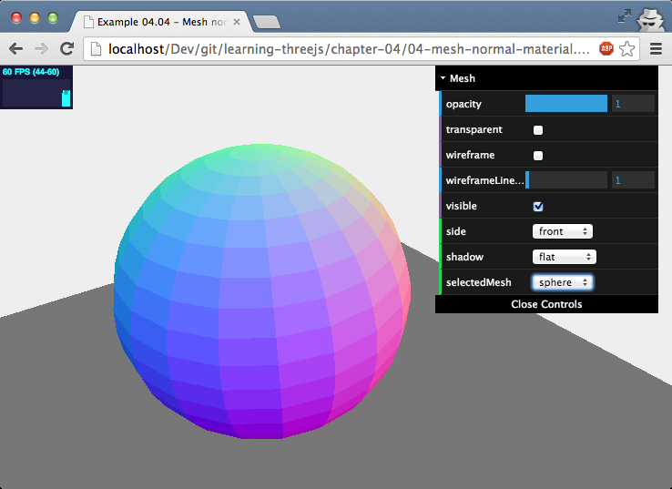

可以看到，网格的每个面都以略微不同的颜色渲染，即使球体旋转，颜色也基本停留在相同的位置。这是因为每个面的颜色都基于从该面向外指的法线。这条法线就是垂直于该面的向量。法向量（Normal Vector）在 Three.js 的许多不同部分都会用到。它用于确定光的反射，帮助将纹理映射到 3D 模型，并提供有关如何对表面上的像素进行光照、着色和上色的信息。不过幸运的是，Three.js 会处理这些向量的计算并在内部使用它们，因此你不必自己计算。下面的屏幕截图展示了 THREE.SphereGeometry 的所有法向量：

<!-- pdf-page: 130 -->
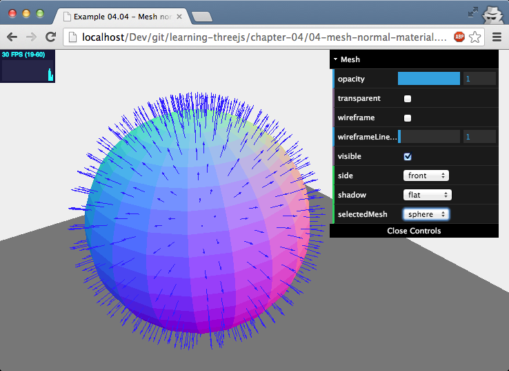

使用 THREE.MeshNormalMaterial 时，这条法线指向的方向决定了一个面所获得的颜色。由于球体各个面的所有法线都指向不同方向，我们便得到了示例中可见的彩色球体。顺便简单说明一下，要添加这些法线箭头，可以像这样使用 THREE.ArrowHelper：

```javascript
for (var f = 0, fl = sphere.geometry.faces.length; f < fl; f++) {
  var face = sphere.geometry.faces[ f ];
  var centroid = new THREE.Vector3(0, 0, 0);
  centroid.add(sphere.geometry.vertices[face.a]);
  centroid.add(sphere.geometry.vertices[face.b]);
  centroid.add(sphere.geometry.vertices[face.c]);
  centroid.divideScalar(3);
```

```javascript
  var arrow = new THREE.ArrowHelper(face.normal, centroid, 2,
    0x3333FF, 0.5, 0.5);
  sphere.add(arrow);
}
```

<!-- pdf-page: 131 -->
使用 Three.js 材质

在这个代码片段中，我们遍历 THREE.SphereGeometry 的所有面。对于每个 THREE.Face3 对象，通过将构成此面的顶点相加并将结果除以 3，计算出中心（质心）。我们使用这个质心和该面的法向量来绘制箭头。THREE.ArrowHelper 接受以下参数：direction、origin、length、color、headLength 和 headWidth。

THREE.MeshNormalMaterial 上还可以设置另外几个属性：

| 名称 | 描述 |
| --- | --- |
| wireframe | 这确定是否显示线框。 |
| wireframeLinewidth | 这确定线框的宽度。 |
| shading | 这配置着色方式，其中 THREE.FlatShading 表示平面着色（Flat Shading），THREE.SmoothShading 表示平滑着色（Smooth Shading）。 |

我们已经见过 wireframe 和 wireframeLinewidth，但在 THREE.MeshBasicMaterial 示例中跳过了 shading 属性。使用 shading 属性，可以告诉 Three.js 如何渲染对象。如果使用 THREE.FlatShading，每个面都会按原样渲染（如前面几张屏幕截图所示）；或者使用 THREE.SmoothShading，让对象的面变得平滑。例如，如果使用 THREE.SmoothShading 渲染球体，结果如下所示：

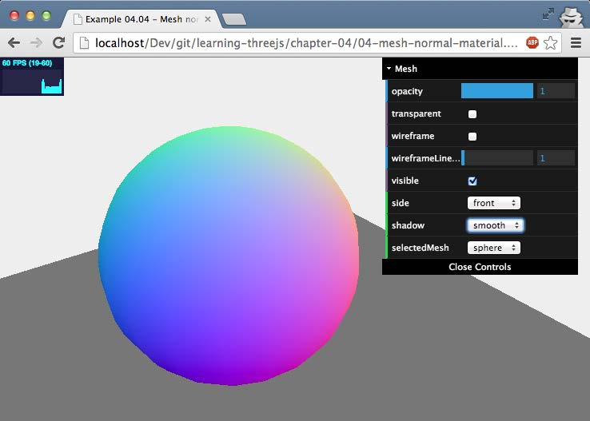

<!-- pdf-page: 132 -->
我们即将介绍完简单的材质。最后一种是 THREE.MeshFaceMaterial。

### THREE.MeshFaceMaterial

最后一种基础材质实际上并不是材质，而更像是其他材质的容器。THREE.MeshFaceMaterial 允许你为几何体的每个面分配不同的材质。例如，如果有一个具有 12 个面的立方体（请记住，Three.js 只处理三角形），可以使用此材质为立方体的每一侧分配不同的材质（例如不同颜色）。使用此材质非常简单，从下面这段代码就可以看出：

```javascript
var matArray = [];
matArray.push(new THREE.MeshBasicMaterial( { color: 0x009e60 }));
matArray.push(new THREE.MeshBasicMaterial( { color: 0x009e60 }));
matArray.push(new THREE.MeshBasicMaterial( { color: 0x0051ba }));
matArray.push(new THREE.MeshBasicMaterial( { color: 0x0051ba }));
matArray.push(new THREE.MeshBasicMaterial( { color: 0xffd500 }));
matArray.push(new THREE.MeshBasicMaterial( { color: 0xffd500 }));
matArray.push(new THREE.MeshBasicMaterial( { color: 0xff5800 }));
matArray.push(new THREE.MeshBasicMaterial( { color: 0xff5800 }));
matArray.push(new THREE.MeshBasicMaterial( { color: 0xC41E3A }));
matArray.push(new THREE.MeshBasicMaterial( { color: 0xC41E3A }));
matArray.push(new THREE.MeshBasicMaterial( { color: 0xffffff }));
matArray.push(new THREE.MeshBasicMaterial( { color: 0xffffff }));
```

```javascript
var faceMaterial = new THREE.MeshFaceMaterial(matArray);
```

```javascript
var cubeGeom = new THREE.BoxGeometry(3,3,3);
var cube = new THREE.Mesh(cubeGeom, faceMaterial);
```

<!-- pdf-page: 133 -->
使用 Three.js 材质

我们首先创建一个名为 matArray 的数组来保存所有材质。接下来，为每个面创建一种不同颜色的新材质，本例中为 THREE.MeshBasicMaterial。使用这个数组实例化 THREE.MeshFaceMaterial，并将它与立方体几何体一起用于创建网格。让我们更深入地研究代码，看看要重现下面的示例需要做什么：一个简单的 3D 魔方。可以在 05-mesh-face-material.html 中找到此示例。下面的屏幕截图展示了该示例：

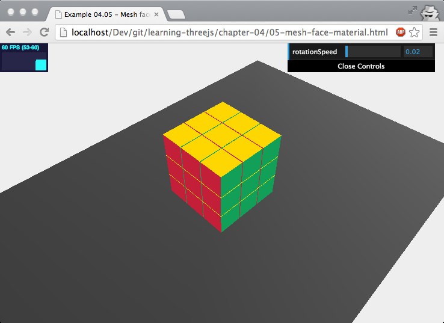

这个魔方由许多较小的立方体组成：沿 x 轴有三个立方体，沿 y 轴有三个，沿 z 轴也有三个。其实现方式如下：

```javascript
var group = new THREE.Mesh();
// add all the rubik cube elements
var mats = [];
mats.push(new THREE.MeshBasicMaterial({ color: 0x009e60 }));
mats.push(new THREE.MeshBasicMaterial({ color: 0x009e60 }));
mats.push(new THREE.MeshBasicMaterial({ color: 0x0051ba }));
mats.push(new THREE.MeshBasicMaterial({ color: 0x0051ba }));
mats.push(new THREE.MeshBasicMaterial({ color: 0xffd500 }));
mats.push(new THREE.MeshBasicMaterial({ color: 0xffd500 }));
```

<!-- pdf-page: 134 -->
```javascript
mats.push(new THREE.MeshBasicMaterial({ color: 0xff5800 }));
mats.push(new THREE.MeshBasicMaterial({ color: 0xff5800 }));
mats.push(new THREE.MeshBasicMaterial({ color: 0xC41E3A }));
mats.push(new THREE.MeshBasicMaterial({ color: 0xC41E3A }));
mats.push(new THREE.MeshBasicMaterial({ color: 0xffffff }));
mats.push(new THREE.MeshBasicMaterial({ color: 0xffffff }));
```

```javascript
var faceMaterial = new THREE.MeshFaceMaterial(mats);
```

```javascript
for (var x = 0; x < 3; x++) {
  for (var y = 0; y < 3; y++) {
    for (var z = 0; z < 3; z++) {
      var cubeGeom = new THREE.BoxGeometry(2.9, 2.9, 2.9);
      var cube = new THREE.Mesh(cubeGeom, faceMaterial);
      cube.position.set(x * 3 - 3, y * 3, z * 3 - 3);
```

```text
      group.add(cube);
    }
  }
}
```

在这段代码中，我们首先创建 THREE.Mesh 来保存所有单独的立方体（group）；接着，为每个面创建材质并将它们推入 mats 数组。请记住，立方体的每一侧由两个面组成，因此需要 12 种材质。使用这些材质创建 THREE.MeshFaceMaterial。然后，我们创建三个循环，以确保创建正确数量的立方体。在循环中，创建每个单独的立方体，分配材质，设置位置，并将它们添加到组中。你应当记住，立方体的位置相对于此组的位置。如果移动或旋转组，所有立方体都会随之移动和旋转。有关如何使用组的更多信息，请参见第 8 章“创建和加载高级网格与几何体”。

如果已经在浏览器中打开示例，可以看到整个魔方在旋转，而不是单独的立方体在旋转。这是因为我们在渲染循环中使用了以下代码：

```text
group.rotation.y=step+=0.01;
```

这会使整个组围绕其中心 (0,0,0) 旋转。在定位各个立方体时，我们确保它们围绕这个中心点放置。这就是为什么在前面代码的 cube.position.set(x \* 3 - 3, y \* 3, z \* 3 - 3); 一行中，你会看到 -3 的偏移量。

<!-- pdf-page: 135 -->
使用 Three.js 材质

如果查看这段代码，你可能会想知道 Three.js 如何确定特定面应使用哪种材质。为此，Three.js 使用 materialIndex 属性，你可以在 geometry.faces 数组的每个单独面上设置此属性。该属性指向我们在 THREE.MeshFaceMaterial 对象的构造函数中添加的材质数组索引。当使用一种标准 Three.js 几何体创建几何时，Three.js 会提供合理的默认值。如果想要其他行为，只需自行设置每个面的 materialIndex 属性，使其指向所提供的材质之一即可。

THREE.MeshFaceMaterial 是我们最后一种基础材质。在下一节中，我们将介绍 Three.js 提供的一些更高级的材质。

## 高级材质

在本节中，我们将介绍 Three.js 提供的更高级材质。首先介绍 THREE.MeshPhongMaterial 和 THREE.MeshLambertMaterial。这两种材质会对光源作出反应，分别可用于创建有光泽和暗淡无光泽的材质。在本节中，我们还会介绍一种功能最丰富但也最难使用的材质：THREE.ShaderMaterial。使用 THREE.ShaderMaterial，可以创建自己的着色器程序，定义材质和对象的显示方式。

### THREE.MeshLambertMaterial

此材质可用于创建看起来暗淡、无光泽的表面。这是一种非常易于使用的材质，会响应场景中的光源。此材质可以通过我们之前见过的许多属性进行配置：color、opacity、shading、blending、depthTest、depthWrite、wireframe、wireframeLinewidth、wireframeLinecap、wireframeLinejoin、vertexColors 和 fog。我们不会深入介绍这些属性的细节，而将重点放在此材质特有的属性上。这样只剩下以下四个属性：

| 名称 | 描述 |
| --- | --- |
| ambient | 这是材质的环境色（Ambient Color）。它与上一章介绍的环境光共同作用。此颜色与环境光提供的颜色相乘。默认为白色。 |
| emissive | 这是此材质的自发光颜色（Emissive Color）。它并不真正充当光源，而是一种不受其他光照影响的纯色。默认为黑色。 |

<!-- pdf-page: 136 -->
| 名称 | 描述 |
| --- | --- |
| wrapAround | 如果此属性设为 true，就会启用半兰伯特（Half-Lambert）光照技术。使用半兰伯特光照时，光的衰减更加柔和。如果网格存在生硬、昏暗的区域，启用此属性将柔化阴影，并更均匀地分布光线。 |
| wrapRGB | 当 wrapAround 设为 true 时，可以使用 THREE.Vector3 控制光衰减的速度。 |

此材质的创建方式与所有其他材质相同。具体做法如下：

```javascript
var meshMaterial = new THREE.MeshLambertMaterial({color:
  0x7777ff});
```

有关此材质的示例，请查看 06-mesh-lambert-material.html。下面的屏幕截图展示了该示例：

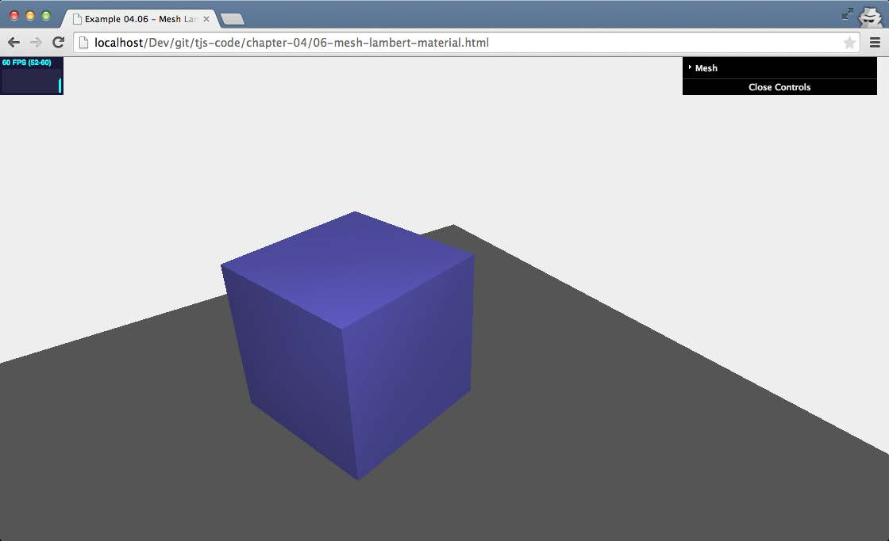

如前面的屏幕截图所示，此材质看起来相当暗淡。还有另一种材质可用于创建有光泽的表面。

<!-- pdf-page: 137 -->
使用 Three.js 材质

### THREE.MeshPhongMaterial

使用 THREE.MeshPhongMaterial，可以创建有光泽的材质。可用来实现这一点的属性与无光泽的 THREE.MeshLambertMaterial 对象几乎相同。我们将再次跳过基本属性和已经讨论过的属性：color、opacity、shading、blending、depthTest、depthWrite、wireframe、wireframeLinewidth、wireframeLinecap、wireframeLinejoin 和 vertexColors。

此材质值得关注的属性如下表所示：

| 名称 | 描述 |
| --- | --- |
| ambient | 这是材质的环境色。它与上一章介绍的环境光共同作用。此颜色与环境光提供的颜色相乘。默认为白色。 |
| emissive | 这是此材质的自发光颜色。它并不真正充当光源，而是一种不受其他光照影响的纯色。默认为黑色。 |
| specular | 此属性定义材质的光泽程度以及镜面反射颜色（Specular Color）。如果设为与 color 属性相同的颜色，就会得到看起来更具金属质感的材质。如果设为灰色，则会得到看起来更像塑料的材质。 |
| shininess | 此属性定义镜面高光（Specular Highlight）的光泽程度。shininess 的默认值为 30。 |
| metal | 当此属性设为 true 时，Three.js 会使用一种略微不同的像素颜色计算方式，使对象看起来更像金属。请注意，此效果非常轻微。 |
| wrapAround | 如果此属性设为 true，就会启用半兰伯特光照技术。使用半兰伯特光照时，光的衰减更加柔和。如果网格存在生硬、昏暗的区域，启用此属性将柔化阴影，并更均匀地分布光线。 |
| wrapRGB | 当 wrapAround 设为 true 时，可以使用 THREE.Vector3 控制光衰减的速度。 |

THREE.MeshPhongMaterial 对象的初始化方式与我们此前看到的所有其他材质相同，如下面的代码行所示：

```javascript
var meshMaterial = new THREE.MeshPhongMaterial({color: 0x7777ff});
```

<!-- pdf-page: 138 -->
为了便于你进行最直观的比较，我们为此材质创建了与 THREE.MeshLambertMaterial 相同的示例。可以使用控制 GUI 试验此材质。例如，以下设置会创建一种看起来像塑料的材质。可以在 07-mesh-phong-material.html 中找到此示例。下面的屏幕截图展示了该示例：

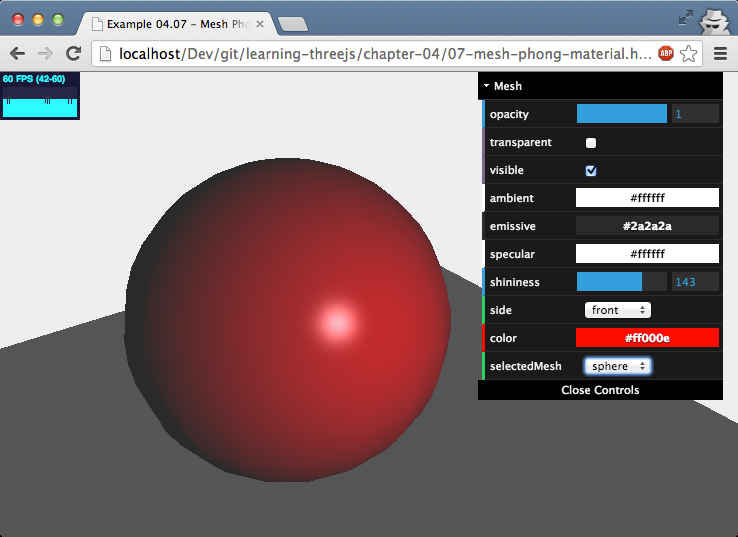

我们将探讨的最后一种高级材质是 THREE.ShaderMaterial。

### 使用 THREE.ShaderMaterial 创建自己的着色器

THREE.ShaderMaterial 是 Three.js 中功能最丰富也最复杂的材质之一。使用此材质，可以传入直接在 WebGL 上下文中运行的自定义着色器。着色器将 Three.js JavaScript 网格转换为屏幕上的像素。使用这些自定义着色器，可以精确定义对象的渲染方式，以及如何覆盖或更改 Three.js 的默认行为。在本节中，我们暂不深入介绍如何编写自定义着色器。更多信息请参见第 11 章“自定义着色器与渲染后期处理”。目前，我们只介绍一个非常基础的示例，展示如何配置此材质。

<!-- pdf-page: 139 -->
使用 Three.js 材质

THREE.ShaderMaterial 有许多我们已经见过的可设置属性。对于 THREE.ShaderMaterial，Three.js 会传入与这些属性有关的所有信息，但你仍必须在自己的着色器程序中处理这些信息。以下是我们已经见过的 THREE.ShaderMaterial 属性：

| 名称 | 描述 |
| --- | --- |
| wireframe | 这将材质渲染为线框。这非常适用于调试。 |
| wireframeLinewidth | 如果启用线框，此属性定义线框中线条的宽度。 |
| linewidth | 这定义要绘制线条的宽度。 |
| shading | 这定义如何应用着色。可能的值为 THREE.SmoothShading 和 THREE.FlatShading。此材质的示例中未启用此属性。示例请参见关于 MeshNormalMaterial 的一节。 |
| vertexColors | 使用此属性，可以定义应用到每个顶点的单独颜色。此属性在 CanvasRenderer 上不起作用，但在 WebGLRenderer 上有效。请查看 LineBasicMaterial 示例，其中我们使用此属性为线条的各个部分着色。 |
| fog | 这决定此材质是否受全局雾效设置影响。这里没有展示其实际效果。如果设为 false，第 2 章“构成 Three.js 场景的基本组件”中介绍的全局雾效就不会影响此对象的渲染方式。 |

除了这些传入着色器的属性外，THREE.ShaderMaterial 还提供了许多特定属性，可用于向自定义着色器传入额外信息（目前它们可能看起来有些晦涩；更多细节请参见第 11 章“自定义着色器与渲染后期处理”），如下所示：

| 名称 | 描述 |
| --- | --- |
| fragmentShader | 此着色器定义传入的每个像素的颜色。这里需要传入片元着色器（Fragment Shader）程序的字符串值。 |
| vertexShader | 此着色器允许你更改传入的每个顶点的位置。这里需要传入顶点着色器（Vertex Shader）程序的字符串值。 |
| uniforms | 此属性允许你向着色器发送信息。相同的信息会发送给每个顶点和片元（Fragment）。 |

<!-- pdf-page: 140 -->
| 名称 | 描述 |
| --- | --- |
| defines | 转换为 #define 代码片段。使用这些片段，可以在着色器程序中设置一些额外的全局变量。 |
| attributes | 它们可以为每个顶点指定不同的值，通常用于传递位置和法线相关数据。如果要使用此属性，需要为几何体的所有顶点提供信息。 |
| lights | 这确定是否应将光源数据传入着色器。默认为 false。 |

在查看示例之前，我们先简要解释 ShaderMaterial 最重要的部分。要使用此材质，必须传入两种不同的着色器：

- vertexShader：它在几何体的每个顶点上运行。可以使用此着色器通过移动顶点的位置来变换几何体。

- fragmentShader：它在几何体的每个片元上运行。在 fragmentShader 中，我们返回此特定片元应显示的颜色。

对于本章到目前为止讨论的所有材质，Three.js 都提供了 fragmentShader 和 vertexShader，因此你不必担心它们。


在本节中，我们将介绍一个简单的示例，它使用非常简单的 vertexShader 程序来更改立方体顶点的 x、y 和 z 坐标，并使用一个 fragmentShader 程序，利用来自 http://glslsandbox.com/ 的着色器创建动画材质。

接下来，你可以看到我们将使用的 vertexShader 的完整代码。请注意，编写着色器使用的不是 JavaScript，而是一种称为 GLSL 的类 C 语言。WebGL 支持 OpenGL ES 着色语言（OpenGL ES Shading Language）1.0；有关 GLSL 的更多信息，请参见 https://www.khronos.org/webgl/。代码如下所示：

```html
<script id="vertex-shader" type="x-shader/x-vertex">
  uniform float time;
```

```glsl
  void main()
  {
    vec3 posChanged = position;
    posChanged.x = posChanged.x*(abs(sin(time*1.0)));
    posChanged.y = posChanged.y*(abs(cos(time*1.0)));
```

<!-- pdf-page: 141 -->
使用 Three.js 材质

```text
    posChanged.z = posChanged.z*(abs(sin(time*1.0)));
```

```text
    gl_Position = projectionMatrix * modelViewMatrix *
      vec4(posChanged,1.0);
  }
</script>
```

这里不会深入介绍太多细节，只关注此代码最重要的部分。为了实现 JavaScript 与着色器之间的通信，我们使用一种称为统一变量（Uniform）的机制。在这个示例中，我们使用 uniform float time; 语句传入一个外部值。根据此值，我们更改传入顶点的 x、y 和 z 坐标（该顶点作为 position 变量传入）：

```text
vec3 posChanged = position;
posChanged.x = posChanged.x*(abs(sin(time*1.0)));
posChanged.y = posChanged.y*(abs(cos(time*1.0)));
posChanged.z = posChanged.z*(abs(sin(time*1.0)));
```

现在，posChanged 向量根据传入的 time 变量包含了此顶点的新坐标。我们需要执行的最后一步是将此新位置传回 Three.js，始终按以下方式完成：

```text
gl_Position = projectionMatrix * modelViewMatrix *
  vec4(posChanged,1.0);
```

gl\_Position 变量是一个特殊变量，用于返回最终位置。接下来，需要创建 shaderMaterial 并传入 vertexShader。为此，我们创建了一个简单的辅助函数，下面代码中的 var meshMaterial1 = createMaterial("vertex-shader","fragment-shader-1"); 展示了它的使用方式：

```javascript
function createMaterial(vertexShader, fragmentShader) {
  var vertShader = document.getElementById
    (vertexShader).innerHTML;
  var fragShader = document.getElementById
    (fragmentShader).innerHTML;
```

```javascript
  var attributes = {};
  var uniforms = {
    time: {type: 'f', value: 0.2},
    scale: {type: 'f', value: 0.2},
    alpha: {type: 'f', value: 0.6},
    resolution: { type: "v2", value: new THREE.Vector2() }
  };
```

<!-- pdf-page: 142 -->
```text
  uniforms.resolution.value.x = window.innerWidth;
  uniforms.resolution.value.y = window.innerHeight;
```

```javascript
  var meshMaterial = new THREE.ShaderMaterial({
    uniforms: uniforms,
    attributes: attributes,
    vertexShader: vertShader,
    fragmentShader: fragShader,
    transparent: true
```

```text
  });
  return meshMaterial;
}
```

这些参数指向 HTML 页面中 script 元素的 ID。在这里还可以看到，我们设置了一个 uniforms 变量。此变量用于将信息从渲染器传递到着色器中。此示例的完整渲染循环如下面的代码片段所示：

```javascript
function render() {
  stats.update();
```

```text
  cube.rotation.y = step += 0.01;
  cube.rotation.x = step;
  cube.rotation.z = step;
```

```javascript
  cube.material.materials.forEach(function (e) {
    e.uniforms.time.value += 0.01;
  });
```

```text
  // render using requestAnimationFrame
  requestAnimationFrame(render);
  renderer.render(scene, camera);
}
```

<!-- pdf-page: 143 -->
使用 Three.js 材质

可以看到，渲染循环每次运行时，我们都会将 time 变量增加 0.01。此信息被传入 vertexShader，并用于计算立方体顶点的新位置。现在打开 08-shader-material.html 示例，你会看到立方体围绕其轴收缩和增长。下面的屏幕截图提供了此示例的静态图像：

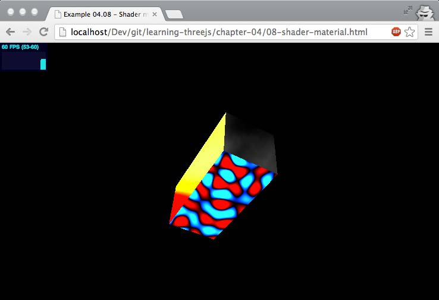

在这个示例中，可以看到立方体的每个面都有动画图案。分配给立方体每个面的片元着色器创建了这些图案。你可能已经猜到，我们为此使用了 THREE.MeshFaceMaterial（以及前面解释的 createMaterial 函数）：

```javascript
var cubeGeometry = new THREE.CubeGeometry(20, 20, 20);
```

```javascript
var meshMaterial1 = createMaterial("vertex-shader", "fragment-
  shader-1");
var meshMaterial2 = createMaterial("vertex-shader", "fragment-
  shader-2");
var meshMaterial3 = createMaterial("vertex-shader", "fragment-
  shader-3");
var meshMaterial4 = createMaterial("vertex-shader", "fragment-
  shader-4");
var meshMaterial5 = createMaterial("vertex-shader", "fragment-
  shader-5");
var meshMaterial6 = createMaterial("vertex-shader", "fragment-
  shader-6");
```

<!-- pdf-page: 144 -->
```javascript
var material = new THREE.MeshFaceMaterial([meshMaterial1,
  meshMaterial2, meshMaterial3, meshMaterial4, meshMaterial5,
  meshMaterial6]);
```

```javascript
var cube = new THREE.Mesh(cubeGeometry, material);
```

唯一尚未解释的部分是 fragmentShader。对于此示例，所有 fragmentShader 对象均复制自 http://glslsandbox.com/。此网站提供了一个试验场地，你可以在其中编写和分享 fragmentShader 对象。这里不会深入介绍细节，但此示例中使用的 fragment-shader-6 如下所示：

```html
<script id="fragment-shader-6" type="x-shader/x-fragment">
  #ifdef GL_ES
  precision mediump float;
  #endif
```

```glsl
  uniform float time;
  uniform vec2 resolution;
```

```glsl
  void main( void )
  {
```

```text
    vec2 uPos = ( gl_FragCoord.xy / resolution.xy );
```

```text
    uPos.x -= 1.0;
    uPos.y -= 0.5;
```

```text
    vec3 color = vec3(0.0);
    float vertColor = 2.0;
    for( float i = 0.0; i < 15.0; ++i ) {
      float t = time * (0.9);
```

```text
      uPos.y += sin( uPos.x*i + t+i/2.0 ) * 0.1;
      float fTemp = abs(1.0 / uPos.y / 100.0);
      vertColor += fTemp;
      color += vec3( fTemp*(10.0-i)/10.0, fTemp*i/10.0,
        pow(fTemp,1.5)*1.5 );
    }
```

```text
    vec4 color_final = vec4(color, 1.0);
    gl_FragColor = color_final;
  }
</script>
```

<!-- pdf-page: 145 -->
使用 Three.js 材质

最终传回 Three.js 的颜色是通过 gl\_FragColor = color\_final 设置的颜色。要进一步体会 fragmentShader，一个好方法是探索 http://glslsandbox.com/ 上提供的内容，并将代码用于自己的对象。在继续介绍下一组材质之前，这里再举一个自定义 vertexShader 程序可以实现的效果示例（https://www.shadertoy. com/view/4dXGR4）：

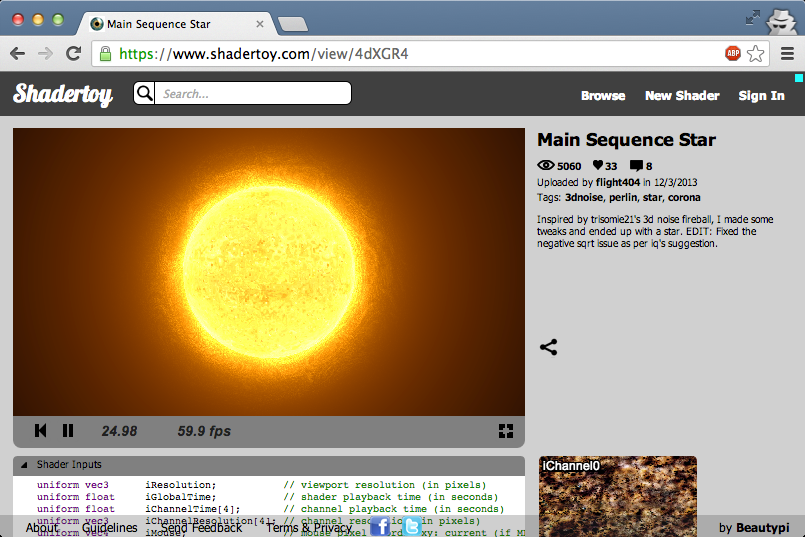

有关片元着色器和顶点着色器的更多内容，请参见第 11 章“自定义着色器与渲染后期处理”。

## 可用于线条几何体的材质

我们要介绍的最后几种材质只能用于一种特定几何体：THREE.Line。顾名思义，它只是一条仅由顶点组成且不包含任何面的线。Three.js 提供了两种可用于线条的不同材质，如下所示：

- THREE.LineBasicMaterial：线条的基础材质，允许你设置 color、linewidth、linecap 和 linejoin 属性

- THREE.LineDashedMaterial：它具有与 THREE.LineBasicMaterial 相同的属性，但允许通过指定虚线段和间隙的大小来创建虚线效果

<!-- pdf-page: 146 -->
我们将从基础版本开始，然后再介绍虚线版本。

### THREE.LineBasicMaterial

可用于 THREE.Line 几何体的材质非常简单。下表展示了此材质可用的属性：

| 名称 | 描述 |
| --- | --- |
| color | 这决定线条的颜色。如果指定 vertexColors，此属性将被忽略。 |
| linewidth | 这决定线条的宽度。 |
| linecap | 此属性定义线框模式下线条末端的外观。可能的值为 butt、round 和 square。默认值为 round。在实践中，更改此属性的效果很难看出。WebGLRenderer 不支持此属性。 |
| linejoin | 定义线条连接处的显示方式。可能的值为 round、bevel 和 miter。默认值为 round。如果仔细观察，可以在示例中使用较低的 opacity 和非常大的 wireframeLinewidth 看到这一点。WebGLRenderer 不支持此属性。 |
| vertexColors | 通过将此属性设为 THREE.VertexColors 值，可以为每个顶点提供特定颜色。 |
| fog | 这确定此对象是否受全局 fog 属性影响。 |

在查看 LineBasicMaterial 的示例之前，我们先快速看看如何通过一组顶点创建 THREE.Line 网格，以及如何将其与 LineMaterial 组合来创建网格，如下面的代码所示：

```javascript
var points = gosper(4, 60);
var lines = new THREE.Geometry();
var colors = [];
var i = 0;
points.forEach(function (e) {
  lines.vertices.push(new THREE.Vector3(e.x, e.z, e.y));
  colors[ i ] = new THREE.Color(0xffffff);
  colors[ i ].setHSL(e.x / 100 + 0.5, (  e.y * 20 ) / 300, 0.8);
  i++;
});
```

```javascript
lines.colors = colors;
var material = new THREE.LineBasicMaterial({
  opacity: 1.0,
```

<!-- pdf-page: 147 -->
使用 Three.js 材质

```javascript
  linewidth: 1,
  vertexColors: THREE.VertexColors });
```

```javascript
var line = new THREE.Line(lines, material);
```

此代码片段的第一部分 var points = gosper(4, 60); 用作获取一组 x 和 y 坐标的示例。此函数返回一条戈斯珀曲线（Gosper Curve，更多信息请查看 http://en.wikipedia.org/wiki/Gosper\_curve），这是一种填充 2D 空间的简单算法。接下来，我们创建一个 THREE.Geometry 实例，并为每个坐标创建一个新顶点，将其推入此实例的 vertices 数组。对于每个坐标，我们还计算一个颜色值，用于设置 colors 属性。

在这个示例中，我们使用 setHSL() 方法设置颜色。使用 HSL 时，不提供红色、绿色和蓝色值，而是提供色相、饱和度和明度。使用 HSL 比使用 RGB 更直观，也更容易创建相互匹配的颜色集。CSS 规范中对 HSL 有非常好的解释：http://www. w3.org/TR/2003/CR-css3-color-20030514/#hsl-color。

现在有了几何体，就可以创建 THREE.LineBasicMaterial，并将它与几何体一起用于创建 THREE.Line 网格。可以在 09-line-material.html 示例中看到结果。下面的屏幕截图展示了该示例：

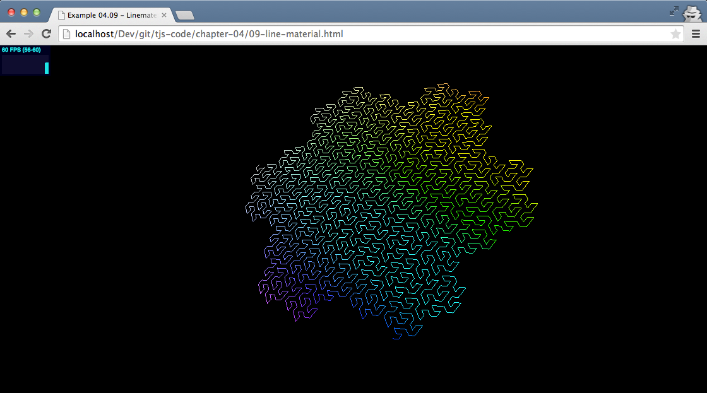

<!-- pdf-page: 148 -->
本章要讨论的下一种也是最后一种材质与 THREE.LineBasicMaterial 只有细微差别。使用 THREE.LineDashedMaterial，不仅可以为线条着色，还可以添加虚线效果。

### THREE.LineDashedMaterial

此材质具有与 THREE.LineBasicMaterial 相同的属性，另外还有两个属性，可用于定义虚线段的宽度和虚线段之间间隙的宽度，如下所示：

| 名称 | 描述 |
| --- | --- |
| scale | 这将缩放 dashSize 和 gapSize。如果 scale 小于 1，dashSize 和 gapSize 会增大；如果 scale 大于 1，dashSize 和 gapSize 会减小。 |
| dashSize | 这是虚线段的尺寸。 |
| gapSize | 这是间隙的尺寸。 |

此材质的工作方式与 THREE.LineBasicMaterial 几乎完全相同。其用法如下：

```javascript
lines.computeLineDistances();
var material = new THREE.LineDashedMaterial({ vertexColors: true,
  color: 0xffffff, dashSize: 10, gapSize: 1, scale: 0.1 });
```

唯一的区别是必须调用 computeLineDistances()（用于确定组成线条的顶点之间的距离）。如果不这样做，间隙将无法正确显示。此材质的示例可以在 10-line-material-dashed.html 中找到，效果如下面的屏幕截图所示：

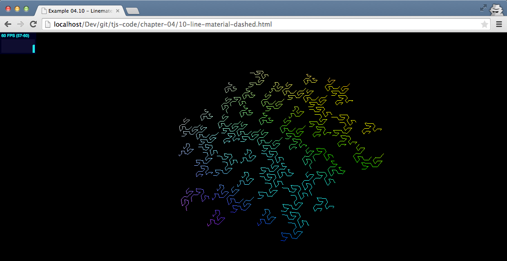

<!-- pdf-page: 149 -->
使用 Three.js 材质

## 总结

Three.js 提供了大量可用于为几何体添加外观的材质。这些材质从非常简单的（THREE.MeshBasicMaterial）到复杂的（THREE.ShaderMaterial）不等，对于后者，你可以提供自己的 vertexShader 和 fragmentShader 程序。材质共享许多基本属性。如果知道如何使用一种材质，很可能也会知道如何使用其他材质。请注意，并非所有材质都会响应场景中的光源。如果想要一种考虑光照的材质，请使用 THREE.MeshPhongMaterial 或 THREE.MeshLambertMaterial。仅从代码判断某些材质属性的效果非常困难。通常，使用 dat.GUI 方法来试验这些属性是个好主意。

另外，请记住，材质的大多数属性都可以在运行时修改。不过，有些属性（例如 side）无法在运行时修改。如果更改了这样的值，就需要将 needsUpdate 属性设为 true。有关哪些内容可以和不能在运行时更改的完整概述，请参见以下页面：https:// github.com/mrdoob/three.js/wiki/Updates。

在本章和前几章中，我们讨论了几何体。我们在示例中使用了几何体，并探讨了其中几种。在下一章中，你将学习有关几何体以及如何使用几何体的所有知识。

