# 第 5 章 · 学习使用几何体

<!-- pdf-page: 150 -->
## 学习使用

## 几何体

在前面的章节中，你已经学习了许多使用 Three.js 的知识。你知道如何创建基本场景、添加光照，以及为网格（Mesh）配置材质（Material）。在第 2 章“构成 Three.js 场景的基本组件”中，我们曾提及 Three.js 提供、可用于创建三维（3D）对象的各种几何体（Geometry），但没有真正深入介绍细节。在本章和下一章中，我们将带你逐一了解 Three.js 开箱即用的所有几何体（上一章讨论过的 THREE.Line 除外）。本章将介绍以下几何体：

```javascript
•
THREE.CircleGeometry
```

```javascript
•
THREE.RingGeometry
```

```javascript
•
THREE.PlaneGeometry
```

```javascript
•
THREE.ShapeGeometry
```

```javascript
•
THREE.BoxGeometry
```

```javascript
•
THREE.SphereGeometry
```

```javascript
•
THREE.CylinderGeometry
```

```javascript
•
THREE.TorusGeometry
```

```javascript
•
THREE.TorusKnotGeometry
```

```javascript
•
THREE.PolyhedronGeometry
```

```javascript
•
THREE.IcosahedronGeometry
```

```javascript
•
THREE.OctahedronGeometry
```

```javascript
•
THREE.TetraHedronGeometry
•
THREE.DodecahedronGeometry
```

<!-- pdf-page: 151 -->
学习使用几何体

下一章将介绍以下复杂几何体：

```javascript
•
THREE.ConvexGeometry
```

```javascript
•
THREE.LatheGeometry
```

```javascript
•
THREE.ExtrudeGeometry
```

```javascript
•
THREE.TubeGeometry
```

```javascript
•
THREE.ParametricGeometry
```

```javascript
•
THREE.TextGeometry
```

那么，让我们来看看 Three.js 提供的所有基本几何体。

## Three.js 提供的基本几何体

在 Three.js 中，有一些几何体可以生成二维网格，还有更多几何体可以创建三维网格。本节首先介绍二维（2D）几何体：THREE.CircleGeometry、THREE.RingGeometry、THREE.PlaneGeometry 和 THREE.ShapeGeometry。随后，我们将探索所有可用的基本三维几何体。

### 二维几何体

二维对象看起来是扁平的，顾名思义，它们只有两个维度。列表中的第一个二维几何体是 THREE.PlaneGeometry。

#### 平面几何体（THREE.PlaneGeometry）

PlaneGeometry 对象可用于创建非常简单的二维矩形。有关此几何体的示例，请查看本章源代码中的 01-basic-2d-geometriesplane.html 示例。以下截图显示了使用 PlaneGeometry 创建的矩形：

<!-- pdf-page: 152 -->
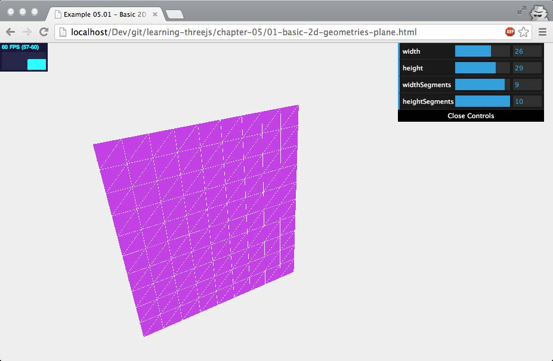

创建此几何体非常简单，如下所示：

```javascript
new THREE.PlaneGeometry(width, height,widthSegments,
  heightSegments);
```

在 THREE.PlaneGeometry 的这个示例中，你可以更改这些属性，并直接查看它们对最终三维对象的影响。下表解释了这些属性：

| 属性 | 是否必需 | 说明 |
| --- | --- | --- |
| width | 是 | 矩形的宽度。 |
| height | 是 | 矩形的高度。 |
| widthSegments | 否 | 宽度应划分成的段数。默认值为 1。 |
| heightSegments | 否 | 高度应划分成的段数。默认值为 1。 |

如你所见，这并不是一个非常复杂的几何体。你只需指定大小即可。如果想创建更多面（例如，想创建棋盘格图案），可以使用 widthSegments 和 heightSegments 属性将几何体划分为更小的面。

<!-- pdf-page: 153 -->
学习使用几何体

在继续介绍下一个几何体之前，先简要说明此示例使用的材质；本章的大多数其他示例也使用这种材质。我们使用以下方法基于几何体创建网格：

```javascript
function createMesh(geometry) {
```

```javascript
  // assign two materials
  var meshMaterial = new THREE.MeshNormalMaterial();
  meshMaterial.side = THREE.DoubleSide;
  var wireframeMaterial = new THREE.MeshBasicMaterial();
  wireFrameMaterial.wireframe = true;
```

```javascript
  // create a multimaterial
  var mesh = THREE.SceneUtils.createMultiMaterialObject(
    geometry,[meshMaterial,wireframeMaterial]);
  return mesh;
}
```

在此函数中，我们基于所提供的几何体创建了一个多材质网格。使用的第一种材质是 THREE.MeshNormalMaterial。正如你在上一章学到的，THREE.MeshNormalMaterial 根据法向量（面的朝向）创建彩色面。我们还将此材质设置为双面（THREE.DoubleSide）。如果不这样做，当对象背对相机时，我们就看不到它。除了 THREE.MeshNormalMaterial，我们还添加了 THREE.MeshBasicMaterial，并启用了它的 wireframe 属性。这样，我们就能清楚地看到对象的三维形状，以及为特定几何体创建的面。

如果想在几何体创建后访问它的属性，不能直接写 plane.width。要访问几何体的属性，必须使用对象的 parameters 属性。因此，要获取本节创建的平面对象的 width 属性，必须使用 plane.parameters.width。

#### 圆形几何体（THREE.CircleGeometry）

你大概已经能猜到 THREE.CircleGeometry 会创建什么。使用此几何体，可以创建非常简单的二维圆形（或圆的一部分）。先来看看此几何体的示例 02-basic-2d-geometries-circle.html。在下面的截图中，我们创建了一个 thetaLength 值小于 2 \* PI 的 THREE.CircleGeometry 示例：

<!-- pdf-page: 154 -->
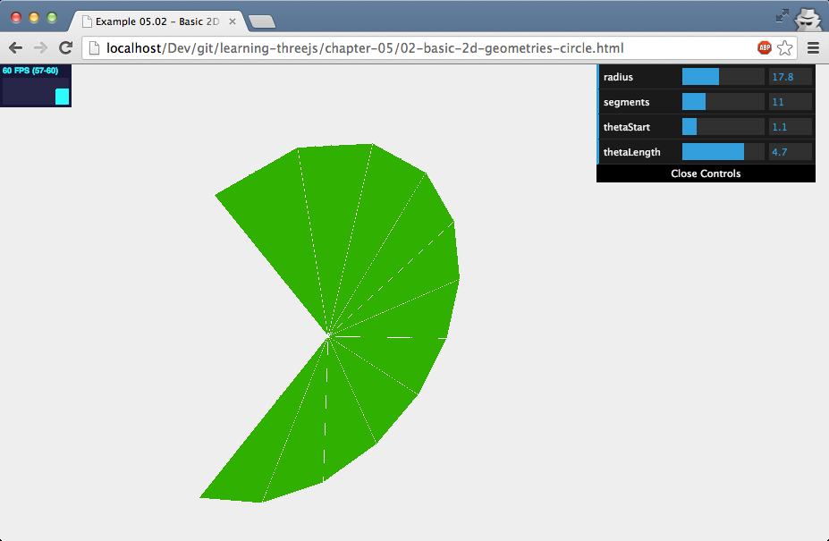

请注意，2 \* PI 以弧度表示一个完整的圆。如果更习惯使用角度而不是弧度，二者之间的转换非常简单。以下两个函数可以帮助你在弧度和角度之间转换：

```javascript
function deg2rad(degrees) {
  return degrees * Math.PI / 180;
}
```

```javascript
function rad2deg(radians) {
  return radians * 180 / Math.PI;
}
```

<!-- pdf-page: 155 -->
学习使用几何体

在此示例中，你可以查看并控制使用 THREE.CircleGeometry 创建的网格。创建 THREE.CircleGeometry 时，可以指定几个属性来定义圆形的外观，如下所示：

| 属性 | 是否必需 | 说明 |
| --- | --- | --- |
| radius | 否 | 圆的半径决定其大小。半径是从圆心到圆边的距离。默认值为 50。 |
| segments | 否 | 此属性定义用于创建圆的面数。最小值为 3；如果未指定，则默认为 8。值越大，圆越平滑。 |
| thetaStart | 否 | 此属性定义开始绘制圆的位置。此值的范围可以从 0 到 2 \* PI，默认值为 0。 |
| thetaLength | 否 | 此属性定义圆的完整程度。未指定时，默认值为 2 \* PI（一个完整的圆）。例如，如果将此值指定为 0.5 \* PI，就会得到四分之一圆。可将此属性与 thetaStart 属性结合使用，以定义圆的形状。 |

可以使用以下代码片段创建一个完整的圆：

```javascript
new THREE.CircleGeometry(3, 12);
```

如果想用此几何体创建半圆，可以这样写：

```javascript
new THREE.CircleGeometry(3, 12, 0, Math.PI);
```

在继续介绍下一个几何体之前，先简要说明 Three.js 创建这些二维形状（THREE.PlaneGeometry、THREE.CircleGeometry 和 THREE.ShapeGeometry）时采用的朝向：Three.js 创建的这些对象处于竖直状态，因此它们位于 x-y 平面上。这很合乎逻辑，因为它们是二维形状。不过，你常常希望网格平放在地面上（x-z 平面），尤其是使用 THREE.PlaneGeometry 时——它可以作为某种地面区域，用来放置其他对象。要创建水平而非竖直朝向的二维对象，最简单的方法是使网格绕其 x 轴向后旋转四分之一圈（-PI/2），如下所示：

```text
mesh.rotation.x =- Math.PI/2;
```

THREE.CircleGeometry 就介绍到这里。下一个几何体 THREE.RingGeometry 与 THREE.CircleGeometry 非常相似。

<!-- pdf-page: 156 -->
#### 环形几何体（THREE.RingGeometry）

使用 THREE.RingGeometry，不仅可以创建与 THREE.CircleGeometry 非常相似的二维对象，还可以在中心定义一个孔洞（参见 03-basic-3d-geometries-ring.html）：

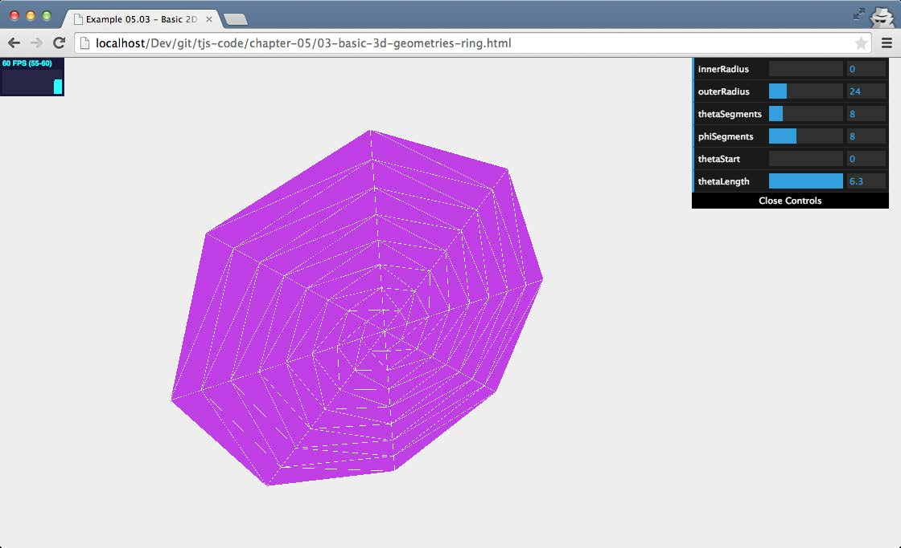

THREE.RingGeometry 没有任何必需属性（默认值参见下表），因此要创建此几何体，只需编写以下代码：

```javascript
Var ring = new THREE.RingGeometry();
```

通过向构造函数传入以下参数，可以进一步自定义环形几何体的外观：

| 属性 | 是否必需 | 说明 |
| --- | --- | --- |
| innerRadius | 否 | 圆的内半径定义中心孔洞的大小。如果此属性设置为 0，则不会显示孔洞。默认值为 0。 |
| outerRadius | 否 | 圆的外半径定义其大小。半径是从圆心到圆边的距离。默认值为 50。 |
| thetaSegments | 否 | 这是用于创建圆的对角线段数。值越大，圆环越平滑。默认值为 8。 |

<!-- pdf-page: 157 -->
学习使用几何体

| 属性 | 是否必需 | 说明 |
| --- | --- | --- |
| phiSegments | 否 | 这是沿圆环长度方向使用的段数。默认值为 8。它并不会真正影响圆的平滑度，但会增加面数。 |
| thetaStart | 否 | 这定义了开始绘制圆的位置。此值的范围可以从 0 到 2 \* PI，默认值为 0。 |
| thetaLength | 否 | 这定义了圆的完整程度。未指定时，默认值为 2 \* PI（一个完整的圆）。例如，如果将此值指定为 0.5 \* PI，就会得到四分之一圆。可将此属性与 thetaStart 属性结合使用，以定义圆的形状。 |

下一节将介绍最后一种二维形状：THREE.ShapeGeometry。

#### 形状几何体（THREE.ShapeGeometry）

THREE.PlaneGeometry 和 THREE.CircleGeometry 自定义外观的方式有限。如果想创建自定义二维形状，可以使用 THREE.ShapeGeometry。THREE.ShapeGeometry 提供了一些可调用的函数，用于创建自己的形状。可以将此功能与 HTML canvas 元素和 SVG 同样提供的 \<path\> 元素功能相比较。我们先看一个示例，然后再说明如何使用各种函数绘制自己的形状。04-basic-2d-geometries-shape.html 示例可以在本章源代码中找到。以下截图显示了此示例：

<!-- pdf-page: 158 -->
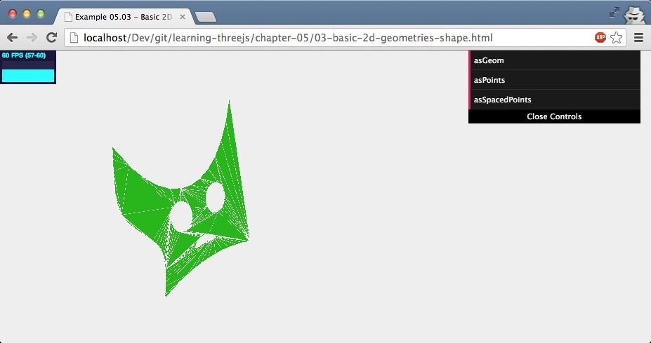

在此示例中，你可以看到一个自定义创建的二维形状。在介绍这些属性之前，先来看看用于创建此形状的代码。创建 THREE.ShapeGeometry 之前，必须先创建 THREE.Shape。你可以对照上一张截图，从右下角开始了解这些步骤。下面是创建 THREE.Shape 的方法：

```javascript
function drawShape() {
  // create a basic shape
  var shape = new THREE.Shape();
```

```text
  // startpoint
  shape.moveTo(10, 10);
```

```text
  // straight line upwards
  shape.lineTo(10, 40);
```

```text
  // the top of the figure, curve to the right
  shape.bezierCurveTo(15, 25, 25, 25, 30, 40);
```

```javascript
  // spline back down
  shape.splineThru(
    [new THREE.Vector2(32, 30),
      new THREE.Vector2(28, 20),
      new THREE.Vector2(30, 10),
    ])
```

<!-- pdf-page: 159 -->
学习使用几何体

```text
  // curve at the bottom
  shape.quadraticCurveTo(20, 15, 10, 10);
```

```javascript
  // add 'eye' hole one
  var hole1 = new THREE.Path();
  hole1.absellipse(16, 24, 2, 3, 0, Math.PI * 2, true);
  shape.holes.push(hole1);
```

```javascript
  // add 'eye hole 2'
  var hole2 = new THREE.Path();
  hole2.absellipse(23, 24, 2, 3, 0, Math.PI * 2, true);
  shape.holes.push(hole2);
```

```javascript
  // add 'mouth'
  var hole3 = new THREE.Path();
  hole3.absarc(20, 16, 2, 0, Math.PI, true);
  shape.holes.push(hole3);
```

```text
  // return the shape
  return shape;
}
```

在这段代码中，你可以看到我们使用直线、曲线和样条曲线创建了此形状的轮廓。随后，我们使用 THREE.Shape 的 holes 属性在此形状上打出了几个孔。不过，本节讨论的是 THREE.ShapeGeometry，而不是 THREE.Shape。要从 THREE.Shape 创建几何体，需要将 THREE.Shape（在本例中由 drawShape() 函数返回）作为参数传给 THREE.ShapeGeometry，如下所示：

```javascript
new THREE.ShapeGeometry(drawShape());
```

此函数返回的几何体可用于创建网格。如果已经有一个形状，还有另一种创建 THREE.ShapeGeometry 的方法。可以调用 shape.makeGeometry(options)，它将返回 THREE.ShapeGeometry 的实例（有关 options 的说明，请参见下表）。

首先来看看可以传给 THREE.ShapeGeometry 的参数：

| 属性 | 是否必需 | 说明 |
| --- | --- | --- |
| shapes | 是 | 这些是用于创建 THREE.Geometry 的一个或多个 THREE.Shape 对象。既可以传入单个 THREE.Shape 对象，也可以传入 THREE.Shape 对象数组。 |

<!-- pdf-page: 160 -->
| 属性 | 是否必需 | 说明 |
| --- | --- | --- |
| options | 否 | 还可以传入一些选项，它们会应用于通过 shapes 参数传入的所有形状。这些选项的说明如下： |

- curveSegments：此属性决定根据形状创建的曲线的平滑程度。默认值为 12。

- material：这是为指定形状创建的面所使用的 materialIndex 属性。将此几何体与 THREE.MeshFaceMaterial 一起使用时，materialIndex 属性决定为传入形状的面使用哪一种传入的材质。

- UVGenerator：在材质中使用纹理（Texture）时，UV 映射决定特定面使用纹理的哪一部分。通过 UVGenerator 属性，可以传入自己的对象，为传入形状所创建的面生成 UV 设置。有关 UV 设置的更多信息，请参见第 10 章“加载和使用纹理”。如果未指定，则使用 THREE.ExtrudeGeometry.WorldUVGenerator。

THREE.ShapeGeometry 最重要的部分是用于创建形状的 THREE.Shape，因此，下面来看看可用于创建 THREE.Shape 的绘制函数列表（请注意，这些实际上是 THREE.Path 对象的函数，THREE.Shape 继承自 THREE.Path）：

| 名称 | 说明 |
| --- | --- |
| moveTo(x,y) | 将绘制位置移到指定的 x 和 y 坐标。 |
| lineTo(x,y) | 从当前位置（例如由 moveTo 函数设置的位置）向提供的 x 和 y 坐标绘制一条直线。 |

<!-- pdf-page: 161 -->
学习使用几何体

| 名称 | 说明 |
| --- | --- |
| quadraticCurveTo(aCPx, aCPy, x, y) | 可以使用两种不同的方式指定曲线。可以使用 quadraticCurveTo 函数，也可以使用 bezierCurveTo 函数（参见下一行）。这两个函数的区别在于指定曲线曲率的方式。下图解释了这两个选项之间的差异： |

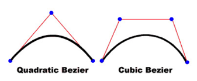

对于二次曲线，需要额外指定一个点（使用 aCPx 和 aCPy 参数），曲线完全由该点以及指定的终点（由 x 和 y 参数指定）决定。对于三次曲线（bezierCurveTo 函数使用），需要额外指定两个点来定义曲线。起点是路径的当前位置。

| 名称 | 说明 |
| --- | --- |
| bezierCurveTo(aCPx1, aCPy1, aCPx2, aCPy2,  x, y) | 根据所提供的参数绘制曲线。相关说明请参见上一项。曲线由定义它的两个坐标（aCPx1、aCPy1、aCPx2 和 aCPy2）以及终点坐标（x 和 y）绘制。起点是路径的当前位置。 |
| splineThru(pts) | 此函数穿过所提供的一组坐标（pts）绘制一条平滑曲线。此参数应是 THREE.Vector2 对象的数组。起点是路径的当前位置。 |
| arc(aX, aY, aRadius, aStartAngle, aEndAngle, aClockwise) | 绘制一个圆（或圆的一部分）。圆从路径的当前位置开始。这里，aX 和 aY 用作相对于当前位置的偏移量。请注意，aRadius 设置圆的大小，aStartAngle 和 aEndAngle 定义绘制圆的多大一部分。布尔属性 aClockwise 决定按顺时针还是逆时针绘制圆。 |
| absArc(aX, aY, aRadius, aStartAngle, aEndAngle, AClockwise) | 参见 arc 的说明。这里的位置是绝对位置，而不是相对于当前位置。 |

<!-- pdf-page: 162 -->
```text
Name
Description
ellipse(aX, aY, xRadius,
yRadius, aStartAngle,
aEndAngle, aClockwise)
```

参见 arc 的说明。此外，使用 ellipse 函数可以分别设置 x 半径和 y 半径。

absEllipse(aX, aY, xRadius, yRadius, aStartAngle, aEndAngle, aClockwise)：参见 ellipse 的说明。这里的位置是绝对位置，而不是相对于当前位置。

| 名称 | 说明 |
| --- | --- |
| fromPoints(vectors) | 如果向此函数传入 THREE.Vector2（或 THREE.Vector3）对象数组，Three.js 会使用所提供的向量，通过直线创建一条路径。 |
| holes | holes 属性包含一个 THREE.Shape 对象数组。此数组中的每个对象都会渲染为一个孔洞。本节开头看到的示例就是很好的例子。在那个代码片段中，我们向此数组添加了三个 THREE.Shape 对象：一个用于左眼，一个用于右眼，还有一个用于主 THREE.Shape 对象的嘴。 |

在此示例中，我们使用 new THREE.ShapeGeometry(drawShape())) 构造函数，从一个 THREE.Shape 对象创建了 THREE.ShapeGeometry。THREE.Shape 对象本身也提供了几个可用于创建几何体的辅助函数，如下所示：

| 名称 | 说明 |
| --- | --- |
| makeGeometry(options) | 从 THREE.Shape 返回 THREE.ShapeGeometry。有关可用选项的更多信息，请查看前面讨论的 THREE.ShapeGeometry 属性。 |
| createPointsGeometry(divisions) | 将形状转换为一组点。divisions 属性定义返回的点数。此值越大，返回的点越多，最终得到的线越平滑。divisions 分别应用于路径的每个部分。 |
| createSpacedPointsGeometry(divisions) | 此函数同样将形状转换为一组点，但这次会一次性将划分应用于整条路径。 |

<!-- pdf-page: 163 -->
学习使用几何体

创建一组点时，可使用 createPointsGeometry 或 createSpacedPointsGeometry；随后可以用创建的点绘制一条线，如下所示：

```javascript
new THREE.Line( shape.createPointsGeometry(10), new
  THREE.LineBasicMaterial( { color: 0xff3333, linewidth: 2 } ) );
```

单击示例中的 asPoints 或 asSpacedPoints 按钮时，会看到如下效果：

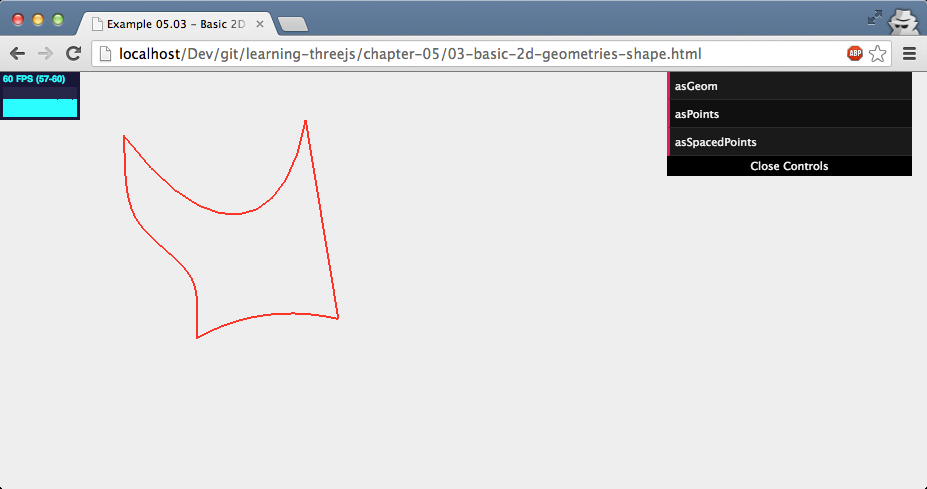

二维形状就介绍到这里。下一部分将展示并讲解基本的三维形状。

### 三维几何体

在本节的基本三维几何体介绍中，我们将从已经见过多次的几何体 THREE.BoxGeometry 开始。

#### 立方体几何体（THREE.BoxGeometry）

THREE.BoxGeometry 是非常简单的三维几何体，可以通过指定宽度、高度和深度来创建立方体。我们添加了一个示例 05-basic-3dgeometries-cube.html，你可以在其中尝试这些属性。以下截图显示了此几何体：

<!-- pdf-page: 164 -->
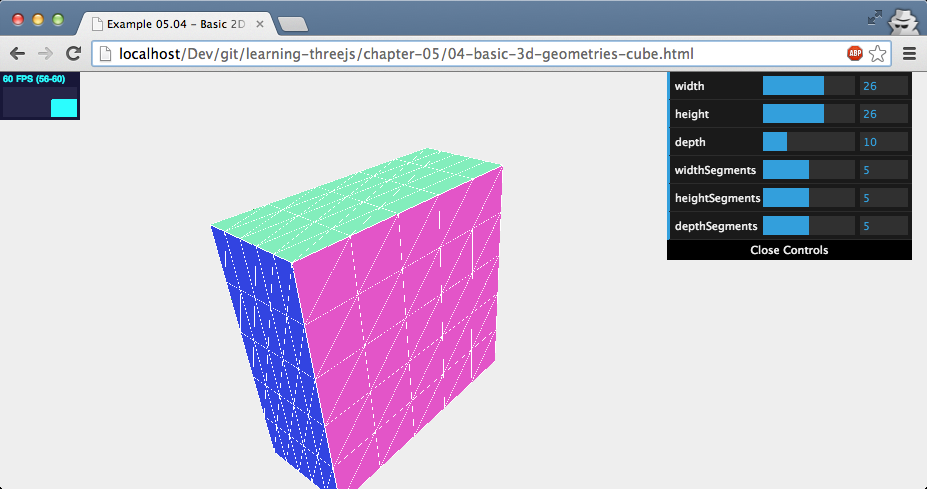

如示例所示，通过更改 THREE.BoxGeometry 的 width、height 和 depth 属性，可以控制最终网格的大小。创建新立方体时，这三个属性也是必需的，如下所示：

```javascript
new THREE.BoxGeometry(10,10,10);
```

在示例中，还可以看到可在立方体上定义的其他几个属性。下表解释了所有属性：

| 属性 | 是否必需 | 说明 |
| --- | --- | --- |
| width | 是 | 立方体的宽度。这是立方体顶点沿 x 轴的长度。 |
| height | 是 | 立方体的高度。这是立方体顶点沿 y 轴的长度。 |
| depth | 是 | 立方体的深度。这是立方体顶点沿 z 轴的长度。 |
| widthSegments | 否 | 沿立方体 x 轴将一个面划分成的段数。默认值为 1。 |
| heightSegments | 否 | 沿立方体 y 轴将一个面划分成的段数。默认值为 1。 |
| depthSegments | 否 | 沿立方体 z 轴将一个面划分成的段数。默认值为 1。 |

<!-- pdf-page: 165 -->
学习使用几何体

增大各个分段属性，会将立方体的六个主面划分为更小的面。如果想使用 THREE.MeshFaceMaterial 为立方体的某些部分设置特定的材质属性，这会很有用。THREE.BoxGeometry 是非常简单的几何体。另一个简单的几何体是 THREE.SphereGeometry。

#### 球体几何体（THREE.SphereGeometry）

使用 SphereGeometry 可以创建三维球体。让我们直接进入示例 06-basic-3d-geometries-sphere.html：

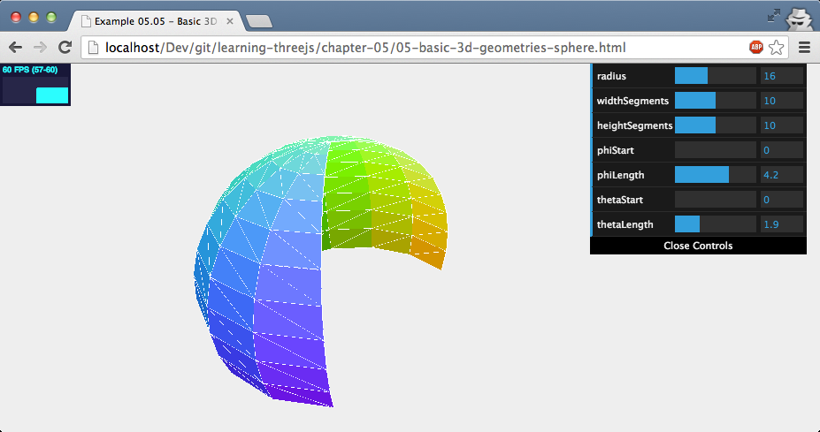

上一张截图展示了一个基于 THREE.SphereGeometry 创建的半开放球体。此几何体非常灵活，可用于创建各种与球体相关的几何体。不过，只需这样即可轻松创建基本的 THREE.SphereGeometry：new THREE.SphereGeometry()。可以使用以下属性调整最终网格的外观：

| 属性 | 是否必需 | 说明 |
| --- | --- | --- |
| radius | 否 | 用于设置球体的半径。这决定最终网格的大小。默认值为 50。 |
| widthSegments | 否 | 竖直方向使用的段数。段数越多，表面越平滑。默认值为 8，最小值为 3。 |

<!-- pdf-page: 166 -->
| 属性 | 是否必需 | 说明 |
| --- | --- | --- |
| heightSegments | 否 | 水平方向使用的段数。段数越多，球体表面越平滑。默认值为 6，最小值为 2。 |
| phiStart | 否 | 确定沿球体 x 轴从何处开始绘制球体。范围可以从 0 到 2 \* PI。默认值为 0。 |
| phiLength | 否 | 确定从 phiStart 开始绘制球体的范围。2 \* PI 会绘制完整的球体，0.5 \* PI 会绘制开放的四分之一球体。默认值为 2 \* PI。 |
| thetaStart | 否 | 确定沿球体 x 轴从何处开始绘制球体。范围可以从 0 到 PI，默认值为 0。 |
| thetaLength | 否 | 确定从 phiStart 开始绘制球体的范围。PI 值表示完整的球体，而 0.5 \* PI 只绘制球体的上半部分。默认值为 PI。 |

radius、widthSegments 和 heightSegments 属性应该很清楚，我们已经在其他示例中见过这类属性。如果不看示例，phiStart、phiLength、thetaStart 和 thetaLength 属性会稍难理解。幸运的是，你可以在 06-basic-3d-geometries-sphere.html 示例的菜单中试验这些属性，并创建出如下有趣的几何体：

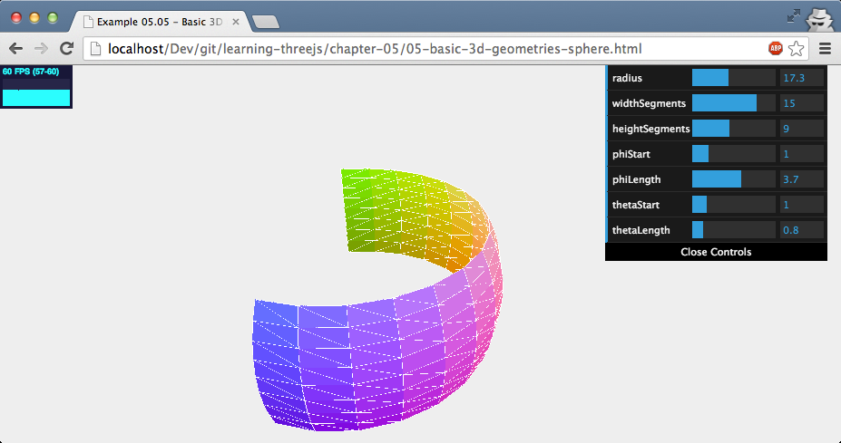

<!-- pdf-page: 167 -->
学习使用几何体

列表中的下一个是 THREE.CylinderGeometry。

#### 圆柱体几何体（THREE.CylinderGeometry）

使用此几何体，可以创建圆柱体和类似圆柱体的对象。与所有其他几何体一样，我们也有一个示例（07-basic-3d-geometries-cylinder.html），可以让你试验此几何体的属性，其截图如下：

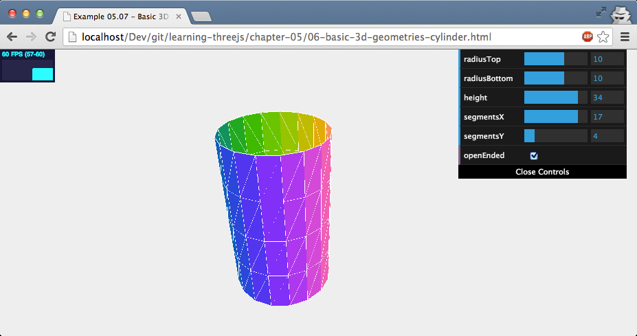

创建 THREE.CylinderGeometry 时，没有任何必需参数。因此，只需调用 new THREE.CylinderGeometry() 就能创建圆柱体。如示例所示，可以传入多个属性来更改此圆柱体的外观。下表解释了这些属性：

| 属性 | 是否必需 | 说明 |
| --- | --- | --- |
| radiusTop | 否 | 设置圆柱体顶部的大小。默认值为 20。 |
| radiusBottom | 否 | 设置圆柱体底部的大小。默认值为 20。 |
| height | 否 | 此属性设置圆柱体的高度。默认高度为 100。 |
| radialSegments | 否 | 确定沿圆柱体半径方向的段数。默认值为 8。段数越多，圆柱体越平滑。 |

<!-- pdf-page: 168 -->
| 属性 | 是否必需 | 说明 |
| --- | --- | --- |
| heightSegments | 否 | 确定沿圆柱体高度方向的段数。默认值为 1。段数越多，面越多。 |
| openEnded | 否 | 确定网格的顶部和底部是否封闭。默认值为 false。 |

这些都是可用于配置圆柱体的非常基本的属性。不过，一个有趣的地方是顶部（或底部）使用负半径的情况。如果这样做，就可以用此几何体创建类似沙漏的形状，如下面的截图所示。从颜色可以看出，这里需要注意一点：在这种情况下，上半部分会内外翻转。如果使用的材质未配置 THREE.DoubleSide，就看不到上半部分。

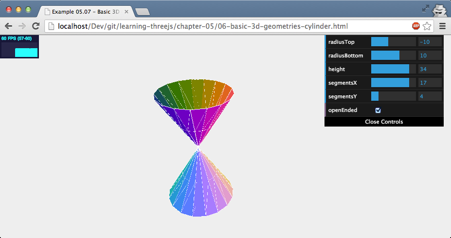

下一个几何体是 THREE.TorusGeometry，可以用它创建类似甜甜圈的形状。

<!-- pdf-page: 169 -->
学习使用几何体

#### 圆环体几何体（THREE.TorusGeometry）

圆环体是一种看起来像甜甜圈的简单形状。打开 08-basic-3d-geometries-torus.html 示例，即可亲自查看 THREE.TorusGeometry 的实际效果，如下面的截图所示：

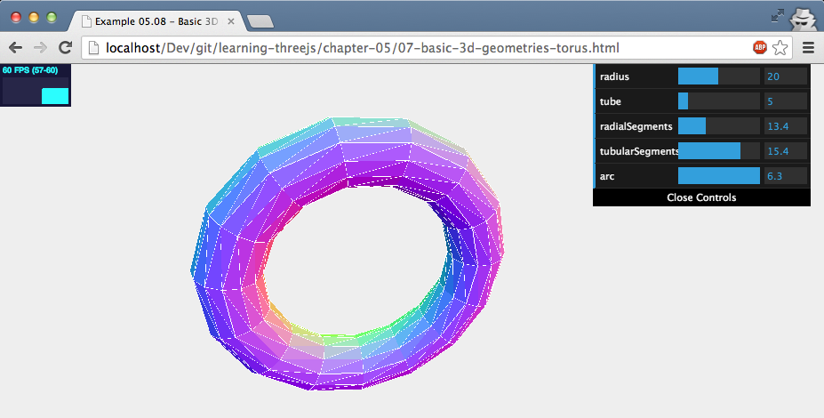

与大多数简单几何体一样，创建 THREE.TorusGeometry 时没有任何必需参数。下表列出了创建此几何体时可以指定的参数：

| 属性 | 是否必需 | 说明 |
| --- | --- | --- |
| radius | 否 | 设置整个圆环体的大小。默认值为 100。 |
| tube | 否 | 设置管子的半径（即实际的甜甜圈部分）。此属性的默认值为 40。 |
| radialSegments | 否 | 确定沿圆环体长度方向使用的段数。默认值为 8。请在演示中查看更改此值的效果。 |
| tubularSegments | 否 | 确定沿圆环体宽度方向使用的段数。默认值为 6。请在演示中查看更改此值的效果。 |
| arc | 否 | 使用此属性，可以控制是否绘制完整的圆环体。此值的默认值为 2 \* PI（一个完整的圆）。 |

<!-- pdf-page: 170 -->
其中大多数都是你已经见过的非常基本的属性。不过，arc 属性非常有趣。使用此属性，可以定义甜甜圈是完整的圆还是只有一部分。通过试验此属性，可以创建非常有趣的网格，例如下面这个 arc 设置为 0.5 \* PI 的网格：

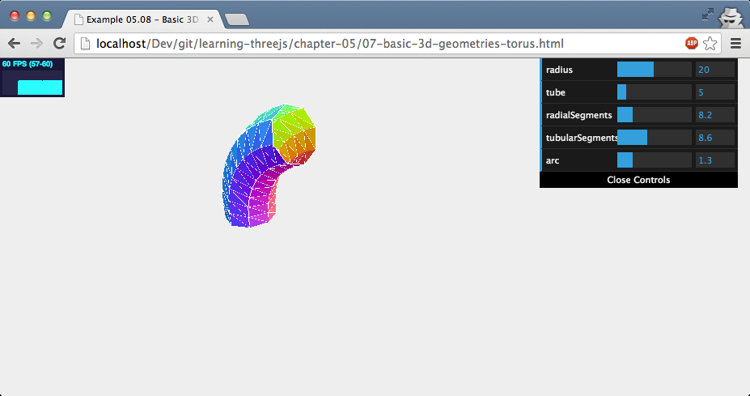

THREE.TorusGeometry 是非常直观的几何体。下一节将介绍一个名称与它几乎相同、但复杂得多的几何体：THREE.TorusKnotGeometry。

<!-- pdf-page: 171 -->
学习使用几何体

#### 圆环结几何体（THREE.TorusKnotGeometry）

使用 THREE.TorusKnotGeometry 可以创建圆环结。圆环结是一种特殊的结，看起来像一根绕自身缠绕数圈的管子。解释它的最佳方式是查看 09-basic-3d-geometries-torusknot.html 示例。以下截图显示了此几何体：

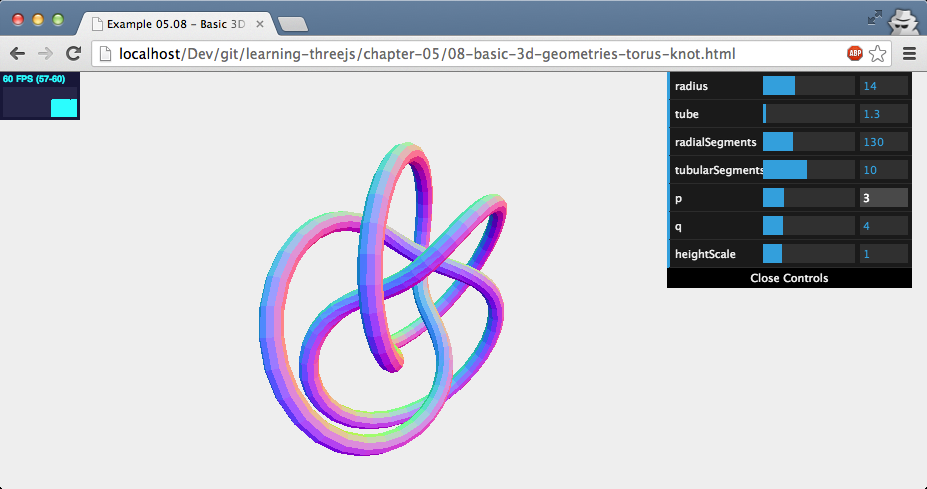

打开此示例并尝试调整 p 和 q 属性，就能创建各种漂亮的几何体。p 属性定义结绕其轴缠绕的次数，q 定义结绕其内部缠绕的程度。如果这听起来有些模糊，不用担心。要创建漂亮的结，并不需要理解这些属性，例如下面截图所示的结（对细节感兴趣的读者，可以在 Wikipedia 的 http://en.wikipedia.org/wiki/Torus\_knot 找到一篇关于此主题的好文章）：

<!-- pdf-page: 172 -->
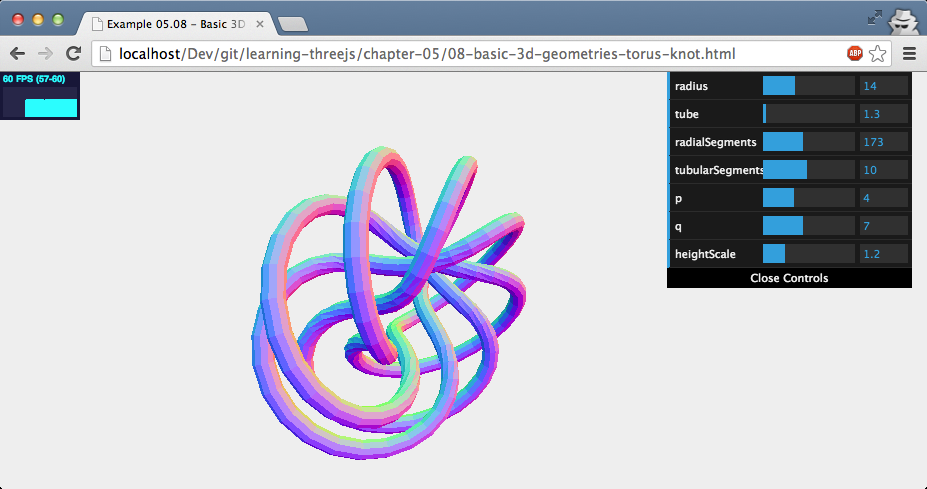

通过此几何体的示例，你可以尝试以下属性，并查看 p 和 q 的各种组合对此几何体产生的影响：

| 属性 | 是否必需 | 说明 |
| --- | --- | --- |
| radius | 否 | 设置整个圆环体的大小。默认值为 100。 |
| tube | 否 | 设置管子的半径（即实际的甜甜圈部分）。此属性的默认值为 40。 |
| radialSegments | 否 | 确定沿圆环结长度方向使用的段数。默认值为 64。请在演示中查看更改此值的效果。 |
| tubularSegments | 否 | 确定沿圆环结宽度方向使用的段数。默认值为 8。请在演示中查看更改此值的效果。 |
| p | 否 | 定义结的形状，默认值为 2。 |
| q | 否 | 定义结的形状，默认值为 3。 |
| heightScale | 否 | 使用此属性可以拉伸圆环结。默认值为 1。 |

列表中的下一个几何体是基本几何体中的最后一个：THREE.PolyhedronGeometry。

<!-- pdf-page: 173 -->
学习使用几何体

#### 多面体几何体（THREE.PolyhedronGeometry）

使用此几何体，可以轻松创建多面体。多面体是仅由平面和直边组成的几何体。不过，大多数情况下，你不会直接使用此几何体。Three.js 提供了许多可以直接使用的特定多面体，无需指定 THREE.PolyhedronGeometry 的顶点和面。本节稍后将讨论这些多面体。如果确实想直接使用 THREE.PolyhedronGeometry，就必须指定顶点和面（就像我们在第 3 章“使用 Three.js 中提供的不同光源”里为立方体所做的那样）。例如，可以这样创建一个简单的四面体（另请参见本章的 THREE.TetrahedronGeometry）：

```javascript
var vertices = [
  1,  1,  1,
  -1, -1,  1,
  -1,  1, -1,
  1, -1, -1
];
```

```javascript
var indices = [
  2, 1, 0,
  0, 3, 2,
  1, 3, 0,
  2, 3, 1
];
```

```javascript
polyhedron = createMesh(new THREE.PolyhedronGeometry(vertices,
  indices, controls.radius, controls.detail));
```

要构造 THREE.PolyhedronGeometry，需要传入 vertices、indices、radius 和 detail 属性。最终得到的 THREE.PolyhedronGeometry 对象显示在 10-basic-3d-geometries-polyhedron.html 示例中（在右上角的菜单中选择 type as: Custom）：

<!-- pdf-page: 174 -->
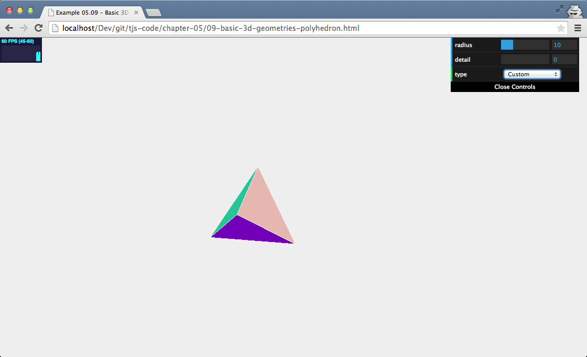

创建多面体时，可以传入以下四个属性：

| 属性 | 是否必需 | 说明 |
| --- | --- | --- |
| vertices | 是 | 这些是构成多面体的点。 |
| indices | 是 | 这些是需要由顶点创建的面。 |
| radius | 否 | 多面体的大小。默认值为 1。 |
| detail | 否 | 使用此属性可以为多面体添加更多细节。如果设置为 1，多面体中的每个三角形都会拆分为四个较小的三角形。如果设置为 2，这四个较小的三角形又各自拆分为四个更小的三角形，依此类推。 |

在本节开头，我们提到 Three.js 开箱即用地提供了几种多面体。在以下小节中，我们将快速展示这些多面体。

通过查看 09-basic-3dgeometries-polyhedron.html 示例，可以查看所有这些多面体类型。

<!-- pdf-page: 175 -->
学习使用几何体

#### 二十面体几何体（THREE.IcosahedronGeometry）

THREE.IcosahedronGeometry 创建一种多面体，它由 12 个顶点构成，具有 20 个完全相同的三角形面。创建此多面体时，只需指定 radius 和 detail 级别。此截图显示了使用 THREE.IcosahedronGeometry 创建的多面体：

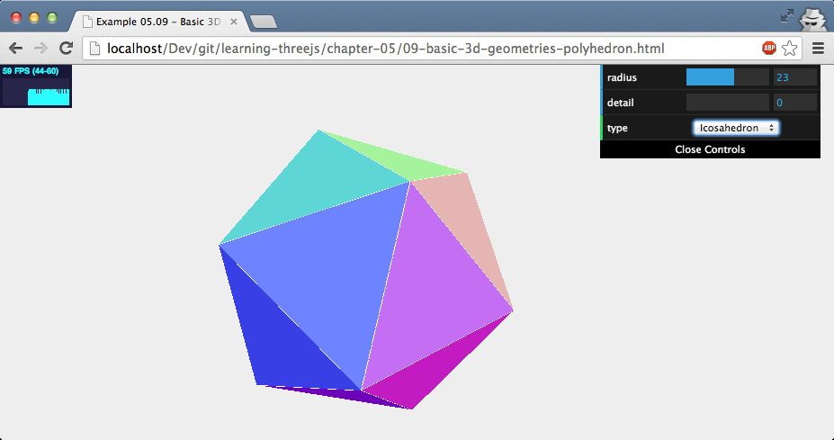

#### 四面体几何体（THREE.TetrahedronGeometry）

四面体是最简单的多面体之一。此多面体仅包含由四个顶点构成的四个三角形面。与 Three.js 提供的其他多面体一样，只需指定 radius 和 detail 级别即可创建 THREE.TetrahedronGeometry。下面的截图显示了使用 THREE.TetrahedronGeometry 创建的四面体：

<!-- pdf-page: 176 -->
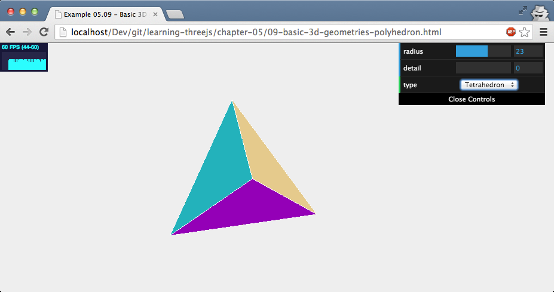

#### 八面体几何体（THREE.OctahedronGeometry）

Three.js 也提供了八面体的实现。顾名思义，此多面体有 8 个面。这些面由 6 个顶点构成。以下截图显示了此几何体：

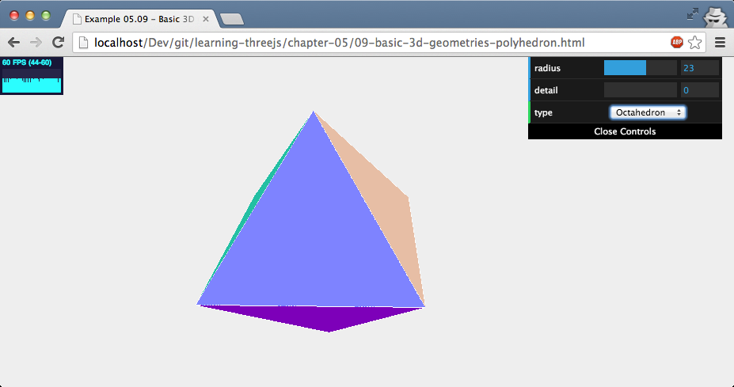

<!-- pdf-page: 177 -->
学习使用几何体

#### 十二面体几何体（THREE.DodecahedronGeometry）

Three.js 提供的最后一种多面体几何体是 THREE.DodecahedronGeometry。此多面体有 12 个面。以下截图显示了此几何体：

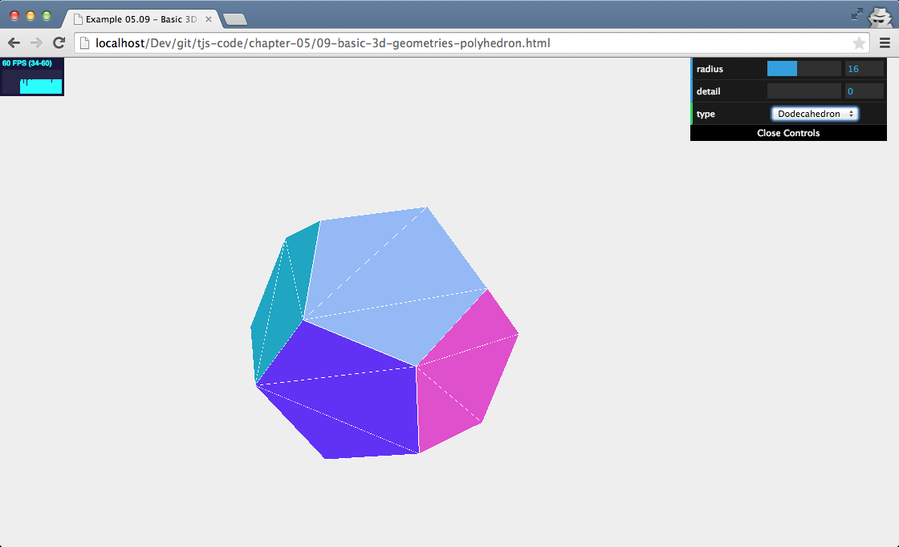

本章关于 Three.js 提供的基本二维和三维几何体的内容到此结束。

<!-- pdf-page: 178 -->
## 总结

本章讨论了 Three.js 提供的所有标准几何体。如你所见，有大量几何体可以直接开箱使用。要学习如何使用几何体，最好的方法就是动手试验。利用本章示例，熟悉可用于自定义 Three.js 标准几何体集合的属性。刚开始使用几何体时，最好选择一种基本材质；不要直接使用复杂材质，而应从简单的 THREE.MeshBasicMaterial（将 wireframe 设置为 true）或 THREE.MeshNormalMaterial 开始。这样，你就能更清楚地了解几何体的真实形状。对于二维形状，务必记住它们位于 x-y 平面上。如果想让二维形状水平放置，必须使网格绕 x 轴旋转 -0.5 \* PI。最后要注意，如果旋转的是二维形状，或开放的三维形状（例如圆柱体或管子），请记住将材质设置为 THREE.DoubleSide。否则，几何体的内部或背面将不会显示。

本章重点介绍了简单直观的网格。Three.js 也提供了创建复杂几何体的方法。下一章将学习如何创建这些复杂几何体。

<!-- pdf-page: 179 -->
