# 第 6 章 · 高级几何体与二元运算

<!-- pdf-page: 180 -->
## 高级几何体与

## 二元运算

上一章介绍了 Three.js 提供的所有基本几何体。除了这些基本几何体，Three.js 还提供了一组更高级、更专门的对象。本章将介绍这些高级几何体，并涵盖以下主题：

- 如何使用 THREE.ConvexGeometry、THREE.LatheGeometry 和 THREE.TubeGeometry 等高级几何体。

- 如何使用 THREE.ExtrudeGeometry 从二维形状创建三维形状。我们将基于使用 Three.js 提供的功能绘制的二维形状进行演示，还会展示一个根据外部加载的 SVG 图像创建三维形状的示例。

- 如果你想自己创建自定义形状，可以轻松地修改我们在前面章节中讨论过的形状。不过，Three.js 还提供了 THREE.ParametricGeometry 对象。使用此对象，可以基于一组方程创建几何体。

- 最后，我们将介绍如何使用 THREE.TextGeometry 创建三维文本效果。

- 此外，我们还会展示如何通过 Three.js 扩展 ThreeBSP 提供的二元运算（binary operations），根据现有几何体创建新几何体。

我们从列表中的第一项 THREE.ConvexGeometry 开始。

<!-- pdf-page: 181 -->
高级几何体与二元运算

## 凸包几何体（THREE.ConvexGeometry）

使用 THREE.ConvexGeometry，可以围绕一组点创建凸包（convex hull）。凸包是包含所有这些点的最小形状。理解这一点的最简单方法是查看示例。打开 01-advanced-3dgeometries-convex.html 示例，就会看到一组随机点的凸包。以下截图显示了此几何体：

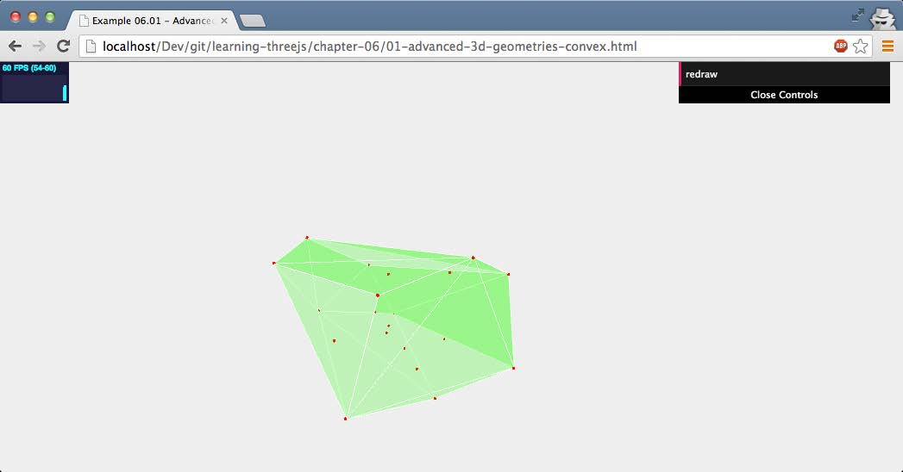

在此示例中，我们生成一组随机点，并基于这些点创建 THREE.ConvexGeometry。在示例中，可以单击 redraw，这将生成 20 个新点并绘制凸包。我们还将每个点添加为一个小型 THREE.SphereGeometry 对象，以清楚展示凸包的工作方式。THREE.ConvexGeometry 并未包含在标准 Three.js 发行包中，因此必须额外包含一个 JavaScript 文件才能使用此几何体。在 HTML 页面顶部添加以下代码：

```html
<script src="../libs/ConvexGeometry.js"></script>
```

下面这段代码展示了这些点的创建方式，以及将它们添加到场景中的方式：

```javascript
function generatePoints() {
  // add 10 random spheres
  var points = [];
  for (var i = 0; i < 20; i++) {
```

<!-- pdf-page: 182 -->
```javascript
    var randomX = -15 + Math.round(Math.random() * 30);
    var randomY = -15 + Math.round(Math.random() * 30);
    var randomZ = -15 + Math.round(Math.random() * 30);
    points.push(new THREE.Vector3(randomX, randomY, randomZ));
  }
```

```javascript
  var group = new THREE.Object3D();
  var material = new THREE.MeshBasicMaterial({color: 0xff0000,
    transparent: false});
  points.forEach(function (point) {
    var geom = new THREE.SphereGeometry(0.2);
    var mesh = new THREE.Mesh(geom, material);
    mesh.position.clone(point);
    group.add(mesh);
  });
```

```text
  // add the points as a group to the scene
  scene.add(group);
}
```

如这段代码所示，我们创建了 20 个随机点（THREE.Vector3），并将它们放入一个数组。接着遍历此数组，创建 THREE.SphereGeometry，并将其位置设置为其中一个点（position.clone(point)）。所有点都添加到一个组中（更多信息请参见第 7 章“粒子、精灵和点云”），因此只需旋转该组，就能轻松旋转所有点。

有了这组点后，创建 THREE.ConvexGeometry 就非常简单，如以下代码片段所示：

```javascript
// use the same points to create a convexgeometry
var convexGeometry = new THREE.ConvexGeometry(points);
convexMesh = createMesh(convexGeometry);
scene.add(convexMesh);
```

包含顶点（THREE.Vector3 类型）的数组是 THREE.ConvexGeometry 接受的唯一参数。最后，再说明一下这里调用的 createMesh() 函数（这是我们在第 5 章“学习使用几何体”中自行创建的函数）。上一章使用此方法通过 THREE.MeshNormalMaterial 创建网格。在此示例中，我们将其改为半透明的绿色 THREE.MeshBasicMaterial，以便更清楚地展示所创建的凸包，以及构成此几何体的各个点。

下一个复杂几何体是 THREE.LatheGeometry，可用它创建类似花瓶的形状。

<!-- pdf-page: 183 -->
高级几何体与二元运算

## 车削几何体（THREE.LatheGeometry）

THREE.LatheGeometry 允许根据平滑曲线创建形状。此曲线由若干个点（也称为节点，knots）定义，通常称为样条曲线（spline）。此样条曲线绕对象的中心 z 轴旋转，生成类似花瓶和铃铛的形状。同样，了解 THREE.LatheGeometry 外观的最简单方法是查看示例。02-advanced-3d-geometries-lathe.html 展示了此几何体。下面这张来自示例的截图显示了此几何体：

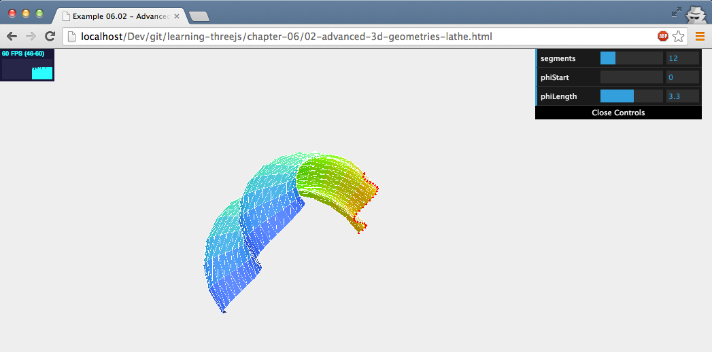

在上一张截图中，可以看到由一组小红球表示的样条曲线。这些球的位置会与其他几个参数一起传给 THREE.LatheGeometry。在此示例中，我们将此样条曲线旋转半圈，并基于此样条曲线生成你看到的形状。在介绍所有参数之前，先来看看用于创建样条曲线的代码，以及 THREE.LatheGeometry 如何使用此样条曲线：

```javascript
function generatePoints(segments, phiStart, phiLength) {
  // add 10 random spheres
  var points = [];
  var height = 5;
  var count = 30;
  for (var i = 0; i < count; i++) {
    points.push(new THREE.Vector3((Math.sin(i * 0.2) + Math.cos(i
      * 0.3)) * height + 12, 0, ( i - count ) + count / 2));
  }
```

<!-- pdf-page: 184 -->
```text
  ...
```

```javascript
  // use the same points to create a LatheGeometry
  var latheGeometry = new THREE.LatheGeometry (points, segments,
    phiStart, phiLength);
  latheMesh = createMesh(latheGeometry);
  scene.add(latheMesh);
}
```

在这段 JavaScript 中，你可以看到我们生成了 30 个点，其 x 坐标基于正弦和余弦函数的组合，而 z 坐标基于 i 和 count 变量。这就创建了上一张截图中由红点表示的样条曲线。

基于这些点，就可以创建 THREE.LatheGeometry。除了顶点数组，THREE.LatheGeometry 还接受另外几个参数。下表列出了所有参数：

| 属性 | 是否必需 | 说明 |
| --- | --- | --- |
| points | 是 | 这些是构成样条曲线的点，该样条曲线用于生成铃铛/花瓶形状。 |
| segments | 否 | 这是创建形状时使用的段数。此数值越大，最终形状越圆。默认值为 12。 |
| phiStart | 否 | 确定生成形状时从圆上的何处开始。范围可以从 0 到 2\*PI。默认值为 0。 |
| phiLength | 否 | 定义形状生成的完整程度。例如，四分之一形状为 0.5\*PI。默认值为完整的 360 度，即 2\*PI。 |

下一节将介绍另一种创建几何体的方法：从二维形状拉伸生成三维几何体。

### 通过拉伸创建几何体

Three.js 提供了几种将二维形状拉伸（extrude）为三维形状的方法。所谓拉伸，是指沿二维形状的 z 轴将其延展，从而转换为三维形状。例如，如果拉伸 THREE.CircleGeometry，会得到类似圆柱体的形状；如果拉伸 THREE.PlaneGeometry，会得到类似立方体的形状。

拉伸形状最通用的方式是使用 THREE.ExtrudeGeometry 对象。

<!-- pdf-page: 185 -->
高级几何体与二元运算

#### 拉伸几何体（THREE.ExtrudeGeometry）

使用 THREE.ExtrudeGeometry，可以从二维形状创建三维对象。在深入介绍此几何体的细节之前，先看一个示例：03-extrude-geometry.html。下面这张来自示例的截图显示了此几何体：

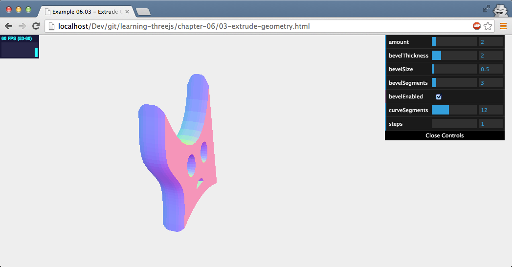

在此示例中，我们使用上一章创建的二维形状，并通过 THREE.ExtrudeGeometry 将其转换为三维形状。如截图所示，形状沿 z 轴拉伸，从而形成三维形状。创建 THREE.ExtrudeGeometry 的代码非常简单：

```javascript
var options = {
  amount: 10,
  bevelThickness: 2,
  bevelSize: 1,
  bevelSegments: 3,
  bevelEnabled: true,
  curveSegments: 12,
  steps: 1
};
```

```javascript
shape = createMesh(new THREE.ExtrudeGeometry(drawShape(),
  options));
```

<!-- pdf-page: 186 -->
在这段代码中，我们像在上一章那样，使用 drawShape() 函数创建了形状。此形状与一个 options 对象一起传给 THREE.ExtrudeGeometry 构造函数。通过 options 对象，可以精确定义形状应如何拉伸。下表解释了可以传给 THREE.ExtrudeGeometry 的选项。

| 属性 | 是否必需 | 说明 |
| --- | --- | --- |
| shapes | 是 | 需要一个或多个形状（THREE.Shape 对象），以便据此拉伸几何体。有关如何创建此类形状，请参见上一章。 |
| amount | 否 | 确定形状应拉伸多远（深度）。默认值为 100。 |
| bevelThickness | 否 | 确定倒角的深度。倒角是正面和背面与拉伸部分之间的圆角。此值定义倒角深入形状的程度。默认值为 6。 |
| bevelSize | 否 | 确定倒角的高度。它会加到形状的正常高度上。默认值为 bevelThickness - 2。 |
| bevelSegments | 否 | 定义倒角使用的段数。使用的段数越多，倒角看起来越平滑。默认值为 3。 |
| bevelEnabled | 否 | 如果设置为 true，则添加倒角。默认值为 true。 |
| curveSegments | 否 | 确定拉伸形状曲线时使用的段数。使用的段数越多，曲线看起来越平滑。默认值为 12。 |
| steps | 否 | 定义拉伸部分沿深度方向划分成的段数。默认值为 1。值越大，生成的独立面越多。 |
| extrudePath | 否 | 这是形状应沿其拉伸的路径（THREE.CurvePath）。如果未指定，形状将沿 z 轴拉伸。 |
| material | 否 | 这是正面和背面所用材质的索引。如果想为正面和背面使用不同的材质，请使用 THREE.SceneUtils.createMultiMaterialObject 函数创建网格。 |

<!-- pdf-page: 187 -->
高级几何体与二元运算

| 属性 | 是否必需 | 说明 |
| --- | --- | --- |
| extrudeMaterial | 否 | 这是倒角和拉伸部分所用材质的索引。如果想为正面和背面使用不同的材质，请使用 THREE.SceneUtils.createMultiMaterialObject 函数创建网格。 |
| uvGenerator | 否 | 在材质中使用纹理时，UV 映射决定特定面使用纹理的哪一部分。通过 uvGenerator 属性，可以传入自己的对象，为传入形状所创建的面生成 UV 设置。有关 UV 设置的更多信息，请参见第 10 章“加载和使用纹理”。如果未指定，则使用 THREE.ExtrudeGeometry.WorldUVGenerator。 |
| frames | 否 | 弗勒内标架（frenet frame）用于计算样条曲线的切线、法线和副法线。沿 extrudePath 拉伸时会用到它。你无需指定此项，因为 Three.js 提供了自己的实现 THREE.TubeGeometry.FrenetFrames，并将其作为默认值使用。有关弗勒内标架的更多信息，请参见 http://en.wikipedia.org/wiki/Differential\_geometry\_of\_curves#Frenet\_frame。 |

可以使用 03-extrudegeometry.html 示例中的菜单试验这些选项。

在此示例中，我们沿形状的 z 轴进行拉伸。如你在选项中看到的，也可以通过 extrudePath 选项沿路径拉伸形状。在接下来的 THREE.TubeGeometry 几何体中，我们就会这样做。

#### 管状几何体（THREE.TubeGeometry）

THREE.TubeGeometry 创建沿三维样条曲线拉伸的管子。你使用若干顶点指定路径，THREE.TubeGeometry 就会创建管子。本章源代码中有一个可供试验的示例（04-extrude-tube.html）。以下截图显示了此示例：

<!-- pdf-page: 188 -->
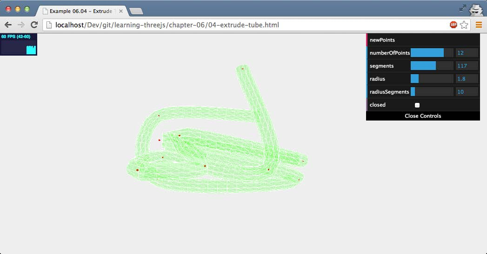

如示例所示，我们生成若干随机点，并使用这些点绘制管子。通过右上角的控件，可以定义管子的外观，或单击 newPoints 按钮生成新管子。创建管子所需的代码非常简单，如下所示：

```javascript
var points = [];
for (var i = 0 ; i < controls.numberOfPoints ; i++) {
  var randomX = -20 + Math.round(Math.random() * 50);
  var randomY = -15 + Math.round(Math.random() * 40);
  var randomZ = -20 + Math.round(Math.random() * 40);
```

```javascript
  points.push(new THREE.Vector3(randomX, randomY, randomZ));
}
```

```javascript
var tubeGeometry = new THREE.TubeGeometry(new THREE.SplineCurve3
  (points), segments, radius, radiusSegments, closed);
```

```javascript
var tubeMesh = createMesh(tubeGeometry);
scene.add(tubeMesh);
```

首先需要获取一组 THREE.Vector3 类型的顶点，就像创建 THREE.ConvexGeometry 和 THREE.LatheGeometry 时所做的那样。不过，在使用这些点创建管子之前，需要先将它们转换为 THREE.SplineCurve3。换言之，需要定义一条穿过这些指定点的平滑曲线。只需将顶点数组传给 THREE.SplineCurve3 的构造函数，即可完成此操作。有了此样条曲线和其他参数（稍后会解释），就可以创建管子并将其添加到场景中。

<!-- pdf-page: 189 -->
高级几何体与二元运算

除了 THREE.SplineCurve3，THREE.TubeGeometry 还接受其他一些参数。下表列出了 THREE.TubeGeometry 的所有参数：

| 属性 | 是否必需 | 说明 |
| --- | --- | --- |
| path | 是 | 这是描述管子应遵循路径的 THREE.SplineCurve3。 |
| segments | 否 | 这些是用于构建管子的段。默认值为 64。路径越长，应指定的段数越多。 |
| radius | 否 | 管子的半径。默认值为 1。 |
| radiusSegments | 否 | 沿管子长度方向使用的段数。默认值为 8。使用得越多，管子看起来越圆。 |
| closed | 否 | 如果设置为 true，管子的起点和终点会连接在一起。默认值为 false。 |

本章展示的最后一个拉伸示例实际上并不是另一种几何体。下一节将展示如何使用 THREE.ExtrudeGeometry，根据现有 SVG 路径创建拉伸形状。

#### 从 SVG 拉伸

讨论 THREE.ShapeGeometry 时，我们曾提到 SVG 绘制形状的方式与它几乎相同。SVG 与 Three.js 处理形状的方式非常吻合。本节将介绍如何使用 https://github.com/asutherland/d3-threeD 提供的一个小库，将 SVG 路径转换为 Three.js 形状。

<!-- pdf-page: 190 -->
在 05-extrude-svg.html 示例中，我使用了一幅蝙蝠侠标志的 SVG 图，并用 ExtrudeGeometry 将其转换为三维形状，如下面的截图所示：

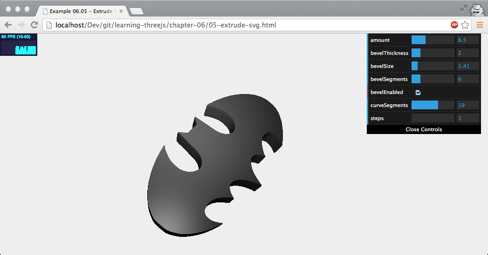

首先，来看看原始 SVG 代码是什么样的（查看此示例的源代码时，你也可以亲自看到）：

```text
<svg version="1.0" xmlns="http://www.w3.org/2000/svg"
  xmlns:xlink="http://www.w3.org/1999/xlink" x="0px" y="0px"
  width="1152px" height="1152px" xml:space="preserve">
  <g>
  <path  id="batman-path" style="fill:rgb(0,0,0);" d="M 261.135
    114.535 C 254.906 116.662 247.491 118.825 244.659 119.344 C
    229.433 122.131 177.907 142.565 151.973 156.101 C 111.417
    177.269 78.9808 203.399 49.2992 238.815 C 41.0479 248.66
    26.5057 277.248 21.0148 294.418 C 14.873 313.624 15.3588
    357.341 21.9304 376.806 C 29.244 398.469 39.6107 416.935
    52.0865 430.524 C 58.2431 437.23 63.3085 443.321 63.3431
    444.06 ... 261.135 114.535 "/>
  </g>
</svg>
```

<!-- pdf-page: 191 -->
高级几何体与二元运算

除非你是 SVG 专家，否则这些内容对你来说可能毫无意义。不过，从根本上说，你在这里看到的是一组绘制指令。例如，C 277.987 119.348 279.673 116.786 279.673 115.867 告诉浏览器绘制一条三次贝塞尔曲线（cubic Bezier curve），而 L 489.242 111.787 告诉我们要向那个特定位置绘制一条直线。幸运的是，我们不必自己编写解释这些指令的代码。使用 d3-threeD 库，就可以自动完成转换。此库最初是为了与优秀的 D3.js 库一起使用而创建的，但经过一些小的调整，也可以独立使用这项特定功能。

SVG 代表可缩放矢量图形（Scalable Vector Graphics）。这是一种基于 XML 的标准，可用于为 Web 创建基于矢量的二维图像。它是所有现代浏览器都支持的开放标准。不过，直接使用 SVG 并从 JavaScript 操作它并不是很简单。幸运的是，有一些开源 JavaScript 库可以让 SVG 的使用轻松许多。Paper.js、Snap.js、D3.js 和 Raphael.js 就是其中一些最优秀的库。

以下代码片段展示了如何加载前面看到的 SVG，将其转换为 THREE.ExtrudeGeometry，并显示在屏幕上：

```javascript
function drawShape() {
  var svgString = document.querySelector("#batman-
    path").getAttribute("d");
  var shape = transformSVGPathExposed(svgString);
  return shape;
}
```

```javascript
var options = {
  amount: 10,
  bevelThickness: 2,
  bevelSize: 1,
  bevelSegments: 3,
  bevelEnabled: true,
  curveSegments: 12,
  steps: 1
};
```

```javascript
shape = createMesh(new THREE.ExtrudeGeometry(drawShape(),
  options));
```

<!-- pdf-page: 192 -->
在此代码片段中，你会看到对 transformSVGPathExposed 函数的调用。此函数由 d3-threeD 库提供，接受 SVG 字符串作为参数。我们使用以下表达式直接从 SVG 元素获取此 SVG 字符串：document.querySelector("#batman-path").getAttribute("d")。在 SVG 中，d 属性包含用于绘制形状的路径语句。添加一种外观漂亮的闪亮材质和一盏聚光灯，就能重现此示例。

本节要讨论的最后一种几何体是 THREE.ParametricGeometry。使用此几何体，可以指定几个函数，以编程方式创建几何体。

#### 参数化几何体（THREE.ParametricGeometry）

使用 THREE.ParametricGeometry，可以基于方程创建几何体。在深入自己的示例之前，最好先查看 Three.js 已经提供的示例。下载 Three.js 发行包时，会得到 examples/js/ParametricGeometries.js 文件。在此文件中，可以找到几个可与 THREE.ParametricGeometry 一起使用的方程示例。最基本的示例是创建平面的函数：

```javascript
function plane(u, v) {
  var x = u * width;
  var y = 0;
  var z = v * depth;
  return new THREE.Vector3(x, y, z);
}
```

此函数由 THREE.ParametricGeometry 调用。u 和 v 的值将在 0 到 1 之间变化，并针对 0 到 1 之间的所有值调用此函数很多次。在此示例中，u 值用于确定向量的 x 坐标，v 值用于确定 z 坐标。运行后，就会得到一个宽度为 width、深度为 depth 的基本平面。

<!-- pdf-page: 193 -->
高级几何体与二元运算

在我们的示例中，做法与此类似。不过，我们创建的不是平面，而是类似波浪的图案，如 06-parametric-geometries.html 示例所示。以下截图显示了此示例：

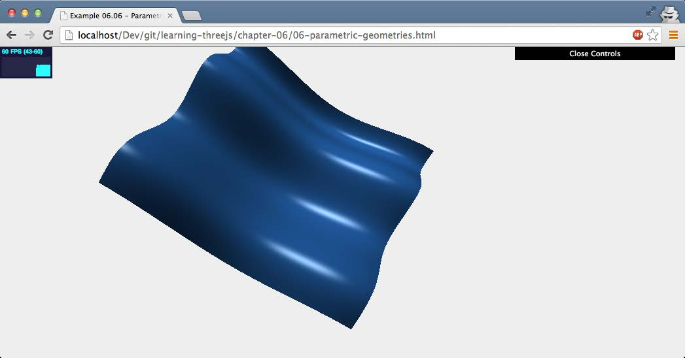

为创建此形状，我们将以下函数传给了 THREE.ParametricGeometry：

```javascript
radialWave = function (u, v) {
  var r = 50;
```

```javascript
  var x = Math.sin(u) * r;
  var z = Math.sin(v / 2) * 2 * r;
  var y = (Math.sin(u * 4 * Math.PI) + Math.cos(v * 2 * Math.PI))
    * 2.8;
```

```javascript
  return new THREE.Vector3(x, y, z);
}
```

```javascript
var mesh = createMesh(new THREE.ParametricGeometry(radialWave,
  120, 120, false));
```

如此例所示，只需几行代码，就能创建非常有趣的几何体。在此示例中，还可以看到能传给 THREE.ParametricGeometry 的参数。下表对这些参数进行了解释：

<!-- pdf-page: 194 -->
| 属性 | 是否必需 | 说明 |
| --- | --- | --- |
| function | 是 | 此函数根据提供的 u 和 v 值定义每个顶点的位置。 |
| slices | 是 | 定义 u 值应划分成的份数。 |
| stacks | 是 | 定义 v 值应划分成的份数。 |

在进入本章最后一部分之前，我想最后说明一下如何使用 slices 和 stacks 属性。我们提到过，u 和 v 属性会传给所提供的 function 参数，这两个属性的值在 0 到 1 之间。使用 slices 和 stacks 属性，可以定义传入函数的调用次数。例如，如果将 slices 设置为 5、将 stacks 设置为 4，该函数将使用以下值被调用：

```text
u:0/5, v:0/4
u:1/5, v:0/4
u:2/5, v:0/4
u:3/5, v:0/4
u:4/5, v:0/4
u:5/5, v:0/4
u:0/5, v:1/4
u:1/5, v:1/4
...
u:5/5, v:3/4
u:5/5, v:4/4
```

因此，此值越大，可指定的顶点越多，创建的几何体就越平滑。可以使用 06-parametric-geometries.html 示例右上角的菜单查看此效果。

更多示例请查看 Three.js 发行包中的 examples/js/ParametricGeometries.js 文件。此文件包含创建以下几何体的函数：

- 克莱因瓶（Klein bottle）

- 平面（Plane）

- 扁平莫比乌斯带（Flat mobius strip）

- 三维莫比乌斯带（3d mobius strip）

- 管子（Tube）

- 圆环结（Torus knot）

- 球体（Sphere）

<!-- pdf-page: 195 -->
高级几何体与二元运算

本章最后一部分将介绍如何创建三维文本对象。

## 创建三维文本

在本章最后一部分，我们将快速介绍如何创建三维文本效果。首先介绍如何使用 Three.js 提供的字体渲染文本，然后快速介绍如何为此使用自己的字体。

### 渲染文本

在 Three.js 中渲染文本非常简单。你只需定义想使用的字体，以及讨论 THREE.ExtrudeGeometry 时见过的基本拉伸属性。以下截图展示了 07-text-geometry.html 示例，说明如何在 Three.js 中渲染文本：

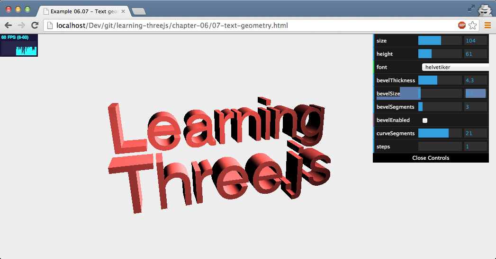

创建此三维文本所需的代码如下：

```javascript
var options = {
  size: 90,
  height: 90,
  weight: 'normal',
  font: 'helvetiker',
  style: 'normal',
  bevelThickness: 2,
  bevelSize: 4,
```

<!-- pdf-page: 196 -->
```text
  bevelSegments: 3,
  bevelEnabled: true,
  curveSegments: 12,
  steps: 1
};
```

```javascript
// the createMesh is the same function we saw earlier
text1 = createMesh(new THREE.TextGeometry("Learning", options));
text1.position.z = -100;
text1.position.y = 100;
scene.add(text1);
```

```javascript
text2 = createMesh(new THREE.TextGeometry("Three.js", options));
scene.add(text2);
};
```

下面来看看可以为 THREE.TextGeometry 指定的所有选项：

| 属性 | 是否必需 | 说明 |
| --- | --- | --- |
| size | 否 | 文本的大小。默认值为 100。 |
| height | 否 | 拉伸的长度（深度）。默认值为 50。 |
| weight | 否 | 字体的粗细。可能的值为 normal 和 bold。默认值为 normal。 |
| font | 否 | 要使用的字体名称。默认值为 helvetiker。 |
| style | 否 | 字体的样式。可能的值为 normal 和 italic。默认值为 normal。 |
| bevelThickness | 否 | 倒角的深度。倒角是正面和背面与拉伸部分之间的圆角。默认值为 10。 |
| bevelSize | 否 | 倒角的高度。默认值为 8。 |
| bevelSegments | 否 | 定义倒角使用的段数。段数越多，倒角看起来越平滑。默认值为 3。 |
| bevelEnabled | 否 | 如果设置为 true，则添加倒角。默认值为 false。 |

<!-- pdf-page: 197 -->
高级几何体与二元运算

| 属性 | 是否必需 | 说明 |
| --- | --- | --- |
| curveSegments | 否 | 定义拉伸形状曲线时使用的段数。段数越多，曲线看起来越平滑。默认值为 4。 |
| steps | 否 | 定义拉伸部分将划分成的段数。默认值为 1。 |
| extrudePath | 否 | 这是形状应沿其拉伸的路径。如果未指定，形状将沿 z 轴拉伸。 |
| material | 否 | 这是正面和背面所用材质的索引。请使用 THREE.SceneUtils.createMultiMaterialObject 函数创建网格。 |
| extrudeMaterial | 否 | 这是倒角和拉伸部分所用材质的索引。请使用 THREE.SceneUtils.createMultiMaterialObject 函数创建网格。 |
| uvGenerator | 否 | 在材质中使用纹理时，UV 映射决定特定面使用纹理的哪一部分。通过 uvGenerator 属性，可以传入自己的对象，为传入形状所创建的面生成 UV 设置。有关 UV 设置的更多信息，请参见第 10 章“加载和使用纹理”。如果未指定，则使用 THREE.ExtrudeGeometry.WorldUVGenerator。 |
| frames | 否 | 弗勒内标架用于计算样条曲线的切线、法线和副法线。沿 extrudePath 拉伸时会用到它。你无需指定此项，因为 Three.js 提供了自己的实现 THREE.TubeGeometry.FrenetFrames，并将其作为默认值使用。有关弗勒内标架的更多信息，请参见 http://en.wikipedia.org/wiki/Differential\_geometry\_of\_curves#Frenet\_frame。 |

Three.js 中包含的字体也已添加到本书的源代码中。可以在 assets/fonts 文件夹中找到它们。

<!-- pdf-page: 198 -->
如果要以二维方式渲染字体，例如将其用作材质的纹理，则不应使用 THREE.TextGeometry。THREE.TextGeometry 内部使用 THREE.ExtrudeGeometry 构建三维文本，而它和 JavaScript 字体会带来大量开销。渲染简单的二维字体时，直接使用 HTML5 canvas 会更好。通过 context.font 可以设置要使用的字体，通过 context.fillText 可以将文本输出到 canvas。随后，可以把这个 canvas 用作纹理的输入。我们将在第 10 章“加载和使用纹理”中展示具体做法。

也可以在此几何体中使用其他字体，但需要先将它们转换为 JavaScript。下一节将展示转换方法。

### 添加自定义字体

Three.js 提供了几种可在场景中使用的字体。这些字体基于 typeface.js（http://typeface.neocracy.org:81/）提供的字体。Typeface.js 是一个可将 TrueType 和 OpenType 字体转换为 JavaScript 的库。生成的 JavaScript 文件可包含在页面中，随后即可在 Three.js 中使用该字体。

要转换现有的 OpenType 或 TrueType 字体，可以使用 http://typeface.neocracy.org:81/fonts.html 网页。在此页面上，可以上传字体，网站会将其转换为 JavaScript。请注意，这并不适用于所有类型的字体。字体越简单（直线越多），在 Three.js 中使用时正确渲染的可能性就越大。

要包含该字体，只需在 HTML 页面顶部添加下面这行代码：

```html
<script type="text/javascript" src="../assets/fonts/bitstream
  _vera_sans_mono_roman.typeface.js">
</script>
```

这会加载字体并使其可供 Three.js 使用。如果想知道字体名称（以便与 font 属性一起使用），可以使用下面这行 JavaScript 将字体缓存打印到控制台：

```javascript
console.log(THREE.FontUtils.faces);
```

<!-- pdf-page: 199 -->
高级几何体与二元运算

这会打印出如下内容：

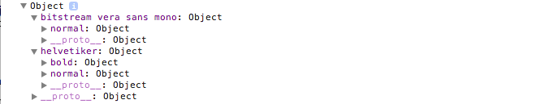

从这里可以看到，helvetiker 字体的 weight 可使用 bold 或 normal，而 bitstream vera sans mono 字体的 weight 可使用 normal。请注意，每种字体粗细都有单独的 JavaScript 文件，需要分别加载。确定字体名称的另一种方法是查看字体的 JavaScript 源文件。在文件末尾，会找到一个名为 familyName 的属性，如下面的代码所示。此属性也包含字体名称：

```text
"familyName":"Bitstream Vera Sans Mono"
```

在本章下一部分，我们将介绍 ThreeBSP 库，使用 intersect、subtract 和 union 这三种二元运算来创建外观非常有趣的几何体。

## 使用二元运算组合网格

本节将介绍另一种创建几何体的方式。到目前为止，在本章和上一章中，我们都使用 Three.js 提供的默认几何体来创建外观有趣的几何体。使用默认属性集可以创建漂亮的模型，但会受到 Three.js 所提供内容的限制。本节将展示如何组合这些标准几何体来创建新几何体——这种技术称为构造实体几何（Constructive Solid Geometry，CSG）。为此，我们使用 Three.js 扩展 ThreeBSP，可在 https://github.com/skalnik/ThreeBSP 在线找到它。这个额外的库提供以下三个函数：

<!-- pdf-page: 200 -->
| 名称 | 说明 |
| --- | --- |
| intersect | 此函数允许基于两个现有几何体的交集创建新几何体。两个几何体重叠的区域将定义此新几何体的形状。 |
| union | union 函数可用于组合两个几何体并创建一个新几何体。可以将其与第 8 章“创建和加载高级网格与几何体”中介绍的 mergeGeometry 功能相比较。 |
| subtract | subtract 函数与 union 函数相反。可以通过从第一个几何体中移除重叠区域来创建新几何体。 |

以下各节将更详细地介绍这些函数。下面的截图展示了一个示例，说明只需依次使用 union 和 subtract 功能可以创建什么。

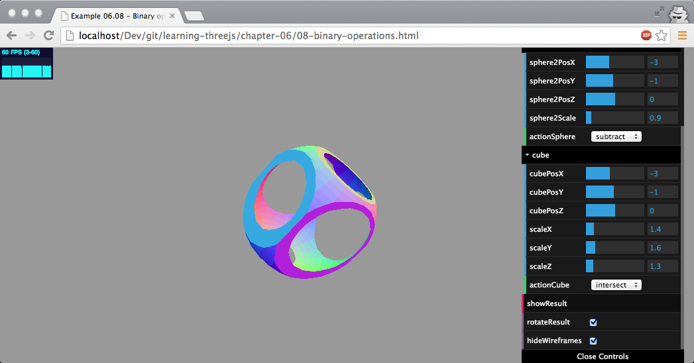

要使用此库，需要将它包含在页面中。此库用 CoffeeScript 编写，CoffeeScript 是 JavaScript 的一种更友好的变体。要使其正常工作，有两种选择。可以添加 CoffeeScript 文件并即时编译，也可以预先将它编译为 JavaScript 并直接包含。第一种方法需要执行以下操作：

```html
<script type="text/javascript" src="../libs/coffee-script.js">
  </script>
<script type="text/coffeescript" src="../libs/ThreeBSP.coffee">
  </script>
```

<!-- pdf-page: 201 -->
高级几何体与二元运算

ThreeBSP.coffee 文件包含此示例所需的功能，而 coffee-script.js 可以解释 ThreeBSP 使用的 CoffeeScript 语言。最后还需要采取一个步骤：确保在开始使用 ThreeBSP 功能之前，ThreeBSP.coffee 文件已完全解析。为此，在文件底部添加以下代码：

```html
<script type="text/coffeescript">
  onReady();
</script>
```

我们将初始的 onload 函数重命名为 onReady，如下所示：

```javascript
function onReady() {
  // Three.js code
}
```

如果使用 CoffeeScript 命令行工具将 CoffeeScript 预编译为 JavaScript，就可以直接包含生成的 JavaScript 文件。不过，在此之前，需要安装 CoffeeScript。可以按照 CoffeeScript 网站 http://coffeescript.org/ 上的安装说明操作。安装 CoffeeScript 后，可以使用以下命令将 ThreeBSP 的 CoffeeScript 文件转换为 JavaScript：

```text
coffee --compile ThreeBSP.coffee
```

此命令会创建一个 ThreeBSP.js 文件，我们可以像包含其他 JavaScript 文件一样，在示例中包含它。在示例中，我们使用第二种方法，因为与每次加载页面时都编译 CoffeeScript 相比，这样加载更快。为此，只需在 HTML 页面顶部添加以下代码：

```html
<script type="text/javascript" src="../libs/ThreeBSP.js"></script>
```

现在 ThreeBSP 库已加载，我们可以使用它提供的函数了。

### subtract（相减）函数

开始使用 subtract 函数之前，有一个重要步骤需要牢记。这三个函数使用网格的绝对位置进行计算。因此，如果在应用这些函数之前将网格分组或使用多种材质，很可能会得到奇怪的结果。为了获得最佳且最可预测的结果，请确保使用未分组的网格。

<!-- pdf-page: 202 -->
首先演示 subtract 功能。为此，我们提供了一个示例 08-binary-operations.html。通过此示例，可以试验这三种运算。首次打开二元运算示例时，会看到如下所示的初始画面：

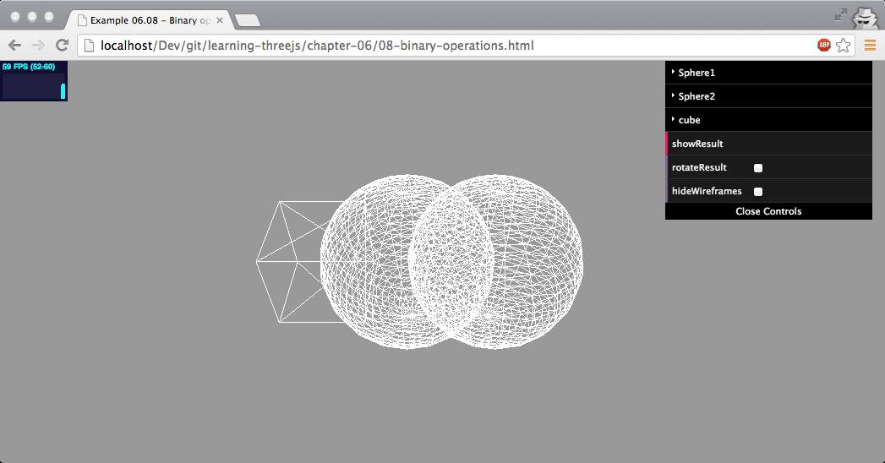

这里有三个线框：一个立方体和两个球体。中心的球体 Sphere1 是执行所有操作的对象，Sphere2 位于右侧，Cube 位于左侧。在 Sphere2 和 Cube 上，可以定义四种操作之一：subtract、union、intersect 和 none。这些操作从 Sphere1 的角度应用。将 Sphere2 设置为 subtract 并选择 showResult（同时隐藏线框）后，结果会显示 Sphere1 减去 Sphere1 与 Sphere2 重叠区域后的形状。请注意，按下 showResult 按钮后，其中一些操作可能需要几秒钟才能完成，因此在忙碌指示器可见时请耐心等待。

<!-- pdf-page: 203 -->
高级几何体与二元运算

以下截图显示了一个球体减去另一个球体后的结果：

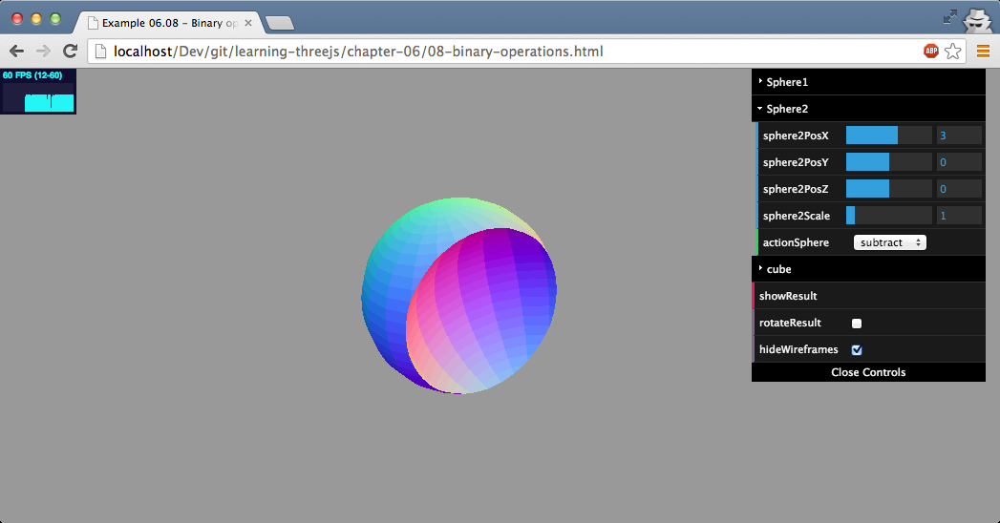

在此示例中，首先执行为 Sphere2 定义的操作，然后执行 Cube 的操作。因此，如果同时减去 Sphere2 和 Cube（我们沿 x 轴将 Cube 稍微缩放了一点），会得到以下结果：

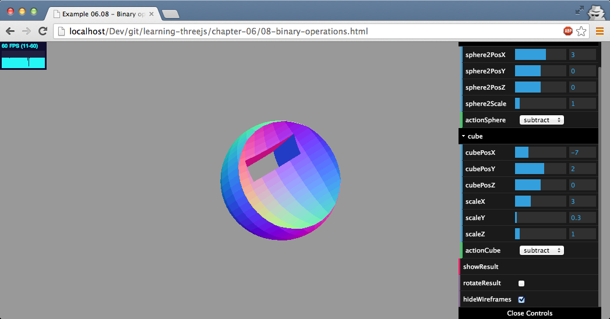

<!-- pdf-page: 204 -->
理解 subtract 功能的最佳方法就是直接动手试验示例。实现此功能的 ThreeBSP 代码非常简单，在此示例中，它在 redrawResult 函数中实现；每次单击示例中的 showResult 按钮时，都会调用此函数：

```javascript
function redrawResult() {
  scene.remove(result);
  var sphere1BSP = new ThreeBSP(sphere1);
  var sphere2BSP = new ThreeBSP(sphere2);
  var cube2BSP = new ThreeBSP(cube);
```

```javascript
  var resultBSP;
```

```text
  // first do the sphere
  switch (controls.actionSphere) {
    case "subtract":
      resultBSP = sphere1BSP.subtract(sphere2BSP);
    break;
    case "intersect":
      resultBSP = sphere1BSP.intersect(sphere2BSP);
    break;
    case "union":
      resultBSP = sphere1BSP.union(sphere2BSP);
    break;
    case "none": // noop;
  }
```

```text
  // next do the cube
  if (!resultBSP) resultBSP = sphere1BSP;
  switch (controls.actionCube) {
    case "subtract":
      resultBSP = resultBSP.subtract(cube2BSP);
    break;
    case "intersect":
      resultBSP = resultBSP.intersect(cube2BSP);
    break;
    case "union":
      resultBSP = resultBSP.union(cube2BSP);
    break;
    case "none": // noop;
  }
```

```text
  if (controls.actionCube === "none" && controls.actionSphere ===
    "none") {
```

<!-- pdf-page: 205 -->
高级几何体与二元运算

```text
  // do nothing
  } else {
    result = resultBSP.toMesh();
    result.geometry.computeFaceNormals();
    result.geometry.computeVertexNormals();
    scene.add(result);
  }
}
```

在这段代码中，我们首先将网格（你看到的线框）包装在 ThreeBSP 对象中。这样就可以在这些对象上应用 subtract、intersect 和 union 函数。现在，只需在包装中心球体的 ThreeBSP 对象（sphere1BSP）上调用所需的特定函数，此函数的结果就会包含创建新网格所需的全部信息。要创建此网格，只需在 sphere1BSP 对象上调用 toMesh() 函数。对于结果对象，必须先调用 computeFaceNormals，再调用 computeVertexNormals()，以确保所有法线都得到正确计算。之所以需要调用这些计算函数，是因为执行任一种二元运算都会更改几何体的顶点和面，从而影响面的法线。显式重新计算它们，可以确保新对象平滑着色（材质的着色方式设置为 THREE.SmoothShading 时）并正确渲染。最后，将结果添加到场景中。

对于 intersect 和 union，我们采用完全相同的方法。

### intersect（相交）函数

有了上一节介绍的所有内容，intersect 函数就没有太多需要解释的了。使用此函数，只会保留网格相互重叠的部分。以下截图展示了球体和立方体都设置为 intersect 的示例：

<!-- pdf-page: 206 -->
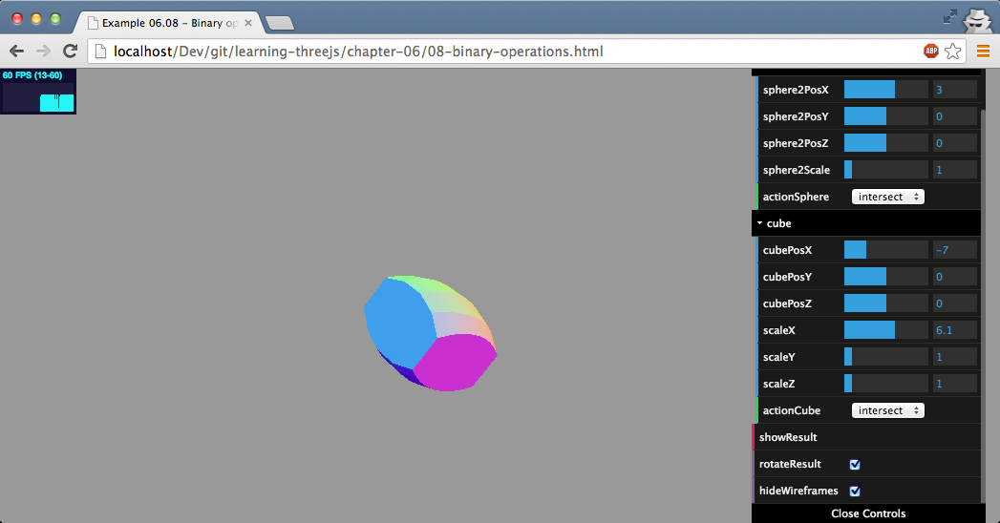

如果查看示例并尝试调整设置，就会发现创建这类对象非常容易。请记住，此功能可以应用于你能创建的每一种网格，甚至是本章见过的复杂网格，例如 THREE.ParametricGeometry 和 THREE.TextGeometry。

subtract 和 intersect 函数可以很好地协同工作。本节开头展示的示例是这样创建的：首先减去一个较小的球体，创建空心球体；随后使用立方体与此空心球体相交，得到以下结果（一个圆角的空心立方体）：

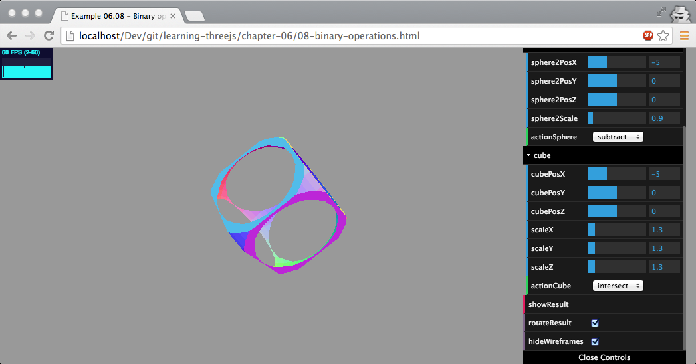

<!-- pdf-page: 207 -->
高级几何体与二元运算

ThreeBSP 提供的最后一个函数是 union 函数。

### union（合并）函数

最后一个函数是 ThreeBSP 提供的函数中最无趣的一个。使用此函数，可以将两个网格组合起来创建一个新网格。因此，将它应用于两个球体和立方体时，会得到一个单独的对象——union 函数的结果：

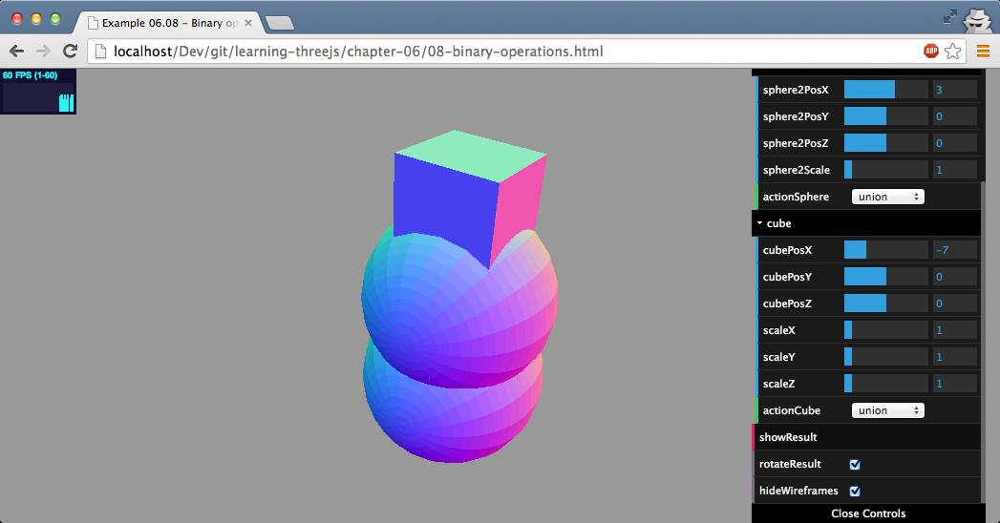

这并不是特别有用，因为 Three.js 也提供了此功能（参见第 8 章“创建和加载高级网格与几何体”，其中解释了如何使用 THREE.Geometry.merge），而且性能还略好一些。如果启用旋转，可以看到此 union 是从中心球体的角度应用的，因为它围绕该球体的中心旋转。另外两种操作也是如此。

<!-- pdf-page: 208 -->
## 总结

本章介绍了很多内容。我们介绍了几种高级几何体，甚至展示了如何通过几个简单的二元运算创建外观有趣的几何体。我们展示了如何使用 THREE.ConvexGeometry、THREE.TubeGeometry 和 THREE.LatheGeometry 等高级几何体创建非常漂亮的形状，并通过试验这些几何体获得你想要的结果。一项非常好的功能是，我们还可以将现有 SVG 路径转换为 Three.js 形状。不过请记住，你可能仍需使用 GIMP、Adobe Illustrator 或 Inkscape 等工具对路径进行微调。

如果想创建三维文本，需要指定要使用的字体。Three.js 自带了几种可用字体，但你也可以创建自己的字体。不过请记住，复杂字体通常无法正确转换。最后，通过 ThreeBSP，可以使用三种可应用于网格的二元运算：union、subtract 和 intersect。使用 union 可将两个网格组合在一起；使用 subtract 可从源网格中移除网格的重叠部分；使用 intersect 则仅保留重叠部分。

到目前为止，我们研究的都是实体（或线框）几何体，其中顶点相互连接形成面。下一章将介绍一种使用所谓粒子（particle）来可视化几何体的替代方法。使用粒子时，我们不渲染完整几何体，而只将顶点渲染为空间中的点。这样可以创建外观出色且性能良好的三维效果。

<!-- pdf-page: 209 -->
