# 第 7 章 · 粒子、精灵和点云

<!-- pdf-page: 210 -->
## 粒子、精灵和

## 点云

在前面的章节中，我们讨论了 Three.js 提供的最重要的概念、对象和 API。在本章中，我们将研究迄今为止唯一跳过的概念：粒子（Particle）。使用粒子（有时也称为精灵（Sprite）），可以非常轻松地创建许多小对象，用它们模拟雨、雪、烟雾和其他有趣的效果。例如，可以将各个几何体（Geometry）渲染为一组粒子，并分别控制这些粒子。在本章中，我们将探索 Three.js 提供的各种粒子功能。具体来说，本章将介绍以下主题：

- 使用 THREE.SpriteMaterial 创建粒子并设置其样式

- 使用点云（Point Cloud）创建一组粒子

- 根据现有几何体创建点云

- 为粒子和粒子系统（Particle System）添加动画

- 使用纹理（Texture）设置粒子的样式

- 使用画布（Canvas）和 THREE.SpriteCanvasMaterial 设置粒子的样式

首先，我们来探索什么是粒子以及如何创建粒子。不过，在开始之前，先简要说明本章使用的一些名称。在 Three.js 的近期版本中，与粒子相关的对象名称已经发生变化。本章使用的 THREE.PointCloud 以前称为 THREE.ParticleSystem，THREE.Sprite 以前称为 THREE.Particle，材质（Material）的名称也发生了一些变化。因此，如果在网上看到使用这些旧名称的示例，请记住它们讨论的是相同的概念。本章使用 Three.js 最新版本引入的新命名约定。

<!-- pdf-page: 211 -->
粒子、精灵和点云

## 理解粒子

与处理大多数新概念时一样，我们从一个示例开始。在本章的源代码中，你会找到名为 01-particles.html 的示例。打开此示例，你会看到一排排看起来毫无趣味的白色立方体，如以下屏幕截图所示：

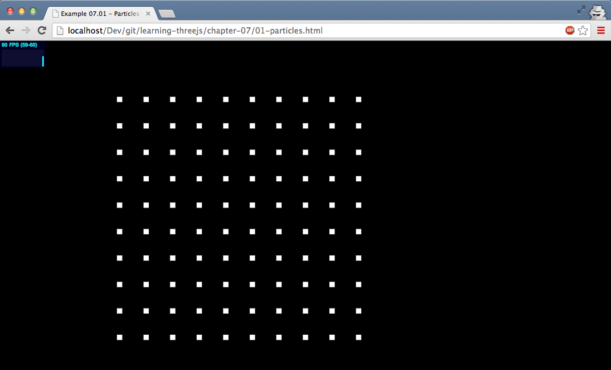

屏幕截图中显示的是 100 个精灵。精灵是一个始终面向相机的二维平面。如果创建精灵时不指定任何属性，它们会被渲染为白色的小二维方块。这些精灵是使用以下代码行创建的：

```javascript
function createSprites() {
  var material = new THREE.SpriteMaterial();
  for (var x = -5; x < 5; x++) {
    for (var y = -5; y < 5; y++) {
      var sprite = new THREE.Sprite(material);
      sprite.position.set(x * 10, y * 10, 0);
      scene.add(sprite);
    }
  }
}
```

在此示例中，我们使用 THREE.Sprite(material) 构造函数手动创建精灵。唯一传入的参数是一种材质。它必须是 THREE.SpriteMaterial 或 THREE.SpriteCanvasMaterial。本章后面将更深入地介绍这两种材质。

<!-- pdf-page: 212 -->
在继续介绍更有趣的粒子之前，我们先仔细看看 THREE.Sprite 对象。与 THREE.Mesh 一样，THREE.Sprite 对象也扩展自 THREE.Object3D 对象。这意味着你从 THREE.Mesh 了解到的大多数属性和函数都可以用于 THREE.Sprite。可以使用 position 属性设置其位置，使用 scale 属性对其进行缩放，还可以使用 translate 属性相对移动它。

请注意，在旧版 Three.js 中，THREE.Sprite 对象无法与 THREE.WebGLRenderer 一起使用，只能与 THREE.CanvasRenderer 一起使用。在当前版本中，THREE.Sprite 对象可以与这两种渲染器一起使用。

使用 THREE.Sprite，可以非常轻松地创建一组对象并在场景中移动它们。处理少量对象时，这种方式效果很好；但是，当需要处理大量 THREE.Sprite 对象时，很快就会遇到性能问题，因为 Three.js 需要分别管理每个对象。Three.js 提供了一种使用 THREE.PointCloud 处理大量精灵（或粒子）的替代方式。使用 THREE.PointCloud 时，Three.js 不必管理许多单独的 THREE.Sprite 对象，而只需管理 THREE.PointCloud 实例。

要获得与前面屏幕截图相同的结果，但这次使用 THREE.PointCloud，可以执行以下操作：

```javascript
function createParticles() {
```

```javascript
  var geom = new THREE.Geometry();
  var material = new THREE.PointCloudMaterial({size: 4,
    vertexColors: true, color: 0xffffff});
```

```javascript
  for (var x = -5; x < 5; x++) {
    for (var y = -5; y < 5; y++) {
      var particle = new THREE.Vector3(x * 10, y * 10, 0);
      geom.vertices.push(particle);
      geom.colors.push(new THREE.Color(Math.random() * 0x00ffff));
    }
  }
```

```javascript
  var cloud = new THREE.PointCloud(geom, material);
  scene.add(cloud);
}
```

<!-- pdf-page: 213 -->
粒子、精灵和点云

如你所见，对于每个粒子（云中的每个点），我们都需要创建一个顶点（Vertex）（由 THREE.Vector3 表示），将其添加到 THREE.Geometry，结合使用 THREE.Geometry 与 THREE.PointCloudMaterial 创建 THREE.PointCloud，然后将 cloud 添加到场景中。可以在 02-particles-webgl.html 示例中找到 THREE.PointCloud 的实际应用示例（带有彩色方块）。以下屏幕截图显示了此示例：

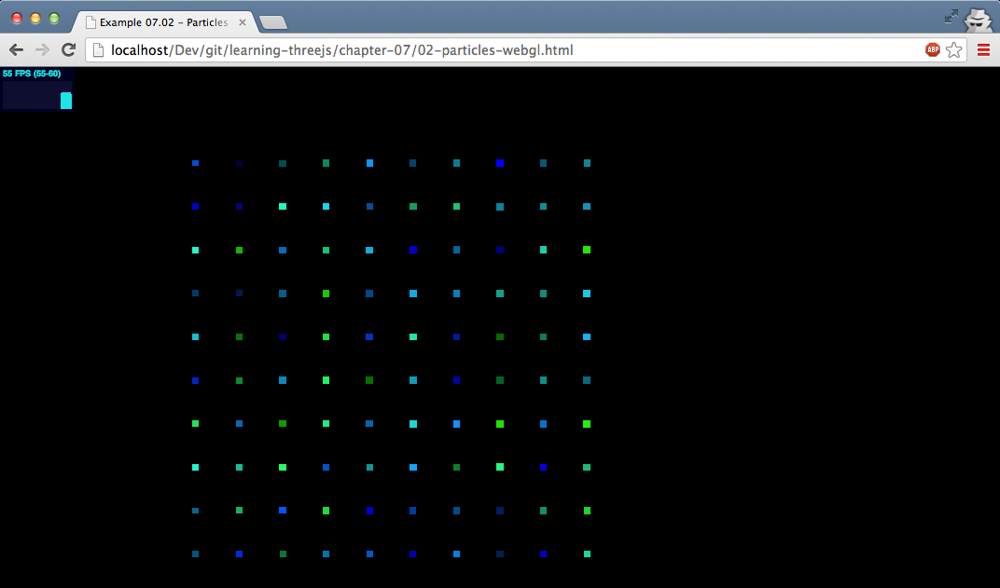

在接下来的几节中，我们将进一步探索 THREE.PointCloud。

## 粒子、THREE.PointCloud 和 THREE.PointCloudMaterial

在上一节的结尾，我们简要介绍了 THREE.PointCloud。THREE.PointCloud 的构造函数接受两个属性：一个几何体和一种材质。材质用于为粒子着色和添加纹理（稍后将会看到），几何体则定义各个粒子的位置。用于定义几何体的每个顶点和每个点都会显示为一个粒子。基于 THREE.BoxGeometry 创建 THREE.PointCloud 时，会得到 8 个粒子，立方体的每个角对应一个。不过，通常不会根据 Three.js 的某种标准几何体创建 THREE.PointCloud，而是像上一节结尾所做的那样，手动将顶点添加到从头创建的几何体中（或使用从外部加载的模型）。在本节中，我们将更深入地研究这种方法，并了解如何使用 THREE.PointCloudMaterial 设置粒子的样式。我们将通过 03-basic-point-cloud.html 示例进行探索。以下屏幕截图显示了此示例：

<!-- pdf-page: 214 -->
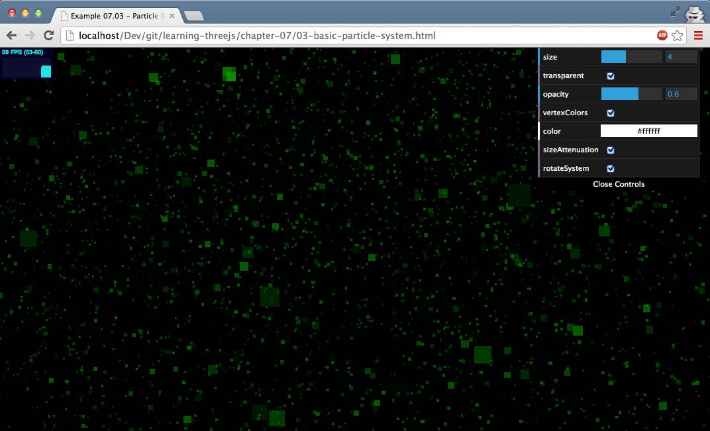

在此示例中，我们创建了 THREE.PointCloud，并向其中填充了 15,000 个粒子。所有粒子都使用 THREE.PointCloudMaterial 设置样式。为了创建 THREE.PointCloud，我们使用了以下代码：

```javascript
function createParticles(size, transparent, opacity, vertexColors,
  sizeAttenuation, color) {
```

```javascript
  var geom = new THREE.Geometry();
  var material = new THREE.PointCloudMaterial({size: size,
    transparent: transparent, opacity: opacity, vertexColors:
    vertexColors, sizeAttenuation: sizeAttenuation, color:
    color});
```

```javascript
  var range = 500;
  for (var i = 0; i < 15000; i++) {
    var particle = new THREE.Vector3(Math.random() * range - range
      / 2, Math.random() * range - range / 2, Math.random() *
      range - range / 2);
    geom.vertices.push(particle);
    var color = new THREE.Color(0x00ff00);
    color.setHSL(color.getHSL().h, color.getHSL().s, Math.random()
      * color.getHSL().l);
    geom.colors.push(color);
  }
```

<!-- pdf-page: 215 -->
粒子、精灵和点云

```javascript
  cloud = new THREE.PointCloud(geom, material);
  scene.add(cloud);
}
```

在此代码清单中，我们首先创建 THREE.Geometry。我们会将以 THREE.Vector3 表示的粒子添加到此几何体中。为此，我们创建了一个简单的循环，在随机位置创建 THREE.Vector3 并将其添加进去。在同一个循环中，我们还指定了颜色数组 geom.colors；将 THREE.PointCloudMaterial 的 vertexColors 属性设置为 true 时，就会使用这些颜色。最后要做的是创建 THREE.PointCloudMaterial 并将其添加到场景中。

下表说明了可以在 THREE.PointCloudMaterial 上设置的所有属性：

| 名称 | 描述 |
| --- | --- |
| color | 这是 ParticleSystem 中所有粒子的颜色。将 vertexColors 属性设置为 true 并使用几何体的 colors 属性指定颜色，会覆盖此属性（更准确地说，顶点的颜色将与此值相乘，以确定最终颜色）。默认值为 0xFFFFFF。 |
| map | 使用此属性，可以将纹理应用于粒子。例如，可以让它们看起来像雪花。此示例未展示此属性，本章稍后会对其进行说明。 |
| size | 这是粒子的大小。默认值为 1。 |
| sizeAnnutation | 如果将其设置为 false，无论粒子距离相机多远，所有粒子的大小都相同。如果设置为 true，则大小取决于粒子与相机之间的距离。默认值为 true。 |
| vertexColors | 通常，THREE.PointCloud 中的所有粒子都具有相同的颜色。如果将此属性设置为 THREE.VertexColors，并且几何体中的 colors 数组已填充，则会改用该数组中的颜色（另请参阅此表中的 color 条目）。默认值为 THREE.NoColors。 |
| opacity | 此属性与 transparent 属性一起设置粒子的不透明度。默认值为 1（不透明）。 |
| transparent | 如果将其设置为 true，粒子将按照 opacity 属性设置的不透明度进行渲染。默认值为 false。 |
| blending | 这是渲染粒子时使用的混合模式。有关混合模式的更多信息，请参阅第 9 章“动画和移动相机”。 |
| fog | 此属性确定粒子是否受添加到场景中的雾影响。默认为 true。 |

<!-- pdf-page: 216 -->
上一个示例提供了一个简单的控制菜单，你可以用它试验 THREE.ParticleCloudMaterial 特有的属性。

到目前为止，我们只将粒子渲染为小立方体，这是默认行为。不过，还有几种其他方法可以用来设置粒子的样式：

- 我们可以应用 THREE.SpriteCanvasMaterial（仅适用于 THREE.CanvasRenderer），将 HTML canvas 元素的结果用作纹理

- 使用 THREE.SpriteMaterial 和基于 HTML5 的纹理，以便在使用 THREE.WebGLRenderer 时将 HTML 画布的输出用作纹理

- 通过 THREE.PointCloudMaterial 的 map 属性加载外部图像文件（或使用 HTML5 画布），以设置 THREE.ParticleCloud 中所有粒子的样式

在下一节中，我们将介绍如何做到这一点。

## 使用 HTML5 画布设置粒子的样式

Three.js 提供了三种使用 HTML5 画布设置粒子样式的不同方式。如果使用 THREE.CanvasRenderer，可以直接从 THREE.SpriteCanvasMaterial 引用 HTML5 画布。使用 THREE.WebGLRenderer 时，则需要额外执行几个步骤，才能使用 HTML5 画布设置粒子的样式。在接下来的两节中，我们将展示不同的方法。

### 在 THREE.CanvasRenderer 中使用 HTML5 画布

使用 THREE.SpriteCanvasMaterial，可以将 HTML5 画布的输出用作粒子的纹理。这种材质是专门为 THREE.CanvasRenderer 创建的，只有使用这种特定的渲染器时才有效。在了解如何使用此材质之前，我们先来看看可以在此材质上设置的属性：

| 名称 | 描述 |
| --- | --- |
| color | 这是粒子的颜色。根据指定的混合模式，它会影响画布图像的颜色。 |
| program | 这是一个接受画布上下文作为参数的函数。渲染粒子时会调用此函数。对此二维绘图上下文进行调用所产生的输出会显示为粒子。 |

<!-- pdf-page: 217 -->
粒子、精灵和点云

| 名称 | 描述 |
| --- | --- |
| opacity | 此属性确定粒子的不透明度。默认值为 1，即不透明。 |
| transparent | 此属性确定粒子是否透明。它与 opacity 属性共同起作用。 |
| blending | 这是要使用的混合模式。更多详细信息，请参阅第 9 章“动画和移动相机”。 |
| rotation | 此属性允许旋转画布的内容。通常需要将其设置为 PI，才能正确对齐画布的内容。请注意，此属性不能传入材质的构造函数，而需要显式设置。 |

要查看 THREE.SpriteCanvasMaterial 的实际效果，可以打开 04-programbased-sprites.html 示例。以下屏幕截图显示了此示例：

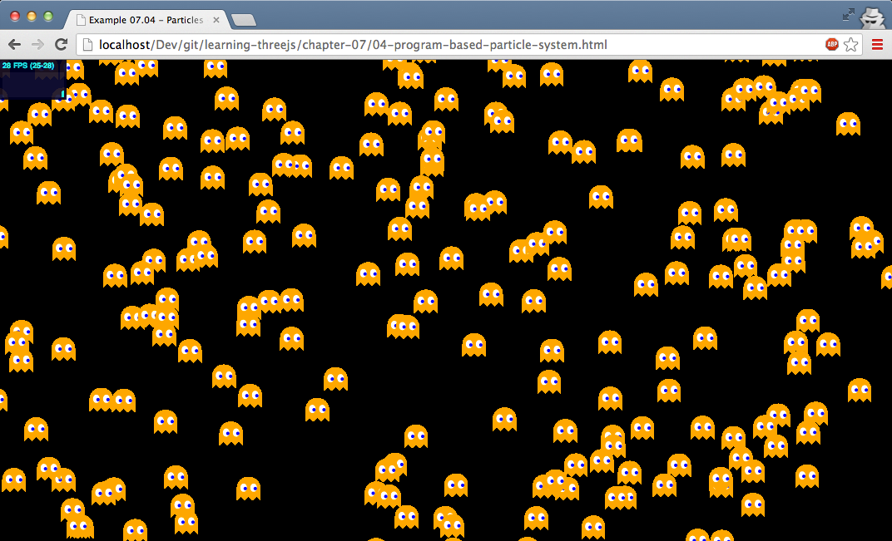

在此示例中，粒子是在 createSprites 函数中创建的：

```javascript
function createSprites() {
```

```javascript
  var material = new THREE.SpriteCanvasMaterial({
    program: draw,
    color: 0xffffff});
   material.rotation = Math.PI;
```

<!-- pdf-page: 218 -->
```javascript
  var range = 500;
  for (var i = 0; i < 1000; i++) {
    var sprite = new THREE.Sprite(material);
    sprite.position = new THREE.Vector3(Math.random() * range -
      range / 2, Math.random() * range - range / 2, Math.random()
      * range - range / 2);
    sprite.scale.set(0.1, 0.1, 0.1);
    scene.add(sprite);
  }
}
```

这段代码看起来很像我们在上一节看到的代码。主要变化在于，由于我们使用 THREE.CanvasRenderer，因此直接创建 THREE.Sprite 对象，而不是使用 THREE.PointCloud。在此代码中，我们还定义了 THREE.SpriteCanvasMaterial，其 program 属性指向 draw 函数。此 draw 函数定义粒子的外观（在本例中，是 Pac-Man 中的一个幽灵）：

```javascript
var draw = function(ctx) {
  ctx.fillStyle = "orange";
  ...
  // lots of other ctx drawing calls
  ...
  ctx.beginPath();
  ctx.fill();
}
```

我们不会深入研究绘制形状所需的实际画布代码。这里重要的是，我们定义了一个接受二维画布上下文（ctx）作为参数的函数。绘制到该上下文中的所有内容都会用作 THREE.Sprite 的形状。

### 在 WebGLRenderer 中使用 HTML5 画布

如果希望在 THREE.WebGLRenderer 中使用 HTML5 画布，可以采用两种不同方法。我们可以使用 THREE.PointCloudMaterial 并创建 THREE.PointCloud，也可以使用 THREE.Sprite 和 THREE.SpriteMaterial 的 map 属性。

<!-- pdf-page: 219 -->
粒子、精灵和点云

我们从第一种方法开始，创建 THREE.PointCloud。在介绍 THREE.PointCloudMaterial 的属性时，我们提到过 map 属性。使用 map 属性，可以为粒子加载纹理。在 Three.js 中，此纹理也可以是 HTML5 画布的输出。展示此概念的一个示例是 05a-program-based-point-cloud-webgl.html。以下屏幕截图显示了此示例：

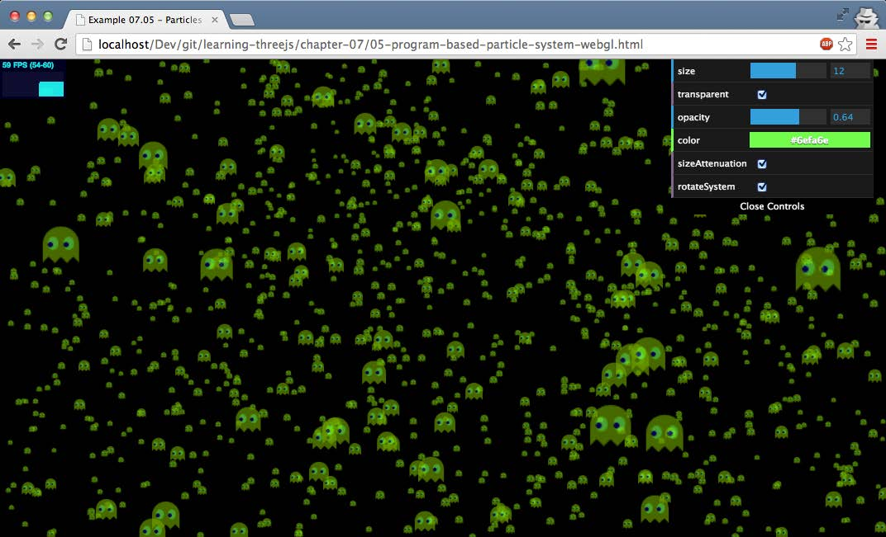

我们来看看为实现此效果而编写的代码。大部分代码与前面的 WebGL 示例相同，因此不做过多详细介绍。为得到此示例所做的重要代码更改如下所示：

```javascript
var getTexture = function() {
  var canvas = document.createElement('canvas');
  canvas.width = 32;
  canvas.height = 32;
```

```javascript
  var ctx = canvas.getContext('2d');
  ...
  // draw the ghost
  ...
  ctx.fill();
  var texture = new THREE.Texture(canvas);
  texture.needsUpdate = true;
```

<!-- pdf-page: 220 -->
```text
  return texture;
}
```

```javascript
function createPointCloud(size, transparent, opacity,
  sizeAttenuation, color) {
```

```javascript
  var geom = new THREE.Geometry();
```

```javascript
  var material = new THREE.PointCloudMaterial ({size: size,
    transparent: transparent, opacity: opacity, map: getTexture(),
    sizeAttenuation: sizeAttenuation, color: color});
```

```javascript
  var range = 500;
  for (var i = 0; i < 5000; i++) {
    var particle = new THREE.Vector3(Math.random() * range -
      range / 2, Math.random() * range - range / 2,
      Math.random() * range - range / 2);
    geom.vertices.push(particle);
  }
```

```javascript
  cloud = new THREE.PointCloud(geom, material);
  cloud.sortParticles = true;
  scene.add(cloud);
}
```

在这两个 JavaScript 函数的第一个 getTexture 中，我们基于 HTML5 canvas 元素创建 THREE.Texture。在第二个函数 createPointCloud 中，我们将此纹理赋给 THREE.PointCloudMaterial 的 map 属性。在此函数中，你还可以看到我们将 THREE.PointCloud 的 sortParticles 属性设置为 true。此属性确保在渲染粒子之前，根据它们在屏幕上的 z 位置进行排序。如果看到粒子部分重叠或透明度不正确，将此属性设置为 true（在大多数情况下）可以解决这些问题。不过，应该注意，将此属性设置为 true 会影响场景的性能。设置为 true 时，Three.js 必须确定每个单独粒子与相机之间的距离。对于非常大的 THREE.PointCloud 对象，这可能会对性能产生很大影响。

既然正在讨论 THREE.PointCloud 的属性，这里还有一个可以在 THREE.PointCloud 上设置的属性：FrustumCulled。如果此属性设置为 true，就意味着当粒子位于相机的可见范围之外时，不会渲染它们。如果需要，可以利用这一点来提高性能和帧率。

<!-- pdf-page: 221 -->
粒子、精灵和点云

这样一来，我们在 getTexture() 方法中绘制到画布上的所有内容都会用于 THREE.PointCloud 中的粒子。在下一节中，我们将更深入地介绍如何使用从外部文件加载的纹理来实现这一点。请注意，此示例只展示了纹理所能实现功能的一小部分。在第 10 章“加载和使用纹理”中，我们将深入介绍可以使用纹理完成哪些操作。

在本节开头，我们提到还可以将 THREE.Sprite 与 map 属性结合使用，以创建基于画布的粒子。为此，我们采用与上一个示例相同的方法来创建 THREE.Texture。不过，这次将其赋给 THREE.Sprite，如下所示：

```javascript
function createSprites() {
  var material = new THREE.SpriteMaterial({
    map: getTexture(),
    color: 0xffffff
  });
```

```javascript
  var range = 500;
  for (var i = 0; i < 1500; i++) {
    var sprite = new THREE.Sprite(material);
    sprite.position.set(Math.random() * range - range / 2,
      Math.random() * range - range / 2, Math.random() * range -
      range / 2);
    sprite.scale.set(4,4,4);
    scene.add(sprite);
  }
}
```

在这里可以看到，我们使用标准的 THREE.SpriteMaterial 对象，并将画布的输出作为 THREE.Texture 赋给材质的 map 属性。在浏览器中打开 05b-program-based-sprites-webgl.html，即可查看此示例。这两种方法各有优缺点。使用 THREE.Sprite 时，可以更好地控制单个粒子，但处理大量粒子时，性能会下降，复杂度也会增加。使用 THREE.PointCloud 时，可以轻松管理大量粒子，但对每个单独粒子的控制较少。

<!-- pdf-page: 222 -->
## 使用纹理设置粒子的样式

在上一个示例中，我们看到了如何使用 HTML5 画布设置 THREE.PointCloud 和单个 THREE.Sprite 对象的样式。由于可以绘制任何想要的内容，甚至可以加载外部图像，因此可以使用此方法为粒子系统添加各种样式。不过，还有一种更直接的方法可以使用图像设置粒子的样式。可以使用 THREE.ImageUtils.loadTexture() 函数将图像加载为 THREE.Texture。然后，可以将 THREE.Texture 赋给材质的 map 属性。

在本节中，我们将展示两个示例并说明如何创建它们。这两个示例都使用图像作为粒子的纹理。在第一个示例中，我们将创建下雨模拟，即 06-rainy-scene.html。以下屏幕截图显示了此示例：

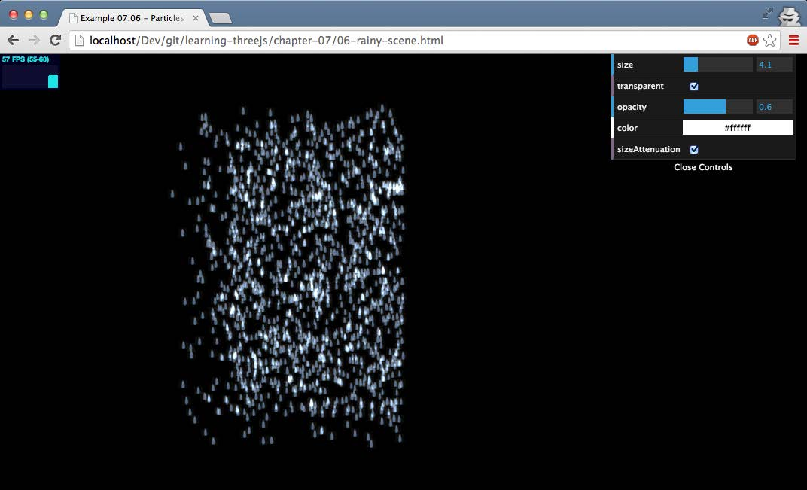

<!-- pdf-page: 223 -->
粒子、精灵和点云

我们需要做的第一件事是获取一个表示雨滴的纹理。可以在 assets/textures/particles 文件夹中找到几个示例。在第 9 章“动画和移动相机”中，我们将说明纹理的所有细节和要求。现在，你只需要知道纹理应为正方形，并且尺寸最好是 2 的幂（例如 64 x 64、128 x 128、256 x 256）。对于此示例，我们将使用以下纹理：

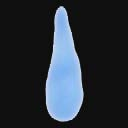

此图像使用黑色背景（正确混合所必需），并显示雨滴的形状和颜色。在 THREE.PointCloudMaterial 中使用此纹理之前，我们需要先加载它。可以使用以下代码行完成此操作：

```javascript
var texture = THREE.ImageUtils.loadTexture("../assets/textures/
  particles/raindrop-2.png");
```

使用这行代码，Three.js 将加载纹理，然后我们可以在材质中使用它。对于此示例，我们像这样定义材质：

```javascript
var material = new THREE.PointCloudMaterial({size: 3, transparent:
  true, opacity: true, map: texture, blending:
  THREE.AdditiveBlending, sizeAttenuation: true, color:
  0xffffff});
```

本章已经讨论了所有这些属性。这里主要需要理解的是，map 属性指向我们使用 THREE.ImageUtils.loadTexture() 函数加载的纹理，并且我们将 THREE.AdditiveBlending 指定为混合模式。这种混合模式意味着，绘制新像素时，背景像素的颜色会与此新像素的颜色相加。对于我们的雨滴纹理，这意味着不会显示黑色背景。一个合乎逻辑的替代方案是将纹理中的黑色替换为透明背景，但遗憾的是，这不适用于粒子和 WebGL。

<!-- pdf-page: 224 -->
这样就完成了 THREE.PointCloud 的样式设置。打开此示例时，你还会看到粒子本身在移动。在前面的示例中，我们移动的是整个粒子系统；这次，我们将在 THREE.PointCloud 内分别定位各个粒子。这其实非常简单。每个粒子都表示为一个顶点（Vertex），这些顶点构成了用于创建 THREE.PointCloud 的几何体。我们来看看如何为 THREE.PointCloud 添加粒子：

```javascript
var range = 40;
for (var i = 0; i < 1500; i++) {
  var particle = new THREE.Vector3(Math.random() * range - range /
    2, Math.random() * range * 1.5, Math.random() * range - range
    / 2);
```

```text
  particle.velocityX = (Math.random() - 0.5) / 3;
  particle.velocityY = 0.1 + (Math.random() / 5);
  geom.vertices.push(particle);
}
```

这与我们前面看到的示例没有太大区别。在这里，我们为每个粒子（THREE.Vector3）添加了两个额外属性：velocityX 和 velocityY。第一个属性定义粒子（雨滴）如何水平移动，第二个属性定义雨滴下落的速度。水平速度范围为 -0.16 到 +0.16，垂直速度范围为 0.1 到 0.3。现在每个雨滴都有自己的速度，我们就可以在渲染循环中移动各个粒子：

```javascript
var vertices = system2.geometry.vertices;
vertices.forEach(function (v) {
  v.x = v.x - (v.velocityX);
  v.y = v.y - (v.velocityY);
```

```text
  if (v.x <= -20 || v.x >= 20) v.velocityX = v.velocityX * -1;
  if (v.y <= 0) v.y = 60;
});
```

在这段代码中，我们从用于创建 THREE.PointCloud 的几何体中获取所有顶点（粒子）。对于每个粒子，我们取得 velocityX 和 velocityY，并使用它们更改粒子的当前位置。最后两行确保粒子保持在我们定义的范围内。如果 v.y 位置降到零以下，我们就将雨滴重新添加到顶部；如果 v.x 位置到达任一边缘，我们就反转水平速度，使其弹回。

<!-- pdf-page: 225 -->
粒子、精灵和点云

我们来看另一个示例。这次我们不制作雨，而是制作雪。此外，我们不再只使用单个纹理，而是使用五张独立的图像（取自 Three.js 示例）。我们还是先来看结果（参见 07-snowy-scene.html）：

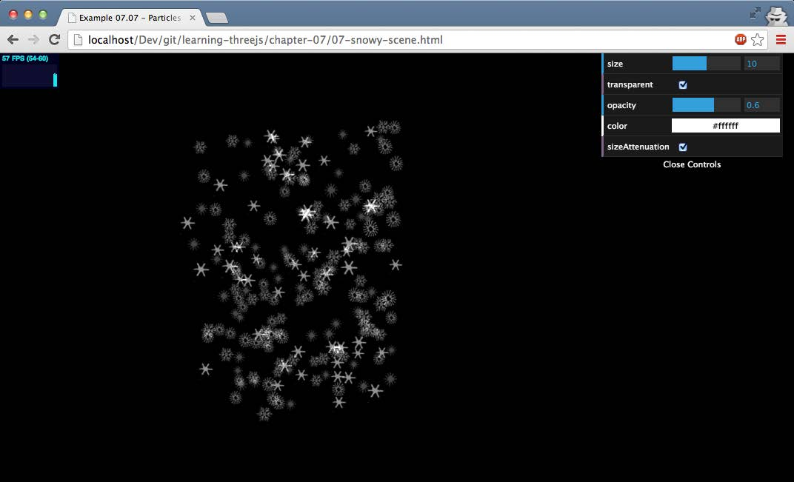

在前面的屏幕截图中，可以看到我们没有只使用一张图像作为纹理，而是使用了多张图像。你可能想知道我们是如何做到的。你可能还记得，THREE.PointCloud 只能有一种材质。如果想要多种材质，只需创建多个粒子系统，如下所示：

```javascript
function createPointClouds(size, transparent, opacity,
  sizeAttenuation, color) {
```

```javascript
  var texture1 = THREE.ImageUtils.loadTexture
    ("../assets/textures/particles/snowflake1.png");
  var texture2 = THREE.ImageUtils.loadTexture
    ("../assets/textures/particles/snowflake2.png");
  var texture3 = THREE.ImageUtils.loadTexture
    ("../assets/textures/particles/snowflake3.png");
  var texture4 = THREE.ImageUtils.loadTexture
    ("../assets/textures/particles/snowflake5.png");
```

```text
  scene.add(createPointCloud("system1", texture1, size,
    transparent, opacity, sizeAttenuation, color));
```

<!-- pdf-page: 226 -->
```text
  scene.add(createPointCloud ("system2", texture2, size,
    transparent, opacity, sizeAttenuation, color));
  scene.add(createPointCloud ("system3", texture3, size,
    transparent, opacity, sizeAttenuation, color));
  scene.add(createPointCloud ("system4", texture4, size,
    transparent, opacity, sizeAttenuation, color));
}
```

在这里可以看到，我们分别加载纹理，并将有关如何创建 THREE.PointCloud 的所有信息传递给 createPointCloud 函数。此函数如下所示：

```javascript
function createPointCloud(name, texture, size, transparent,
  opacity, sizeAttenuation, color) {
  var geom = new THREE.Geometry();
```

```javascript
  var color = new THREE.Color(color);
  color.setHSL(color.getHSL().h, color.getHSL().s, (Math.random())
    * color.getHSL().l);
```

```javascript
  var material = new THREE.PointCloudMaterial({size: size,
    transparent: transparent, opacity: opacity, map: texture,
    blending: THREE.AdditiveBlending, depthWrite: false,
    sizeAttenuation: sizeAttenuation, color: color});
```

```javascript
  var range = 40;
  for (var i = 0; i < 50; i++) {
    var particle = new THREE.Vector3(Math.random() * range - range
      / 2, Math.random() * range * 1.5, Math.random() * range -
      range / 2);
    particle.velocityY = 0.1 + Math.random() / 5;
    particle.velocityX = (Math.random() - 0.5) / 3;
    particle.velocityZ = (Math.random() - 0.5) / 3;
    geom.vertices.push(particle);
  }
```

```javascript
  var cloud = new THREE.ParticleCloud(geom, material);
  cloud.name = name;
  cloud.sortParticles = true;
  return cloud;
}
```

<!-- pdf-page: 227 -->
粒子、精灵和点云

在此函数中，我们首先要定义使用此特定纹理的粒子应以哪种颜色渲染。这是通过随机更改传入颜色的亮度来完成的。接下来，按照之前相同的方式创建材质。这里唯一的变化是将 depthWrite 属性设置为 false。此属性定义此对象是否影响 WebGL 深度缓冲区。通过将其设置为 false，我们可以确保各个点云不会相互干扰。如果未将此属性设置为 false，你会看到，当一个粒子位于另一个 THREE.PointCloud 对象的粒子前方时，有时会显示纹理的黑色背景。这段代码的最后一步是随机放置粒子，并为每个粒子添加随机速度。现在，在渲染循环中，我们可以像这样更新每个 THREE.PointCloud 对象中所有粒子的位置：

```javascript
scene.children.forEach(function (child) {
  if (child instanceof THREE.ParticleSystem) {
    var vertices = child.geometry.vertices;
    vertices.forEach(function (v) {
      v.y = v.y - (v.velocityY);
      v.x = v.x - (v.velocityX);
      v.z = v.z - (v.velocityZ);
```

```text
      if (v.y <= 0) v.y = 60;
      if (v.x <= -20 || v.x >= 20) v.velocityX = v.velocityX * -1;
      if (v.z <= -20 || v.z >= 20) v.velocityZ = v.velocityZ * -1;
    });
  }
});
```

使用这种方法，我们可以获得具有不同纹理的粒子。不过，这种方法有些局限。想要的不同纹理越多，需要创建和管理的点云就越多。如果只有一小组样式各异的粒子，最好使用本章开头介绍的 THREE.Sprite 对象。

## 使用精灵图

在本章开头，我们使用 THREE.Sprite 对象通过 THREE.CanvasRenderer 和 THREE.WebGLRenderer 渲染单个粒子。这些精灵位于三维世界中的某个位置，其大小取决于与相机之间的距离（这有时也称为广告牌效果（billboarding））。在本节中，我们将展示 THREE.Sprite 对象的另一种用途。我们将展示如何使用额外的 THREE.OrthographicCamera 实例，通过 THREE.Sprite 为三维内容创建一个类似平视显示器（head-up display，HUD）的图层。我们还将展示如何使用精灵图（sprite map）为 THREE.Sprite 对象选择图像。

<!-- pdf-page: 228 -->
作为示例，我们将创建一个简单的 THREE.Sprite 对象，使其在屏幕上从左向右移动。在背景中，我们将渲染一个带有移动相机的三维场景，以说明 THREE.Sprite 的移动独立于相机。以下屏幕截图显示了我们将为第一个示例创建的内容（08-sprites.html）：

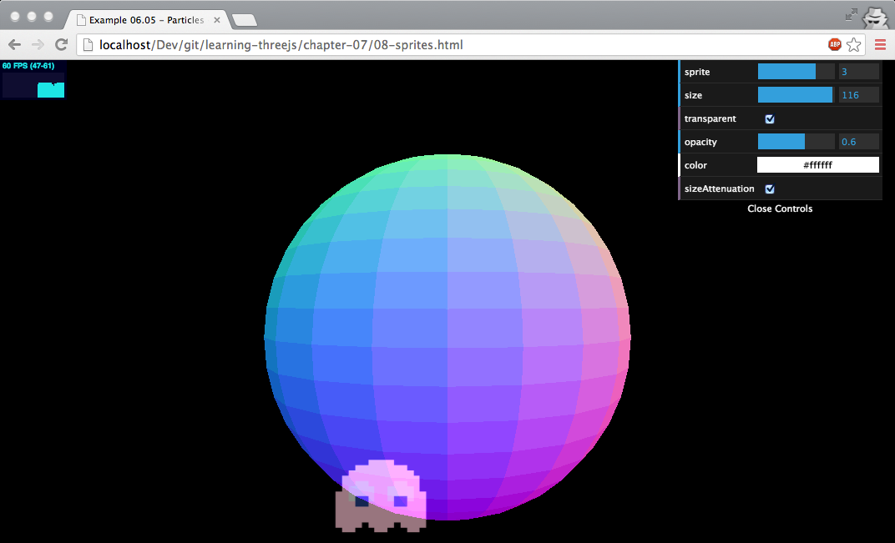

如果在浏览器中打开此示例，你会看到一个类似 Pac-Man 幽灵的精灵在屏幕上移动，并且每当碰到右边缘时都会改变颜色和形状。我们首先要了解如何创建 THREE.OrthographicCamera 和一个单独的场景，以便在其中渲染 THREE.Sprite：

```javascript
var sceneOrtho = new THREE.Scene();
var cameraOrtho = new THREE.OrthographicCamera( 0,
  window.innerWidth, window.innerHeight, 0, -10, 10 );
```

接下来，我们看看 THREE.Sprite 的构造，以及如何加载精灵可以呈现的各种形状：

```javascript
function getTexture() {
  var texture = new THREE.ImageUtils.loadTexture("../assets/
    textures/particles/sprite-sheet.png");
  return texture;
}
```

<!-- pdf-page: 229 -->
粒子、精灵和点云

```javascript
function createSprite(size, transparent, opacity, color,
  spriteNumber) {
  var spriteMaterial = new THREE.SpriteMaterial({
    opacity: opacity,
    color: color,
    transparent: transparent,
    map: getTexture()});
```

```javascript
  // we have 1 row, with five sprites
  spriteMaterial.map.offset = new THREE.Vector2(1/5 *
    spriteNumber, 0);
  spriteMaterial.map.repeat = new THREE.Vector2(1/5, 1);
  spriteMaterial.blending = THREE.AdditiveBlending;
```

```javascript
  // makes sure the object is always rendered at the front
  spriteMaterial.depthTest = false;
  var sprite = new THREE.Sprite(spriteMaterial);
  sprite.scale.set(size, size, size);
  sprite.position.set(100, 50, 0);
  sprite.velocityX = 5;
```

```text
  sceneOrtho.add(sprite);
}
```

在 getTexture() 函数中，我们加载一个纹理。不过，我们没有为五个幽灵分别加载不同的图像，而是加载了一个包含所有精灵的纹理。该纹理如下所示：

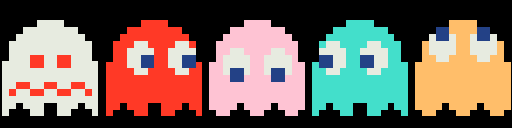

<!-- pdf-page: 230 -->
使用 map.offset 和 map.repeat 属性，我们可以选择要在屏幕上显示的正确精灵。使用 map.offset 属性，可以确定所加载纹理在 x 轴（u）和 y 轴（v）上的偏移量。这些属性的取值范围为 0 到 1。在我们的示例中，如果想选择第三个幽灵，就将 u 偏移量（x 轴）设置为 0.4；由于只有一行，因此无需更改 v 偏移量（y 轴）。如果只设置此属性，纹理会将第三个、第四个和第五个幽灵压缩在一起显示在屏幕上。要只显示一个幽灵，我们需要放大。为此，将 map.repeat 属性的 u 值设置为 1/5。这意味着我们（仅沿 x 轴）放大到只显示纹理的 20%，正好是一个幽灵。

我们需要执行的最后一步是更新 render 函数：

```text
webGLRenderer.render(scene, camera);
webGLRenderer.autoClear = false;
webGLRenderer.render(sceneOrtho, cameraOrtho);
```

我们首先使用普通相机渲染包含移动球体的场景，然后渲染包含精灵的场景。请注意，我们需要将 WebGLRenderer 的 autoClear 属性设置为 false。如果不这样做，Three.js 会在渲染精灵之前清除场景，球体就不会显示出来。

下表概述了我们在前面的示例中使用的 THREE.SpriteMaterial 的所有属性：

| 名称 | 描述 |
| --- | --- |
| color | 这是精灵的颜色。 |
| map | 这是要用于此精灵的纹理。它可以是精灵表（sprite sheet），如本节示例所示。 |
| sizeAnnutation | 如果将其设置为 false，精灵的大小就不会受其与相机之间距离的影响。默认值为 true。 |
| opacity | 此属性设置精灵的不透明度。默认值为 1（不透明）。 |
| blending | 此属性定义渲染精灵时使用的混合模式。有关混合模式的更多信息，请参阅第 9 章“动画和移动相机”。 |
| fog | 此属性确定精灵是否受添加到场景中的雾影响。默认为 true。 |

还可以在此材质上设置 depthTest 和 depthWrite 属性。有关这些属性的更多信息，请参阅第 4 章“使用 Three.js 材质”。

<!-- pdf-page: 231 -->
粒子、精灵和点云

当然，在三维空间中定位 THREE.Sprites 时（就像我们在本章开头所做的那样），也可以使用精灵图。以下屏幕截图显示了一个这样的示例（09-sprites-3D.html）：

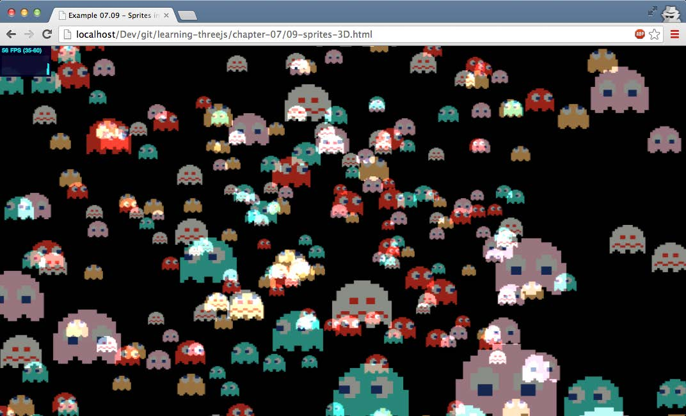

使用我们在上表中看到的属性，可以非常轻松地创建前面的屏幕截图所示的效果：

```javascript
function createSprites() {
```

```javascript
  group = new THREE.Object3D();
  var range = 200;
  for (var i = 0; i < 400; i++) {
    group.add(createSprite(10, false, 0.6, 0xffffff, i % 5,
      range));
  }
  scene.add(group);
}
```

```javascript
function createSprite(size, transparent, opacity, color,
  spriteNumber, range) {
```

```javascript
  var spriteMaterial = new THREE.SpriteMaterial({
    opacity: opacity,
```

<!-- pdf-page: 232 -->
```text
    color: color,
    transparent: transparent,
    map: getTexture()}
  );
```

```javascript
  // we have 1 row, with five sprites
  spriteMaterial.map.offset = new THREE.Vector2(0.2*spriteNumber,
    0);
  spriteMaterial.map.repeat = new THREE.Vector2(1/5, 1);
  spriteMaterial.depthTest = false;
```

```javascript
  spriteMaterial.blending = THREE.AdditiveBlending;
```

```javascript
  var sprite = new THREE.Sprite(spriteMaterial);
  sprite.scale.set(size, size, size);
  sprite.position.set(Math.random() * range - range / 2,
    Math.random() * range - range / 2, Math.random() * range -
    range / 2);
  sprite.velocityX = 5;
```

```text
  return sprite;
}
```

在此示例中，我们根据前面展示的精灵表创建了 400 个精灵。你可能已经了解并理解这里显示的大多数属性和概念。由于我们将各个精灵添加到了一个组中，因此旋转它们非常容易，可以这样做：

```text
group.rotation.x+=0.1;
```

到目前为止，本章主要介绍了如何从头创建精灵和点云。不过，一个有趣的选择是根据现有几何体创建 THREE.PointCloud。

## 根据高级几何体创建 THREE.PointCloud

你可能还记得，THREE.PointCloud 根据所提供几何体的顶点来渲染每个粒子。这意味着，如果提供复杂的几何体（例如环面纽结（torus knot）或管状体），就可以根据该特定几何体的顶点创建 THREE.PointCloud。在本章的最后一节，我们将创建一个环面纽结，就像上一章中看到的那个一样，并将其渲染为 THREE.PointCloud。

<!-- pdf-page: 233 -->
粒子、精灵和点云

上一章已经介绍过环面纽结，因此这里不做详细说明。我们使用与上一章完全相同的代码，并添加了一个菜单选项，可以用它将渲染的网格转换为 THREE.PointCloud。可以在本章的源代码中找到此示例（10-create-particle-systemfrom-model.html）。以下屏幕截图显示了此示例：

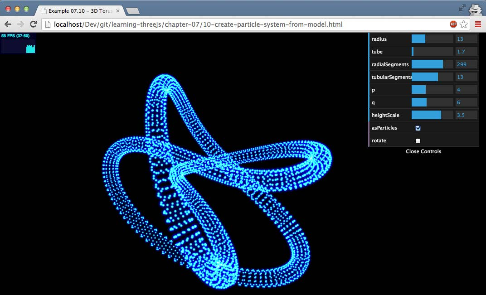

如前面的屏幕截图所示，用于生成环面纽结的每个顶点都用作一个粒子。在此示例中，我们添加了一种基于 HTML 画布的漂亮材质，以创建这种发光效果。我们只会查看创建材质和粒子系统的代码，因为本章已经讨论了其他属性：

```javascript
function generateSprite() {
```

```javascript
  var canvas = document.createElement('canvas');
  canvas.width = 16;
  canvas.height = 16;
```

```javascript
  var context = canvas.getContext('2d');
```

<!-- pdf-page: 234 -->
```javascript
  var gradient = context.createRadialGradient(canvas.width / 2,
    canvas.height / 2, 0, canvas.width / 2, canvas.height / 2,
    canvas.width / 2);
```

```text
  gradient.addColorStop(0, 'rgba(255,255,255,1)');
  gradient.addColorStop(0.2, 'rgba(0,255,255,1)');
  gradient.addColorStop(0.4, 'rgba(0,0,64,1)');
  gradient.addColorStop(1, 'rgba(0,0,0,1)');
```

```text
  context.fillStyle = gradient;
  context.fillRect(0, 0, canvas.width, canvas.height);
```

```javascript
  var texture = new THREE.Texture(canvas);
  texture.needsUpdate = true;
  return texture;
}
```

```javascript
function createPointCloud(geom) {
  var material = new THREE.PointCloudMaterial({
    color: 0xffffff,
    size: 3,
    transparent: true,
    blending: THREE.AdditiveBlending,
    map: generateSprite()
  });
```

```javascript
  var cloud = new THREE.PointCloud(geom, material);
  cloud.sortParticles = true;
  return cloud;
}
```

```javascript
// use it like this
var geom = new THREE.TorusKnotGeometry(...);
var knot = createPointCloud(geom);
```

<!-- pdf-page: 235 -->
粒子、精灵和点云

在此代码片段中，可以看到两个函数：createPointCloud() 和 generateSprite()。在第一个函数中，我们直接根据提供的几何体（在本例中为环面纽结）创建一个简单的 THREE.PointCloud 对象，并使用 generateSprite() 函数将纹理（map 属性）设置为一个发光点（在 HTML5 canvas 元素上生成），该函数如下所示：

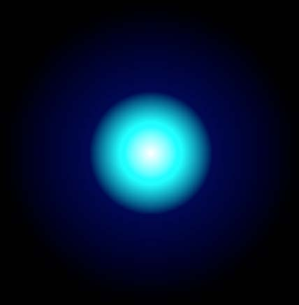

## 总结

本章到此结束。我们说明了什么是粒子、精灵和粒子系统，以及如何使用可用的材质设置这些对象的样式。在本章中，你看到了如何直接将 THREE.Sprite 与 THREE.CanvasRenderer 和 THREE.WebGLRenderer 结合使用。不过，如果要创建大量粒子，则应使用 THREE.PointCloud。使用 THREE.PointCloud 时，所有粒子共享相同的材质；唯一可以针对单个粒子更改的属性是其颜色，方法是将材质的 vertexColors 属性设置为 THREE.VertexColors，并在用于创建 THREE.PointCloud 的 THREE.Geometry 的 colors 数组中提供颜色值。我们还展示了如何通过更改粒子的位置来轻松地为粒子添加动画。无论是单个 THREE.Sprite 实例，还是用于创建 THREE.PointCloud 的几何体中的顶点，这种方式都相同。

到目前为止，我们已经根据 Three.js 提供的几何体创建了网格。这种方式非常适用于球体和立方体等简单模型，但在需要创建复杂的三维模型时，并不是最佳方法。对于这些模型，通常会使用 Blender 或 3D Studio Max 等三维建模应用程序。在下一章中，你将学习如何加载和显示由此类三维建模应用程序创建的模型。

