# 第 8 章 · 创建和加载高级网格与几何体

<!-- pdf-page: 236 -->
## 创建和加载高级网格与

## 几何体

在本章中，我们将介绍几种创建高级、复杂几何体（Geometry）和网格（Mesh）的不同方法。在第 5 章“学习使用几何体”和第 6 章“高级几何体与二元运算”中，我们已经展示了如何使用 Three.js 的内置对象创建一些高级几何体。在本章中，我们将使用以下两种方法创建高级几何体和网格：

- 分组和合并（Grouping and merging）：我们介绍的第一种方法使用 Three.js 的内置功能对现有几何体进行分组和合并。这会从现有对象创建新的网格和几何体。

- 从外部加载（Loading from external）：在本节中，我们将说明如何从外部来源加载网格和几何体。例如，我们将展示如何使用 Blender 以 Three.js 支持的格式导出网格。

我们从分组和合并的方法开始。使用这种方法时，我们使用标准的 Three.js 分组功能和 THREE.Geometry.merge() 函数来创建新对象。

## 几何体的分组与合并

在本节中，我们将介绍 Three.js 的两项基本功能：将对象组合在一起，以及将多个网格合并为单个网格。我们先从对象分组开始。

<!-- pdf-page: 237 -->
创建和加载高级网格与几何体

### 将对象组合在一起

在前面的一些章节中，你在使用多种材质（Material）时已经见过这种情况。使用多种材质根据几何体创建网格时，Three.js 会创建一个组。该组中会添加几何体的多个副本，每个副本都有自己的特定材质。返回的是这个组，因此它看起来像一个使用多种材质的网格。然而，实际上它是一个包含多个网格的组。

创建组非常容易。你创建的每个网格都可以包含子元素，这些子元素可以使用 add 函数添加。将子对象添加到组中的效果是，当你移动、缩放、旋转和平移父对象时，所有子对象也会受到影响。我们来看一个示例（01-grouping.html）。以下屏幕截图显示了此示例：

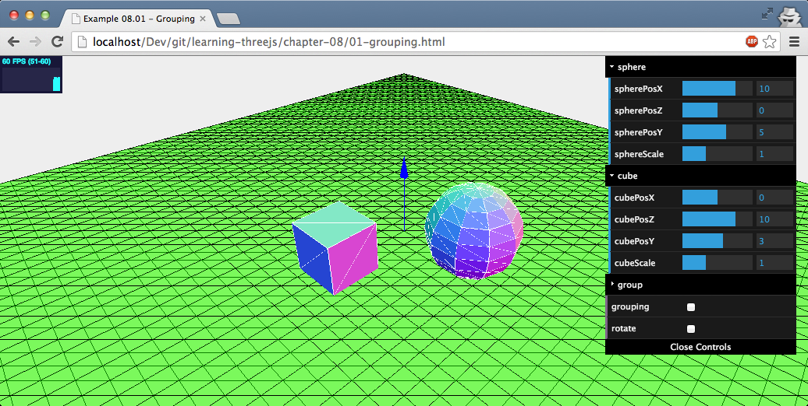

在此示例中，你可以使用菜单移动球体和立方体。如果勾选 rotate 选项，你会看到这两个网格围绕其中心旋转。这并不是什么新内容，也不是很有趣。不过，这两个对象并不是直接添加到场景中的，而是作为一个组添加的。以下代码概括了上述讨论：

```javascript
sphere = createMesh(new THREE.SphereGeometry(5, 10, 10));
cube = createMesh(new THREE.BoxGeometry(6, 6, 6));
```

```javascript
group = new THREE.Object3D();
group.add(sphere);
```

<!-- pdf-page: 238 -->
```text
group.add(cube);
```

```text
scene.add(group);
```

在此代码片段中，可以看到我们创建了 THREE.Object3D。这是 THREE.Mesh 和 THREE.Scene 的基类，但它本身不包含任何内容，也不会导致任何内容被渲染。请注意，在最新版本的 Three.js 中，引入了一个名为 THREE.Group 的新对象来支持分组。此对象与 THREE.Object3D 对象完全相同，你可以将前面代码中的 new THREE.Object3D() 替换为 new THREE.Group()，效果相同。在此示例中，我们使用 add 函数将球体和立方体添加到此对象，然后再将其添加到场景中。查看示例时，你仍然可以移动立方体和球体，并缩放和旋转这两个对象。你也可以对它们所在的组执行这些操作。查看 group 菜单，你会看到 position 和 scale 选项。可以使用它们缩放和移动整个组。组内对象的缩放和位置是相对于组自身的缩放和位置而言的。

缩放和位置都非常直观。不过，需要记住的一点是，旋转一个组时，并不是分别旋转组内的对象，而是让整个组围绕其自身中心旋转（在我们的示例中，就是让整个组围绕组对象的中心旋转）。在此示例中，我们使用 THREE.ArrowHelper 对象在组的中心放置了一个箭头，以指示旋转点：

```javascript
var arrow = new THREE.ArrowHelper(new THREE.Vector3(0, 1, 0),
  group.position, 10, 0x0000ff);
scene.add(arrow);
```

<!-- pdf-page: 239 -->
创建和加载高级网格与几何体

如果同时勾选 grouping 和 rotate 复选框，组就会旋转。你会看到球体和立方体围绕组的中心（由箭头指示）旋转，如下所示：

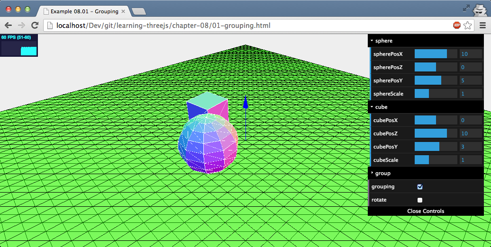

使用组时，仍然可以引用、修改和定位各个几何体。唯一需要记住的是，所有位置、旋转和平移都是相对于父对象进行的。在下一节中，我们将介绍合并，届时你会将多个独立的几何体组合起来，最终得到单个 THREE.Geometry 对象。

### 将多个网格合并为单个网格

在大多数情况下，使用组可以轻松地操作和管理大量网格。但是，在处理非常大量的对象时，性能会成为一个问题。使用组时，你仍然在处理单独的对象，每个对象都需要单独处理和渲染。使用 THREE.Geometry.merge()，可以将几何体合并在一起，创建一个组合后的几何体。在下面的示例中，你可以看到它的工作方式及其对性能的影响。如果打开 02-merging.html 示例，你会看到一个包含一组随机分布的半透明立方体的场景。使用菜单中的滑块，可以设置场景中所需的立方体数量，并通过单击 redraw 按钮重新绘制场景。根据运行示例的硬件，随着立方体数量的增加，你会看到性能下降。在我们的例子中，如以下屏幕截图所示，这种情况发生在大约 4,000 个对象时，此时刷新率从正常的 60 fps 降至约 40 fps：

<!-- pdf-page: 240 -->
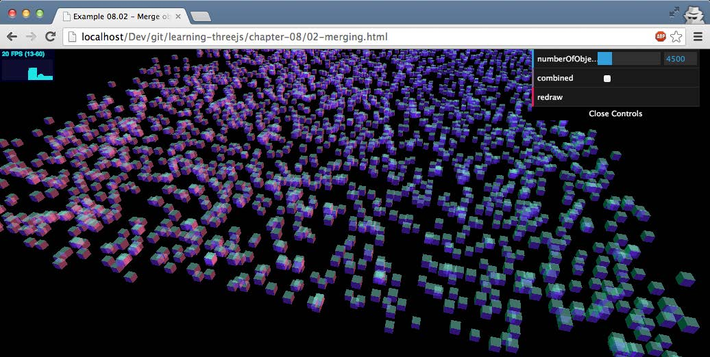

如你所见，可以添加到场景中的网格数量存在一定限制。不过，通常你可能不需要那么多网格；但在创建特定游戏（例如 Minecraft 之类的游戏）或高级可视化时，可能需要管理大量单独的网格。使用 THREE.Geometry.merge() 可以解决这个问题。在查看代码之前，我们先运行同一个示例，但这次勾选 combine 复选框。选中此选项后，我们会将所有立方体合并为单个 THREE.Geometry，并改为添加这个几何体，如以下屏幕截图所示：

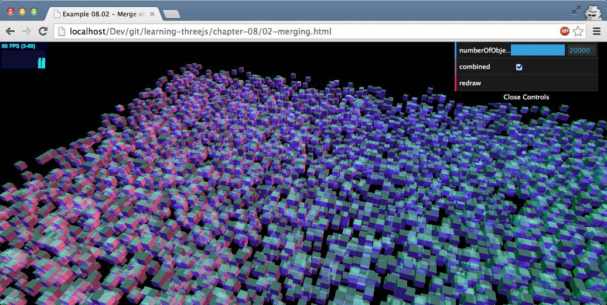

<!-- pdf-page: 241 -->
创建和加载高级网格与几何体

如你所见，我们可以轻松渲染 20,000 个立方体，而性能没有任何下降。为此，我们使用了以下几行代码：

```javascript
var geometry = new THREE.Geometry();
for (var i = 0; i < controls.numberOfObjects; i++) {
  var cubeMesh = addcube();
  cubeMesh.updateMatrix();
  geometry.merge(cubeMesh.geometry,cubeMesh.matrix);
}
scene.add(new THREE.Mesh(geometry, cubeMaterial));
```

在此代码片段中，addCube() 函数返回 THREE.Mesh。在旧版 Three.js 中，我们还可以使用 THREE.GeometryUtils.merge 函数将 THREE.Mesh 对象合并为 THREE.Geometry 对象。在最新版本中，此功能已被弃用，转而使用 THREE.Geometry.merge 函数。为了确保合并进来的 THREE.Geometry 对象具有正确的位置和旋转，我们不仅向 merge 函数提供 THREE.Geometry，还提供其变换矩阵。将此矩阵添加到 merge 函数后，合并进来的立方体就会被正确定位。

我们重复执行此操作 20,000 次，最终得到单个几何体并将其添加到场景中。查看代码，你可能会发现这种方法的一些缺点。由于最终只剩下单个几何体，因此无法为每个单独的立方体应用材质。不过，使用 THREE.MeshFaceMaterial 可以在一定程度上解决这个问题。然而，最大的缺点是会失去对各个立方体的控制。如果想移动、旋转或缩放单个立方体，就无法做到（除非你搜索正确的面和顶点，并分别定位它们）。

使用分组和合并的方法，可以利用 Three.js 提供的基本几何体创建大型复杂几何体。如果想创建更高级的几何体，那么使用 Three.js 提供的编程方式并不总是最佳、最简单的选择。幸运的是，Three.js 还提供了其他几种创建几何体的方式。在下一节中，我们将介绍如何从外部资源加载几何体和网格。

### 从外部资源加载几何体

Three.js 可以读取多种三维文件格式，并导入这些文件中定义的几何体和网格。下表列出了 Three.js 支持的文件格式：

<!-- pdf-page: 242 -->
格式 描述

JSON Three.js 有自己的 JSON 格式，可用于以声明方式定义几何体或场景。尽管这不是一种官方格式，但它非常易于使用，在需要重用复杂几何体或场景时非常方便。

OBJ 或 MTL OBJ 是一种简单的三维格式，最初由 Wavefront Technologies 开发。它是采用最广泛的三维文件格式之一，用于定义对象的几何体。MTL 是 OBJ 的配套格式。在 MTL 文件中，指定 OBJ 文件中对象的材质。

如果希望将模型从 Three.js 导出为 OBJ，Three.js 还提供了一个名为 OBJExporter.js 的自定义 OBJ 导出器。

Collada Collada 是一种以基于 XML 的格式定义数字资产的格式。这也是一种广泛使用的格式，几乎所有三维应用程序和渲染引擎都支持它。

STL STL 代表立体光刻（STereoLithography），广泛用于快速原型制作。例如，三维打印机的模型通常定义为 STL 文件。

如果希望将模型从 Three.js 导出为 STL，Three.js 还提供了一个名为 STLExporter.js 的自定义 STL 导出器。

CTM CTM 是由 openCTM 创建的一种文件格式。它用于以紧凑格式存储基于三角形的三维网格。

VTK VTK 是由 Visualization Toolkit 定义的文件格式，用于指定顶点和面。它有两种可用格式：二进制格式和基于文本的 ASCII 格式。Three.js 仅支持基于 ASCII 的格式。

AWD AWD 是一种用于三维场景的二进制格式，最常与 http://away3d.com/ 引擎一起使用。请注意，此加载器不支持压缩的 AWD 文件。

Assimp 开放资产导入库（Open asset import library，也称为 Assimp）是导入各种三维模型格式的标准方式。使用此加载器，可以导入已使用 assimp2json 转换的多种三维格式模型，其详细信息可在 https:// github.com/acgessler/assimp2json 找到。

VRML VRML 代表虚拟现实建模语言（Virtual Reality Modeling Language）。这是一种基于文本的格式，可用于指定三维对象和世界。它已被 X3D 文件格式取代。Three.js 不支持加载 X3D 模型，但这些模型可以轻松转换为其他格式。更多信息请访问 http://www. x3dom.org/?page\_id=532#。

<!-- pdf-page: 243 -->
创建和加载高级网格与几何体

格式 描述

Babylon Babylon 是一个三维 JavaScript 游戏库。它以自己的内部格式存储模型。有关此格式的更多信息，请访问 http://www.babylonjs.com/。

PDB 这是一种非常专业的格式，由蛋白质数据库（Protein Data Bank）创建，用于指定蛋白质的外观。Three.js 可以加载以此格式指定的蛋白质并对其进行可视化。

PLY 此格式称为多边形文件格式（Polygon File Format）。它最常用于存储来自三维扫描仪的信息。

在下一章讨论动画时，我们将重新介绍其中一些格式（并介绍另外两种格式：MD2 和 glTF）。现在，我们从列表中的第一种格式，即 Three.js 的内部格式开始。

### 以 Three.js JSON 格式保存和加载

在 Three.js 中，可以在两种不同情况下使用 Three.js 的 JSON 格式。可以用它保存和加载单个 THREE.Mesh，也可以用它保存和加载完整场景。

#### 保存和加载 THREE.Mesh

为了演示保存和加载，我们基于 THREE.TorusKnotGeometry 创建了一个简单示例。使用此示例，可以像在第 5 章“学习使用几何体”中所做的那样创建一个环面纽结（torus knot），并使用 Save & Load 菜单中的 save 按钮保存当前几何体。对于此示例，我们使用 HTML5 本地存储（local storage）API 进行保存。此 API 使我们能够轻松地在客户端浏览器中存储持久信息，并在以后检索这些信息（即使在浏览器关闭并重新启动之后也是如此）。

我们将查看 03-load-save-json-object.html 示例。以下屏幕截图显示了此示例：

<!-- pdf-page: 244 -->
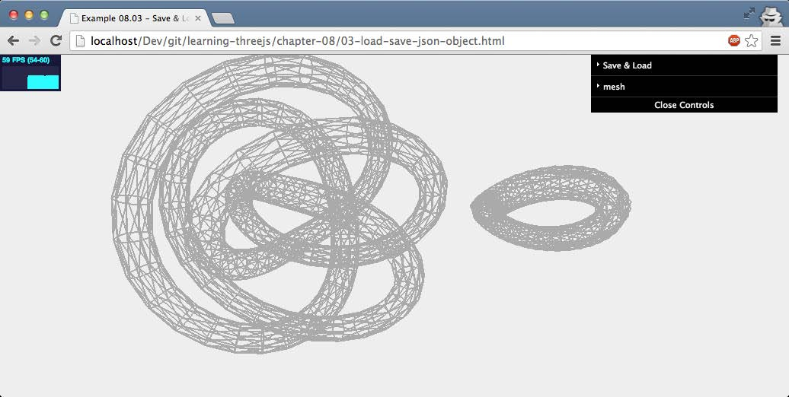

从 Three.js 以 JSON 导出非常容易，不需要包含任何额外的库。将 THREE.Mesh 导出为 JSON 只需执行以下操作：

```javascript
var result = knot.toJSON();
localStorage.setItem("json", JSON.stringify(result));
```

保存之前，我们首先使用 JSON.stringify 函数将 toJSON 函数的结果（一个 JavaScript 对象）转换为字符串。这会生成如下所示的 JSON 字符串（省略了大部分顶点和面）：

```text
{
  "metadata": {
    "version": 4.3,
    "type": "Object",
    "generator": "ObjectExporter"
  },
  "geometries": [{
    "uuid": "53E1B290-3EF3-4574-BD68-E65DFC618BA7",
    "type": "TorusKnotGeometry",
    "radius": 10,
    "tube": 1,
    "radialSegments": 64,
    "tubularSegments": 8,
    "p": 2,
```

<!-- pdf-page: 245 -->
创建和加载高级网格与几何体

```text
    "q": 3,
    "heightScale": 1
  }],
  ...
}
```

如你所见，Three.js 会保存有关 THREE.Mesh 的所有信息。要使用 HTML5 本地存储 API 保存此信息，我们只需调用 localStorage.setItem 函数。第一个参数是键名（json），以后可以用它检索作为第二个参数传入的信息。

将 THREE.Mesh 加载回 Three.js 也只需要几行代码，如下所示：

```javascript
var json = localStorage.getItem("json");
```

```javascript
if (json) {
  var loadedGeometry = JSON.parse(json);
  var loader = new THREE.ObjectLoader();
```

```text
  loadedMesh = loader.parse(loadedGeometry);
  loadedMesh.position.x -= 50;
  scene.add(loadedMesh);
}
```

在这里，我们首先使用保存时采用的名称（在本例中为 json）从本地存储中获取 JSON。为此，我们使用 HTML5 本地存储 API 提供的 localStorage.getItem 函数。接下来，需要将字符串转换回 JavaScript 对象（JSON.parse），并将 JSON 对象转换回 THREE.Mesh。Three.js 提供了一个名为 THREE.ObjectLoader 的辅助对象，可以用它将 JSON 转换为 THREE.Mesh。在此示例中，我们使用加载器上的 parse 方法直接解析 JSON 字符串。加载器还提供了 load 函数，可以向其传入包含 JSON 定义的文件的 URL。

如你所见，这里只保存了 THREE.Mesh。其他所有内容都会丢失。如果想保存完整场景，包括光源和相机，可以使用 THREE.SceneExporter。

#### 保存和加载场景

如果要保存完整场景，可以使用与上一节保存几何体时相同的方法。04-load-save-json-scene.html 是一个展示此方法的可运行示例。以下屏幕截图显示了此示例：

<!-- pdf-page: 246 -->
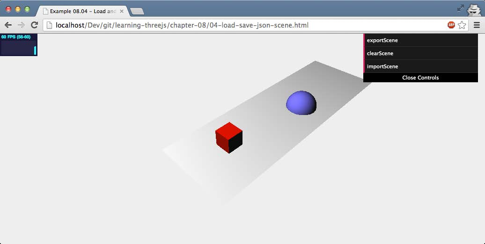

在此示例中，你有三个选项：exportScene、clearScene 和 importScene。使用 exportScene，场景的当前状态将保存在浏览器的本地存储中。要测试导入功能，可以单击 clearScene 按钮移除场景，然后使用 importScene 按钮从本地存储加载它。完成所有这些操作的代码非常简单，但在使用之前，必须从 Three.js 发行包中导入所需的导出器和加载器（请查看 examples/js/exporters 和 examples/js/loaders 目录）：

```html
<script type="text/javascript" src="../libs/SceneLoader.js">
  </script>
<script type="text/javascript" src="../libs/SceneExporter.js">
  </script>
```

将这些 JavaScript 文件引入页面后，就可以使用以下代码导出场景：

```javascript
var exporter = new THREE.SceneExporter();
var sceneJson = JSON.stringify(exporter.parse(scene));
localStorage.setItem('scene', sceneJson);
```

此方法与我们在上一节使用的方法完全相同，只是这次使用 THREE.SceneExporter() 导出完整场景。生成的 JSON 如下所示：

```text
{
  "metadata": {
    "formatVersion": 3.2,
```

<!-- pdf-page: 247 -->
创建和加载高级网格与几何体

```text
    "type": "scene",
    "generatedBy": "SceneExporter",
    "objects": 5,
    "geometries": 3,
    "materials": 3,
    "textures": 0
  },
  "urlBaseType": "relativeToScene", "objects": {
    "Object_78B22F27-C5D8-46BF-A539-A42207DDDCA8": {
      "geometry": "Geometry_5",
      "material": "Material_1",
      "position": [15, 0, 0],
      "rotation": [-1.5707963267948966, 0, 0],
      "scale": [1, 1, 1],
      "visible": true
    }
    ... // removed all the other objects for legibility
  },
  "geometries": {
    "Geometry_8235FC68-64F0-45E9-917F-5981B082D5BC": {
      "type": "cube",
      "width": 4,
      "height": 4,
      "depth": 4,
      "widthSegments": 1,
      "heightSegments": 1,
      "depthSegments": 1
    }
    ... // removed all the other objects for legibility
  }
  ... other scene information like textures
```

再次加载此 JSON 时，Three.js 会按照导出时的样子准确地重新创建对象。加载场景的方法如下：

```javascript
var json = (localStorage.getItem('scene'));
var sceneLoader = new THREE.SceneLoader();
sceneLoader.parse(JSON.parse(json), function(e) {
  scene = e.scene;
}, '.');
```

<!-- pdf-page: 248 -->
传入加载器的最后一个参数（'.'）定义相对 URL。例如，如果材质使用了纹理（例如外部图像），就会使用此相对 URL 检索它们。在这个不使用纹理的示例中，我们只传入当前目录。与 THREE.ObjectLoader 一样，也可以使用 load 函数从 URL 加载 JSON 文件。

有许多不同的三维程序可用于创建复杂网格。Blender（www.blender.org）是一个流行的开源程序。Three.js 有一个适用于 Blender（以及 Maya 和 3D Studio Max）的导出器，可直接导出为 Three.js 的 JSON 格式。在下一节中，我们将逐步介绍如何配置 Blender 以使用此导出器，并展示如何在 Blender 中导出复杂模型并在 Three.js 中显示它。

### 使用 Blender

在开始配置之前，我们先展示要实现的结果。在以下屏幕截图中，可以看到一个简单的 Blender 模型，我们使用 Three.js 插件将其导出，再使用 THREE.JSONLoader 将其导入 Three.js：

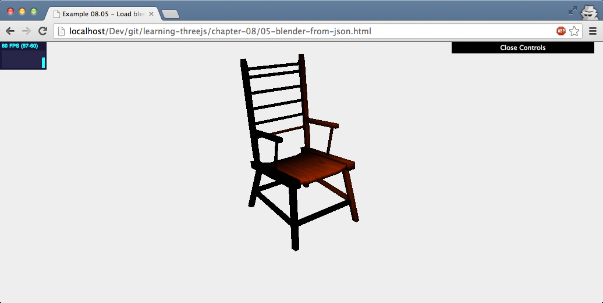

<!-- pdf-page: 249 -->
创建和加载高级网格与几何体

#### 在 Blender 中安装 Three.js 导出器

要让 Blender 导出 Three.js 模型，首先需要将 Three.js 导出器添加到 Blender。以下步骤适用于 Mac OS X，但在 Windows 和 Linux 上也基本相同。可以从 www.blender.org 下载 Blender，并按照特定平台的安装说明进行安装。安装后，即可添加 Three.js 插件。首先，使用终端窗口找到 Blender 安装目录中的 addons 目录：

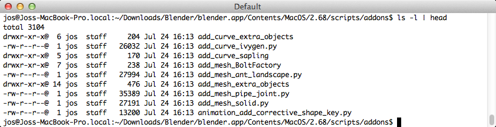

在我的 Mac 上，它位于 ./blender.app/Contents/MacOS/2.70/scripts/ addons。对于 Windows，可以在以下位置找到此目录：C:\\Users\\USERNAME\\AppData\\Roaming\\Blender Foundation\\Blender\\2.7X\\ scripts\\addons。对于 Linux，可以在这里找到此目录：/home/ USERNAME/.config/blender/2.7X/scripts/addons。

接下来，需要获取 Three.js 发行包并在本地解压。在此发行包中，可以找到以下文件夹：utils/exporters/blender/2.65/ scripts/addons/。此目录中有一个名为 io\_ mesh\_threejs 的子目录。将此目录复制到 Blender 安装目录的 addons 文件夹中。

现在，我们只需启动 Blender 并启用导出器。在 Blender 中，打开 Blender 用户首选项（File | User Preferences）。在打开的窗口中，选择 Addons（插件）选项卡，并在搜索框中输入 three。这将显示以下界面：

<!-- pdf-page: 250 -->
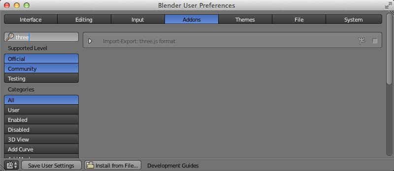

此时，已经找到 Three.js 插件，但它仍处于禁用状态。勾选右侧的小复选框，Three.js 导出器就会启用。最后检查一切是否正常工作：打开 File | Export 菜单选项，你会看到 Three.js 被列为一个导出选项。以下屏幕截图显示了这一点：

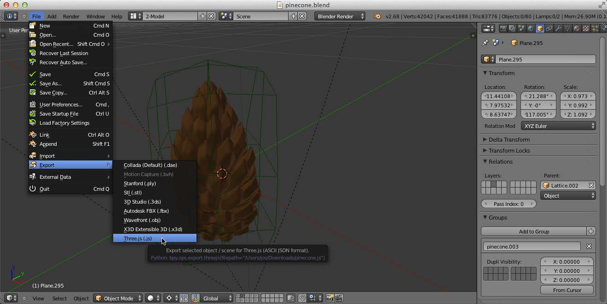

插件安装完成后，我们就可以加载第一个模型了。

<!-- pdf-page: 251 -->
创建和加载高级网格与几何体

#### 从 Blender 加载和导出模型

作为示例，我们在 assets/models 文件夹中添加了一个名为 misc\_chair01.blend 的简单 Blender 模型，你可以在本书的源代码中找到该文件夹。在本节中，我们将加载此模型，并展示将其导出到 Three.js 所需的最少步骤。

首先，需要在 Blender 中加载此模型。使用 File | Open，导航到包含 misc\_chair01.blend 文件的文件夹。选择此文件并单击 Open。这将显示一个类似下面的界面：

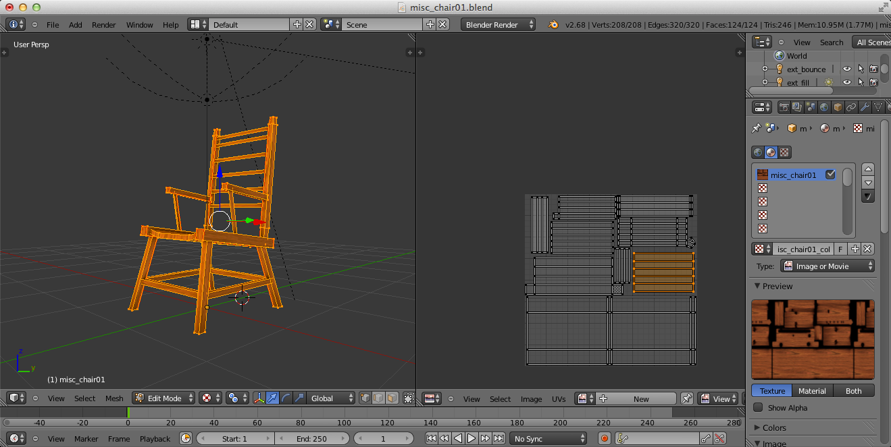

将此模型导出为 Three.js JSON 格式非常简单。从 File 菜单中打开 Export | Three.js，输入导出文件的名称，然后选择 Export Three.js。这将创建一个 Three.js 能够理解的 JSON 文件。此文件的部分内容如下所示：

```text
{
```

```text
  "metadata" :
  {
    "formatVersion" : 3.1,
    "generatedBy"   : "Blender 2.7 Exporter",
    "vertices"      : 208,
    "faces"         : 124,
    "normals"       : 115,
    "colors"        : 0,
```

<!-- pdf-page: 252 -->
```text
    "uvs"           : [270,151],
    "materials"     : 1,
    "morphTargets"  : 0,
    "bones"         : 0
  },
...
```

不过，我们还没有完全完成。在前面的屏幕截图中，可以看到椅子包含木质纹理。如果查看 JSON 导出内容，可以看到椅子的导出内容还指定了一种材质，如下所示：

```text
"materials": [{
  "DbgColor": 15658734,
  "DbgIndex": 0,
  "DbgName": "misc_chair01",
  "blending": "NormalBlending",
  "colorAmbient": [0.53132, 0.25074, 0.147919],
  "colorDiffuse": [0.53132, 0.25074, 0.147919],
  "colorSpecular": [0.0, 0.0, 0.0],
  "depthTest": true,
  "depthWrite": true,
  "mapDiffuse": "misc_chair01_col.jpg",
  "mapDiffuseWrap": ["repeat", "repeat"],
  "shading": "Lambert",
  "specularCoef": 50,
  "transparency": 1.0,
  "transparent": false,
  "vertexColors": false
}],
```

此材质为 mapDiffuse 属性指定了纹理 misc\_chair01\_col.jpg。因此，除了导出模型之外，我们还需要确保 Three.js 也能访问纹理文件。幸运的是，我们可以直接从 Blender 保存此纹理。

在 Blender 中，打开 UV/Image Editor（UV/图像编辑器）视图。可以从 File 菜单选项左侧的下拉菜单中选择此视图。这会将顶部菜单替换为以下内容：

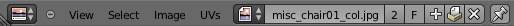

<!-- pdf-page: 253 -->
创建和加载高级网格与几何体

确保选中要导出的纹理，在本例中为 misc\_chair\_01\_col.jpg（可以使用小图像图标选择其他纹理）。接下来，单击 Image 菜单，并使用 Save as Image（图像另存为）菜单选项保存图像。使用 JSON 导出文件中指定的名称，将其保存在保存模型的同一文件夹中。至此，我们就可以将模型加载到 Three.js 中了。

此时，将其加载到 Three.js 的代码如下所示：

```javascript
var loader = new THREE.JSONLoader();
loader.load('../assets/models/misc_chair01.js', function (geometry,
mat) {
  mesh = new THREE.Mesh(geometry, mat[0]);
```

```text
  mesh.scale.x = 15;
  mesh.scale.y = 15;
  mesh.scale.z = 15;
```

```text
  scene.add(mesh);
```

```text
}, '../assets/models/');
```

我们之前已经见过 JSONLoader，但这次使用 load 函数而不是 parse 函数。在此函数中，我们指定要加载的 URL（指向导出的 JSON 文件）、对象加载完成时调用的回调，以及可以找到纹理的位置 ../assets/models/（相对于页面）。此回调接受两个参数：geometry 和 mat。geometry 参数包含模型，mat 参数包含材质对象数组。我们知道只有一种材质，因此在创建 THREE.Mesh 时直接引用该材质。如果打开 05-blender-from-json.html 示例，就可以看到刚刚从 Blender 导出的椅子。

使用 Three.js 导出器并不是将模型从 Blender 加载到 Three.js 的唯一方法。Three.js 支持多种三维文件格式，而 Blender 可以导出为其中几种格式。不过，使用 Three.js 格式非常容易，而且如果出现问题，通常也能很快找到原因。

在下一节中，我们将介绍 Three.js 支持的几种格式，并展示一个基于 Blender 的 OBJ 和 MTL 文件格式示例。

<!-- pdf-page: 254 -->
### 从三维文件格式导入

在本章开头，我们列出了 Three.js 支持的多种格式。在本节中，我们将快速浏览其中几种格式的示例。请注意，对于所有这些格式，都需要包含额外的 JavaScript 文件。可以在 Three.js 发行包的 examples/js/ loaders 目录中找到所有这些文件。

#### OBJ 和 MTL 格式

OBJ 和 MTL 是配套格式，经常一起使用。OBJ 文件定义几何体，MTL 文件定义所使用的材质。OBJ 和 MTL 都是基于文本的格式。OBJ 文件的部分内容如下所示：

```text
v -0.032442 0.010796 0.025935
v -0.028519 0.013697 0.026201
v -0.029086 0.014533 0.021409
usemtl Material
s 1
f 2731 2735 2736 2732
f 2732 2736 3043 3044
```

MTL 文件像这样定义材质：

```text
newmtl Material
Ns 56.862745
Ka 0.000000 0.000000 0.000000
Kd 0.360725 0.227524 0.127497
Ks 0.010000 0.010000 0.010000
Ni 1.000000
d 1.000000
illum 2
```

<!-- pdf-page: 255 -->
创建和加载高级网格与几何体

Three.js 能够很好地理解 OBJ 和 MTL 格式，Blender 也支持这两种格式。因此，作为替代方案，可以选择以 OBJ/MTL 格式而不是 Three.js JSON 格式从 Blender 导出模型。Three.js 提供了两种不同的加载器供你使用。如果只想加载几何体，可以使用 OBJLoader。我们在示例（06-load-obj.html）中使用了此加载器。以下屏幕截图显示了此示例：

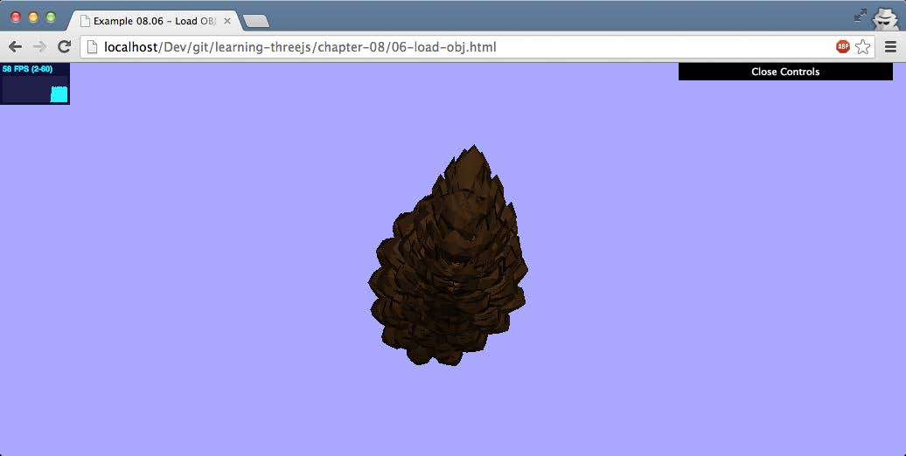

要将其导入 Three.js，必须添加 OBJLoader JavaScript 文件：

```html
<script type="text/javascript" src="../libs/OBJLoader.js">
  </script>
```

像这样导入模型：

```javascript
var loader = new THREE.OBJLoader();
loader.load('../assets/models/pinecone.obj', function (loadedMesh) {
  var material = new THREE.MeshLambertMaterial({color: 0x5C3A21});
```

```javascript
  // loadedMesh is a group of meshes. For
  // each mesh set the material, and compute the information
  // three.js needs for rendering.
  loadedMesh.children.forEach(function (child) {
    child.material = material;
    child.geometry.computeFaceNormals();
    child.geometry.computeVertexNormals();
  });
```

<!-- pdf-page: 256 -->
```text
  mesh = loadedMesh;
  loadedMesh.scale.set(100, 100, 100);
  loadedMesh.rotation.x = -0.3;
  scene.add(loadedMesh);
});
```

在此代码中，我们使用 OBJLoader 从 URL 加载模型。模型加载完成后，我们提供的回调会被调用，然后我们将模型添加到场景中。

通常，一个好的第一步是将回调的响应输出到控制台，以了解加载对象的结构。使用这些加载器时，几何体或网格通常以组的层次结构返回。理解这一点会让放置模型、应用正确的材质以及执行任何其他附加步骤变得容易得多。此外，还要查看几个顶点的位置，以确定是否需要放大或缩小模型，以及应将相机放置在何处。在此示例中，我们还调用了 computeFaceNormals 和 computeVertexNormals。这是确保所用材质（THREE.MeshLambertMaterial）正确渲染所必需的。

下一个示例（07-load-obj-mtl.html）使用 OBJMTLLoader 加载模型并直接指定材质。以下屏幕截图显示了此示例：

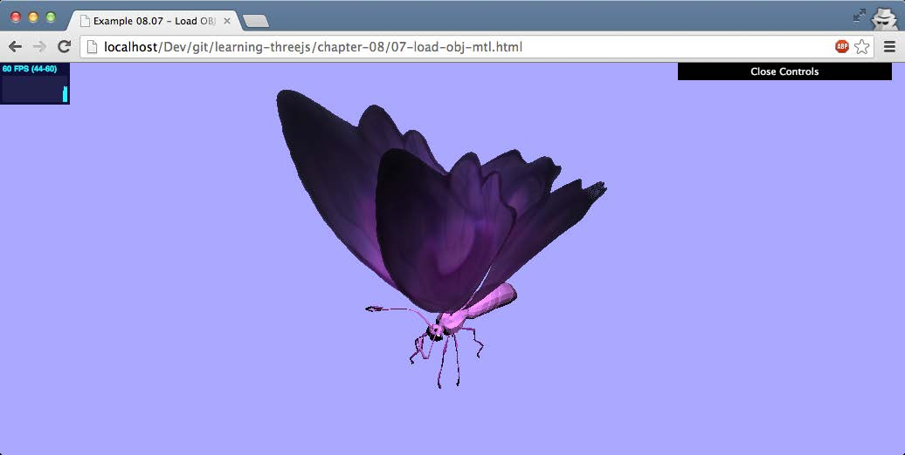

首先，需要向页面添加正确的加载器：

```html
<script type="text/javascript" src="../libs/OBJLoader.js">
  </script>
<script type="text/javascript" src="../libs/MTLLoader.js">
  </script>
<script type="text/javascript" src="../libs/OBJMTLLoader.js">
  </script>
```

<!-- pdf-page: 257 -->
创建和加载高级网格与几何体

我们可以像这样从 OBJ 和 MTL 文件加载模型：

```javascript
var loader = new THREE.OBJMTLLoader();
loader.load('../assets/models/butterfly.obj', '../assets/
  models/butterfly.mtl', function(object) {
  // configure the wings
  var wing2 = object.children[5].children[0];
  var wing1 = object.children[4].children[0];
```

```javascript
  wing1.material.opacity = 0.6;
  wing1.material.transparent = true;
  wing1.material.depthTest = false;
  wing1.material.side = THREE.DoubleSide;
```

```javascript
  wing2.material.opacity = 0.6;
  wing2.material.depthTest = false;
  wing2.material.transparent = true;
  wing2.material.side = THREE.DoubleSide;
```

```text
  object.scale.set(140, 140, 140);
  mesh = object;
  scene.add(mesh);
```

```text
  mesh.rotation.x = 0.2;
  mesh.rotation.y = -1.3;
});
```

在查看代码之前，首先要提到的是，如果你收到一个 OBJ 文件、一个 MTL 文件和所需的纹理文件，则必须检查 MTL 文件如何引用纹理。这些引用应相对于 MTL 文件，而不是使用绝对路径。代码本身与我们看到的 THREE.ObjLoader 代码没有太大区别。我们指定 OBJ 文件的位置、MTL 文件的位置以及模型加载完成时要调用的函数。在本例中，我们用作示例的模型是一个复杂模型。因此，我们在回调中设置了一些特定属性，以解决一些渲染问题，如下所示：

- 源文件中的不透明度设置不正确，导致翅膀不可见。因此，为了解决这个问题，我们自己设置了 opacity 和 transparent 属性。

- 默认情况下，Three.js 只渲染对象的一面。由于我们会从两侧观察翅膀，因此需要将 side 属性设置为 THREE.DoubleSide 值。

<!-- pdf-page: 258 -->
- 当翅膀需要相互重叠渲染时，会产生一些不想要的伪影。我们通过将 depthTest 属性设置为 false 解决了这个问题。这会对性能产生轻微影响，但通常可以解决一些奇怪的渲染伪影。

但是，如你所见，可以轻松地将复杂模型直接加载到 Three.js 中，并在浏览器中实时渲染。不过，你可能需要微调一些材质属性。

#### 加载 Collada 模型

Collada 模型（扩展名为 .dae）是另一种非常常见的场景和模型定义格式（还可以定义动画，我们将在下一章中看到）。在 Collada 模型中，不仅定义了几何体，还定义了材质。甚至可以定义光源。

要加载 Collada 模型，执行的步骤与 OBJ 和 MTL 模型基本相同。首先包含正确的加载器：

```html
<script type="text/javascript" src="../libs/ColladaLoader.js">
  </script>
```

对于此示例，我们将加载以下模型：

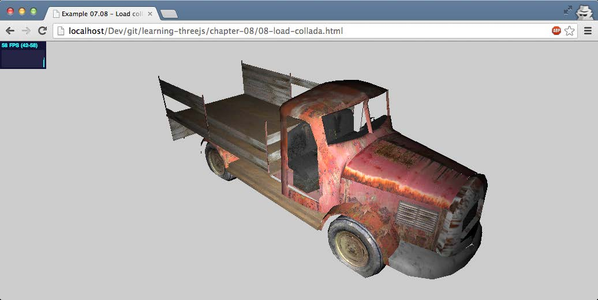

加载卡车模型同样非常简单：

```javascript
var mesh;
loader.load("../assets/models/dae/Truck_dae.dae", function
  (result) {
  mesh = result.scene.children[0].children[0].clone();
  mesh.scale.set(4, 4, 4);
  scene.add(mesh);
});
```

<!-- pdf-page: 259 -->
创建和加载高级网格与几何体

这里的主要区别在于返回给回调的对象结果。result 对象具有以下结构：

```javascript
var result = {
```

```text
  scene: scene,
  morphs: morphs,
  skins: skins,
  animations: animData,
  dae: {
    ...
  }
};
```

在本章中，我们关注的是 scene 参数中的对象。我首先将 scene 输出到控制台，查看我感兴趣的网格位于何处，即 result.scene.children\[0\].children\[0\]。剩下的工作就是将其缩放到合理大小并添加到场景中。关于这个特定示例，最后还要说明一点：第一次加载此模型时，材质未能正确渲染。原因是纹理使用了 WebGL 不支持的 .tga 格式。为了解决此问题，我必须将 .tga 文件转换为 .png，并编辑 .dae 模型的 XML，使其指向这些 .png 文件。

如你所见，对于大多数包含材质的复杂模型，通常需要执行一些额外步骤才能获得所需结果。通过仔细查看材质的配置方式（使用 console.log()）或将其替换为测试材质，通常很容易发现问题。

#### 加载 STL、CTM、VTK、AWD、Assimp、VRML 和 Babylon 模型

我们将快速浏览这些文件格式，因为它们都遵循相同的原则：

1.	 在网页中包含 \[NameOfFormat\]Loader.js。

2.	 使用 \[NameOfFormat\]Loader.load() 加载 URL。

3.	 检查回调的响应格式并渲染结果。

<!-- pdf-page: 260 -->
我们为所有这些格式都提供了示例：

名称 示例 屏幕截图

```text
STL
08-load-STL.
html
```

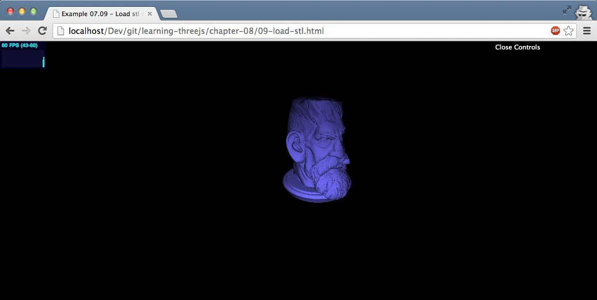

```text
CTM
09-load-CTM.
html
```

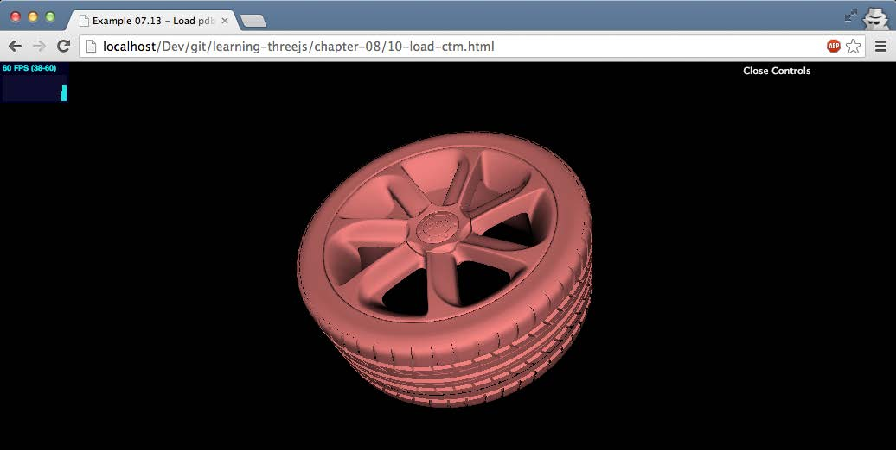

```text
VTK
10-load-vtk.
html
```

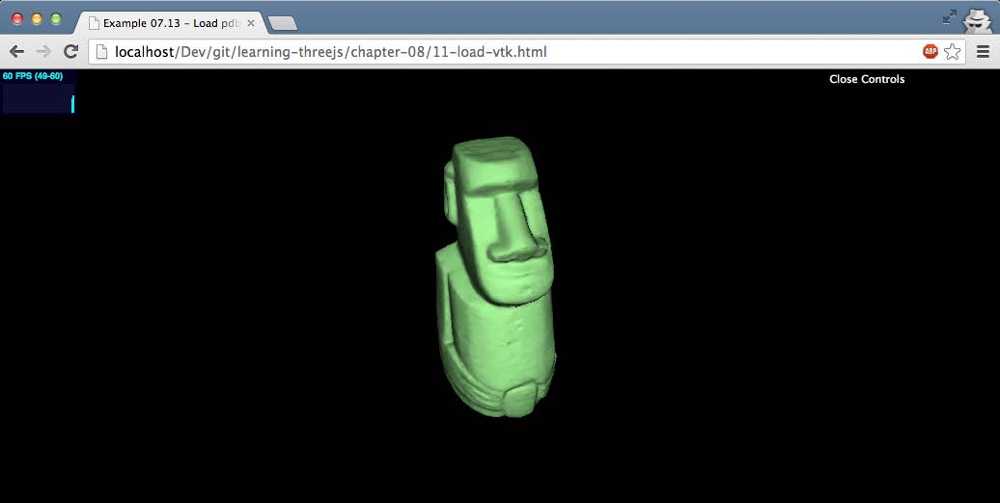

<!-- pdf-page: 261 -->
创建和加载高级网格与几何体

名称 示例 屏幕截图

```text
AWD
11-load-awd.
html
```

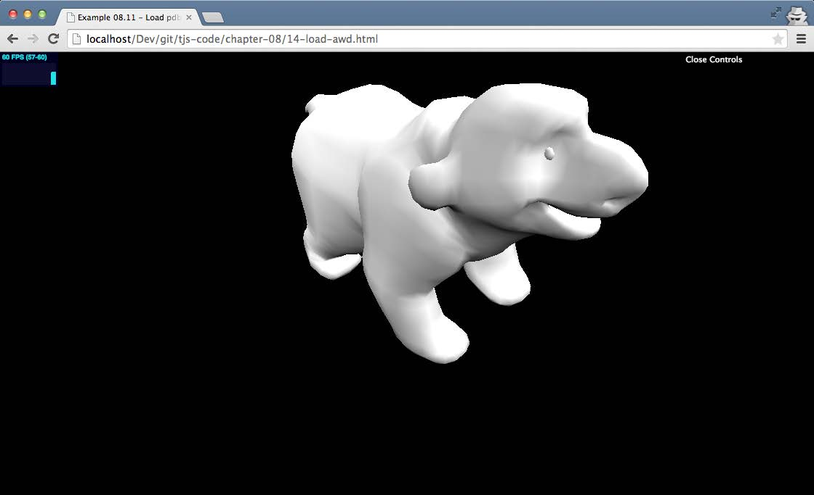

Assimp 12-loadassimp.html

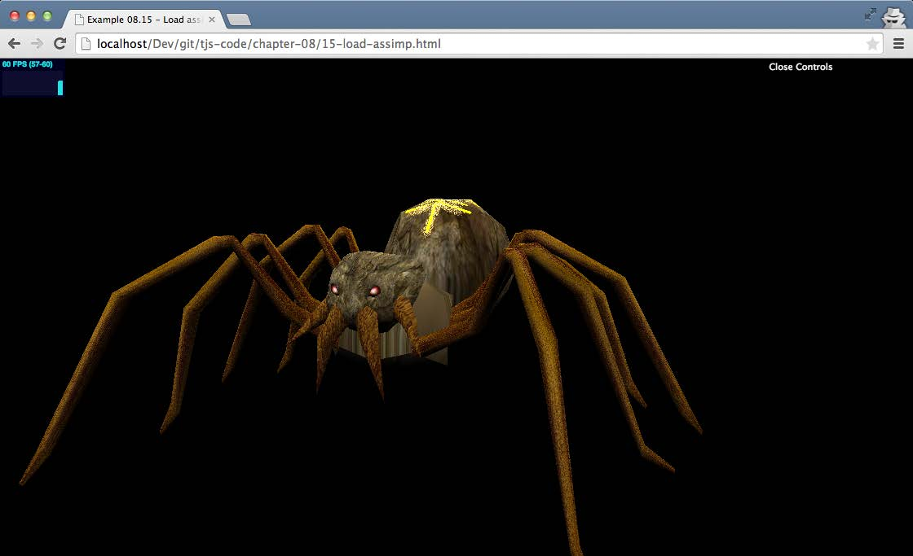

```text
VRML
13-load-
vrml.html
```

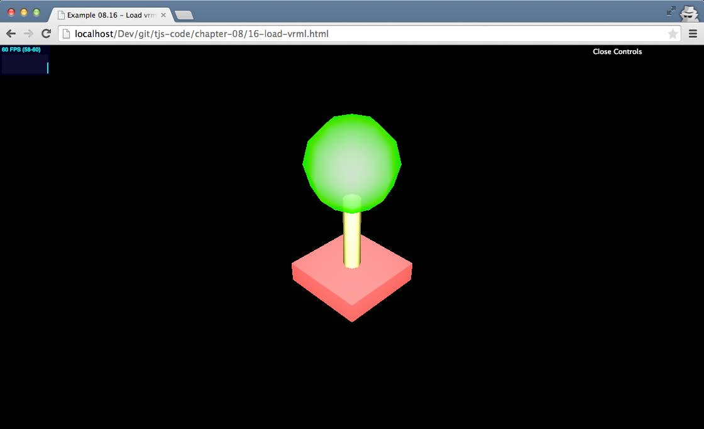

<!-- pdf-page: 262 -->
名称 示例 屏幕截图

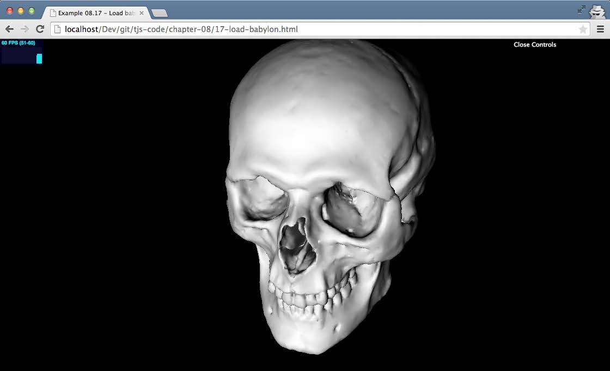

Babylon Babylon 加载器与此表中的其他加载器略有不同。使用此加载器时，加载的不是单个 THREE.Mesh 或 THREE.Geometry 实例，而是完整场景，包括光源。

```text
14-load-
babylon.html
```

如果查看这些示例的源代码，你可能会发现，对于其中一些示例，我们需要更改一些材质属性或进行一些缩放，才能正确渲染模型。之所以需要这样做，是因为模型在其外部应用程序中的创建方式赋予了它不同的尺寸和分组，与我们通常在 Three.js 中使用的不同。

我们几乎展示了所有受支持的文件格式。在接下来的两节中，我们将采用不同的方法。首先介绍如何渲染来自蛋白质数据库（PDB 格式）的蛋白质，最后使用以 PLY 格式定义的模型创建粒子系统（Particle System）。

#### 显示来自蛋白质数据库的蛋白质

蛋白质数据库（www.rcsb.org）包含许多不同分子和蛋白质的详细信息。除这些蛋白质的介绍外，它还提供了一种以 PDB 格式下载这些分子结构的方式。Three.js 为以 PDB 格式指定的文件提供了一个加载器。在本节中，我们将举例说明如何解析 PDB 文件并使用 Three.js 对其进行可视化。

加载新文件格式时，我们总是需要做的第一件事是在 Three.js 中包含正确的加载器，如下所示：

```html
<script type="text/javascript" src="../libs/PDBLoader.js">
  </script>
```

<!-- pdf-page: 263 -->
创建和加载高级网格与几何体

包含此加载器后，我们将根据提供的分子描述创建以下三维模型（参见 15-load-ptb.html 示例）：

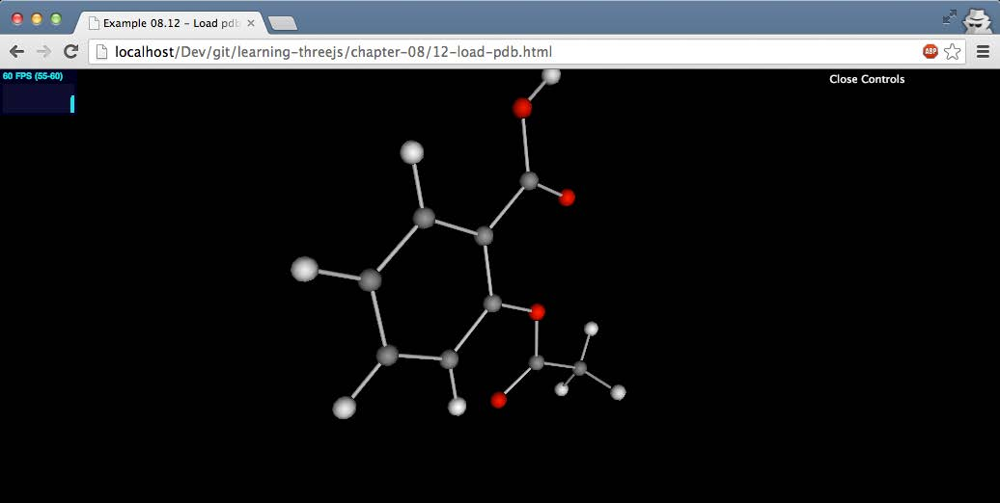

加载 PDB 文件的方式与前面的格式相同，如下所示：

```javascript
var loader = new THREE.PDBLoader();
var group = new THREE.Object3D();
loader.load("../assets/models/diamond.pdb", function (geometry,
  geometryBonds) {
  var i = 0;
```

```javascript
  geometry.vertices.forEach(function (position) {
    var sphere = new THREE.SphereGeometry(0.2);
    var material = new THREE.MeshPhongMaterial({color:
      geometry.colors[i++]});
    var mesh = new THREE.Mesh(sphere, material);
    mesh.position.copy(position);
    group.add(mesh);
  });
```

```javascript
  for (var j = 0; j < geometryBonds.vertices.length; j += 2) {
    var path = new THREE.SplineCurve3([geometryBonds.vertices[j],
      geometryBonds.vertices[j + 1]]);
    var tube = new THREE.TubeGeometry(path, 1, 0.04)
```

<!-- pdf-page: 264 -->
```javascript
    var material = new THREE.MeshPhongMaterial({color: 0xcccccc});
    var mesh = new THREE.Mesh(tube, material);
    group.add(mesh);
  }
  console.log(geometry);
  console.log(geometryBonds);
```

```text
  scene.add(group);
});
```

从此示例中可以看到，我们实例化 THREE.PDBLoader，传入要加载的模型文件，并提供一个在模型加载完成时调用的回调。对于这个特定的加载器，回调函数被调用时会带有两个参数：geometry 和 geometryBonds。所提供 geometry 参数中的顶点包含各个原子的位置，geometryBounds 则用于表示原子之间的连接。

对于每个顶点，我们使用模型同时提供的颜色创建一个球体：

```javascript
var sphere = new THREE.SphereGeometry(0.2);
var material = new THREE.MeshPhongMaterial({color:
  geometry.colors[i++]});
var mesh = new THREE.Mesh(sphere, material);
mesh.position.copy(position);
group.add(mesh)
```

每个连接都这样定义：

```javascript
var path = new THREE.SplineCurve3([geometryBonds.vertices[j],
  geometryBonds.vertices[j + 1]]);
var tube = new THREE.TubeGeometry(path, 1, 0.04)
var material = new THREE.MeshPhongMaterial({color: 0xcccccc});
var mesh = new THREE.Mesh(tube, material);
group.add(mesh);
```

对于连接，我们首先使用 THREE.SplineCurve3 对象创建一条三维路径。此路径用作 THREE.Tube 的输入，用于创建原子之间的连接。所有连接和原子都会添加到一个组中，再将此组添加到场景中。你可以从蛋白质数据库下载许多模型。

<!-- pdf-page: 265 -->
创建和加载高级网格与几何体

下图显示了钻石的结构：

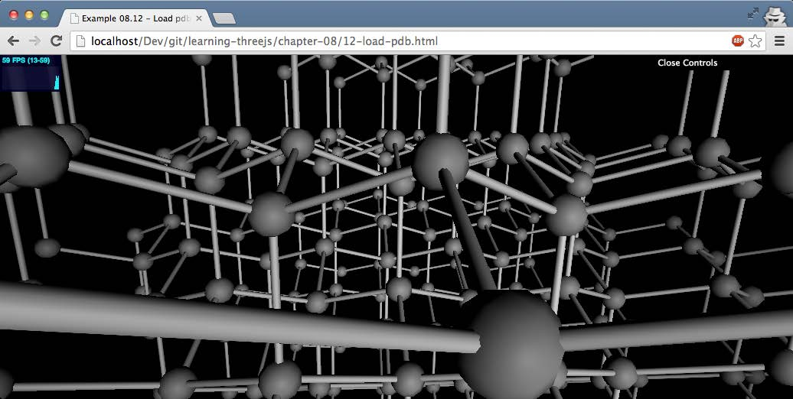

#### 根据 PLY 模型创建粒子系统

使用 PLY 格式与使用其他格式没有太大区别。包含加载器，提供回调，然后对模型进行可视化。不过，对于最后一个示例，我们要做一些不同的事情。我们不会将模型渲染为网格，而是使用此模型中的信息创建粒子系统（参见 15-load-ply.html 示例）。以下屏幕截图显示了此示例：

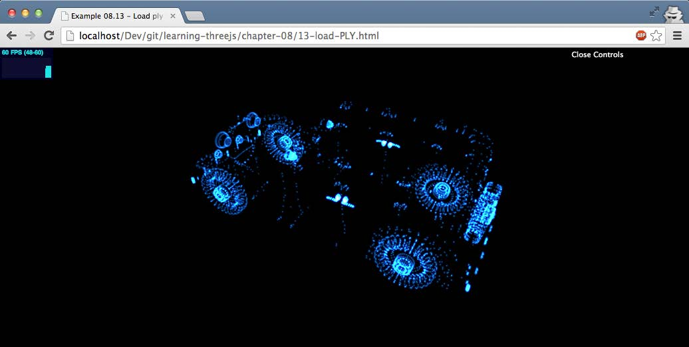

<!-- pdf-page: 266 -->
渲染前面的屏幕截图所需的 JavaScript 代码实际上非常简单，如下所示：

```javascript
var loader = new THREE.PLYLoader();
var group = new THREE.Object3D();
loader.load("../assets/models/test.ply", function (geometry) {
  var material = new THREE.PointCloudMaterial({
    color: 0xffffff,
    size: 0.4,
    opacity: 0.6,
    transparent: true,
    blending: THREE.AdditiveBlending,
    map: generateSprite()
  });
```

```javascript
  group = new THREE.PointCloud(geometry, material);
  group.sortParticles = true;
```

```text
  scene.add(group);
});
```

如你所见，我们使用 THREE.PLYLoader 加载模型。回调返回 geometry，我们将此几何体用作 THREE.PointCloud 的输入。所用材质与上一章最后一个示例中使用的材质相同。如你所见，使用 Three.js，只需几行代码，就可以非常轻松地组合来自各种来源的模型，并以不同方式渲染它们。

## 总结

在 Three.js 中使用来自外部来源的模型并不困难。尤其是对于简单模型，只需执行几个简单步骤。使用外部模型，或通过分组和合并创建模型时，最好记住几点。首先需要记住的是，对对象进行分组时，它们仍然可以作为单独的对象使用。应用于父对象的变换也会影响子对象，但你仍然可以单独变换子对象。除了分组，还可以将几何体合并在一起。使用这种方法，会失去各个几何体，得到单个新的几何体。当需要渲染数千个几何体并遇到性能问题时，这种方法尤其有用。

<!-- pdf-page: 267 -->
创建和加载高级网格与几何体

Three.js 支持大量外部格式。使用这些格式加载器时，最好浏览源代码，并将回调中收到的信息输出到日志。这将帮助你了解获得正确网格并设置正确位置和缩放所需的步骤。通常，模型无法正确显示是由其材质设置导致的。可能使用了不兼容的纹理格式、不透明度定义不正确，或者格式包含指向纹理图像的错误链接。通常，最好使用测试材质来确定模型本身是否正确加载，并将加载的材质记录到 JavaScript 控制台，以检查是否存在意外值。也可以导出网格和场景，但请记住，Three.js 的 GeometryExporter、SceneExporter 和 SceneLoader 仍在开发中。

你在本章及前几章中使用的模型大多是静态模型。它们没有动画，不会四处移动，也不会改变形状。在下一章中，你将学习如何为模型添加动画，使其生动起来。除动画外，下一章还将介绍 Three.js 提供的各种相机控件。使用相机控件，可以围绕场景移动、平移和旋转相机。

