# 第 9 章 · 动画（Animations）与相机移动（Moving the Camera）

<!-- pdf-page: 268 -->
## 动画与移动

## 相机

在前几章中，我们已经见过一些简单的动画，但还没有涉及太复杂的内容。在第 1 章“使用 Three.js 创建你的第一个 3D 场景”中，我们介绍了基本的渲染循环（render loop），并在随后的一章中使用它来旋转一些简单对象，同时展示了另外几个基本的动画概念。在本章中，我们将更详细地了解 Three.js 如何支持动画。我们会详细讨论以下四个主题：

- 基础动画

- 移动相机

- 变形（Morphing）与蒙皮（Skinning）

- 加载外部动画

我们从动画背后的基本概念开始。

## 基础动画

在查看示例之前，让我们快速回顾一下第 1 章“使用 Three.js 创建你的第一个 3D 场景”中关于渲染循环的内容。为了支持动画，我们需要告诉 Three.js 每隔一段时间渲染一次场景。为此，我们使用标准的 HTML5 requestAnimationFrame 功能，如下所示：

```text
render();
```

```javascript
function render() {
```

<!-- pdf-page: 269 -->
动画与相机移动

```text
  // render the scene
  renderer.render(scene, camera);
  // schedule the next rendering using requestAnimationFrame
  requestAnimationFrame(render);
}
```

使用这段代码时，我们只需要在场景初始化完成后调用一次 render() 函数。在 render() 函数内部，我们使用 requestAnimationFrame 安排下一次渲染。这样，浏览器会确保以正确的时间间隔调用 render() 函数（通常约为每秒 60 次）。在浏览器加入 requestAnimationFrame 之前，人们使用 setInterval(function, interval) 或 setTimeout(function, interval)。它们会按照设定的时间间隔反复调用指定函数。这种方法的问题在于，它不会考虑正在发生的其他事情。即使你的动画没有显示出来，或者位于隐藏的标签页中，它仍会被调用并继续占用资源。另一个问题是，这些函数一旦被调用就会更新屏幕，而不是等到浏览器最适合更新的时机，这意味着更高的 CPU 使用率。使用 requestAnimationFrame 时，我们不是告诉浏览器何时需要更新屏幕，而是请求浏览器在最合适的时机运行所提供的函数。通常，这会产生约 60 fps 的帧率。借助 requestAnimationFrame，你的动画会运行得更流畅，对 CPU 和 GPU 也更友好，而且你不必自己担心计时问题。

### 简单动画

采用这种方法，我们可以通过更改对象的旋转、缩放、位置、材质、顶点、面以及你能想象到的任何其他属性，非常轻松地为对象制作动画。在下一次渲染循环中，Three.js 会渲染这些更改后的属性。01-basic-animation.html 中提供了一个非常简单的示例，它基于我们已经在第 1 章“使用 Three.js 创建你的第一个 3D 场景”中见过的示例。以下截图展示了这个示例：

<!-- pdf-page: 270 -->
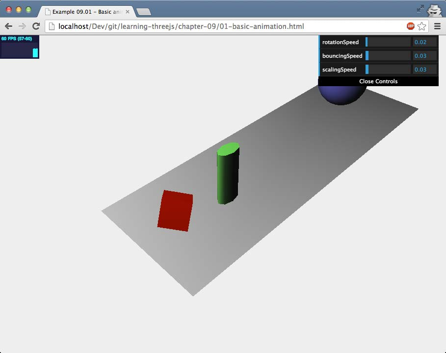

这个示例的渲染循环非常简单。只需更改相关网格（Mesh）的属性，其余工作都由 Three.js 处理。具体做法如下：

```javascript
function render() {
  cube.rotation.x += controls.rotationSpeed;
  cube.rotation.y += controls.rotationSpeed;
  cube.rotation.z += controls.rotationSpeed;
```

```text
  step += controls.bouncingSpeed;
```

<!-- pdf-page: 271 -->
动画与相机移动

```text
  sphere.position.x = 20 + ( 10 * (Math.cos(step)));
  sphere.position.y = 2 + ( 10 * Math.abs(Math.sin(step)));
```

```javascript
  scalingStep += controls.scalingSpeed;
  var scaleX = Math.abs(Math.sin(scalingStep / 4));
  var scaleY = Math.abs(Math.cos(scalingStep / 5));
  var scaleZ = Math.abs(Math.sin(scalingStep / 7));
  cylinder.scale.set(scaleX, scaleY, scaleZ);
```

```text
  renderer.render(scene, camera);
  requestAnimationFrame(render);
}
```

这里没有什么特别惊人的地方，但它很好地展示了本书所讨论的基础动画背后的概念。在下一节中，我们会稍微岔开一下话题。除了动画之外，在使用 Three.js 处理更复杂的场景时，你很快会遇到的另一个重要方面，就是能够使用鼠标选择屏幕上的对象。

### 选择对象

虽然这与动画没有直接关系，但由于本章将探讨相机和动画，因此它也是本章所述主题的一个很好的补充。这里我们将展示如何使用鼠标从场景中选择一个对象。在查看示例之前，我们先看看实现它所需的代码：

```javascript
var projector = new THREE.Projector();
```

```javascript
function onDocumentMouseDown(event) {
  var vector = new THREE.Vector3(event.clientX / window.innerWidth
    ) * 2 - 1, -( event.clientY / window.innerHeight ) * 2 + 1,
    0.5);
  vector = vector.unproject(camera);
```

```javascript
  var raycaster = new THREE.Raycaster(camera.position,
    vector.sub(camera.position).normalize());
```

```javascript
  var intersects = raycaster.intersectObjects([sphere, cylinder,
    cube]);
```

<!-- pdf-page: 272 -->
```text
  if (intersects.length > 0) {
    intersects[ 0 ].object.material.transparent = true;
    intersects[ 0 ].object.material.opacity = 0.1;
  }
}
```

在这段代码中，我们将 THREE.Projector 与 THREE.Raycaster 结合使用，以确定是否点击了某个特定对象。点击屏幕时会发生以下过程：

1.	 首先，根据我们在屏幕上点击的位置创建一个 THREE.Vector3。

2.	 接下来，使用 vector.unproject 函数，将屏幕上的点击位置转换为 Three.js 场景中的坐标。换句话说，就是从屏幕坐标反投影到世界坐标。

3.	 然后，我们创建 THREE.Raycaster。使用 THREE.Raycaster，可以向场景中发射射线。在这个例子中，我们从相机的位置（camera.position）向场景中点击的位置发射一条射线。

4.	 最后，我们使用 raycaster.intersectObjects 函数来确定这条射线是否击中了所提供的任何对象。

最后一步的结果包含被这条射线击中的所有对象的信息。其中提供了以下信息：

```javascript
distance: 49.9047088522448
face: THREE.Face3
faceIndex: 4
object: THREE.Mesh
point: THREE.Vector3
```

被点击的网格就是 object，而 face 和 faceIndex 指向网格中被选中的面。distance 值是从相机到被点击对象之间的距离，point 则是网格上被点击的精确位置。你可以在 02-selecting-objects.html 示例中测试这一点。你点击的任何对象都会变得透明，并且选择的详细信息会打印到控制台中。

<!-- pdf-page: 273 -->
动画与相机移动

如果你想查看所发射射线的路径，可以从菜单中启用 showRay 属性。以下截图显示了用于选择蓝色球体的射线：

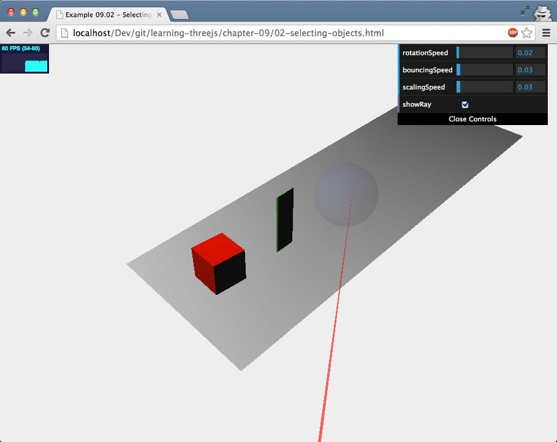

现在，这段小小的插曲已经结束，让我们回到动画。到目前为止，我们一直通过在渲染循环中更改属性来为对象制作动画。在下一节中，我们将了解一个可以让动画定义变得容易得多的小型库。

### 使用 Tween.js 制作动画

Tween.js 是一个小型 JavaScript 库，可以从 https://github.com/sole/tween.js/ 下载，你可以使用它轻松定义属性在两个值之间的过渡。起始值和结束值之间的所有中间点都会为你计算出来。这个过程称为补间（tweening）。

<!-- pdf-page: 274 -->
例如，你可以使用这个库在 10 秒内将网格的 x 位置从 10 改为 3，如下所示：

```javascript
var tween = new TWEEN.Tween({x: 10}).to({x: 3},
  10000).easing(TWEEN.Easing.Elastic.InOut).onUpdate( function ()
  {
  // update the mesh
})
```

在这个示例中，我们创建了 TWEEN.Tween。这个补间会确保 x 属性在 10,000 毫秒内从 10 变为 3。Tween.js 还允许你定义这个属性如何随时间变化。可以使用线性、二次或任何其他方式（完整概述请参见 http://sole.github.io/ tween.js/examples/03\_graphs.html）。值随时间变化的方式称为缓动（easing）。在 Tween.js 中，你可以使用 easing() 函数对此进行配置。

在 Three.js 中使用这个库非常简单。打开 03-animationtween.html 示例，就可以看到 Tween.js 库的实际效果。以下截图展示了该示例的静态画面：

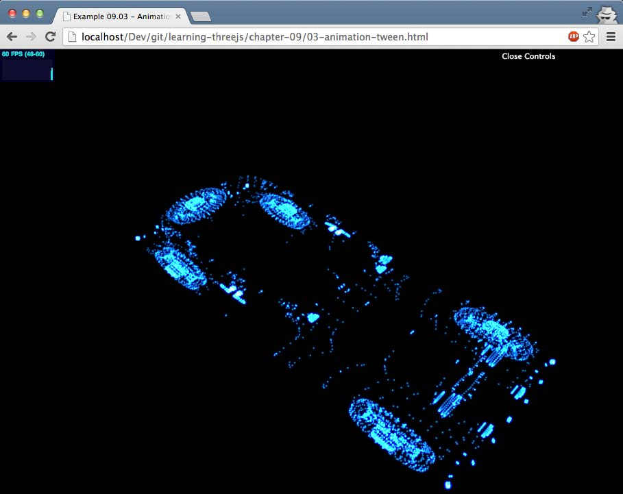

<!-- pdf-page: 275 -->
动画与相机移动

在这个示例中，我们使用了第 7 章“粒子、精灵与点云”中的粒子云，并为所有粒子向下落到地面的过程制作了动画。这些粒子的位置基于使用 Tween.js 库创建的补间，如下所示：

```javascript
// first create the tweens
var posSrc = {pos: 1}
var tween = new TWEEN.Tween(posSrc).to({pos: 0}, 5000);
tween.easing(TWEEN.Easing.Sinusoidal.InOut);
```

```javascript
var tweenBack = new TWEEN.Tween(posSrc).to({pos: 1}, 5000);
tweenBack.easing(TWEEN.Easing.Sinusoidal.InOut);
```

```text
tween.chain(tweenBack);
tweenBack.chain(tween);
```

```javascript
var onUpdate = function () {
  var count = 0;
  var pos = this.pos;
```

```javascript
  loadedGeometry.vertices.forEach(function (e) {
    var newY = ((e.y + 3.22544) * pos) - 3.22544;
    particleCloud.geometry.vertices[count++].set(e.x, newY, e.z);
  });
```

```text
  particleCloud.sortParticles = true;
};
```

```text
tween.onUpdate(onUpdate);
tweenBack.onUpdate(onUpdate);
```

通过这段代码，我们创建了两个补间：tween 和 tweenBack。第一个定义 position 属性如何从 1 过渡到 0，第二个则执行相反的过程。使用 chain() 函数，我们将这两个补间相互链接，因此它们启动后会开始循环。这里最后定义的是 onUpdate 方法。在这个方法中，我们遍历粒子系统的所有顶点，并根据补间提供的位置（this.pos）更改它们的位置。

<!-- pdf-page: 276 -->
我们在模型加载完成时启动补间，因此在以下函数的末尾调用 tween.start() 函数：

```javascript
var loader = new THREE.PLYLoader();
loader.load( "../assets/models/test.ply", function (geometry) {
  ...
  tween.start()
  ...
});
```

补间启动后，我们需要告诉 Tween.js 库何时更新它所知道的所有补间。为此，我们调用 TWEEN.update() 函数：

```javascript
function render() {
  TWEEN.update();
  webGLRenderer.render(scene, camera);
  requestAnimationFrame(render);
}
```

完成这些步骤后，补间库就会负责定位点云的各个点。如你所见，使用这个库比自己管理过渡过程要容易得多。

除了为对象制作动画和更改对象之外，我们还可以通过四处移动相机来为场景制作动画。在前几章中，我们已经通过手动更新相机的位置这样做过几次。Three.js 还提供了许多其他更新相机的方式。

## 使用相机

Three.js 提供了许多相机控制（camera controls），你可以用它们在整个场景中控制相机。这些控件位于 Three.js 发行包中，可以在 examples/js/controls 目录下找到。在本节中，我们将更详细地了解以下控件：

| 名称 | 说明 |
| --- | --- |
| FirstPersonControls | 这些控件的行为类似于第一人称射击游戏中的控件。使用键盘四处移动，使用鼠标四处查看。 |
| FlyControls | 这些是类似飞行模拟器的控件。使用键盘和鼠标移动与转向。 |

<!-- pdf-page: 277 -->
动画与相机移动

| 名称 | 说明 |
| --- | --- |
| RollControls | 这是 FlyControls 的一个较简单版本。允许你四处移动，并绕 z 轴翻滚。 |
| TrackBallControls | 这是最常用的控件，允许你使用鼠标（或轨迹球）轻松地在场景中移动、平移和缩放。 |
| OrbitControls | 它模拟一颗围绕特定场景运行的卫星。这使你可以使用鼠标和键盘四处移动。 |

这些控件是现有控件中最有用的。除此之外，Three.js 还提供了许多你可以使用的其他控件（但本书不对其进行讲解）。不过，这些控件的使用方式与上表中讲解的控件相同：

| 名称 | 说明 |
| --- | --- |
| DeviceOrientationControls | 根据设备的朝向来控制相机的移动。其内部使用 HTML 设备方向 API（device orientation API，http://www.w3.org/TR/ orientation-event/）。 |
| EditorControls | 这些是专门为在线 3D 编辑器创建的控件。Three.js 在线编辑器使用了它，你可以在 http://threejs.org/editor/ 找到该编辑器。 |
| OculusControls | 这些控件允许你使用 Oculus Rift 设备在场景中四处查看。 |
| OrthographicTrackballControls | 这是与 TrackBallControls 相同的控件，但专门用于 THREE.OrthographicCamera。 |
| PointerLockControls | 这是一个简单的控件，使用渲染场景的 DOM 元素锁定鼠标。它为简单的 3D 游戏提供基本功能。 |
| TransformControls | 这是 Three.js 编辑器使用的内部控件。 |

<!-- pdf-page: 278 -->
| 名称 | 说明 |
| --- | --- |
| VRControls | 这个控件使用 PositionSensorVRDevice API 来控制场景。有关此标准的更多信息，请参见 https://developer.mozilla. org/en-US/docs/Web/API/Navigator. getVRDevices。 |

除了使用这些相机控件之外，你当然也可以通过设置 position 自行移动相机，并使用 lookAt() 函数改变它所指向的位置。

如果你使用过较旧版本的 Three.js，可能会找不到一个名为 THREE.PathControls 的特定相机控件。以前可以使用这个控件定义一条路径（例如使用 THREE.Spline），并让相机沿该路径移动。在 Three.js 的最近一个版本中，由于代码复杂性问题，这个控件被移除了。Three.js 的开发人员目前正在开发替代方案，但尚不可用。

我们要了解的第一个控件是 TrackballControls。

### TrackballControls

在使用 TrackballControls 之前，首先需要将正确的 JavaScript 文件包含到页面中：

```html
<script type="text/javascript" src="../libs/TrackballControls.js">
  </script>
```

包含该文件后，我们就可以创建控件并将其附加到相机，如下所示：

```javascript
var trackballControls = new THREE.TrackballControls(camera);
trackballControls.rotateSpeed = 1.0;
trackballControls.zoomSpeed = 1.0;
trackballControls.panSpeed = 1.0;
```

更新相机的位置是在渲染循环中完成的，如下所示：

```javascript
var clock = new THREE.Clock();
function render() {
  var delta = clock.getDelta();
  trackballControls.update(delta);
  requestAnimationFrame(render);
  webGLRenderer.render(scene, camera);
}
```

<!-- pdf-page: 279 -->
动画与相机移动

在前面的代码片段中，我们看到了一个新的 Three.js 对象：THREE.Clock。THREE.Clock 对象可用于精确计算某次调用或渲染循环完成所经过的时间。你可以通过调用 clock.getDelta() 函数来做到这一点。这个函数会返回本次调用与上一次调用 getDelta() 之间经过的时间。为了更新相机的位置，我们调用 trackballControls.update() 函数。在这个函数中，我们需要提供自上次调用此更新函数以来经过的时间。为此，我们使用 THREE.Clock 对象的 getDelta() 函数。你可能会想，为什么不直接将帧率（1/60 秒）传给 update 函数。原因是使用 requestAnimationFrame 时，我们可以预期达到 60 fps，但这一点并没有保证。帧率可能会因各种外部因素而变化。为了确保相机平滑地转动和旋转，我们需要传入精确经过的时间。

04-trackball-controls-camera.html 中提供了一个可运行的示例。以下截图展示了该示例的静态画面：

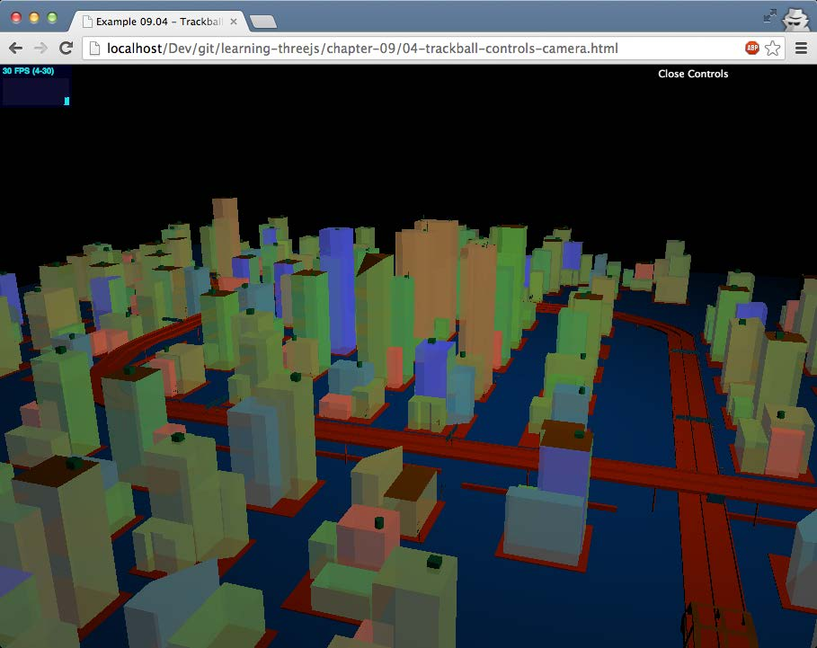

<!-- pdf-page: 280 -->
你可以通过以下方式控制相机：

| 控制方式 | 操作 |
| --- | --- |
| 按住鼠标左键并移动 | 围绕场景旋转和翻滚相机 |
| 滚动滚轮 | 放大和缩小 |
| 按住鼠标中键并移动 | 放大和缩小 |
| 按住鼠标右键并移动 | 在场景中平移 |

有几个属性可用于微调相机的行为。例如，你可以使用 rotateSpeed 属性设置相机旋转的速度，并通过将 noZoom 属性设置为 true 来禁用缩放。本章不会详细介绍每个属性的作用，因为它们基本上都不言自明。有关所有可用功能的完整概述，请查看 TrackballControls.js 文件的源代码，其中列出了这些属性。

### FlyControls

接下来我们要了解的控件是 FlyControls。使用 FlyControls，你可以通过飞行模拟器中也能找到的控件在场景中飞行。05-fly-controls-camera.html 中提供了一个示例。以下截图展示了该示例的静态画面：

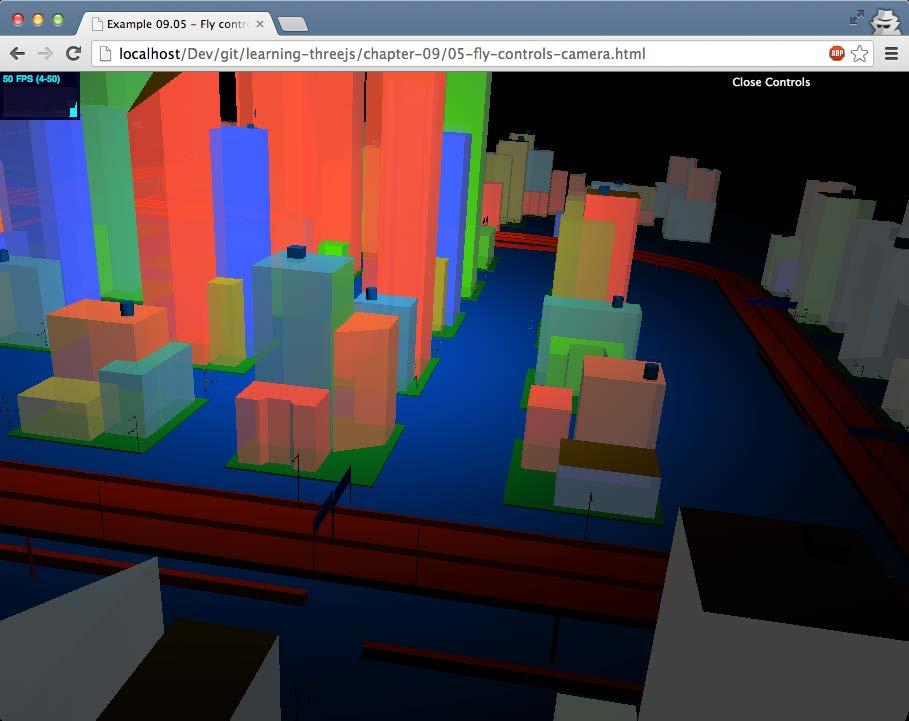

<!-- pdf-page: 281 -->
动画与相机移动

启用 FlyControls 的方式与 TrackballControls 相同。首先，加载正确的 JavaScript 文件：

```html
<script type="text/javascript" src="../libs/FlyControls.js">
  </script>
```

接下来，我们配置控件并将其附加到相机，如下所示：

```javascript
var flyControls = new THREE.FlyControls(camera);
flyControls.movementSpeed = 25;
flyControls.domElement = document.querySelector('#WebGL-output');
flyControls.rollSpeed = Math.PI / 24;
flyControls.autoForward = true;
flyControls.dragToLook = false;
```

同样，我们不会研究所有具体属性。相关内容请查看 FlyControls.js 文件的源代码。这里只挑选出让此控件正常工作所需配置的属性。需要正确设置的属性是 domElement 属性。这个属性应指向我们渲染场景的元素。对于本书中的示例，我们使用以下元素作为输出：

```text
<div id="WebGL-output"></div>
```

我们像这样设置该属性：

```text
flyControls.domElement = document.querySelector('#WebGL-output');
```

如果没有正确设置这个属性，移动鼠标就会导致奇怪的行为。

你可以通过以下方式使用 THREE.FlyControls 控制相机：

| 控制方式 | 操作 |
| --- | --- |
| 鼠标左键和中键 | 开始向前移动 |
| 鼠标右键 | 向后移动 |
| 移动鼠标 | 四处查看 |
| W | 开始向前移动 |
| S | 向后移动 |
| A | 向左移动 |
| D | 向右移动 |
| R | 向上移动 |
| F | 向下移动 |

<!-- pdf-page: 282 -->
| 控制方式 | 操作 |
| --- | --- |
| 左、右、上、下箭头键 | 向左、右、上、下查看 |
| G | 向左翻滚 |
| E | 向右翻滚 |

接下来我们要了解的控件是 THREE.RollControls。

### RollControls

RollControls 的行为与 FlyControls 非常相似，所以这里不再详细介绍。可以这样创建 RollControls：

```javascript
var rollControls = new THREE.RollControls(camera);
rollControls.movementSpeed = 25;
rollControls.lookSpeed = 3;
```

如果你想试用这个控件，请查看 06-roll-controlscamera.html 示例。请注意，如果你只看到黑屏，请将鼠标移到浏览器底部，城市景观就会平移进入视野。可以使用以下控制方式移动这个相机：

| 控制方式 | 操作 |
| --- | --- |
| 鼠标左键 | 向前移动 |
| 鼠标右键 | 向后移动 |
| 左、右、上、下箭头键 | 向左、右、前、后移动 |
| W | 向前移动 |
| A | 向左移动 |
| S | 向后移动 |
| D | 向右移动 |
| Q | 向左翻滚 |
| E | 向右翻滚 |
| R | 向上移动 |
| F | 向下移动 |

FirstPersonControls 是我们要了解的最后一个基础控件。

<!-- pdf-page: 283 -->
动画与相机移动

### FirstPersonControls

顾名思义，FirstPersonControls 允许你像在第一人称射击游戏中一样控制相机。鼠标用于四处查看，键盘用于四处行走。你可以在 07-first-person-camera.html 中找到一个示例。以下截图展示了该示例的静态画面：

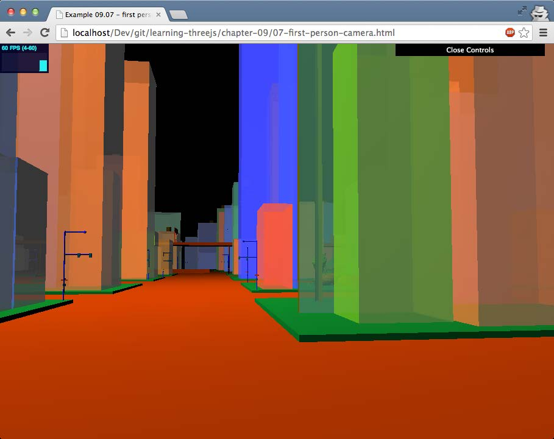

<!-- pdf-page: 284 -->
创建这些控件所遵循的原则，与我们迄今为止见过的其他控件相同。刚才展示的示例使用以下配置：

```javascript
var camControls = new THREE.FirstPersonControls(camera);
camControls.lookSpeed = 0.4;
camControls.movementSpeed = 20;
camControls.noFly = true;
camControls.lookVertical = true;
camControls.constrainVertical = true;
camControls.verticalMin = 1.0;
camControls.verticalMax = 2.0;
camControls.lon = -150;
camControls.lat = 120;
```

在自己使用这个控件时，唯一需要仔细查看的属性是最后两个：lon 和 lat 属性。这两个属性定义了首次渲染场景时相机指向的位置。

这个控件的控制方式非常直观：

| 控制方式 | 操作 |
| --- | --- |
| 移动鼠标 | 四处查看 |
| 左、右、上、下箭头键 | 向左、右、前、后移动 |
| W | 向前移动 |
| A | 向左移动 |
| S | 向后移动 |
| D | 向右移动 |
| R | 向上移动 |
| F | 向下移动 |
| Q | 停止所有移动 |

对于下一个控件，我们将从第一人称视角转向太空视角。

<!-- pdf-page: 285 -->
动画与相机移动

### OrbitControl

OrbitControl 控件是一种围绕场景中心的对象进行旋转和平移的绝佳方式。在 08-controls-orbit.html 中，我们包含了一个展示此控件工作方式的示例。以下截图展示了该示例的静态画面：

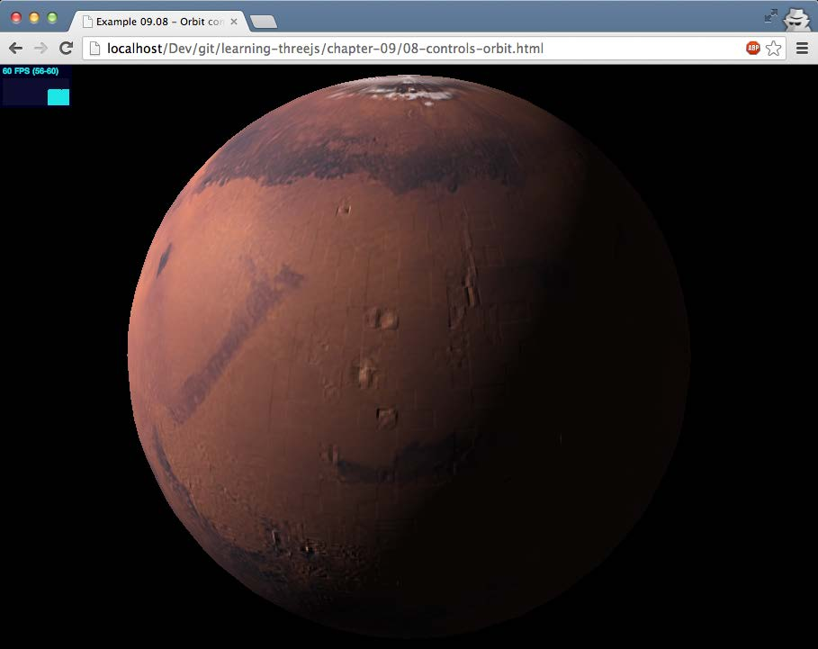

<!-- pdf-page: 286 -->
使用 OrbitControl 与使用其他控件一样简单。包含正确的 JavaScript 文件，使用相机设置控件，并再次使用 THREE.Clock 更新控件：

```html
<script type="text/javascript" src="../libs/OrbitControls.js">
  </script>
...
var orbitControls = new THREE.OrbitControls(camera);
orbitControls.autoRotate = true;
var clock = new THREE.Clock();
...
var delta = clock.getDelta();
orbitControls.update(delta);
```

THREE.OrbitControls 的控制方式以使用鼠标为主，如下表所示：

| 控制方式 | 操作 |
| --- | --- |
| 鼠标左键单击 + 移动 | 围绕场景中心旋转相机 |
| 滚动滚轮或鼠标中键单击 + 移动 | 放大和缩小 |
| 鼠标右键单击 + 移动 | 在场景中平移 |
| 左、右、上、下箭头键 | 在场景中平移 |

关于相机及其移动的内容就到这里。在这一部分中，我们已经看到了许多控件，它们可以帮助你创建有趣的相机动画效果。在下一节中，我们将了解一种更高级的动画方式：变形与蒙皮。

<!-- pdf-page: 287 -->
动画与相机移动

## 变形与骨骼动画（Skeletal Animation）

在外部程序（例如 Blender）中创建动画时，通常有两个定义动画的主要选项：

- 变形目标（Morph Target）：使用变形目标时，你需要定义网格的一个变形版本，也就是一个关键位置。对于这个变形目标，所有顶点的位置都会被存储。要为形状制作动画，你只需将所有顶点从一个位置移动到另一个关键位置，然后重复这个过程。以下截图展示了用于表现面部表情的各种变形目标（下图由 Blender 基金会提供）：

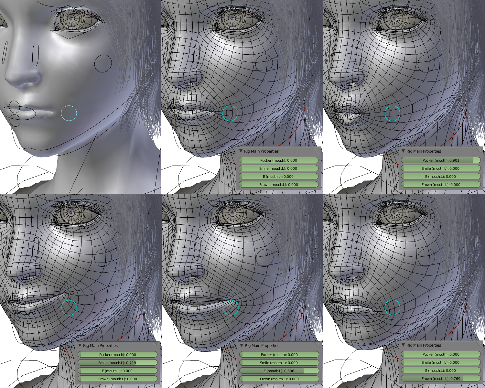

<!-- pdf-page: 288 -->
- 骨骼动画：另一种选择是使用骨骼动画。使用骨骼动画时，你需要定义网格的骨骼（Skeleton），也就是骨头，并将顶点附加到特定的骨头上。现在，当你移动一根骨头时，任何与其相连的骨头也会相应地移动，而附着的顶点则会根据骨头的位置、移动和缩放进行移动和变形。以下截图同样由 Blender 基金会提供，展示了如何使用骨头移动对象并使其变形：

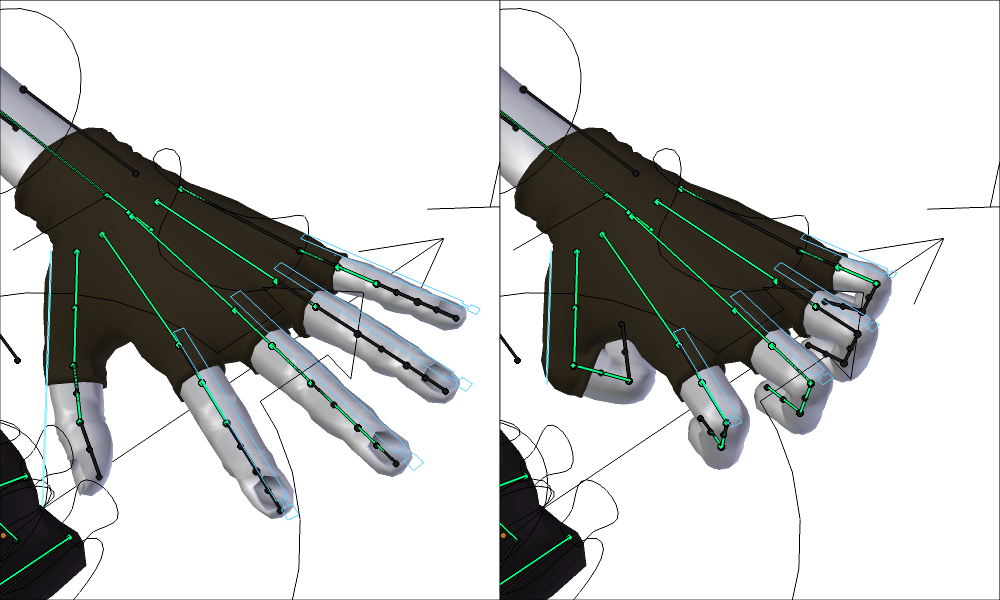

Three.js 支持这两种模式，但通常来说，使用变形目标可能会获得更好的结果。骨骼动画的主要问题在于，很难从 Blender 之类的 3D 程序中导出能在 Three.js 中良好播放动画的内容。与使用骨头和蒙皮相比，使用变形目标更容易获得能正常工作的模型。

在本节中，我们将了解这两个选项，另外还会了解 Three.js 支持的几种可定义动画的外部格式。

<!-- pdf-page: 289 -->
动画与相机移动

### 使用变形目标制作动画

变形目标是定义动画最直接的方式。你为每个重要位置（也称为关键帧（Keyframe））定义所有顶点，并告诉 Three.js 将顶点从一个位置移动到另一个位置。不过，这种方法的缺点是，对于大型网格和大型动画，模型文件会变得非常大。原因是每个关键位置都会重复存储所有顶点的位置。

我们将通过两个示例向你展示如何使用变形目标。在第一个示例中，我们让 Three.js 处理各个关键帧（从现在起，我们将其称为变形目标）之间的过渡；在第二个示例中，我们将手动完成这一过程。

#### 使用 MorphAnimMesh 制作动画

对于第一个变形示例，我们将使用 Three.js 发行包中也提供的模型——马。理解基于变形目标的动画如何工作，最简单的方法是打开 10-morph-targets.html 示例。以下截图展示了该示例的静态画面：

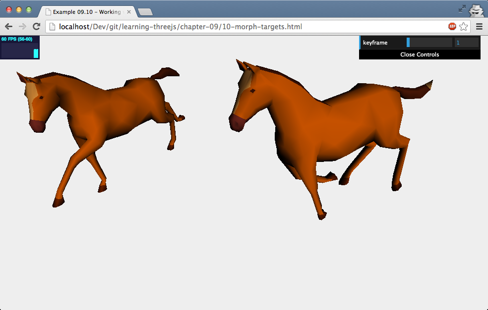

<!-- pdf-page: 290 -->
在这个示例中，右侧的马正在以动画形式奔跑，而左侧的马静止不动。第二匹马（左侧那匹）使用基础模型渲染，也就是原始顶点集。通过右上角的菜单，你可以浏览所有可用的变形目标，并查看左侧的马可以呈现的不同姿态。

Three.js 提供了一种从一个位置移动到下一个位置的方式，但这意味着我们必须手动跟踪当前所处的位置以及想要变形到的目标，并在到达目标位置后，对其他位置重复这一过程。幸运的是，Three.js 还提供了一种特殊的网格，即 THREE.MorphAnimMesh，它会为我们处理这些细节。在继续之前，先简单说明 Three.js 提供的另一个与动画相关的网格，名为 THREE.MorphBlendMesh。如果浏览 Three.js 提供的对象，你可能会注意到这个对象。使用这种特殊的网格，你几乎可以做到 THREE.MorphAnimMesh 所能做到的所有事情；查看源代码时，你甚至会发现这两个对象之间有许多重复代码。不过，THREE.MorphBlendMesh 似乎已被弃用，并且没有在任何 Three.js 官方示例中使用。THREE.MorhpBlendMesh 能做到的一切都可以用 THREE.MorphAnimMesh 完成，因此对于这类功能，请使用 THREE.MorphAnimMesh。以下代码展示了如何加载模型并从中创建 THREE.MorphAnimMesh：

```javascript
var loader = new THREE.JSONLoader();
loader.load('../assets/models/horse.js', function(geometry, mat) {
```

```javascript
  var mat = new THREE.MeshLambertMaterial({ morphTargets: true,
   vertexColors: THREE.FaceColors});
```

```javascript
  morphColorsToFaceColors(geometry);
  geometry.computeMorphNormals();
  meshAnim = new THREE.MorphAnimMesh(geometry, mat );
  scene.add(meshAnim);
```

```text
},'../assets/models' );
```

```javascript
function morphColorsToFaceColors(geometry) {
```

```text
  if (geometry.morphColors && geometry.morphColors.length) {
```

```javascript
    var colorMap = geometry.morphColors[ 0 ];
    for (var i = 0; i < colorMap.colors.length; i++) {
```

<!-- pdf-page: 291 -->
动画与相机移动

```text
      geometry.faces[ i ].color = colorMap.colors[ i ];
      geometry.faces[ i ].color.offsetHSL(0, 0.3, 0);
    }
  }
}
```

这与我们加载其他模型时看到的方法相同。不过这一次，外部模型还包含变形目标。我们不是创建普通的 THREE.Mesh 对象，而是创建 THREE.MorphAnimMesh。加载动画时，需要注意以下几点：

- 确保你使用的材质将 THREE.morphTargets 设置为 true。如果未设置，网格就不会产生动画。

- 在创建 THREE.MorphAnimMesh 之前，确保对几何体调用 computeMorphNormals，以便计算变形目标的所有法向量。这是获得正确光照和阴影效果所必需的。

- 还可以为特定变形目标的面定义颜色。这些颜色可从 morphColors 属性中获得。你可以利用这一点，不仅对几何体的形状进行变形，还对各个面的颜色进行变形。借助 morphColorsToFaceColors 辅助方法，我们只是将面的颜色固定为 morphColors 数组中的第一组颜色。

- 默认设置是将完整动画作为一个整体播放。如果为同一个几何体定义了多个动画，可以将 parseAnimations() 函数与 playAnimation(name,fps) 结合使用，播放其中一个已定义的动画。我们将在本章最后一节加载 MD2 模型的动画时使用这种方法。

剩下要做的就是在渲染循环中更新动画。为此，我们再次使用 THREE.Clock 计算时间差，并用它更新动画，如下所示：

```javascript
function render() {
```

```javascript
  var delta = clock.getDelta();
  webGLRenderer.clear();
  if (meshAnim) {
    meshAnim.updateAnimation(delta *1000);
    meshAnim.rotation.y += 0.01;
  }
```

```text
  // render using requestAnimationFrame
  requestAnimationFrame(render);
  webGLRenderer.render(scene, camera);
}
```

<!-- pdf-page: 292 -->
这种方法最简单，可让你根据已定义变形目标的模型快速设置动画。另一种方法是手动设置动画，我们将在下一节中展示。

#### 通过设置 morphTargetInfluence 属性创建动画

我们将创建一个非常简单的示例，让立方体从一种形状变形为另一种形状。这一次，我们将手动控制要变形到哪个目标。你可以在 11-morph-targets-manually.html 中找到这个示例。以下截图展示了该示例的静态画面：

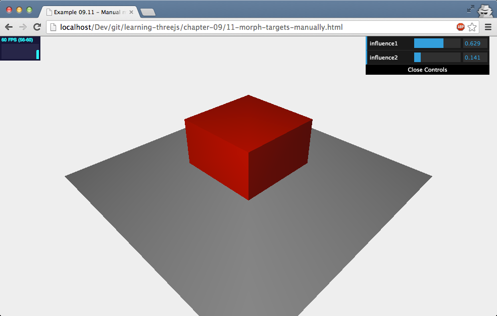

在这个示例中，我们为一个简单的立方体手动创建了两个变形目标，如下所示：

```javascript
// create a cube
var cubeGeometry = new THREE.BoxGeometry(4, 4, 4);
var cubeMaterial = new THREE.MeshLambertMaterial({morphTargets:
  true, color: 0xff0000});
```

<!-- pdf-page: 293 -->
动画与相机移动

```javascript
// define morphtargets, we'll use the vertices from these
  geometries
var cubeTarget1 = new THREE.CubeGeometry(2, 10, 2);
var cubeTarget2 = new THREE.CubeGeometry(8, 2, 8);
```

```text
// define morphtargets and compute the morphnormal
cubeGeometry.morphTargets[0] = {name: 'mt1', vertices:
  cubeTarget2.vertices};
cubeGeometry.morphTargets[1] = {name: 'mt2', vertices:
  cubeTarget1.vertices};
cubeGeometry.computeMorphNormals();
```

```javascript
var cube = new THREE.Mesh(cubeGeometry, cubeMaterial);
```

打开这个示例时，你会看到一个简单的立方体。通过右上角的滑块，可以设置 morphTargetInfluences。换句话说，你可以确定初始立方体应在多大程度上变形为指定为 mt1 的立方体，以及应在多大程度上变形为 mt2。手动创建变形目标时，需要考虑到变形目标必须与源几何体具有相同数量的顶点。你可以使用网格的 morphTargetInfluences 属性设置影响程度：

```javascript
var controls = new function () {
  // set to 0.01 to make sure dat.gui shows correct output
  this.influence1 = 0.01;
  this.influence2 = 0.01;
```

```javascript
  this.update = function () {
    cube.morphTargetInfluences[0] = controls.influence1;
    cube.morphTargetInfluences[1] = controls.influence2;
  };
}
```

请注意，初始几何体可以同时受到多个变形目标的影响。这两个示例展示了变形目标动画背后最重要的概念。在下一节中，我们将快速了解使用骨骼和蒙皮制作动画。

<!-- pdf-page: 294 -->
### 使用骨骼和蒙皮制作动画

变形动画非常直接。Three.js 知道所有目标顶点的位置，只需将每个顶点从一个位置过渡到下一个位置。对于骨骼和蒙皮，情况会变得稍微复杂一些。使用骨骼制作动画时，你移动骨头，Three.js 必须确定如何相应地变换附着的蒙皮（一组顶点）。在这个示例中，我们使用一个从 Blender 导出为 Three.js 格式的模型（models 文件夹中的 hand-1.js）。这是一个手部模型，包含一整套骨骼。通过四处移动骨头，我们可以为整个模型制作动画。首先来看看我们是如何加载该模型的：

```javascript
var loader = new THREE.JSONLoader();
loader.load('../assets/models/hand-1.js', function (geometry, mat)
  {
  var mat = new THREE.MeshLambertMaterial({color: 0xF0C8C9,
    skinning: true});
  mesh = new THREE.SkinnedMesh(geometry, mat);
```

```text
  // rotate the complete hand
  mesh.rotation.x = 0.5 * Math.PI;
  mesh.rotation.z = 0.7 * Math.PI;
```

```text
  // add the mesh
  scene.add(mesh);
```

```text
  // and start the animation
  tween.start();
```

```text
}, '../assets/models');
```

加载用于骨骼动画的模型与加载任何其他模型没有太大区别。我们只需指定模型文件，其中包含顶点、面以及骨骼的定义，然后基于该几何体创建一个网格。Three.js 还为这样的蒙皮几何体提供了一种特殊的网格，称为 THREE.SkinnedMesh。为了确保模型会更新，你需要做的一件事是将所用材质的 skinning 属性设置为 true。如果不将其设置为 true，你就看不到任何骨骼运动。我们在这里做的最后一件事，是将所有骨骼的 useQuaternion 属性设置为 false。在这个示例中，我们将使用一个补间对象来处理动画。这个补间实例的定义如下：

```javascript
var tween = new TWEEN.Tween({pos: -1}).to({pos: 0},
  3000).easing(TWEEN.Easing.Cubic.InOut).yoyo(true)
  .repeat(Infinity).onUpdate(onUpdate);
```

<!-- pdf-page: 295 -->
动画与相机移动

通过这个补间，我们将 pos 变量从 -1 过渡到 0。我们还将 yoyo 属性设置为 true，这会使动画在下一次运行时反向播放。为了确保动画持续运行，我们将 repeat 设置为 Infinity。你还可以看到，我们指定了一个 onUpdate 方法。这个方法用于定位各根骨头，接下来我们就来查看它。

在移动骨骼之前，让我们看看 12-bones-manually.html 示例。以下截图展示了该示例的静态画面：

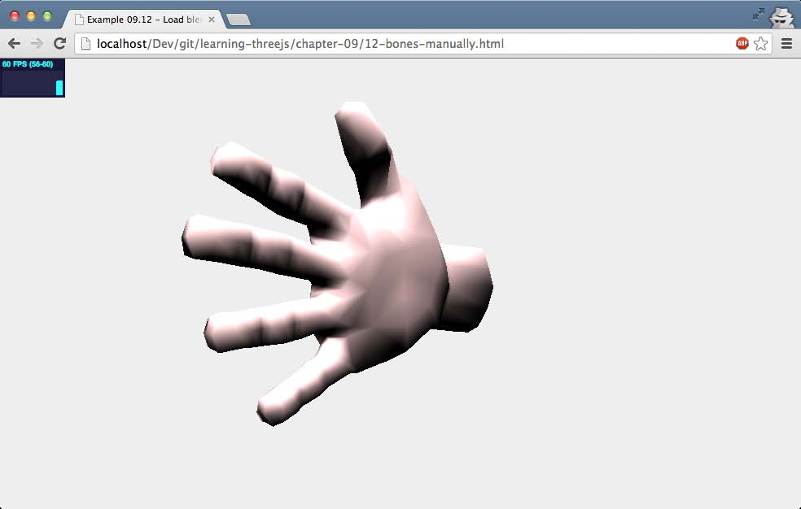

打开这个示例时，你会看到手正在做出类似抓握的动作。我们是在补间动画调用的 onUpdate 方法中，通过设置手指骨骼的 z 轴旋转来实现这一点的，如下所示：

```javascript
var onUpdate = function () {
  var pos = this.pos;
```

```text
  // rotate the fingers
  mesh.skeleton.bones[5].rotation.set(0, 0, pos);
  mesh.skeleton.bones[6].rotation.set(0, 0, pos);
  mesh.skeleton.bones[10].rotation.set(0, 0, pos);
  mesh.skeleton.bones[11].rotation.set(0, 0, pos);
  mesh.skeleton.bones[15].rotation.set(0, 0, pos);
```

<!-- pdf-page: 296 -->
```text
  mesh.skeleton.bones[16].rotation.set(0, 0, pos);
  mesh.skeleton.bones[20].rotation.set(0, 0, pos);
  mesh.skeleton.bones[21].rotation.set(0, 0, pos);
```

```text
  // rotate the wrist
  mesh.skeleton.bones[1].rotation.set(pos, 0, 0);
};
```

每当调用这个更新方法时，相关骨骼就会被设置到 pos 位置。要确定需要移动哪根骨头，一个好办法是将 mesh.skeleton 属性打印到控制台。这会列出所有骨骼及其名称。

Three.js 提供了一个简单的辅助工具，可用于显示模型的骨骼。将以下代码添加到代码中：

```javascript
helper = new THREE.SkeletonHelper( mesh );
```

```text
helper.material.linewidth = 2;
```

```text
helper.visible = false;
```

```text
scene.add( helper );
```

骨骼会被高亮显示。你可以在 12-bones-manually.html 示例中启用 showHelper 属性来查看其效果。

如你所见，使用骨骼需要多花一些精力，但它比固定的变形目标灵活得多。在这个示例中，我们只改变了骨骼的旋转；你也可以移动位置或更改缩放。在下一节中，我们将了解如何从外部模型加载动画。在那一节中，我们会再次使用这个示例，但这一次将运行模型中预定义的动画，而不是手动四处移动骨骼。

## 使用外部模型创建动画

在第 8 章“创建和加载高级网格与几何体”中，我们了解了 Three.js 支持的许多 3D 格式。其中一些格式也支持动画。在本章中，我们将了解以下示例：

- 使用 JSON 导出器的 Blender：我们将从在 Blender 中创建并导出为 Three.js JSON 格式的动画开始。

<!-- pdf-page: 297 -->
动画与相机移动

- Collada 模型：Collada 格式支持动画。在这个示例中，我们将从 Collada 文件加载动画，并使用 Three.js 渲染它。

- MD2 模型：MD2 模型是一种用于旧版 Quake 引擎的简单格式。尽管这种格式有些过时，但它仍然是一种非常适合存储角色动画的格式。

我们从 Blender 模型开始。

### 使用 Blender 创建骨骼动画

要开始使用来自 Blender 的动画，可以加载我们在 models 文件夹中包含的示例。你可以在其中找到 hand.blend 文件，并将其加载到 Blender 中。以下截图展示了该示例的静态画面：

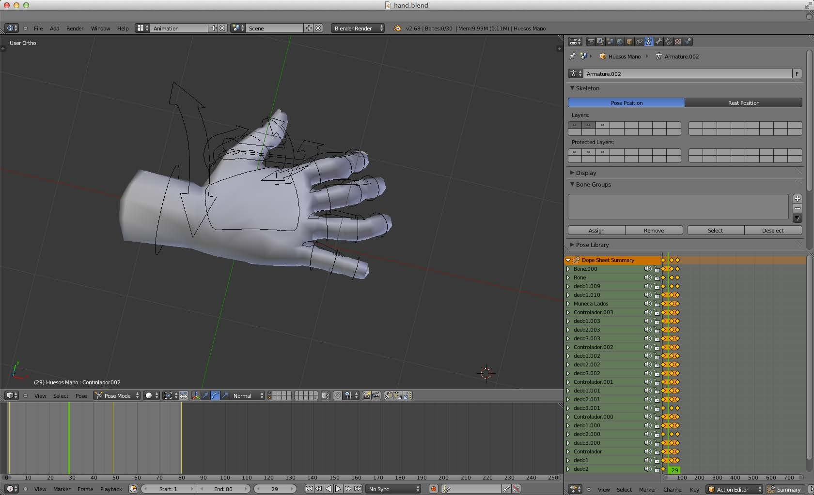

本书没有足够篇幅详细介绍如何在 Blender 中创建动画，但有几点需要牢记：

- 模型中的每个顶点都必须至少分配给一个顶点组。

- 你在 Blender 中使用的顶点组名称必须与控制它的骨骼名称相对应。这样，Three.js 就能确定移动骨骼时需要修改哪些顶点。

<!-- pdf-page: 298 -->
- 只有第一个“动作”会被导出。因此，请确保你想要导出的动画是第一个。

- 创建关键帧时，最好选择所有骨骼，即使它们没有变化也是如此。

- 导出模型时，确保模型处于静止姿态（Rest Pose）。否则，你会看到严重变形的动画。

有关如何从 Blender 创建和导出动画以及上述注意事项原因的更多信息，可以查看以下优秀资源：http://devmatrix.wordpress.com/2013/02/27/creating-skeletalanimation-in-blender-and-exporting-it-to-three-js/。

在 Blender 中创建动画后，可以使用我们在上一章中使用的 Three.js 导出器导出文件。使用 Three.js 导出器导出文件时，必须确保选中以下属性：

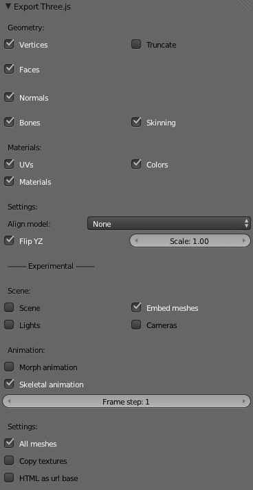

<!-- pdf-page: 299 -->
动画与相机移动

这会将你在 Blender 中指定的动画导出为骨骼动画，而不是变形动画。对于骨骼动画，导出的是骨骼的运动，我们可以在 Three.js 中重放这些运动。

在 Three.js 中加载模型与我们在上一个示例中的做法相同；不过，现在模型加载完成后，我们还会创建一个动画，如下所示：

```javascript
var loader = new THREE.JSONLoader();
loader.load('../assets/models/hand-2.js', function (model, mat) {
```

```javascript
  var mat = new THREE.MeshLambertMaterial({color: 0xF0C8C9,
    skinning: true});
  mesh = new THREE.SkinnedMesh(model, mat);
```

```javascript
  var animation = new THREE.Animation(mesh, model.animation);
```

```text
  mesh.rotation.x = 0.5 * Math.PI;
  mesh.rotation.z = 0.7 * Math.PI;
  scene.add(mesh);
```

```text
  // start the animation
  animation.play();
```

```text
}, '../assets/models');
```

要运行这个动画，我们只需创建一个 THREE.Animation 实例，并对这个动画调用 play 方法。在看到动画之前，我们还需要再执行一个步骤。在渲染循环中，我们调用 THREE.AnimationHandler.update(clock.getDelta()) 函数来更新动画，Three.js 会使用骨骼将模型设置到正确的位置。这个示例（13-animation-from-blender.html）的结果是一只简单挥动的手。

<!-- pdf-page: 300 -->
以下截图展示了该示例的静态画面：

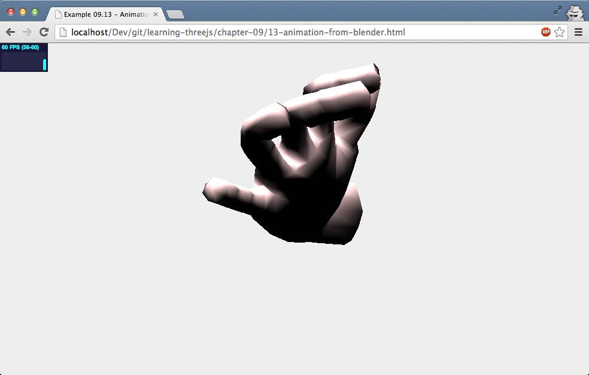

除了 Three.js 自己的格式之外，我们还可以使用另外几种格式来定义动画。我们要了解的第一种是加载 Collada 模型。

### 从 Collada 模型加载动画

从 Collada 文件加载模型的方式与其他格式相同。首先，必须包含正确的加载器 JavaScript 文件：

```html
<script type="text/javascript" src="../libs/ColladaLoader.js">
  </script>
```

<!-- pdf-page: 301 -->
动画与相机移动

接下来，我们创建一个加载器，并用它加载模型文件：

```javascript
var loader = new THREE.ColladaLoader();
loader.load('../assets/models/monster.dae', function (collada) {
```

```javascript
  var child = collada.skins[0];
  scene.add(child);
```

```javascript
  var animation = new THREE.Animation(child, child.
    geometry.animation);
  animation.play();
```

```text
  // position the mesh
  child.scale.set(0.15, 0.15, 0.15);
  child.rotation.x = -0.5 * Math.PI;
  child.position.x = -100;
  child.position.y = -60;
});
```

Collada 文件可以包含的内容远不止单个模型；它可以存储完整的场景，包括相机、光源、动画等。使用 Collada 模型的一个好方法是，将 loader.load 函数的结果打印到控制台，并确定你想使用哪些组件。在这个例子中，场景中有一个 THREE.SkinnedMesh（child）。要渲染这个模型并为其制作动画，我们只需像对基于 Blender 的模型那样设置动画；甚至渲染循环也保持不变。渲染模型并为其制作动画的方法如下：

```javascript
function render() {
  ...
  meshAnim.updateAnimation( delta *1000 );
  ...
}
```

<!-- pdf-page: 302 -->
这个特定 Collada 文件的结果如下所示：

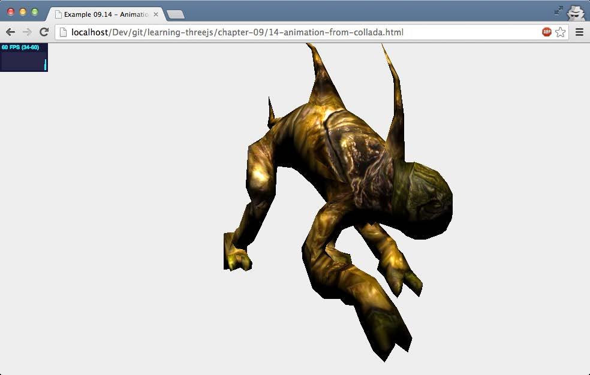

另一个外部模型示例是使用变形目标的 MD2 文件格式。

### 从 Quake 模型加载动画

MD2 格式是为 1996 年的优秀游戏 Quake 中的角色建模而创建的。尽管较新的引擎使用了不同的格式，但你仍然可以找到许多有趣的 MD2 格式模型。要使用这种格式的文件，我们首先必须将其转换为 Three.js JavaScript 格式。你可以使用以下网站在线完成转换：

```text
http://oos.moxiecode.com/js_webgl/md2_converter/
```

<!-- pdf-page: 303 -->
动画与相机移动

转换后，你会得到一个 Three.js 格式的 JavaScript 文件，可以使用 MorphAnimMesh 加载并渲染它。由于前几节已经介绍过如何执行此操作，因此这里略过加载模型的代码。不过，代码中有一件有趣的事情。我们不是播放完整动画，而是提供需要播放的动画名称：

```text
mesh.playAnimation('crattack', 10);
```

原因是 MD2 文件通常包含许多不同的角色动画。幸运的是，Three.js 提供了确定可用动画并使用 playAnimation 函数播放它们的功能。我们需要做的第一件事，是让 Three.js 解析动画：

```text
mesh.parseAnimations();
```

这会生成一个动画名称列表，可以使用 playAnimation 函数播放这些动画。在我们的示例中，你可以从右上角的菜单中选择动画名称。可用动画是这样确定的：

```text
mesh.parseAnimations();
```

```javascript
var animLabels = [];
for (var key in mesh.geometry.animations) {
  if (key === 'length' || !mesh.geometry.animations.
    hasOwnProperty(key)) continue;
  animLabels.push(key);
}
```

```javascript
gui.add(controls,'animations',animLabels).onChange(function(e) {
  mesh.playAnimation(controls.animations,controls.fps);
});
```

<!-- pdf-page: 304 -->
每当从菜单中选择动画时，都会使用指定的动画名称调用 mesh.playAnimation 函数。演示这一点的示例可以在 15-animation-from-md2.html 中找到。以下截图展示了该示例的静态画面：

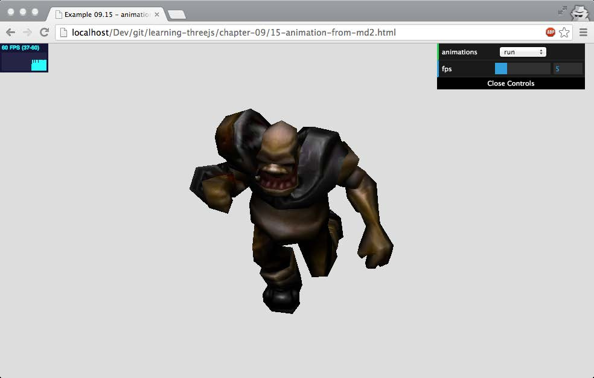

<!-- pdf-page: 305 -->
动画与相机移动

## 总结

在本章中，我们了解了为场景制作动画的不同方式。我们从一些基本的动画技巧开始，接着学习相机移动与控制，最后学习了如何为使用变形目标以及骨骼/骨头的模型制作动画。建立渲染循环后，添加动画就非常容易。只需更改网格的一个属性，Three.js 就会在下一次渲染时渲染更新后的网格。

在前几章中，我们了解了可用于覆盖对象表面的各种材质。例如，我们知道了如何更改这些材质的颜色、光泽度和不透明度。不过，我们尚未详细讨论如何将这些材质与外部图像（也称为纹理）结合使用。使用纹理，你可以轻松创建看起来像由木材、金属、石材等材质制成的对象。在下一章中，我们将探索纹理的各个方面，以及如何在 Three.js 中使用它们。

