# 第 10 章 · 纹理（Textures）的加载与使用

<!-- pdf-page: 306 -->
## 加载与使用

## 纹理

在第 4 章“使用 Three.js 材质（Material）”中，我们向你介绍了 Three.js 中可用的各种材质。不过，那一章并没有讨论如何将纹理应用到网格（Mesh）上。在本章中，我们将探讨这个主题。更具体地说，本章将讨论以下内容：

- 在 Three.js 中加载纹理并将其应用到网格

- 使用凹凸贴图（Bump Map）和法线贴图（Normal Map）为网格增加深度和细节

- 使用光照贴图（Light Map）创建伪阴影

- 使用环境贴图（Environment Map）为材质添加细致的反射

- 使用高光贴图（Specular Map）设置网格特定部分的光泽度

- 微调并自定义网格的 UV 映射（UV mapping）

- 使用 HTML5 canvas 和 video 元素作为纹理的输入

让我们从最基础的示例开始，向你展示如何加载并应用纹理。

## 在材质中使用纹理

在 Three.js 中，纹理有多种使用方式。你可以用它们定义网格的颜色，也可以用它们定义光泽度、凹凸和反射。不过，我们要看的第一个示例采用最基础的方式，即使用纹理来定义网格各个像素（Pixel）的颜色。

<!-- pdf-page: 307 -->
纹理的加载与使用

### 加载纹理并将其应用到网格

纹理最基础的用法，是将其设置为材质上的贴图（Map）。当你使用这种材质创建网格时，网格会根据所提供的纹理着色。

可以通过以下方式加载纹理并将其用于网格：

```javascript
function createMesh(geom, imageFile) {
  var texture = THREE.ImageUtils.loadTexture("../assets/
   textures/general/" + imageFile)
```

```javascript
  var mat = new THREE.MeshPhongMaterial();
  mat.map = texture;
```

```javascript
  var mesh = new THREE.Mesh(geom, mat);
  return mesh;
}
```

在这个代码示例中，我们使用 THREE.ImageUtils.loadTexture 函数从指定位置加载图像文件。你可以使用 PNG、GIF 或 JPEG 图像作为纹理的输入。请注意，纹理是异步加载的。在我们的场景中，这不是问题，因为我们有一个大约每秒渲染场景 60 次的渲染循环。如果你想等到纹理加载完成，可以采用以下方法：

```javascript
texture = THREE.ImageUtils.loadTexture('texture.png', {},
  function() { renderer.render(scene); });
```

在这个示例中，我们向 loadTexture 提供了一个回调函数。纹理加载完成时会调用这个回调。在我们的示例中，我们没有使用回调，而是依靠渲染循环在纹理加载完成后最终将其显示出来。

几乎任何你喜欢的图像都可以用作纹理。不过，使用尺寸为 2 的幂的方形纹理时，效果最佳。因此，256 x 256、512 x 512、1024 x 1024 等尺寸的效果最好。下图是一个方形纹理的示例：

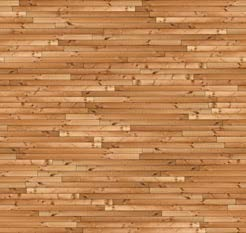

<!-- pdf-page: 308 -->
由于纹理的像素（也称为纹素（texel））通常不会与面上的像素一一对应，因此纹理需要被放大或缩小。为此，WebGL 和 Three.js 提供了几种不同的选项。你可以通过设置 magFilter 属性指定纹理如何放大，通过 minFilter 属性指定纹理如何缩小。这些属性可以设置为以下两个基本值：

| 名称 | 说明 |
| --- | --- |
| THREE.NearestFilter | 这个过滤器使用它能找到的最近纹素的颜色。用于放大时，会产生块状效果；用于缩小时，结果会丢失许多细节。 |
| THREE.LinearFilter | 这个过滤器更高级，使用四个相邻纹素的颜色值来确定正确的颜色。缩小时仍会丢失许多细节，但放大会平滑得多，块状感也更弱。 |

除了这些基本值之外，我们还可以使用多级渐远纹理（mipmap）。多级渐远纹理是一组纹理图像，每一张的尺寸都是前一张的一半。它们在加载纹理时创建，可以实现更平滑的过滤。因此，当你有一张（尺寸为 2 的幂的）方形纹理时，还可以使用以下几种方法获得更好的过滤效果。这些属性可以设置为以下值：

| 名称 | 说明 |
| --- | --- |
| THREE.NearestMipMapNearestFilter | 这个属性选择最符合所需分辨率的多级渐远纹理，并应用我们在上表中讨论的最近邻过滤原则。放大仍呈块状，但缩小效果会好得多。 |
| THREE.NearestMipMapLinearFilter | 这个属性不是只选择单个多级渐远纹理，而是选择最接近的两个多级渐远纹理层级。在这两个层级上分别应用最近邻过滤，得到两个中间结果。这两个结果再经过线性过滤，得到最终结果。 |
| THREE.LinearMipMapNearestFilter | 这个属性选择最符合所需分辨率的多级渐远纹理，并应用我们在上表中讨论的线性过滤原则。 |

<!-- pdf-page: 309 -->
纹理的加载与使用

| 名称 | 说明 |
| --- | --- |
| THREE.LinearMipMapLinearFilter | 这个属性不是选择单个多级渐远纹理，而是选择最接近的两个多级渐远纹理层级。在这两个层级上分别应用线性过滤，得到两个中间结果。这两个结果再经过线性过滤，得到最终结果。 |

如果没有明确指定 magFilter 和 minFilter 属性，Three.js 会默认将 magFilter 属性设置为 THREE.LinearFilter，将 minFilter 属性设置为 THREE.LinearMipMapLinearFilter。在我们的示例中，将直接使用这些默认属性。01-basic-texture.html 中提供了一个基础纹理示例。以下截图展示了这个示例：

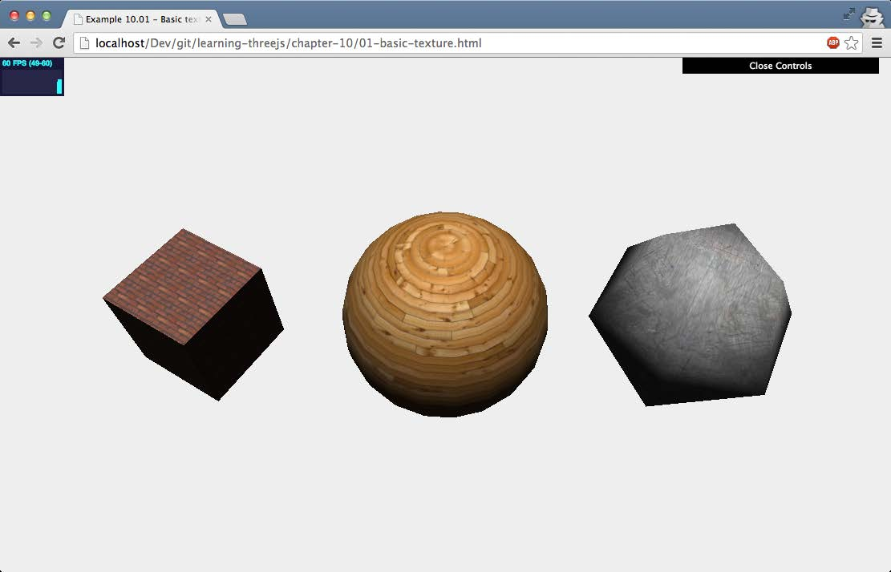

在这个示例中，我们加载了几种纹理（使用你前面看到的代码），并将它们应用到各种形状上。你可以看到，纹理很好地包裹在这些形状周围。在 Three.js 中创建几何体时，它会确保所使用的任何纹理都能正确应用。这是通过一种称为 UV 映射的机制实现的（本章稍后会详细介绍）。通过 UV 映射，我们告诉渲染器应将纹理的哪一部分应用到特定的面上。最简单的示例是立方体。其中一个面的 UV 映射如下所示：

```text
(0,1),(0,0),(1,0),(1,1)
```

<!-- pdf-page: 310 -->
这意味着我们为这个面使用完整的纹理（UV 值的范围从 0 到 1）。

除了可以使用 THREE.ImageUtils.loadTexture 加载的标准图像格式之外，Three.js 还提供了几个自定义加载器，可用于加载以不同格式提供的纹理。下表列出了可以使用的其他加载器：

名称 说明 THREE.DDSLoader 使用这个加载器，可以加载以 DirectDraw Surface 格式提供的纹理。这种格式是 Microsoft 用于存储压缩纹理的专有格式。使用这个加载器非常简单。首先，在 HTML 页面中包含 DDSLoader.js 文件，然后按以下方式使用纹理：

```javascript
var loader = new THREE.DDSLoader();
var texture = loader.load( '../assets/
  textures/  seafloor.dds' );
```

```javascript
var mat = new THREE.MeshPhongMaterial();
mat.map = texture;
```

你可以在本章源代码的 01-basic-texture-dds.html 中查看这个加载器的示例。在内部，这个加载器使用 THREE.CompressedTextureLoader。THREE.PVRLoader Power VR 是另一种用于存储压缩纹理的专有文件格式。Three.js 支持 Power VR 3.0 文件格式，并且可以使用以这种格式提供的纹理。要使用这个加载器，请在 HTML 页面中包含 PVRLoader.js 文件，然后按以下方式使用纹理：

```javascript
var loader = new THREE.DDSLoader();
var texture = loader.load( '../assets/
  textures/ seafloor.dds' );
```

```javascript
var mat = new THREE.MeshPhongMaterial();
mat.map = texture;
```

你可以在本章源代码中查看这个加载器的示例：01-basic-texture-pvr.html。请注意，并非所有 WebGL 实现都支持这种格式的纹理。因此，当你使用它却看不到纹理时，请检查控制台中的错误。在内部，这个加载器也使用 THREE.CompressedTextureLoader。

<!-- pdf-page: 311 -->
纹理的加载与使用

名称 说明 THREE.TGALoader Targa 是一种光栅图形文件格式，仍被大量 3D 软件程序使用。借助 THREE.TGALoader 对象，你可以在 3D 模型中使用以这种格式提供的纹理。要使用这些图像文件，首先必须在 HTML 中包含 TGALoader.js 文件，然后可以按以下方式加载 TGA 纹理：

```javascript
var loader = new THREE.TGALoader();
var texture = loader.load( '../assets/
  textures/crate_color8.tga' );
```

```javascript
var mat = new THREE.MeshPhongMaterial();
mat.map = texture;
```

本章源代码中提供了这个加载器的示例。你可以在浏览器中打开 01-basictexture-tga.html 来查看这个示例。

在这些示例中，我们使用纹理来定义网格像素的颜色。纹理也可以用于其他用途。以下两个示例用于定义如何将着色应用到材质上。你可以用它们在网格表面创建凸起和皱纹。

### 使用凹凸贴图创建皱纹

凹凸贴图用于为材质增加更多深度。打开 02-bump-map.html 示例，就可以看到它的实际效果。请参考以下截图查看该示例：

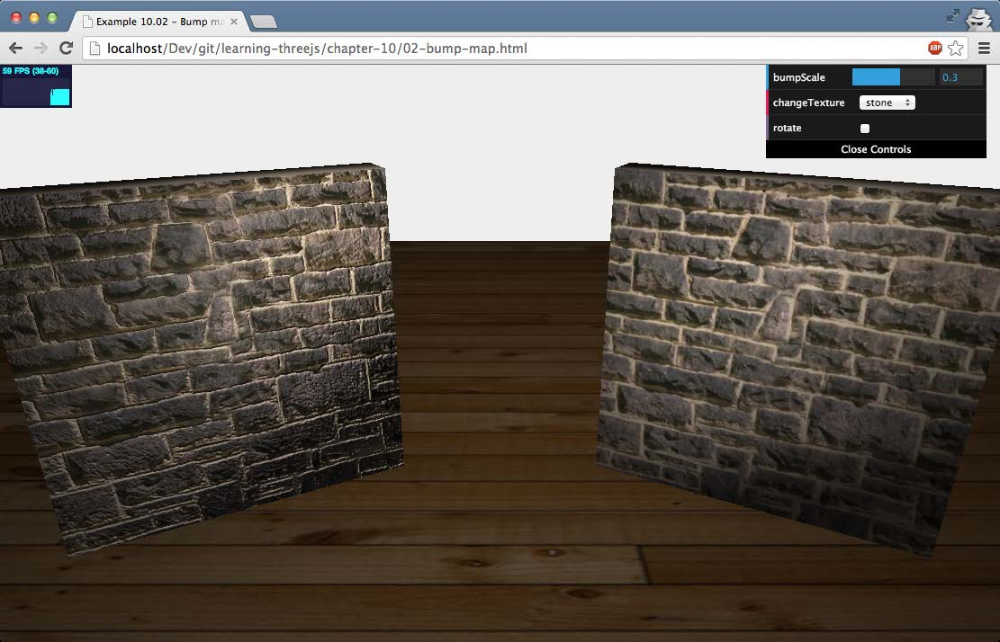

<!-- pdf-page: 312 -->
在这个示例中，你可以看到，与右侧的墙相比，左侧的墙看起来细节丰富得多，似乎也更深。这是通过在材质上设置一种额外的纹理，即所谓的凹凸贴图来实现的：

```javascript
function createMesh(geom, imageFile, bump) {
  var texture = THREE.ImageUtils.loadTexture("../assets/textures/
    general/" + imageFile)
  var mat = new THREE.MeshPhongMaterial();
  mat.map = texture;
```

```javascript
  var bump = THREE.ImageUtils.loadTexture(
    "../assets/textures/general/" + bump)
  mat.bumpMap = bump;
  mat.bumpScale = 0.2;
```

```javascript
  var mesh = new THREE.Mesh(geom, mat);
  return mesh;
}
```

从代码中可以看到，除了设置 map 属性之外，我们还将 bumpMap 属性设置为一个纹理。此外，通过 bumpScale 属性，我们可以设置凹凸的高度（如果设置为负值，则是深度）。本例中使用的纹理如下所示：

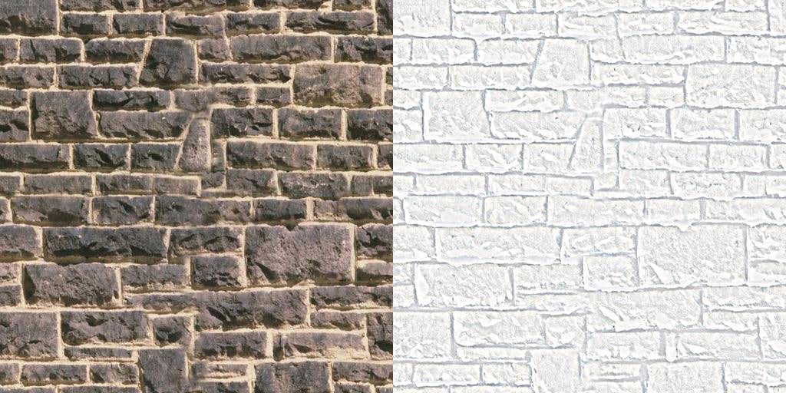

<!-- pdf-page: 313 -->
纹理的加载与使用

凹凸贴图是灰度图像，但你也可以使用彩色图像。像素的强度决定凹凸的高度。凹凸贴图只包含像素的相对高度，并不说明坡度的方向。因此，使用凹凸贴图所能达到的细节程度和深度感是有限的。要获得更多细节，可以使用法线贴图。

### 使用法线贴图实现更细致的凹凸和皱纹

法线贴图中存储的不是高度（位移），而是每个图像元素法线的方向。不深入太多细节的话，使用法线贴图，你可以创建看起来非常细致、但仍只使用少量顶点和面的模型。例如，看看 03-normal-map.html 示例。以下截图描绘了这个示例：

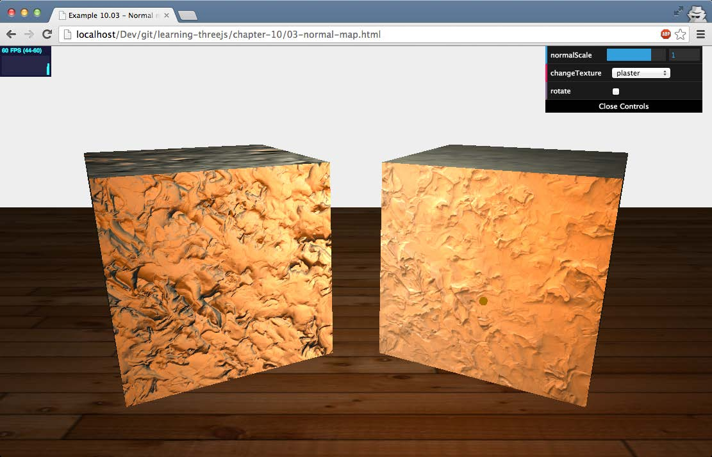

<!-- pdf-page: 314 -->
在这张截图中，你可以看到左侧有一个细节非常丰富的抹灰立方体。光源围绕立方体移动，你可以看到纹理会自然地响应光源。这提供了一个看起来非常真实的模型，而只需要一个非常简单的模型和几种纹理。以下代码片段展示了如何在 Three.js 中使用法线贴图：

```javascript
function createMesh(geom, imageFile, normal) {
  var t = THREE.ImageUtils.loadTexture("../assets/textures
    /general/" + imageFile);
  var m = THREE.ImageUtils.loadTexture("../assets/textures
    /general/" + normal);
```

```javascript
  var mat2 = new THREE.MeshPhongMaterial();
  mat2.map = t;
  mat2.normalMap = m;
```

```javascript
  var mesh = new THREE.Mesh(geom, mat2);
  return mesh;
}
```

这里采用的方法与凹凸贴图相同。不过这一次，我们将 normalMap 属性设置为法线贴图。我们还可以通过 normalScale 属性（mat.normalScale.set(1,1)）定义凹凸的明显程度。通过这两个值，可以分别沿 x 轴和 y 轴进行缩放。不过，为了获得最佳效果，最好的做法是让这两个值保持相同。请再次注意，当这些值低于零时，高度会反转。以下截图同时展示了纹理（左侧）和法线贴图（右侧）：

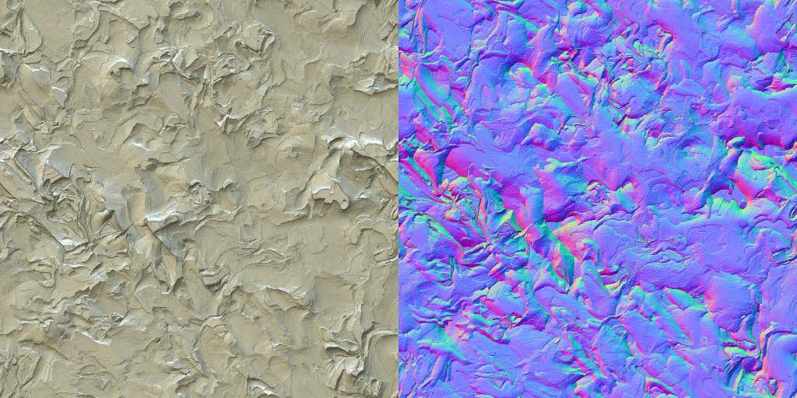

<!-- pdf-page: 315 -->
纹理的加载与使用

不过，法线贴图的问题在于，它们不太容易创建。你需要使用 Blender 或 Photoshop 之类的专用工具。这些工具可以使用高分辨率渲染结果或纹理作为输入，并据此创建法线贴图。

Three.js 还提供了一种在运行时完成此操作的方式。THREE.ImageUtils 对象有一个名为 getNormalMap 的函数，它接受 JavaScript/DOM Image 作为输入，并将其转换为法线贴图。

### 使用光照贴图创建伪阴影

在前面的示例中，我们使用特定的贴图创建看起来真实、会对房间光照作出反应的阴影。还有一种创建伪阴影的替代方案。在本节中，我们将使用光照贴图。光照贴图是一种预渲染阴影（也称为预烘焙阴影），你可以用它来营造真实阴影的错觉。以下截图来自 04-light-map.html 示例，展示了它的效果：

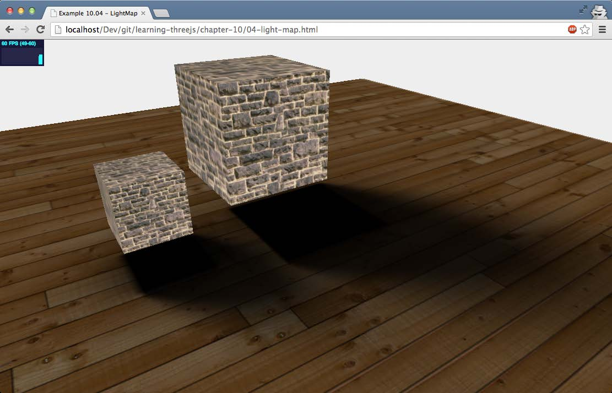

<!-- pdf-page: 316 -->
如果查看上一个示例，你会看到几个非常漂亮的阴影，它们似乎是由两个立方体投射出来的。不过，这些阴影基于如下所示的光照贴图纹理：

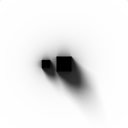

如你所见，光照贴图中指定的阴影也显示为地平面上的阴影，从而营造出真实阴影的错觉。你可以使用这种技术创建高分辨率阴影，而不会带来沉重的渲染性能开销。当然，这只适用于静态场景。使用光照贴图与使用其他纹理基本相同，只有几个小区别。我们这样使用光照贴图：

```javascript
var lm = THREE.ImageUtils.loadTexture('../assets/textures/
  lightmap/lm-1.png');
var wood = THREE.ImageUtils.loadTexture('../assets/textures/
  general/floor-wood.jpg');
var groundMaterial = new THREE.MeshBasicMaterial
  ({lightMap: lm, map: wood});
groundGeom.faceVertexUvs[1] = groundGeom.faceVertexUvs[0];
```

要应用光照贴图，我们只需将材质的 lightMap 属性设置为刚才展示的光照贴图。不过，要让光照贴图显示出来，还需要一个额外步骤。我们需要为光照贴图明确指定 UV 映射（面上显示纹理的哪一部分）。之所以需要这样做，是为了让光照贴图可以独立于其他纹理进行应用和映射。在我们的示例中，我们只使用创建地平面时由 Three.js 自动生成的基础 UV 映射。有关为何需要显式 UV 映射的更多信息和背景，请参见 http://stackoverflow.com/questions/15137695/three-js-lightmapcauses-an-error-webglrenderingcontext-gl-error-gl-invalid-op。

当光照贴图中的阴影位置正确后，我们需要将立方体放到正确的位置，使阴影看起来就像是由它们投射出来的。

Three.js 还提供了另一种纹理，可用于伪造高级 3D 效果。在下一节中，我们将了解如何使用环境贴图伪造反射。

<!-- pdf-page: 317 -->
纹理的加载与使用

### 使用环境贴图创建伪反射

计算环境反射会大量占用 CPU，通常需要采用光线追踪方法。如果你想在 Three.js 中使用反射，仍然可以做到，但必须伪造。为此，可以创建对象所处环境的纹理，并将其应用到特定对象上。首先，我们会展示想要实现的结果（参见 05-env-map-static.html，以下截图也展示了该示例）：

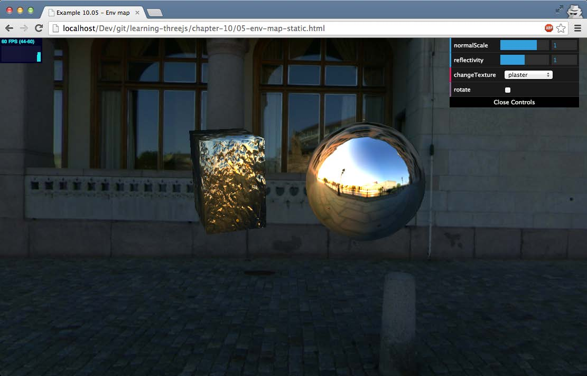

在这张截图中，你可以看到球体和立方体会反射环境。如果四处移动鼠标，还可以看到反射与相机相对于你所见城市环境的角度相对应。为了创建这个示例，我们执行以下步骤：

1.	 创建立方体贴图（CubeMap）对象：我们需要做的第一件事是创建立方体贴图对象。立方体贴图由六个纹理组成，可分别应用到立方体的每一面。

<!-- pdf-page: 318 -->
2.	 使用这个立方体贴图对象创建一个盒子：当你四处移动相机时，所看到的环境就是带有立方体贴图的盒子。它让你产生一种错觉，仿佛自己正站在一个可以四处查看的环境中。实际上，你位于一个立方体内部，立方体内侧渲染了纹理，以营造空间的错觉。

3.	 将立方体贴图对象应用为纹理：我们用于模拟环境的同一个立方体贴图对象，也可以用作网格上的纹理。Three.js 会确保它看起来像环境的反射。

有了源素材之后，创建立方体贴图就相当容易。你需要的是六张共同构成完整环境的图像。因此，你需要以下图片：向前看（posz）、向后看（negz）、向上看（posy）、向下看（negy）、向右看（posx）和向左看（negx）。Three.js 会将它们拼接起来，创建无缝的环境贴图。有几个网站可以下载这些图片。本例使用的图片来自 http://www.humus.name/index.php?page=Textures。

获得六张独立图片后，可以按照以下代码片段所示加载它们：

```javascript
function createCubeMap() {
```

```javascript
  var path = "../assets/textures/cubemap/parliament/";
  var format = '.jpg';
  var urls = [
    path + 'posx' + format, path + 'negx' + format,
    path + 'posy' + format, path + 'negy' + format,
    path + 'posz' + format, path + 'negz' + format
  ];
```

```javascript
  var textureCube = THREE.ImageUtils.loadTextureCube( urls );
  return textureCube;
}
```

我们再次使用 THREE.ImageUtils JavaScript 对象，但这次传入一个纹理数组，并使用 loadTextureCube 函数创建立方体贴图对象。如果你已经有一张 360 度全景图像，也可以将其转换为一组用于创建立方体贴图的图像。只需访问 http://gonchar.me/ panorama/ 转换图像，最后会得到六张图像，名称类似于 right.png、left.png、top.png、bottom.png、front.png 和 back.png。你可以通过像这样创建 urls 变量来使用它们：

```javascript
var urls = [
  'right.png',
```

<!-- pdf-page: 319 -->
纹理的加载与使用

```text
  'left.png',
  'top.png',
  'bottom.png',
  'front.png',
  'back.png'
];
```

或者，你也可以让 Three.js 在加载场景时处理转换，像这样创建 textureCube：

```javascript
var textureCube = THREE.ImageUtils.loadTexture("360-degrees.png",
  new THREE.UVMapping());
```

有了立方体贴图，我们首先创建一个盒子，可以这样创建：

```javascript
var textureCube = createCubeMap();
var shader = THREE.ShaderLib[ "cube" ];
shader.uniforms[ "tCube" ].value = textureCube;
var material = new THREE.ShaderMaterial( {
  fragmentShader: shader.fragmentShader,
  vertexShader: shader.vertexShader,
  uniforms: shader.uniforms,
  depthWrite: false,
  side: THREE.BackSide
});
cubeMesh = new THREE.Mesh(new THREE.BoxGeometry(100, 100, 100),
  material);
```

Three.js 提供了一种特殊的着色器，我们可以将其与 THREE.ShaderMaterial 结合使用，基于立方体贴图创建环境（var shader = THREE.ShaderLib\[ "cube" \];）。我们使用立方体贴图配置这个着色器，创建一个网格，并将其添加到场景中。从内部看，这个网格就代表我们所处的虚拟环境。

同一个立方体贴图对象还应应用到我们想要渲染的网格上，以创建伪反射：

```javascript
var sphere1 = createMesh(new THREE.SphereGeometry(10, 15, 15),
  "plaster.jpg");
sphere1.material.envMap = textureCube;
sphere1.rotation.y = -0.5;
sphere1.position.x = 12;
sphere1.position.y = 5;
scene.add(sphere1);
```

<!-- pdf-page: 320 -->
```javascript
var cube = createMesh(new THREE.CubeGeometry(10, 15, 15),
  "plaster.jpg","plaster-normal.jpg");
sphere2.material.envMap = textureCube;
sphere2.rotation.y = 0.5;
sphere2.position.x = -12;
sphere2.position.y = 5;
scene.add(cube);
```

如你所见，我们将材质的 envMap 属性设置为所创建的立方体贴图对象。结果是一个让我们仿佛站在宽阔户外环境中的场景，其中的网格会反射这个环境。如果使用滑块，可以设置材质的 reflectivity 属性；顾名思义，它决定材质反射环境的程度。

除了反射之外，Three.js 还允许你将立方体贴图对象用于折射（类似玻璃的对象）。以下截图展示了这一点：

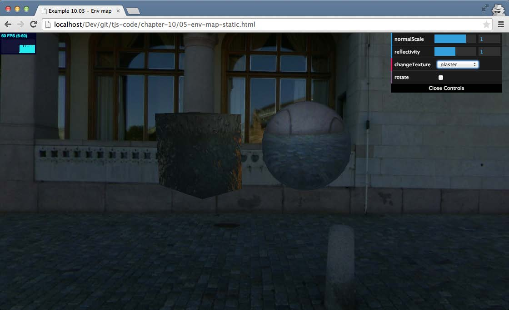

要获得这种效果，我们只需将纹理的加载方式改为：

```javascript
var textureCube = THREE.ImageUtils.loadTextureCube( urls, new
  THREE.CubeRefractionMapping());
```

<!-- pdf-page: 321 -->
纹理的加载与使用

你可以通过材质上的 refraction 属性控制折射率，就像使用 reflection 属性一样。在这个示例中，我们为网格使用了静态环境贴图。换句话说，我们只能看到环境反射，而看不到这个环境中的其他网格。在以下截图中（在浏览器中打开 05-env-map-dynamic.html 可以看到动态效果），我们将向你展示如何创建也能显示场景中其他对象的反射：

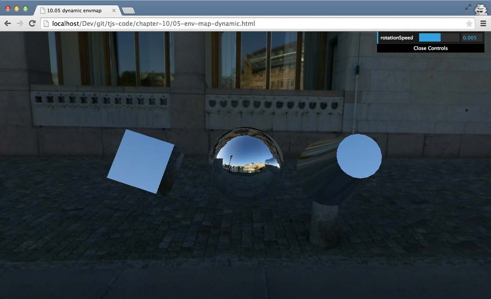

为了同时显示场景中其他对象的反射，我们需要使用另外一些 Three.js 组件。首先需要的是一台名为 THREE.CubeCamera 的额外相机：

```javascript
Var cubeCamera = new THREE.CubeCamera(0.1, 20000, 256);
scene.add(cubeCamera);
```

我们将使用 THREE.CubeCamera 拍摄包含所有已渲染对象的场景快照，并用它来设置立方体贴图。你需要确保将这台相机放置在想要显示动态反射的 THREE.Mesh 的精确位置。对于这个示例，我们只显示中心球体上的反射（如前面的截图所示）。这个球体位于 0, 0, 0 位置，因此在本例中，我们不需要显式定位 THREE.CubeCamera。

<!-- pdf-page: 322 -->
我们只对球体应用动态反射，所以需要两种不同的材质：

```javascript
var dynamicEnvMaterial = new THREE.MeshBasicMaterial({envMap:
  cubeCamera.renderTarget });
var envMaterial = new THREE.MeshBasicMaterial({envMap: textureCube
  });
```

与上一个示例的主要区别在于，对于动态反射，我们将 envMap 属性设置为 cubeCamera.renderTarget，而不是之前创建的 textureCube。在这个示例中，我们对中心球体使用 dynamicEnvMaterial，对另外两个对象使用 envMaterial：

```javascript
sphere = new THREE.Mesh(sphereGeometry, dynamicEnvMaterial);
sphere.name = 'sphere';
scene.add(sphere);
```

```javascript
var cylinder = new THREE.Mesh(cylinderGeometry, envMaterial);
cylinder.name = 'cylinder';
scene.add(cylinder);
cylinder.position.set(10, 0, 0);
```

```javascript
var cube = new THREE.Mesh(boxGeometry, envMaterial);
cube.name = 'cube';
scene.add(cube);
cube.position.set(-10, 0, 0);
```

剩下要做的就是确保 cubeCamera 渲染场景，这样我们就可以将该输出用作中心球体的输入。为此，我们像这样更新渲染循环：

```javascript
function render() {
  sphere.visible = false;
  cubeCamera.updateCubeMap( renderer, scene );
  sphere.visible = true;
  renderer.render(scene, camera);
  ...
  requestAnimationFrame(render);
}
```

如你所见，我们首先禁用 sphere 的可见性。这样做是因为我们只想看到来自另外两个对象的反射。接下来，通过调用 updateCubeMap 函数，使用 cubeCamera 渲染场景。之后，我们再次让 sphere 可见，并照常渲染场景。最终结果是，在球体的反射中，你可以看到立方体和圆柱体的反射。

我们要了解的最后一种基础材质贴图是高光贴图。

<!-- pdf-page: 323 -->
纹理的加载与使用

### 高光贴图

使用高光贴图，你可以指定一张用于定义材质光泽度和高光颜色的贴图。例如，在以下截图中，我们将高光贴图与法线贴图结合使用来渲染一个地球仪。在浏览器中打开 06-specular-map.html，就可以看到这个示例。以下截图也展示了其结果：

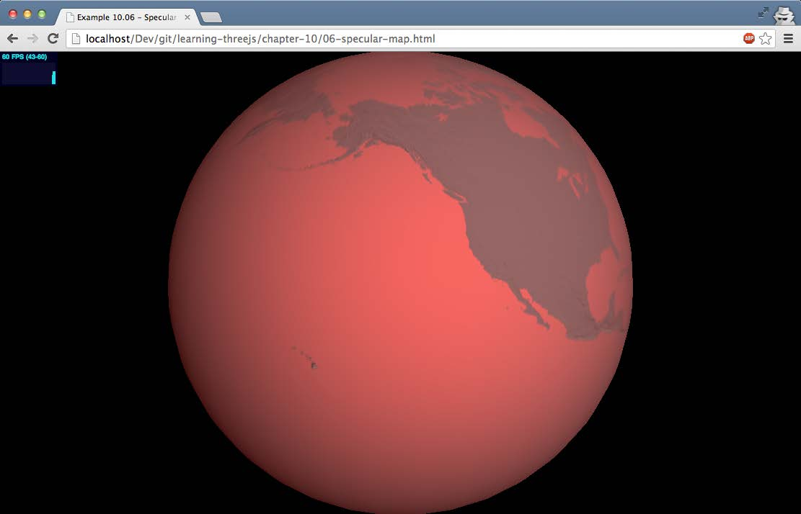

在这张截图中，你可以看到海洋被高亮并反射光线。另一方面，大陆非常暗，不会反射（太多）光。为了实现这种效果，我们没有使用任何特殊的法线贴图，而只是使用法线贴图来表现高度，并使用以下高光贴图来突出海洋：

<!-- pdf-page: 324 -->
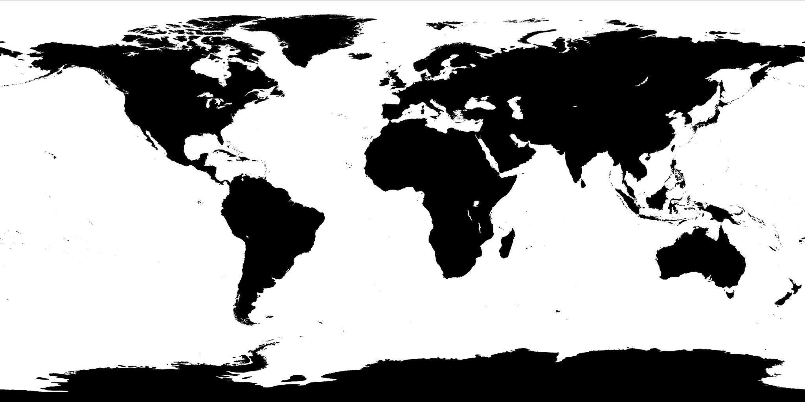

基本上，像素值越高（从黑色到白色），表面看起来就越有光泽。高光贴图通常与 specular 属性结合使用，后者可用于确定反射的颜色。在这个例子中，它被设置为红色：

```javascript
var specularTexture=THREE.ImageUtils.loadTexture("../assets/
  textures/planets/EarthSpec.png");
var normalTexture=THREE.ImageUtils.loadTexture("../assets/
  textures/planets/EarthNormal.png");
```

```javascript
var planetMaterial = new THREE.MeshPhongMaterial();
planetMaterial.specularMap = specularTexture;
planetMaterial.specular = new THREE.Color( 0xff0000 );
planetMaterial.shininess = 1;
```

```text
planetMaterial.normalMap = normalTexture;
```

另请注意，较低的光泽度通常能实现最佳效果，但根据你使用的光照和高光贴图，可能需要进行试验才能获得想要的效果。

<!-- pdf-page: 325 -->
纹理的加载与使用

## 纹理的高级用法

在上一节中，我们了解了一些基础的纹理用法。Three.js 还提供了更高级的纹理使用选项。在本节中，我们将了解 Three.js 提供的几个选项。

### 自定义 UV 映射

我们首先更深入地了解 UV 映射。前面解释过，通过 UV 映射，可以指定在特定面上显示纹理的哪一部分。在 Three.js 中创建几何体时，也会根据所创建几何体的类型自动创建这些映射。在大多数情况下，你并不需要更改这个默认 UV 映射。理解 UV 映射工作方式的一个好方法，是查看 Blender 中的示例，如下面的截图所示：

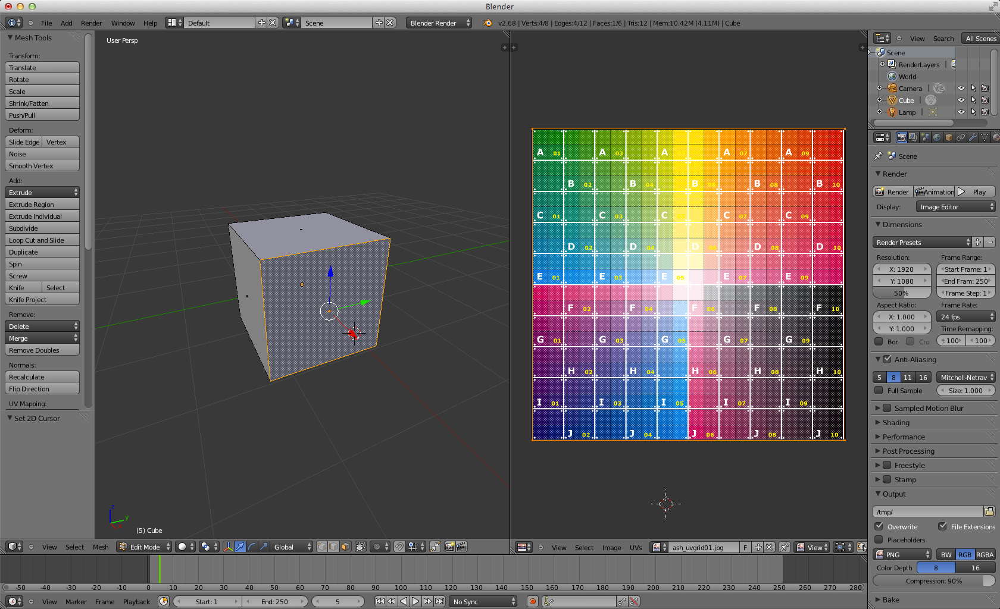

<!-- pdf-page: 326 -->
在这个示例中，你可以看到两个窗口。左侧窗口包含一个立方体几何体。右侧窗口是 UV 映射，我们加载了一张示例纹理来展示映射情况。在这个示例中，我们在左侧窗口中选中了单个面，右侧窗口显示了这个面的 UV 映射。如你所见，该面的每个顶点都位于右侧 UV 映射的一个角上（小圆圈）。这意味着该面会使用完整的纹理。这个立方体的所有其他面都以相同方式映射，因此最终显示的立方体每个面都会显示完整纹理；参见 07-uv-mapping.html，以下截图也展示了该示例：

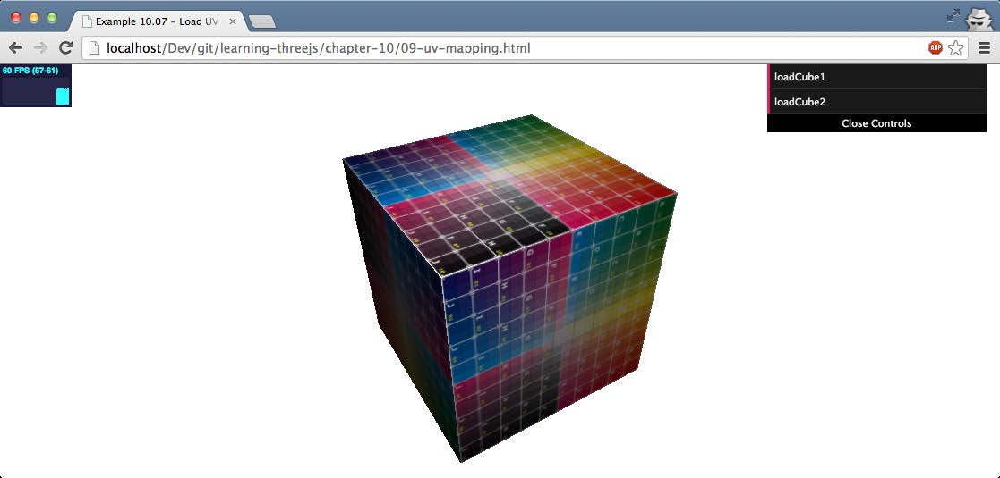

<!-- pdf-page: 327 -->
纹理的加载与使用

这是 Blender 中立方体的默认设置（Three.js 中也是如此）。让我们通过仅选择纹理的三分之二来更改 UV（参见以下截图中的选中区域）：

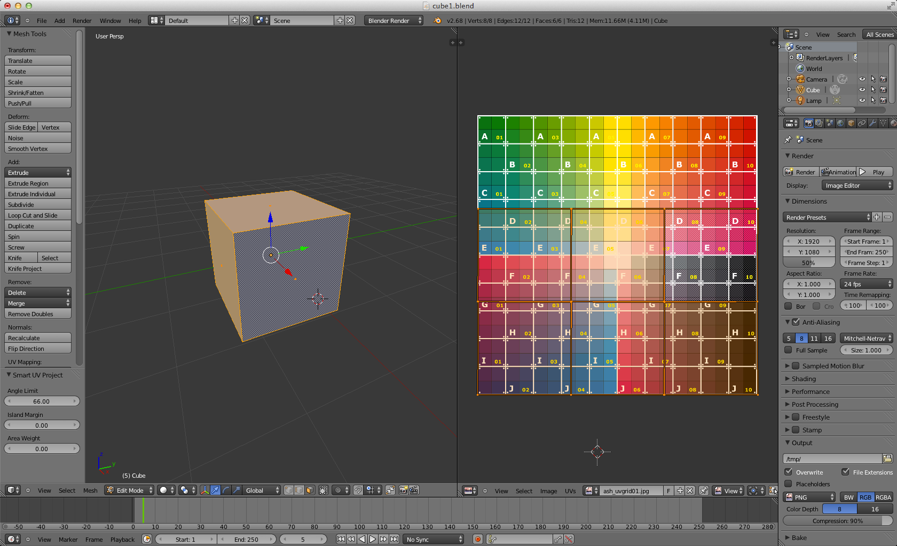

如果现在将其显示在 Three.js 中，你可以看到纹理的应用方式有所不同，如下面的截图所示：

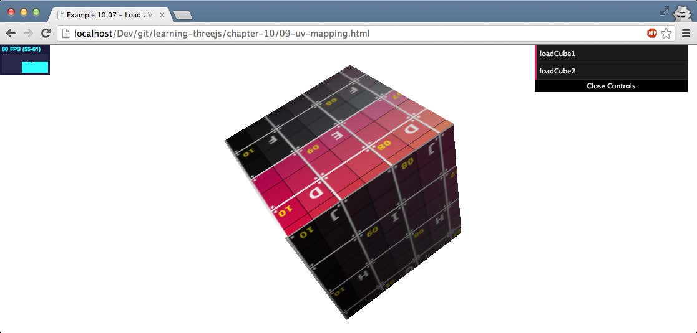

<!-- pdf-page: 328 -->
自定义 UV 映射通常在 Blender 之类的程序中完成，尤其是当模型变得更复杂时。这里需要记住的最重要一点是，UV 映射使用 u 和 v 两个维度，取值范围为 0 到 1。要自定义 UV 映射，你需要为每个面定义应显示纹理的哪一部分。为此，需要为组成该面的每个顶点定义 u 和 v 坐标。你可以使用以下代码设置 u 和 v 值：

```text
geom.faceVertexUvs[0][0][0].x = 0.5;
geom.faceVertexUvs[0][0][0].y = 0.7;
geom.faceVertexUvs[0][0][1].x = 0.4;
geom.faceVertexUvs[0][0][1].y = 0.1;
geom.faceVertexUvs[0][0][2].x = 0.4;
geom.faceVertexUvs[0][0][2].y = 0.5;
```

这段代码会将第一个面的 uv 属性设置为指定值。请记住，每个面由三个顶点定义，所以要设置一个面的所有 uv 值，我们需要设置六个属性。如果打开 07-uv-mapping-manual.html 示例，就可以看到手动更改 uv 映射时会发生什么。以下截图展示了这个示例：

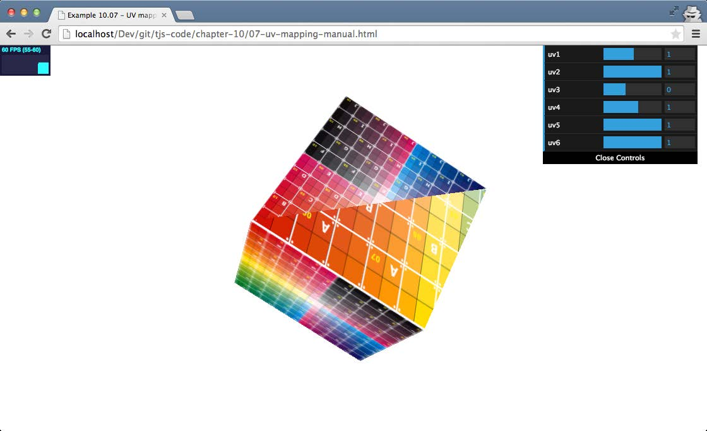

接下来，我们将了解如何重复纹理，这是通过一些内部 UV 映射技巧完成的。

<!-- pdf-page: 329 -->
纹理的加载与使用

### 重复包裹（Repeat wrapping）

将纹理应用到 Three.js 创建的几何体时，Three.js 会尝试尽可能以最佳方式应用纹理。例如，对于立方体，这意味着每一面都会显示完整纹理；对于球体，完整纹理会包裹在球体周围。不过，在某些情况下，你不希望纹理铺满整个面或整个几何体，而是希望纹理自我重复。Three.js 提供了详细的功能来控制这一点。08-repeat-wrapping.html 示例提供了一个可以试用 repeat 属性的示例。以下截图展示了这个示例：

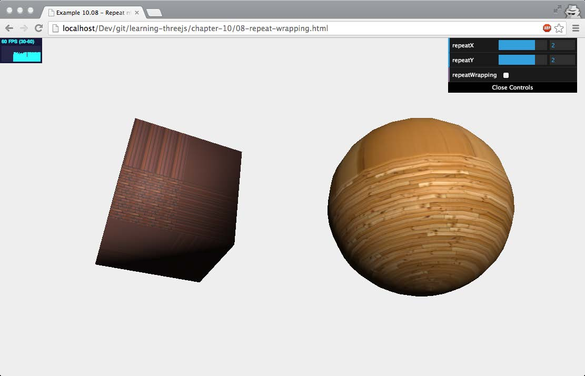

在这个示例中，你可以设置控制纹理如何自我重复的属性。

在这个属性产生预期效果之前，需要确保将纹理的包裹方式设置为 THREE.RepeatWrapping，如以下代码片段所示：

```javascript
cube.material.map.wrapS = THREE.RepeatWrapping;
cube.material.map.wrapT = THREE.RepeatWrapping;
```

<!-- pdf-page: 330 -->
wrapS 属性定义你希望纹理如何沿其 x 轴表现，wrapT 属性定义纹理应如何沿其 y 轴表现。Three.js 为此提供了两个选项，如下所示：

- THREE.RepeatWrapping 允许纹理自我重复。

- THREE.ClampToEdgeWrapping 是默认设置。使用 THREE.ClampToEdgeWrapping 时，纹理不会作为整体重复，而只会重复边缘的像素。

如果禁用 repeatWrapping 菜单选项，就会使用 THREE.ClampToEdgeWrapping 选项，如下所示：

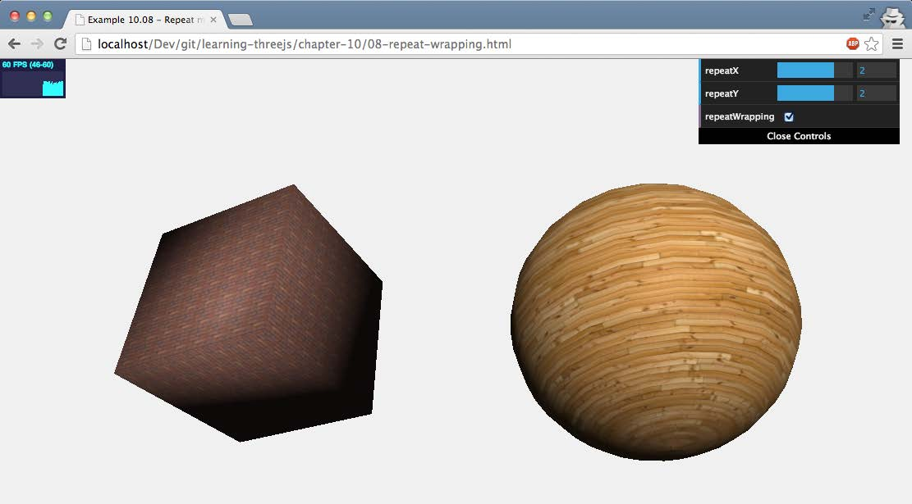

如果使用 THREE.RepeatWrapping，就可以按照以下代码片段所示设置 repeat 属性：

```text
cube.material.map.repeat.set(repeatX, repeatY);
```

repeatX 变量定义纹理沿其 x 轴重复的次数，repeatY 变量对 y 轴定义相同的内容。如果这些值设置为 1，纹理就不会自我重复；如果设置为更高的值，你会看到纹理开始重复。也可以使用小于 1 的值。在这种情况下，你会看到纹理被放大。如果将 repeat 值设置为负数，纹理将被镜像。

<!-- pdf-page: 331 -->
纹理的加载与使用

更改 repeat 属性时，Three.js 会自动更新纹理并使用这个新设置进行渲染。如果从 THREE.RepeatWrapping 更改为 THREE.ClampToEdgeWrapping，则需要显式更新纹理：

```text
cube.material.map.needsUpdate = true;
```

到目前为止，我们只使用静态图像作为纹理。不过，Three.js 也提供了将 HTML5 canvas 用作纹理的选项。

### 渲染到 canvas 并将其用作纹理

在本节中，我们将了解两个不同的示例。首先，我们会了解如何使用 canvas 创建简单纹理并将其应用到网格；之后，我们会更进一步，创建一个使用随机生成图案、可用作凹凸贴图的 canvas。

#### 将 canvas 用作纹理

在第一个示例中，我们将使用 Literally 库（来自 http://literallycanvas. com/）创建一个可以在上面绘图的交互式 canvas；请参见以下截图的左下角。你可以在 09-canvas-texture 中查看这个示例。接下来的截图展示了这个示例：

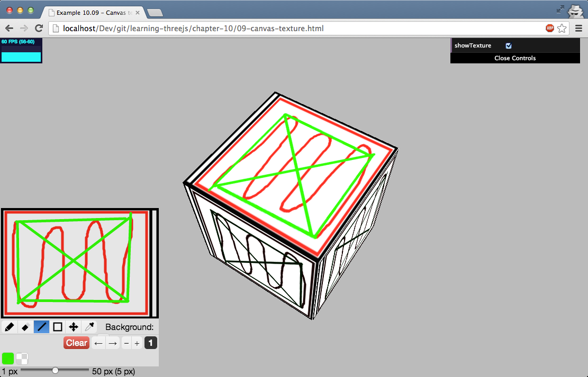

<!-- pdf-page: 332 -->
你在这个 canvas 上绘制的任何内容，都会直接作为纹理渲染到立方体上。在 Three.js 中实现这一点非常简单，只需要几个步骤。我们需要做的第一件事是创建一个 canvas 元素，并且对于这个特定示例，将其配置为与 Literally 库一起使用，如下所示：

```javascript
<div class="fs-container">
  <div id="canvas-output" style="float:left">
  </div>
</div>
...
var canvas = document.createElement("canvas");
$('#canvas-output')[0].appendChild(canvas);
$('#canvas-output').literallycanvas(
  {imageURLPrefix: '../libs/literally/img'});
```

我们只是从 JavaScript 创建一个 canvas 元素，并将其添加到特定的 div 元素中。通过 literallycanvas 调用，可以创建绘图工具，让你直接在 canvas 上绘图。接下来，我们需要创建一个使用 canvas 绘图作为输入的纹理：

```javascript
function createMesh(geom) {
```

```javascript
  var canvasMap = new THREE.Texture(canvas);
  var mat = new THREE.MeshPhongMaterial();
  mat.map = canvasMap;
  var mesh = new THREE.Mesh(geom,mat);
```

```text
  return mesh;
}
```

如代码所示，你唯一需要做的就是在创建新纹理时传入对 canvas 元素的引用，即 new THREE.Texture(canvas)。这会创建一个将 canvas 元素用作其素材的纹理。剩下要做的就是在每次渲染时更新材质，以便立方体上显示 canvas 绘图的最新版本，如下所示：

```javascript
function render() {
  stats.update();
```

```text
  cube.rotation.y += 0.01;
  cube.rotation.x += 0.01;
```

```text
  cube.material.map.needsUpdate = true;
  requestAnimationFrame(render);
  webGLRenderer.render(scene, camera);
}
```

<!-- pdf-page: 333 -->
纹理的加载与使用

要通知 Three.js 我们想更新纹理，只需将纹理的 needsUpdate 属性设置为 true。在这个示例中，我们将 canvas 元素用作最简单纹理的输入。当然，对于目前见过的所有不同类型的贴图，我们都可以使用同样的思路。在下一个示例中，我们会将它用作凹凸贴图。

#### 将 canvas 用作凹凸贴图

正如我们在本章前面所看到的，可以使用凹凸贴图创建简单的皱纹纹理。这张贴图中像素的强度越高，皱纹就越明显。由于凹凸贴图只是一张简单的黑白图像，因此我们完全可以在 canvas 上创建它，并将该 canvas 用作凹凸贴图的输入。

在以下示例中，我们使用 canvas 生成随机灰度图像，并将该图像用作应用到立方体的凹凸贴图的输入。请参见 09-canvas-texture-bumpmap.html 示例。以下截图展示了这个示例：

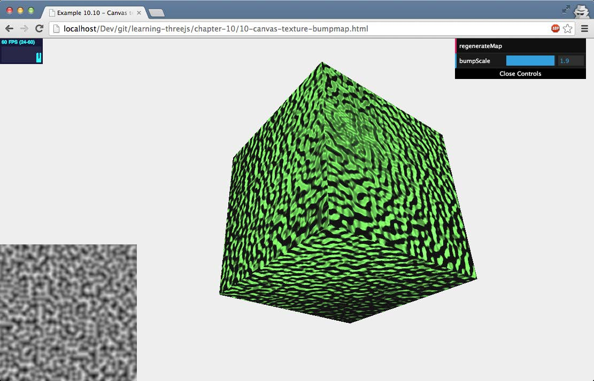

<!-- pdf-page: 334 -->
这里所需的 JavaScript 代码与我们刚才解释的上一个示例没有太大不同。我们需要创建一个 canvas 元素，并用一些随机噪声填充这个 canvas。对于噪声，我们使用 Perlin 噪声（Perlin noise）。Perlin 噪声（http:// en.wikipedia.org/wiki/Perlin\_noise）会生成一种看起来非常自然的随机纹理，如前面的截图所示。为此，我们使用来自 https://github.com/wwwtyro/perlin.js 的 Perlin 噪声函数：

```javascript
var ctx = canvas.getContext("2d");
function fillWithPerlin(perlin, ctx) {
```

```javascript
  for (var x = 0; x < 512; x++) {
    for (var y = 0; y < 512; y++) {
      var base = new THREE.Color(0xffffff);
      var value = perlin.noise(x / 10, y / 10, 0);
      base.multiplyScalar(value);
      ctx.fillStyle = "#" + base.getHexString();
      ctx.fillRect(x, y, 1, 1);
    }
  }
}
```

我们使用 perlin.noise 函数，根据 canvas 元素的 x 和 y 坐标创建一个从 0 到 1 的值。这个值用于在 canvas 元素上绘制单个像素。对所有像素执行此操作，就会创建随机贴图，你也可以在前面截图的左下角看到它。随后，可以很容易地将这张贴图用作凹凸贴图。随机贴图可以这样创建：

```javascript
var bumpMap = new THREE.Texture(canvas);
```

```javascript
var mat = new THREE.MeshPhongMaterial();
mat.color = new THREE.Color(0x77ff77);
mat.bumpMap = bumpMap;
bumpMap.needsUpdate = true;
```

```javascript
var mesh = new THREE.Mesh(geom, mat);
return mesh;
```

在这个示例中，我们使用 HTML canvas 元素渲染了 Perlin 噪声。Three.js 还提供了另一种动态创建纹理的方式。THREE.ImageUtils 对象有一个 generateDataTexture 函数，你可以用它创建特定尺寸的 THREE.DataTexture 纹理。这个纹理的 image.data 属性中包含 Uint8Array，你可以用它直接设置此纹理的 RGB 值。

<!-- pdf-page: 335 -->
纹理的加载与使用

我们用于纹理的最后一种输入是另一个 HTML 元素：HTML5 video 元素。

### 将视频输出用作纹理

如果你读过上一段关于渲染到 canvas 的内容，可能已经想到将视频渲染到 canvas，再将其用作纹理的输入。这是一种选择，但 Three.js（通过 WebGL）已经直接支持使用 HTML5 video 元素。请查看 11-video-texture.html。以下截图展示了这个示例的静态画面：

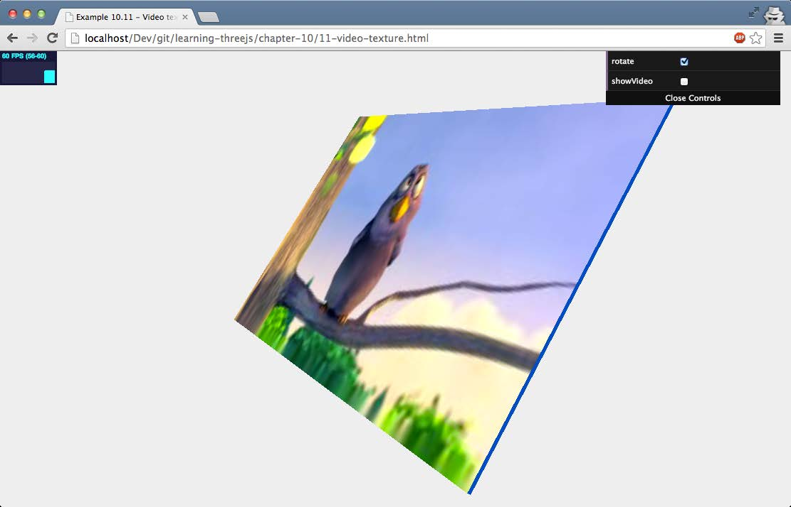

将视频用作纹理的输入，就像使用 canvas 元素一样简单。首先，我们需要一个 video 元素来播放视频：

```text
<video  id="video"
  style="display: none;
  position: absolute; left: 15px; top: 75px;"
  src="../assets/movies/Big_Buck_Bunny_small.ogv"
  controls="true" autoplay="true">
</video>
```

<!-- pdf-page: 336 -->
这只是一个我们设置为自动播放的基础 HTML5 video 元素。接下来，我们可以配置 Three.js 将这个视频用作纹理的输入，如下所示：

```javascript
var video  = document.getElementById('video');
texture = new THREE.Texture(video);
texture.minFilter = THREE.LinearFilter;
texture.magFilter = THREE.LinearFilter;
texture.generateMipmaps = false;
```

由于我们的视频不是方形的，因此需要确保禁用材质上的多级渐远纹理生成。我们还设置了一些简单的高性能过滤器，因为材质会非常频繁地变化。现在剩下要做的就是创建网格并设置纹理。在这个示例中，我们将 MeshFaceMaterial 与 MeshBasicMaterial 结合使用：

```javascript
var materialArray = [];
materialArray.push(new THREE.MeshBasicMaterial({color:
  0x0051ba}));
materialArray.push(new THREE.MeshBasicMaterial({color:
  0x0051ba}));
materialArray.push(new THREE.MeshBasicMaterial({color:
  0x0051ba}));
materialArray.push(new THREE.MeshBasicMaterial({color:
  0x0051ba}));
materialArray.push(new THREE.MeshBasicMaterial({map: texture }));
materialArray.push(new THREE.MeshBasicMaterial({color:
  0xff51ba}));
```

```javascript
var faceMaterial = new THREE.MeshFaceMaterial(materialArray);
var mesh = new THREE.Mesh(geom,faceMaterial);
```

剩下要做的就是确保在渲染循环中更新纹理，如下所示：

```text
if ( video.readyState === video.HAVE_ENOUGH_DATA ) {
  if (texture) texture.needsUpdate = true;
}
```

在这个示例中，我们只是将视频渲染到立方体的一面上，但由于这是一种普通的纹理，因此我们可以对它做任何想做的事情。例如，我们可以使用自定义 UV 映射将它划分到立方体的各个面上，甚至可以将视频输入用作凹凸贴图或法线贴图的输入。

<!-- pdf-page: 337 -->
纹理的加载与使用

在 Three.js r69 版本中，引入了一种专门用于处理视频的纹理。这种纹理（THREE.VideoTexture）封装了你在本节中看到的代码，你可以使用 THREE.VideoTexture 作为替代方案。以下代码片段展示了如何使用 THREE.VideoTexture 创建纹理（查看 11-video-texture.html 示例可以看到它的实际效果）：

```javascript
var video = document.getElementById('video');
texture = new THREE.VideoTexture(video);
```

## 总结

关于纹理的本章到此结束。如你所见，Three.js 中有许多不同类型的纹理，每种都有不同的用途。你可以将 PNG、JPG、GIF、TGA、DDS 或 PVR 格式的任何图像用作纹理。这些图像是异步加载的，因此请记住，在加载纹理时，要么使用渲染循环，要么添加回调。使用纹理，你可以根据低多边形模型创建外观出色的对象，甚至可以使用凹凸贴图和法线贴图添加伪造的细致深度。使用 Three.js，还可以通过 HTML5 canvas 元素或 video 元素轻松创建动态纹理。只需定义一个以这些元素为输入的纹理，并在希望纹理更新时将 needsUpdate 属性设置为 true。

完成本章后，我们几乎已经涵盖了 Three.js 的所有重要概念。不过，我们还没有了解 Three.js 提供的一项有趣功能——后期处理（Postprocessing）。通过后期处理，你可以在场景渲染后为其添加效果。例如，可以使场景模糊或着色，或者使用扫描线添加类似电视的效果。在下一章中，我们将了解后期处理以及如何将其应用到场景中。

