# 第 11 章 · 自定义着色器（Custom Shaders）与渲染后期处理（Render Postprocessing）

<!-- pdf-page: 338 -->
## 自定义着色器与渲染后期处理

本书已接近尾声，本章将介绍 Three.js 中一项尚未涉及的主要功能：渲染后期处理。此外，本章还会介绍如何创建自定义着色器。本章将讨论以下主要内容：

- 设置 Three.js 以进行后期处理

- 讨论 Three.js 提供的基本后期处理通道（postprocessing passes），例如 THREE.BloomPass 和 THREE.FilmPass

- 使用遮罩（mask）将效果应用于场景的局部

- 使用 THREE.TexturePass 保存渲染结果

- 使用 THREE.ShaderPass 添加更多基本的后期处理效果，例如褐色调滤镜、镜像效果和颜色调整

- 使用 THREE.ShaderPass 实现各种模糊效果和更高级的滤镜

- 通过编写一个简单的着色器来创建自定义后期处理效果

在第 1 章“使用 Three.js 创建你的第一个 3D 场景”的“requestAnimationFrame 简介”一节中，我们建立了一个渲染循环，并在全书中使用它来渲染场景和制作动画。为了进行后期处理，我们需要对这一设置做一些修改，让 Three.js 能够对最终渲染结果进行后期处理。第一节将介绍具体的操作方法。

<!-- pdf-page: 339 -->
自定义着色器与渲染后期处理

## 设置 Three.js 以进行后期处理

要设置 Three.js 以进行后期处理，我们需要对当前设置做一些修改。需要执行以下步骤：

1.	 创建 THREE.EffectComposer，可以用它添加后期处理通道。

2.	 配置 THREE.EffectComposer，使其渲染我们的场景并应用任何额外的后期处理步骤。

3.	 在渲染循环中，使用 THREE.EffectComposer 渲染场景、应用各个通道并显示输出结果。

与往常一样，我们提供了一个示例，你可以用它进行试验，也可以将它用于自己的用途。本章的第一个示例是 01-basiceffect-composer.html。你可以通过右上角的菜单修改此示例中所用后期处理步骤的属性。在这个示例中，我们渲染一个简单的地球仪，并为其添加一种类似老式电视机的效果。场景通过 THREE.EffectComposer 渲染完毕后，再添加这种电视效果。下面的屏幕截图展示了这个示例：

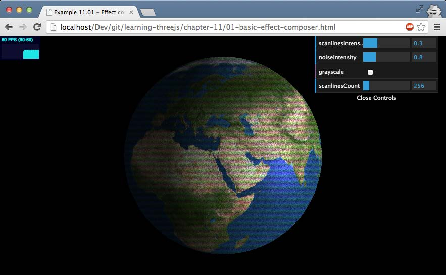

<!-- pdf-page: 340 -->
### 创建 THREE.EffectComposer

首先看看需要额外引入的 JavaScript 文件。这些文件位于 Three.js 发行包的 examples/js/postprocessing 和 examples/js/shaders 目录中。

让 THREE.EffectComposer 正常运行所需的最基本设置如下：

```html
<script type="text/javascript" src="../libs/postprocessing/
  EffectComposer.js"></script>
<script type="text/javascript" src="../libs/postprocessing/
  MaskPass.js"></script>
<script type="text/javascript" src="../libs/postprocessing/
  RenderPass.js"></script>
<script type="text/javascript" src="../libs/shaders/
  CopyShader.js"></script>
<script type="text/javascript" src="../libs/postprocessing/
  ShaderPass.js"></script>
```

EffectComposer.js 文件提供了 THREE.EffectComposer 对象，我们可以通过它添加后期处理步骤。MaskPass.js、ShaderPass.js 和 CopyShader.js 由 THREE.EffectComposer 内部使用，而 RenderPass.js 允许我们向 THREE.EffectComposer 添加一个渲染通道（rendering pass）。如果没有这个通道，我们的场景根本不会被渲染。

对于这个示例，我们还额外添加了两个 JavaScript 文件，以便为场景添加类似电影的效果：

```html
<script type="text/javascript" src="../libs/postprocessing/
  FilmPass.js"></script>
<script type="text/javascript" src="../libs/shaders/
  FilmShader.js"></script>
```

我们需要做的第一件事是创建 THREE.EffectComposer。为此，可以将 THREE.WebGLRenderer 传递给它的构造函数：

```javascript
var webGLRenderer = new THREE.WebGLRenderer();
var composer = new THREE.EffectComposer(webGLRenderer);
```

接下来，我们向这个合成器添加各种通道。

<!-- pdf-page: 341 -->
自定义着色器与渲染后期处理

#### 配置 THREE.EffectComposer 以进行后期处理

各个通道会按照它们被添加到 THREE.EffectComposer 中的顺序执行。我们添加的第一个通道是 THREE.RenderPass。下面的通道会渲染我们的场景，但暂时不会将其输出到屏幕：

```javascript
var renderPass = new THREE.RenderPass(scene, camera);
composer.addPass(renderPass);
```

创建 THREE.RenderPass 时，我们传入要渲染的场景和要使用的相机。通过 addPass 函数，我们将 THREE.RenderPass 添加到 THREE.EffectComposer。下一步是添加另一个会将其结果输出到屏幕的通道。并非所有可用通道都支持这一功能——稍后会进一步介绍——但本示例使用的 THREE.FilmPass 允许我们将其通道的结果输出到屏幕。要添加 THREE.FilmPass，首先需要创建它，再将它添加到合成器。最终代码如下所示：

```javascript
var renderPass = new THREE.RenderPass(scene,camera);
var effectFilm = new THREE.FilmPass(0.8, 0.325, 256, false);
effectFilm.renderToScreen = true;
```

```javascript
var composer = new THREE.EffectComposer(webGLRenderer);
composer.addPass(renderPass);
composer.addPass(effectFilm);
```

如你所见，我们创建了 THREE.FilmPass，并将 renderToScreen 属性设置为 true。这个通道在 renderPass 之后被添加到 THREE.EffectComposer，因此使用这个合成器时，会先渲染场景，然后通过 THREE.FilmPass，我们也能在屏幕上看到输出结果。

#### 更新渲染循环

现在只需对渲染循环做一点小修改，让它使用合成器，而不是 THREE.WebGLRenderer：

```javascript
var clock = new THREE.Clock();
function render() {
  stats.update();
```

```javascript
  var delta = clock.getDelta();
  orbitControls.update(delta);
```

```text
  sphere.rotation.y += 0.002;
```

```text
  requestAnimationFrame(render);
  composer.render(delta);
}
```

<!-- pdf-page: 342 -->
我们所做的唯一修改，是移除 webGLRenderer.render(scene, camera)，并用 composer.render(delta) 取而代之。这会调用 EffectComposer 的 render 函数，而后者会使用传入的 THREE.WebGLRenderer；由于我们将 FilmPass 的 renderToScreen 设置为 true，FilmPass 的结果就会显示在屏幕上。

有了这项基本设置，接下来的几节将介绍可用的后期处理通道。

## 后期处理通道

Three.js 自带了许多后期处理通道，可以直接与 THREE.EffectComposer 一起使用。请注意，最好亲自尝试一下本章的示例，看看这些通道的效果并理解其工作过程。下表概述了可用的通道：

| 通道名称 | 描述 |
| --- | --- |
| THREE.BloomPass | 这种效果会让明亮区域渗入较暗的区域。它模拟的是相机被极强的光线淹没时产生的效果。 |
| THREE.DotScreenPass | 这会在整个屏幕上应用一层代表原始图像的黑点。 |
| THREE.FilmPass | 这通过应用扫描线和失真来模拟电视屏幕。 |
| THREE.GlitchPass | 这会以随机的时间间隔在屏幕上显示电子故障效果。 |
| THREE.MaskPass | 这允许你对当前图像应用遮罩。后续通道只会应用于遮罩区域。 |
| THREE.RenderPass | 这会根据提供的场景和相机渲染场景。 |
| THREE.SavePass | 执行此通道时，它会复制当前渲染步骤的结果，供你以后使用。这个通道在实践中并不是特别有用，我们的任何示例都不会使用它。 |
| THREE.ShaderPass | 这允许你传入自定义着色器，以实现高级或自定义的后期处理通道。 |
| THREE.TexturePass | 这会将合成器的当前状态保存到纹理中，你可以将该纹理用作其他 EffectComposer 实例的输入。 |

让我们先从一些简单的通道开始。

<!-- pdf-page: 343 -->
自定义着色器与渲染后期处理

### 简单的后期处理通道

对于简单的通道，我们将看看可以使用 THREE.FilmPass、THREE.BloomPass 和 THREE.DotScreenPass 做些什么。针对这些通道，我们提供了一个示例 02-post-processing-simple，你可以用它试验这些通道，并观察它们如何以不同方式影响原始输出。下面的屏幕截图展示了这个示例：

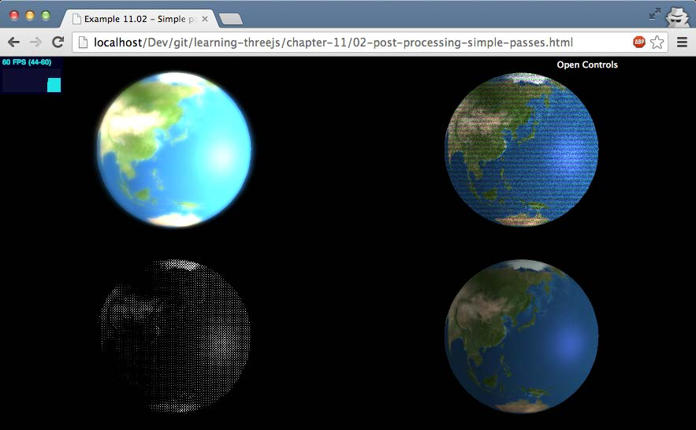

在这个示例中，我们同时显示四个场景，每个场景都添加了一种不同的后期处理通道。左上角显示的是 THREE.BloomPass，右上角显示的是 THREE.FilmPass，左下角显示的是 THREE.DotScreenPass，右下角显示的则是原始渲染结果。

在这个示例中，我们还使用了 THREE.ShaderPass 和 THREE.TexturePass，将原始渲染的输出重复用作另外三个场景的输入。因此，在逐一介绍这些通道之前，我们先看看这两个通道：

```javascript
var renderPass = new THREE.RenderPass(scene, camera);
var effectCopy = new THREE.ShaderPass(THREE.CopyShader);
effectCopy.renderToScreen = true;
```

<!-- pdf-page: 344 -->
```javascript
var composer = new THREE.EffectComposer(webGLRenderer);
composer.addPass(renderPass);
composer.addPass(effectCopy);
```

```javascript
var renderScene = new THREE.TexturePass(composer.renderTarget2);
```

在这段代码中，我们设置了 THREE.EffectComposer，它将输出默认场景（右下角的那个）。这个合成器有两个通道。THREE.RenderPass 负责渲染场景；当 THREE.ShaderPass 配置为使用 THREE.CopyShader 时，如果我们将 renderToScreen 属性设置为 true，它会将输出渲染到屏幕，而不进行任何进一步的后期处理。查看示例时，你可以看到同一个场景显示了四次，但每次应用的效果不同。我们可以使用 THREE.RenderPass 从头渲染场景四次，但这样做有些浪费，因为我们可以直接重用第一个合成器的输出。为此，我们创建 THREE.TexturePass，并传入 composer.renderTarget2 值。现在，我们可以将 renderScene 变量用作其他合成器的输入，而无需从头渲染场景。让我们先重新看看 THREE.FilmPass，了解如何使用 THREE.TexturePass 作为输入。

#### 使用 THREE.FilmPass 创建类似电视的效果

本章第一节已经介绍了如何创建 THREE.FilmPass，现在看看如何将这个效果与上一节的 THREE.TexturePass 结合使用：

```javascript
var effectFilm = new THREE.FilmPass(0.8, 0.325, 256, false);
effectFilm.renderToScreen = true;
```

```javascript
var composer4 = new THREE.EffectComposer(webGLRenderer);
composer4.addPass(renderScene);
composer4.addPass(effectFilm);
```

使用 THREE.TexturePass 所需的唯一步骤，就是将它添加为合成器中的第一个通道。接下来，只需添加 THREE.FilmPass，效果就会被应用。THREE.FilmPass 本身接受四个参数：

| 属性 | 描述 |
| --- | --- |
| noiseIntensity | 此属性允许你控制场景看起来有多少颗粒感。 |
| scanlinesIntensity | THREE.FilmPass 会向场景添加若干扫描线。通过此属性，你可以定义这些扫描线显示的明显程度。 |

<!-- pdf-page: 345 -->
自定义着色器与渲染后期处理

| 属性 | 描述 |
| --- | --- |
| scanLinesCount | 可以通过此属性控制所显示扫描线的数量。 |
| grayscale | 如果将其设置为 true，输出将被转换为灰度图像。 |

实际上，有两种方式可以传入这些参数。在这个示例中，我们将它们作为参数传递给构造函数，但也可以直接设置它们，如下所示：

```text
effectFilm.uniforms.grayscale.value = controls.grayscale;
effectFilm.uniforms.nIntensity.value = controls.noiseIntensity;
effectFilm.uniforms.sIntensity.value = controls.scanlines
  Intensity;
effectFilm.uniforms.sCount.value = controls.scanlinesCount;
```

在这种方式中，我们使用 uniforms 属性直接与 WebGL 通信。在本章后面介绍如何创建自定义着色器的一节中，我们会更深入地讨论 uniform（统一变量）；目前你只需知道，通过这种方式可以直接更新后期处理通道和着色器的配置，并立即看到结果。

#### 使用 THREE.BloomPass 为场景添加泛光效果

你在左上角看到的效果称为泛光效果（bloom effect）。应用泛光效果后，场景中的明亮区域会更加突出，并渗入较暗的区域。创建 THREE.BloomPass 的代码如下所示：

```javascript
var effectCopy = new THREE.ShaderPass(THREE.CopyShader);
effectCopy.renderToScreen = true;
...
var bloomPass = new THREE.BloomPass(3, 25, 5, 256);
var composer3 = new THREE.EffectComposer(webGLRenderer);
composer3.addPass(renderScene);
composer3.addPass(bloomPass);
composer3.addPass(effectCopy);
```

如果将其与我们配合 THREE.FilmPass 使用的 THREE.EffectComposer 进行比较，你会发现我们额外添加了一个通道 effectCopy。这个步骤也曾用于正常输出，它不会添加任何特殊效果，只是将上一个通道的输出复制到屏幕。我们需要添加这个步骤，因为 THREE.BloomPass 无法直接渲染到屏幕。

<!-- pdf-page: 346 -->
下表列出了可以在 THREE.BloomPass 上设置的属性：

| 属性 | 描述 |
| --- | --- |
| strength | 这是泛光效果的强度。该值越高，明亮区域就越亮，并且“渗入”较暗区域的程度也越大。 |
| kernelSize | 此属性控制泛光效果的偏移量。 |
| sigma | 通过 sigma 属性，可以控制泛光效果的清晰度。值越高，泛光效果看起来越模糊。 |
| resolution | 属性定义泛光效果的创建精度。如果该值过低，结果看起来会呈块状。 |

理解这些属性的更好方法，就是使用前面提到的示例 02-post-processing-simple 对它们进行试验。下面的屏幕截图展示了高 kernelSize 和 sigma 值、低强度下的泛光效果：

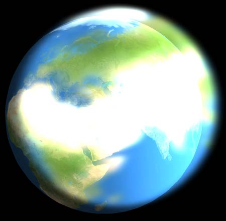

我们要介绍的最后一个简单效果是 THREE.DotScreenPass。

<!-- pdf-page: 347 -->
自定义着色器与渲染后期处理

#### 将场景输出为一组圆点

使用 THREE.DotScreenPass 与使用 THREE.BloomPass 非常相似。我们刚刚看到了 THREE.BloomPass 的实际效果。现在来看看 THREE.DotScreenPass 的代码：

```javascript
var dotScreenPass = new THREE.DotScreenPass();
var composer1 = new THREE.EffectComposer(webGLRenderer);
composer1.addPass(renderScene);
composer1.addPass(dotScreenPass);
composer1.addPass(effectCopy);
```

使用这个效果时，我们同样必须添加 effectCopy，才能将结果输出到屏幕。THREE.DotScreenPass 也可以通过若干属性进行配置，如下所示：

| 属性 | 描述 |
| --- | --- |
| center | 通过 center 属性，可以微调圆点的偏移方式。 |
| angle | 圆点按某种特定方式排列。通过 angle 属性，可以更改这种排列方式。 |
| scale | 通过它可以设置所用圆点的大小。缩放值越低，圆点越大。 |

适用于其他着色器的原则同样适用于这个着色器。通过试验来找到合适的设置会容易得多。

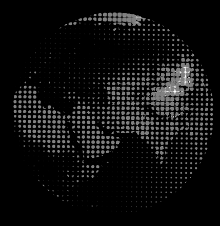

<!-- pdf-page: 348 -->
#### 在同一屏幕上显示多个渲染器的输出

本节不深入介绍后期处理效果的使用细节，而是说明如何让四个 THREE.EffectComposer 实例的输出显示在同一屏幕上。首先，看看本示例使用的渲染循环：

```javascript
function render() {
  stats.update();
```

```javascript
  var delta = clock.getDelta();
  orbitControls.update(delta);
```

```text
  sphere.rotation.y += 0.002;
```

```text
  requestAnimationFrame(render);
```

```text
  webGLRenderer.autoClear = false;
  webGLRenderer.clear();
```

```text
  webGLRenderer.setViewport(0, 0, 2 * halfWidth, 2 * halfHeight);
  composer.render(delta);
```

```text
  webGLRenderer.setViewport(0, 0, halfWidth, halfHeight);
  composer1.render(delta);
```

```text
  webGLRenderer.setViewport(halfWidth, 0, halfWidth, halfHeight);
  composer2.render(delta);
```

```text
  webGLRenderer.setViewport(0, halfHeight, halfWidth, halfHeight);
  composer3.render(delta);
```

```text
  webGLRenderer.setViewport(halfWidth, halfHeight, halfWidth,
  halfHeight);
  composer4.render(delta);
}
```

首先要注意的是，这里将 webGLRenderer.autoClear 属性设置为 false，然后显式调用 clear() 函数。如果每次在合成器上调用 render() 函数时不这样做，先前渲染的场景就会被清除。采用这种方式时，我们只会在渲染循环开始时清除所有内容。

<!-- pdf-page: 349 -->
自定义着色器与渲染后期处理

为了避免所有合成器都渲染到同一区域，我们将合成器所使用的 webGLRenderer 的视口（viewport）设置为屏幕的不同部分。这个函数接受四个参数：x、y、width 和 height。如代码示例所示，我们使用这个函数将屏幕划分为四个区域，并让各个合成器渲染到各自的区域。请注意，如果愿意，你也可以将这种方法用于多个场景、相机和 WebGLRenderer。

在本节开头的表格中，我们还提到了 THREE.GlitchPass。使用这个渲染通道，可以为场景添加一种电子故障效果。这个效果与你到目前为止看到的其他效果一样容易使用。要使用它，首先在 HTML 页面中引入以下两个文件：

```html
<script type="text/javascript" src="../libs/postprocessing/
  GlitchPass.js"></script>
<script type="text/javascript" src="../libs/postprocessing/
  DigitalGlitch.js"></script>
```

然后，按如下方式创建 THREE.GlitchPass 对象：

```javascript
var effectGlitch = new THREE.GlitchPass(64);
effectGlitch.renderToScreen = true;
```

结果场景通常会正常渲染，只是会以随机间隔出现一次故障，如下面的屏幕截图所示：

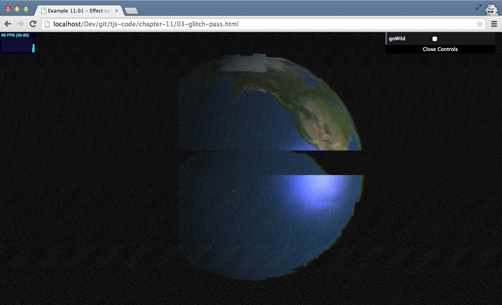

<!-- pdf-page: 350 -->
到目前为止，我们只串联了几个简单的通道。在下一个示例中，我们将配置一个更复杂的 THREE.EffectComposer，并使用遮罩将效果应用到屏幕的一部分。

### 使用遮罩的高级 EffectComposer 流程

在前面的示例中，我们将后期处理通道应用到了整个屏幕。不过，Three.js 也能够只将通道应用于特定区域。在本节中，我们将执行以下步骤：

1.	 创建一个场景作为背景图像。

2.	 创建一个包含地球外观球体的场景。

3.	 创建一个包含火星外观球体的场景。

4.	 创建 EffectComposer，将这三个场景渲染为一幅图像。

5.	 对渲染为火星的球体应用着色（colorify）效果。

6.	 对渲染为地球的球体应用褐色调（sepia）效果。

这听起来可能很复杂，但实际完成起来却出奇地容易。首先，看看 03-post-processing-masks.html 示例中我们要实现的结果。下面的屏幕截图展示了这些步骤的结果：

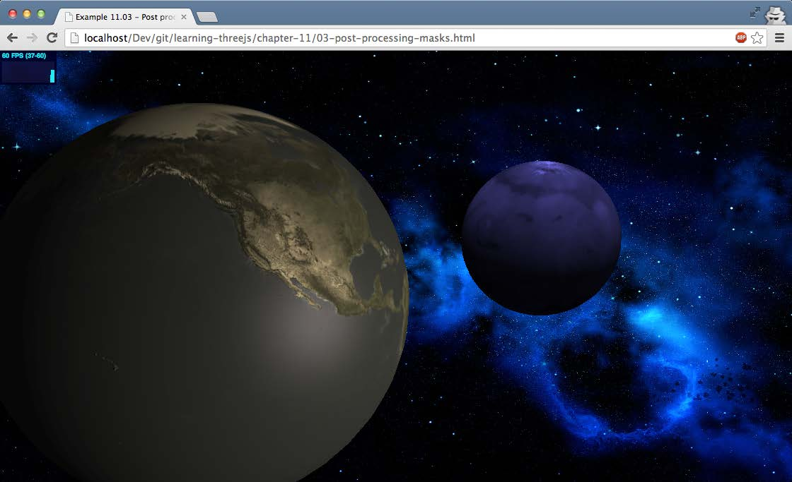

<!-- pdf-page: 351 -->
自定义着色器与渲染后期处理

我们需要做的第一件事是设置将要渲染的各个场景，如下所示：

```javascript
var sceneEarth = new THREE.Scene();
var sceneMars = new THREE.Scene();
var sceneBG = new THREE.Scene();
```

要创建地球和火星球体，只需使用正确的材质和纹理创建球体，并将它们添加到各自的场景中，如下面的代码所示：

```javascript
var sphere = createEarthMesh(new THREE.SphereGeometry(10, 40,
  40));
sphere.position.x = -10;
var sphere2 = createMarshMesh(new THREE.SphereGeometry(5, 40,
  40));
sphere2.position.x = 10;
sceneEarth.add(sphere);
sceneMars.add(sphere2);
```

我们还需要像处理普通场景一样，向场景中添加一些光源，但这里不作展示（更多详细信息，请参阅第 3 章“使用 Three.js 中可用的不同光源”）。唯一需要记住的是，一个光源不能添加到不同的场景中，因此你需要为这两个场景分别创建光源。这两个场景所需的设置就这么多。

对于背景图像，我们创建 THREE.OrthographicCamera。回想一下第 2 章“构成 Three.js 场景的基本组件”，在正交投影（orthographic projection）中，对象的大小并不取决于它与相机的距离，因此这也是一种创建固定背景的好方法。以下是创建 THREE.OrthographicCamera 的方法：

```javascript
var cameraBG = new THREE.OrthographicCamera(-window.innerWidth,
  window.innerWidth, window.innerHeight, -window.innerHeight, -
  10000, 10000);
cameraBG.position.z = 50;
```

```javascript
var materialColor = new THREE.MeshBasicMaterial({ map:
  THREE.ImageUtils.loadTexture("../assets/textures/starry-deep-
  outer-space-galaxy.jpg"), depthTest: false });
var bgPlane = new THREE.Mesh(new THREE.PlaneGeometry(1, 1),
  materialColor);
bgPlane.position.z = -100;
bgPlane.scale.set(window.innerWidth * 2, window.innerHeight * 2,
  1);
sceneBG.add(bgPlane);
```

<!-- pdf-page: 352 -->
我们不会过于详细地介绍这一部分，但创建背景图像需要执行几个步骤。首先，我们根据背景图像创建一种材质，并将这种材质应用到一个简单的平面上。接下来，将这个平面添加到场景中，并对其进行缩放，使其恰好填满整个屏幕。这样，当我们使用这个相机渲染该场景时，背景图像就会被拉伸到屏幕宽度显示出来。

现在我们已经有了三个场景，可以开始设置各个通道和 THREE.EffectComposer 了。先来看看完整的通道链，然后再逐一介绍各个通道：

```javascript
var composer = new THREE.EffectComposer(webGLRenderer);
composer.renderTarget1.stencilBuffer = true;
composer.renderTarget2.stencilBuffer = true;
```

```text
composer.addPass(bgPass);
composer.addPass(renderPass);
composer.addPass(renderPass2);
```

```text
composer.addPass(marsMask);
composer.addPass(effectColorify1);
composer.addPass(clearMask);
```

```text
composer.addPass(earthMask);
composer.addPass(effectSepia);
composer.addPass(clearMask);
```

```text
composer.addPass(effectCopy);
```

要使用遮罩，我们需要以不同的方式创建 THREE.EffectComposer。在这种情况下，我们需要创建一个新的 THREE.WebGLRenderTarget，并将内部使用的渲染目标（render target）的 stencilBuffer 属性设置为 true。模板缓冲区（stencil buffer）是一种特殊类型的缓冲区，用于限制渲染区域。因此，通过启用模板缓冲区，我们就可以使用遮罩。首先看看添加的前三个通道。这三个通道分别渲染背景、地球场景和火星场景，如下所示：

```javascript
var bgPass = new THREE.RenderPass(sceneBG, cameraBG);
var renderPass = new THREE.RenderPass(sceneEarth, camera);
renderPass.clear = false;
var renderPass2 = new THREE.RenderPass(sceneMars, camera);
renderPass2.clear = false;
```

<!-- pdf-page: 353 -->
自定义着色器与渲染后期处理

除了将其中两个通道的 clear 属性设置为 false 之外，这里没有什么新内容。如果不这样做，我们只会看到 renderPass2 的输出，因为它会在开始渲染之前清除所有内容。回顾一下 THREE.EffectComposer 的代码，接下来的三个通道是 marsMask、effectColorify 和 clearMask。首先看看这三个通道是如何定义的：

```javascript
var marsMask = new THREE.MaskPass(sceneMars, camera );
var clearMask = new THREE.ClearMaskPass();
var effectColorify = new THREE.ShaderPass(THREE.ColorifyShader );
effectColorify.uniforms['color'].value.setRGB(0.5, 0.5, 1);
```

这三个通道中的第一个是 THREE.MaskPass。创建 THREE.MaskPass 时，要像创建 THREE.RenderPass 一样传入一个场景和一个相机。THREE.MaskPass 会在内部渲染这个场景，但不会将其显示在屏幕上，而是使用这些信息创建遮罩。将 THREE.MaskPass 添加到 THREE.EffectComposer 后，所有后续通道都只会应用于 THREE.MaskPass 定义的遮罩，直到遇到 THREE.ClearMaskPass 为止。在这个示例中，这意味着添加蓝色光晕的 effectColorify 通道只会应用于 sceneMars 中渲染的对象。

我们使用同样的方法为地球对象应用褐色调滤镜。首先根据地球场景创建一个遮罩，并在 THREE.EffectComposer 中使用这个遮罩。在 THREE.MaskPass 之后，添加我们想要应用的效果（本例中为 effectSepia）；完成后，再添加 THREE.ClearMaskPass 来移除遮罩。这个特定 THREE.EffectComposer 的最后一步是我们已经见过的。我们需要将最终结果复制到屏幕，为此再次使用 effectCopy 通道。

使用 THREE.MaskPass 时，还有一个值得关注的属性，即 inverse 属性。如果此属性设置为 true，遮罩就会反转。换句话说，效果会应用于除传入 THREE.MaskPass 的场景之外的所有内容。下面的屏幕截图展示了这一点：

<!-- pdf-page: 354 -->
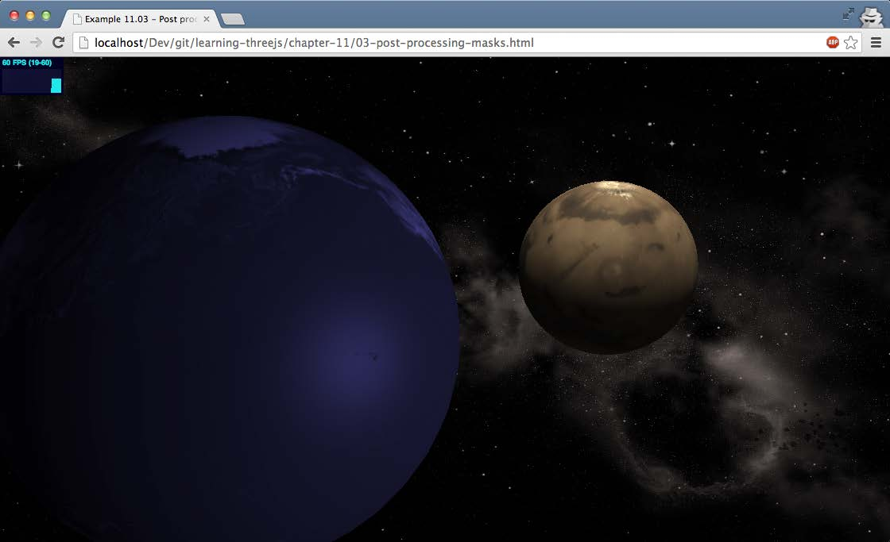

到目前为止，我们一直使用 Three.js 提供的标准通道来实现效果。Three.js 还提供了 THREE.ShaderPass，可用于自定义效果，并且附带了大量可供使用和试验的着色器。

### 使用 THREE.ShaderPass 实现自定义效果

通过 THREE.ShaderPass，我们可以传入自定义着色器，为场景应用大量额外效果。本节分为三个部分。首先，看看下面这组简单的着色器：

| 名称 | 描述 |
| --- | --- |
| THREE.MirrorShader | 这为屏幕的一部分创建镜像效果。 |
| THREE.HueSaturationShader | 这允许你更改颜色的色相和饱和度。 |
| THREE.VignetteShader | 这会应用暗角效果。该效果会在图像中心周围显示深色边框。 |
| THREE.ColorCorrectionShader | 使用这个着色器，可以更改颜色分布。 |
| THREE.RGBShiftShader | 这个着色器会分离颜色的红色、绿色和蓝色分量。 |

<!-- pdf-page: 355 -->
自定义着色器与渲染后期处理

| 名称 | 描述 |
| --- | --- |
| THREE.BrightnessContrastShader | 这会更改图像的亮度和对比度。 |
| THREE.ColorifyShader | 这会向屏幕应用颜色叠加层。 |
| THREE.SepiaShader | 这会在屏幕上创建类似褐色调的效果。 |
| THREE.KaleidoShader | 这会为场景添加万花筒效果，围绕场景中心提供径向反射。 |
| THREE.LuminosityShader | 这提供一种亮度（luminosity）效果，显示场景的亮度。 |
| THREE.TechnicolorShader | 这模拟早期电影中可以看到的双条带特艺七彩效果。 |

接下来，看看提供几种模糊相关效果的着色器：

| 名称 | 描述 |
| --- | --- |
| THREE.HorizontalBlurShader 和 THREE.VerticalBlurShader | 它们会对整个场景应用模糊效果。 |
| THREE.HorizontalTiltShiftShader 和 THREE.VerticalTiltShiftShader | 它们会重新创建移轴效果（tilt shift effect）。利用移轴效果，可以确保只有图像的一部分保持清晰，从而创建出看起来像微缩模型的场景。 |
| THREE.TriangleBlurShader | 这使用基于三角形的方法应用模糊效果。 |

最后，我们再看几个提供高级效果的着色器：

| 名称 | 描述 |
| --- | --- |
| THREE.BleachBypassShader | 这会创建漂白旁路效果（bleach bypass effect）。使用这种效果时，会向图像应用类似银色的叠加层。 |
| THREE.EdgeShader | 这个着色器可用于检测图像中的锐利边缘并将其突出显示。 |
| THREE.FXAAShader | 这个着色器会在后期处理阶段应用抗锯齿效果（anti-aliasing effect）。如果在渲染期间应用抗锯齿的开销太大，请使用它。 |
| THREE.FocusShader | 这是一个简单的着色器，其结果是中心区域渲染清晰，而边缘区域模糊。 |

<!-- pdf-page: 356 -->
我们不会详细介绍所有着色器，因为只要了解其中一个的工作方式，基本上就能知道其他着色器的工作方式。在后面的几节中，我们将重点介绍几个有趣的着色器。你可以通过各节提供的交互式示例来试验其他着色器。

Three.js 还提供两种高级后期处理效果，允许你为场景应用散景效果（bokeh effect）。散景效果会使场景的一部分模糊，同时将主体渲染得非常清晰。Three.js 提供了可用于此目的的 THREE.BokehPass，或者可以与 THREE.ShaderPass 一起使用的 THREE.BokehShader2 和 THREE.DOFMipMapShader。可以在 Three.js 网站的 http://threejs.org/examples/ webgl\_postprocessing\_dof2.html 和 http://threejs. org/examples/webgl\_postprocessing\_dof.html 找到这些着色器的实际效果示例。

我们从几个简单的着色器开始。

#### 简单的着色器

为了试验这些基础着色器，我们创建了一个示例，你可以在其中操作各种着色器，并直接在场景中查看效果。你可以在 04-shaderpass-simple.html 中找到这个示例。下面的屏幕截图展示了这个示例：

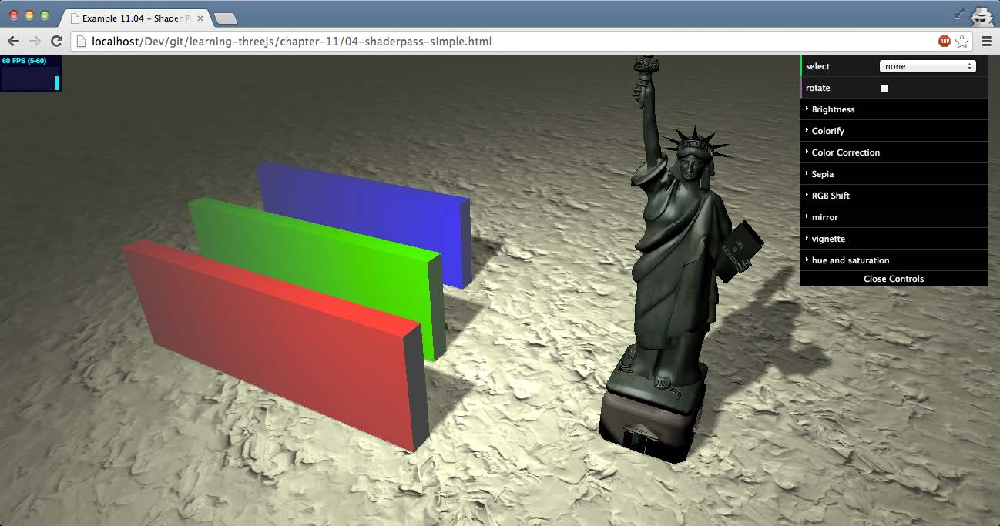

<!-- pdf-page: 357 -->
自定义着色器与渲染后期处理

通过右上角的菜单，可以选择要应用的特定着色器；通过各种下拉菜单，可以设置所选着色器的属性。例如，下面的屏幕截图展示了 RGBShiftShader 的实际效果：

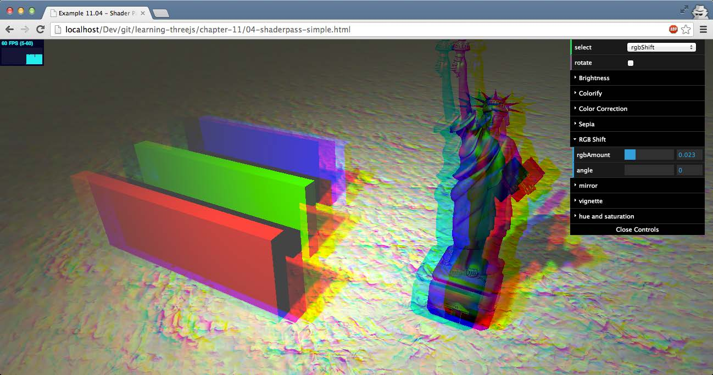

更改着色器的某个属性后，结果会直接更新。在这个示例中，我们直接对着色器设置更改后的值。例如，当 RGBShiftShader 的值发生变化时，我们会像这样更新着色器：

```javascript
this.changeRGBShifter = function() {
  rgbShift.uniforms.amount.value = controls.rgbAmount;
  rgbShift.uniforms.angle.value = controls.angle;
}
```

<!-- pdf-page: 358 -->
让我们看看另外几个着色器。下图显示了 VignetteShader 的结果：

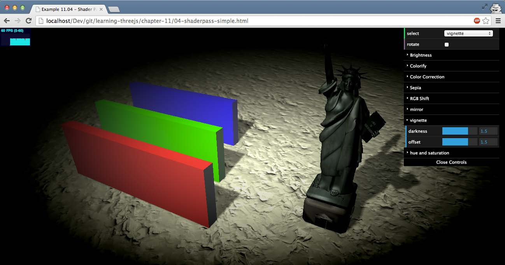

MirrorShader 的效果如下：

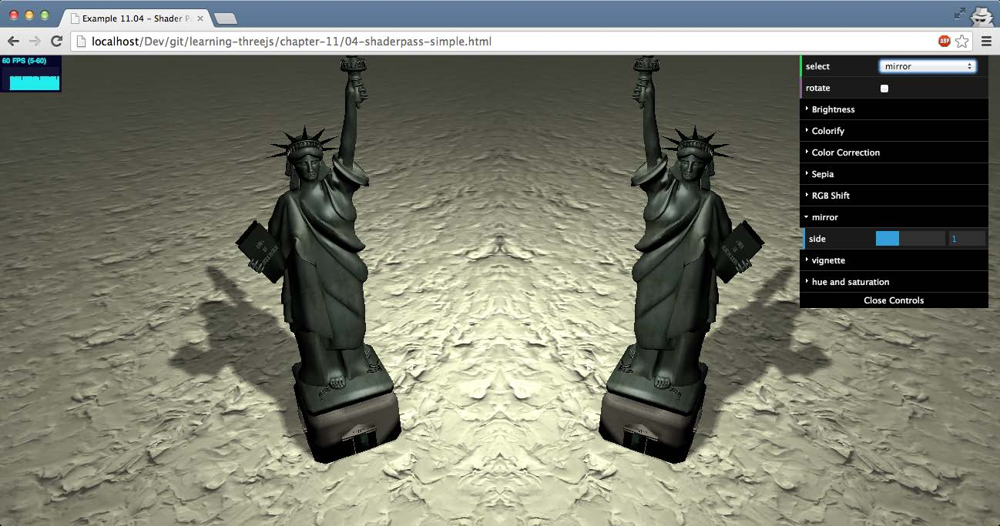

<!-- pdf-page: 359 -->
自定义着色器与渲染后期处理

通过后期处理，我们还可以应用一些极端的效果。THREE.KaleidoShader 就是一个很好的例子。如果从右上角的菜单中选择这个着色器，就会看到以下效果：

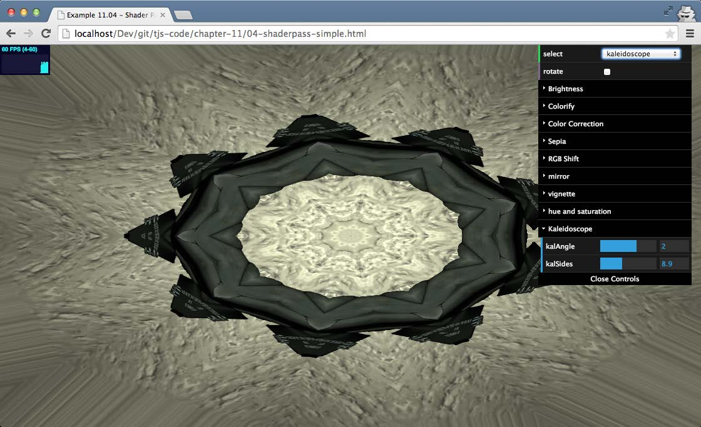

简单的着色器就介绍到这里。如你所见，它们用途非常广泛，可以创建看起来非常有趣的效果。在这个示例中，我们每次只应用一个着色器，但你可以根据需要将任意多个 THREE.ShaderPass 步骤添加到 THREE.EffectComposer。

#### 模糊着色器

本节不会深入代码，只向你展示各种模糊着色器的结果。你可以使用 05-shaderpassblur.html 示例对它们进行试验。下面的场景使用 HorizontalBlurShader 和 VerticalBlurShader 进行了模糊处理，你将在接下来的段落中了解这两个着色器：

<!-- pdf-page: 360 -->
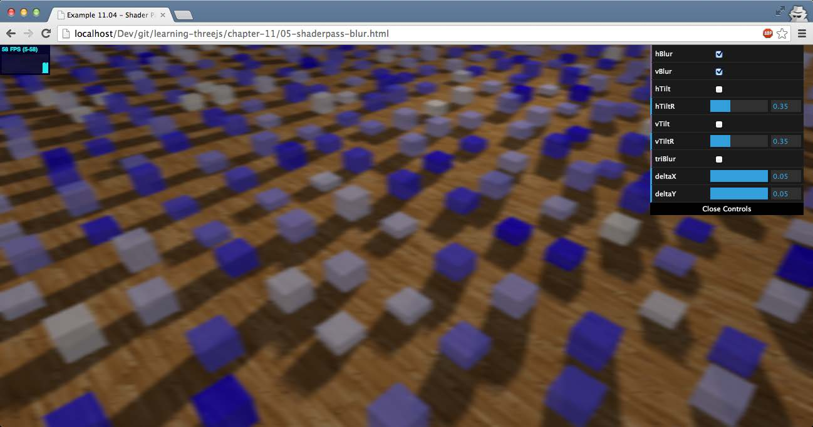

前一幅图像展示了 THREE.HorizontalBlurShader 和 THREE.VerticalBlurShader。你可以看到，其效果是让场景变得模糊。除了这两种模糊效果，Three.js 还提供了另一个可使图像模糊的着色器 THREE.TriangleBlurShader，如下图所示。例如，你可以使用这个着色器来表现运动模糊，如下面的屏幕截图所示：

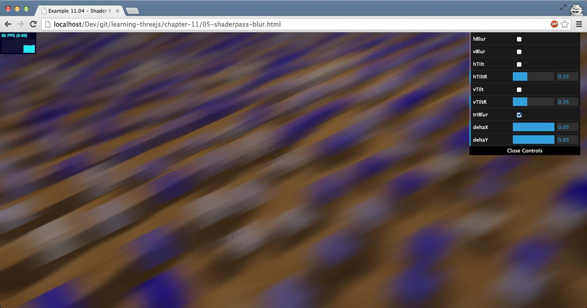

<!-- pdf-page: 361 -->
自定义着色器与渲染后期处理

最后一种类似模糊的效果由 THREE.HorizontalTiltShiftShader 和 THREE.VerticalTiltShiftShader 提供。这个着色器不会模糊整个场景，而只会模糊一小块区域。这提供了一种称为移轴的效果。它常用于根据普通照片创建类似微缩模型的场景。下图展示了这种效果：

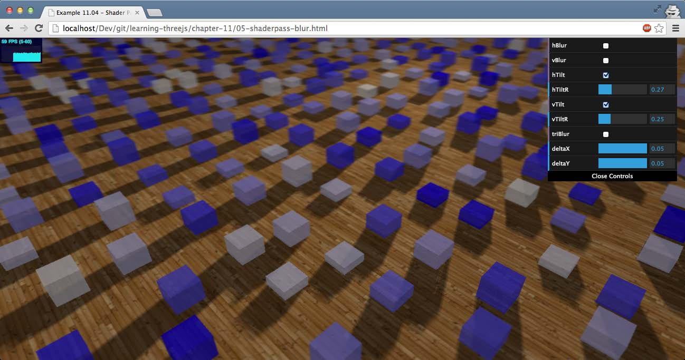

#### 高级着色器

对于高级着色器，我们将采用与前面的模糊着色器相同的处理方式，只向你展示着色器的输出。有关如何配置它们的详细信息，请查看 06-shaderpass-advanced.html 示例。下面的屏幕截图展示了这个示例：

<!-- pdf-page: 362 -->
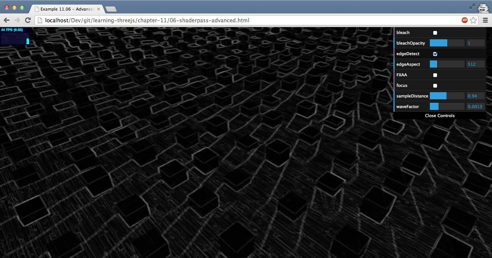

前面的示例展示了 THREE.EdgeShader。使用这个着色器，可以检测场景中对象的边缘。

下一个着色器是 THREE.FocusShader。这个着色器只将屏幕中心渲染为清晰对焦的状态，如下面的屏幕截图所示：

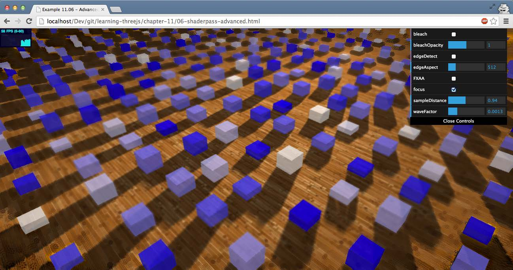

<!-- pdf-page: 363 -->
自定义着色器与渲染后期处理

到目前为止，我们只使用了 Three.js 提供的着色器。不过，自己创建着色器也非常容易。

## 创建自定义后期处理着色器

在本节中，你将学习如何创建可用于后期处理的自定义着色器。我们将创建两个不同的着色器。第一个会将当前图像转换为灰度图像，第二个会通过减少可用颜色的数量，将图像转换为 8 位图像。请注意，创建顶点着色器和片元着色器是一个非常广泛的主题。本节仅触及这些着色器可以实现的功能及其工作方式的表层。有关更深入的信息，你可以在 http://www.khronos.org/webgl/ 查阅 WebGL 规范。另一个充满示例的优质资源是 Shadertoy，网址为 https://www.shadertoy.com/。

### 自定义灰度着色器

要为 Three.js（以及其他 WebGL 库）创建自定义着色器，你需要实现两个组件：顶点着色器（vertex shader）和片元着色器（fragment shader）。顶点着色器可用于更改各个顶点的位置，片元着色器则用于确定各个像素的颜色。对于后期处理着色器，我们只需实现片元着色器，并保留 Three.js 提供的默认顶点着色器即可。在查看代码之前，需要指出重要的一点：GPU 通常支持多个着色器管线。这意味着在顶点着色器阶段，多个着色器可以并行运行——片元着色器阶段也是如此。


首先，我们来看对图像应用灰度效果的着色器的完整源代码（custom-shader.js）：

```javascript
THREE.CustomGrayScaleShader = {
```

```text
  uniforms: {
```

```text
    "tDiffuse": { type: "t", value: null },
    "rPower":  { type: "f", value: 0.2126 },
    "gPower":  { type: "f", value: 0.7152 },
    "bPower":  { type: "f", value: 0.0722 }
```

```text
  },
```

```text
  vertexShader: [
```

<!-- pdf-page: 364 -->
```text
    "varying vec2 vUv;",
    "void main() {",
      "vUv = uv;",
      "gl_Position = projectionMatrix * modelViewMatrix * vec4(
        position, 1.0 );",
    "}"
  ].join("\n"),
```

```text
  fragmentShader: [
```

```text
    "uniform float rPower;",
    "uniform float gPower;",
    "uniform float bPower;",
    "uniform sampler2D tDiffuse;",
```

```text
    "varying vec2 vUv;",
```

```text
    "void main() {",
      "vec4 texel = texture2D( tDiffuse, vUv );",
      "float gray = texel.r*rPower + texel.g*gPower
        + texel.b*bPower;",
      "gl_FragColor = vec4( vec3(gray), texel.w );",
    "}"
  ].join("\n")
};
```

从代码中可以看出，这不是 JavaScript。编写着色器时，需要使用 OpenGL 着色语言（OpenGL Shading Language，GLSL），它看起来很像 C 编程语言。有关 GLSL 的更多信息，请访问 http://www.khronos.org/opengles/sdk/docs/manglsl/。

首先看看这个顶点着色器：

```text
"varying vec2 vUv;","void main() {",
  "vUv = uv;",
  "gl_Position = projectionMatrix * modelViewMatrix * vec4(
    position, 1.0 );",
  "}"
```

对于后期处理，这个着色器实际上不需要执行任何操作。上面看到的代码是 Three.js 实现顶点着色器的标准方式。它使用来自相机的投影矩阵 projectionMatrix，并结合可将对象位置从模型空间变换到观察空间（view space）的 modelViewMatrix，来确定对象在屏幕上的渲染位置。

<!-- pdf-page: 365 -->
自定义着色器与渲染后期处理

对于后期处理，这段代码中唯一值得关注的部分是：uv 值指示要从纹理中读取哪个纹素（texel），它通过 "varying vec2 vUv" 变量传递给片元着色器。我们将使用 vUv 值，在片元着色器中获取要处理的正确像素。让我们看看片元着色器，了解代码的作用。我们从以下变量声明开始：

```text
"uniform float rPower;",
"uniform float gPower;",
"uniform float bPower;",
"uniform sampler2D tDiffuse;",
```

```text
"varying vec2 vUv;",
```

在这里，我们看到四个 uniforms 属性实例。这些 uniforms 属性实例的值从 JavaScript 传入着色器，并且对于所处理的每个片元都是相同的。在这个示例中，我们传入三个浮点数，由类型 f 标识（用于确定最终灰度图像中包含某种颜色的比例），还传入一个由类型 t 标识的纹理（tDiffuse）。此纹理包含来自 THREE.EffectComposer 上一个通道的图像。Three.js 会确保将它正确传递给这个着色器，而其他 uniforms 属性实例则可以由我们自己通过 JavaScript 设置。在能够从 JavaScript 使用这些 uniform 之前，我们必须定义这个着色器可以使用哪些 uniforms 属性。这要在着色器文件顶部按如下方式完成：

```text
uniforms: {
```

```text
  "tDiffuse": { type: "t", value: null },
  "rPower":  { type: "f", value: 0.2126 },
  "gPower":  { type: "f", value: 0.7152 },
  "bPower":  { type: "f", value: 0.0722 }
```

```text
},
```

至此，我们可以从 Three.js 接收配置参数，也已经收到了想要修改的图像。下面看看将每个像素转换为灰色像素的代码：

```text
"void main() {",
  "vec4 texel = texture2D( tDiffuse, vUv );",
  "float gray = texel.r*rPower + texel.g*gPower +
    texel.b*bPower;",
  "gl_FragColor = vec4( vec3(gray), texel.w );"
```

<!-- pdf-page: 366 -->
这里所做的事情，是从传入的纹理中获取正确的像素。为此，我们使用 texture2D 函数，并传入当前图像（tDiffuse）以及要分析的像素位置（vUv）。结果是一个纹素（纹理中的像素），其中包含颜色和不透明度（texel.w）。

接下来，我们使用这个纹素的 r、g 和 b 属性来计算灰度值。这个灰度值被设置到 gl\_FragColor 变量中，最终显示在屏幕上。至此，我们就拥有了自己的自定义着色器。这个着色器的使用方式与其他着色器一样。首先，我们只需设置 THREE.EffectComposer：

```javascript
var renderPass = new THREE.RenderPass(scene, camera);
```

```javascript
var effectCopy = new THREE.ShaderPass(THREE.CopyShader);
effectCopy.renderToScreen = true;
```

```javascript
var shaderPass = new THREE.ShaderPass(THREE.CustomGrayScaleShader);
```

```javascript
var composer = new THREE.EffectComposer(webGLRenderer);
composer.addPass(renderPass);
composer.addPass(shaderPass);
composer.addPass(effectCopy);
```

在渲染循环中调用 composer.render(delta)。如果要在运行时更改这个着色器的属性，只需更新我们定义的 uniforms 属性即可：

```glsl
shaderPass.enabled = controls.grayScale;
shaderPass.uniforms.rPower.value = controls.rPower;
shaderPass.uniforms.gPower.value = controls.gPower;
shaderPass.uniforms.bPower.value = controls.bPower;
```

<!-- pdf-page: 367 -->
自定义着色器与渲染后期处理

结果可以在 07-shaderpass-custom.html 中查看。下面的屏幕截图展示了这个示例：

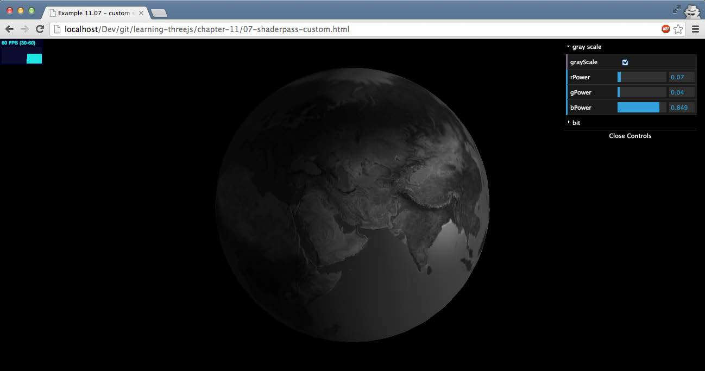

让我们再创建一个自定义着色器。这一次，我们将把 24 位输出降低到更少的位数。

### 创建自定义位深度着色器

通常，颜色表示为 24 位值，这为我们提供了大约 1600 万种不同的颜色。在计算技术发展的早期，这是无法做到的，颜色通常表示为 8 位或 16 位颜色。使用这个着色器，我们可以自动将 24 位输出转换为 8 位颜色深度（或你想要的任何位深）。

由于顶点着色器相对于上一个示例没有变化，我们将跳过它，直接列出 uniforms 属性实例：

```text
uniforms: {
```

```text
  "tDiffuse": { type: "t", value: null },
  "bitSize":  { type: "i", value: 4 }
```

```text
}
```

<!-- pdf-page: 368 -->
以下是片元着色器本身：

```text
fragmentShader: [
```

```text
  "uniform int bitSize;",
```

```text
  "uniform sampler2D tDiffuse;",
```

```text
  "varying vec2 vUv;",
```

```text
  "void main() {",
```

```text
    "vec4 texel = texture2D( tDiffuse, vUv );",
    "float n = pow(float(bitSize),2.0);",
    "float newR = floor(texel.r*n)/n;",
    "float newG = floor(texel.g*n)/n;",
    "float newB = floor(texel.b*n)/n;",
```

```text
    "gl_FragColor = vec4(newR, newG, newB, texel.w );",
```

```text
  "}"
```

```text
].join("\n")
```

我们定义了两个可用于配置这个着色器的 uniforms 属性实例。第一个是 Three.js 用来传入当前屏幕图像的实例，第二个由我们定义为整数（type: "i"），用作渲染结果时所需的颜色深度。代码本身非常直观：

- 我们首先根据传入的像素位置 vUv，从 tDiffuse 纹理中获取纹素。

- 我们通过计算 bitSize 的 2 次幂（pow(float(bitSize),2.0)），根据 bitSize 属性计算可以拥有的颜色数量。

- 接下来，我们将纹素颜色值乘以 n，向下取整（floor(texel.r\*n)），然后再除以 n，以此计算纹素颜色的新值。

- 结果被设置到 gl\_FragColor（红色、绿色和蓝色值以及不透明度）中，并显示在屏幕上。

<!-- pdf-page: 369 -->
自定义着色器与渲染后期处理

你可以在上一个自定义着色器所使用的同一个示例 07-shaderpass-custom.html 中查看这个自定义着色器的结果。下面的屏幕截图展示了这个示例：

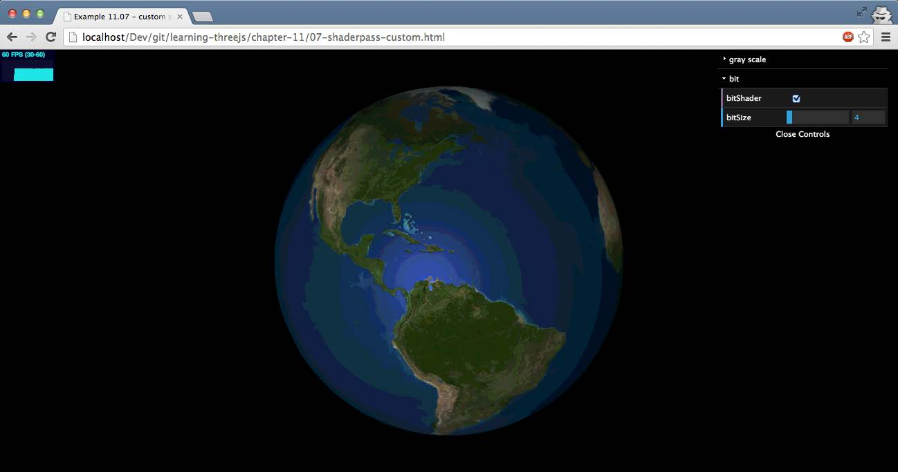

本章关于后期处理的内容到此结束。

## 小结

本章讨论了许多不同的后期处理选项。如你所见，创建 THREE.EffectComposer 并将各个通道串联起来其实非常容易。你只需记住几点。并非所有通道都会输出到屏幕。如果要输出到屏幕，始终可以将 THREE.ShaderPass 与 THREE.CopyShader 一起使用。向合成器添加通道的顺序很重要，效果会按照该顺序应用。如果要重用某个 THREE.EffectComposer 实例的结果，可以使用 THREE.TexturePass 来实现。当你的 THREE.EffectComposer 中有多个 THREE.RenderPass 时，请确保将 clear 属性设置为 false。否则，你只会看到最后一个 THREE.RenderPass 步骤的输出。如果只想对特定对象应用效果，可以使用 THREE.MaskPass。遮罩使用完毕后，用 THREE.ClearMaskPass 清除遮罩。除了 Three.js 提供的标准通道外，还有大量标准着色器可供使用。你可以将它们与 THREE.ShaderPass 一起使用。采用 Three.js 的标准方法，为后期处理创建自定义着色器非常容易。你只需创建一个片元着色器。

<!-- pdf-page: 370 -->
到目前为止，我们几乎已经涵盖了有关 Three.js 的所有知识。在下一章，也就是最后一章中，我们将介绍一个名为 Physijs 的库，你可以用它为 Three.js 扩展物理功能，并应用碰撞、重力和约束。

<!-- pdf-page: 371 -->
