# 第 12 章 · 为场景添加物理效果与声音

<!-- pdf-page: 372 -->
## 为场景添加物理效果

## 与声音

在这最后一章中，我们将介绍 Physijs，这是另一个可用于扩展 Three.js 基本功能的库。Physijs 是一个允许你将物理效果（physics）引入 3D 场景的库。这里所说的物理效果，是指对象会受到重力作用、可以相互碰撞、可以通过施加冲量（impulse）来移动，并且可以通过铰链和滑块来约束其运动。这个库内部使用了另一个名为 ammo.js 的知名物理引擎（physics engine）。除了物理效果，我们还会介绍 Three.js 如何帮助你为场景添加空间定位音频（spatial sounds）。

本章将讨论以下主题：

- 创建一个 Physijs 场景，使其中的对象受到重力作用并可以相互碰撞

- 展示如何更改场景中对象的摩擦力（friction）和恢复系数（restitution，即弹性）

- 解释 Physijs 支持的各种形状及其使用方法

- 展示如何通过将简单形状组合在一起来创建复合形状（compound shapes）

- 展示高度场（height field）如何让你模拟复杂形状

- 通过应用点约束（point constraint）、铰链约束（hinge constraint）、滑动约束（slider constraint）、锥扭转约束（cone twist constraint）以及自由度约束（degree of freedom constraint），限制对象的移动

- 为场景添加声源（sound sources），其音量由声源与相机的距离决定，声音方向由声源相对于相机的位置决定

我们要做的第一件事，是创建一个可与 Physijs 一起使用的 Three.js 场景。我们将在第一个示例中完成这项任务。

<!-- pdf-page: 373 -->
为场景添加物理效果与声音

## 创建基本的 Three.js 场景

为 Physijs 设置 Three.js 场景非常简单，只需几个步骤。我们需要做的第一件事是引入正确的 JavaScript 文件，你可以从 GitHub 存储库 http://chandlerprall.github.io/Physijs/ 获取该文件。按如下方式将 Physijs 库添加到 HTML 页面：

```html
<script type="text/javascript" src="../libs/physi.js"></script>
```

模拟场景会消耗相当多的处理器资源。如果我们在渲染线程上运行所有模拟计算（因为 JavaScript 本质上是单线程的），场景的帧率就会受到严重影响。为弥补这一点，Physijs 在后台线程中进行计算。这个后台线程通过大多数现代浏览器都实现的 Web 工作线程（Web Worker）规范提供。利用该规范，你可以在单独的线程中运行 CPU 密集型任务，从而不影响渲染。有关 Web 工作线程的更多信息，请访问 http://www.w3.org/TR/workers/。

对于 Physijs，这意味着我们必须配置包含此工作线程任务的 JavaScript 文件，还要告诉 Physijs 在哪里可以找到模拟场景所需的 ammo.js 文件。需要引入 ammo.js 文件的原因是，Physijs 是 ammo.js 的一个封装，目的是让它易于使用。Ammo.js（你可以在 https://github.com/kripken/ammo.js/ 找到它）是实现物理引擎的库；Physijs 只是为这个物理库提供一个易于使用的接口。由于 Physijs 只是一个封装，我们也可以将其他物理引擎与 Physijs 一起使用。在 Physijs 存储库中，你还可以找到一个使用另一种物理引擎 Cannon.js 的分支。

要配置 Physijs，必须设置以下两个属性：

```text
Physijs.scripts.worker = '../libs/physijs_worker.js';
Physijs.scripts.ammo = '../libs/ammo.js';
```

第一个属性指向我们要执行的工作线程任务，第二个属性指向内部使用的 ammo.js 库。接下来需要执行的步骤是创建一个场景。Physijs 为普通的 Three.js 场景提供了一个封装，因此在代码中，你可以按如下方式创建场景：

```javascript
var scene = new Physijs.Scene();
scene.setGravity(new THREE.Vector3(0, -10, 0));
```

<!-- pdf-page: 374 -->
这会创建一个应用物理效果的新场景，并设置重力。在这个示例中，我们将 y 轴上的重力设置为 -10。换句话说，对象会竖直向下坠落。你可以将各个轴的重力设置为任何你认为合适的值，也可以在运行时更改它，场景会作出相应的反应。

在开始模拟场景中的物理效果之前，我们需要添加一些对象。为此，可以使用 Three.js 指定对象的常规方式，但必须将它们封装在特定的 Physijs 对象中，以便 Physijs 库对它们进行管理，如下面的代码片段所示：

```javascript
var stoneGeom = new THREE.BoxGeometry(0.6,6,2);
var stone = new Physijs.BoxMesh(stoneGeom, new THREE.
  MeshPhongMaterial({color: 0xff0000}));
scene.add(stone);
```

在这个示例中，我们创建了一个简单的 THREE.BoxGeometry 对象。我们没有创建 THREE.Mesh，而是创建 Physijs.BoxMesh，这会告诉 Physijs 在模拟物理效果和检测碰撞时，将几何体的形状视为一个盒子。Physijs 提供了许多可用于各种形状的网格。有关可用形状的更多信息，请阅读本章后面的内容。

现在已经将 Physijs.BoxMesh 添加到场景中，我们就具备了第一个 Physijs 场景所需的全部要素。剩下要做的，就是告诉 Physijs 模拟物理效果，并更新场景中对象的位置和旋转。为此，可以在刚刚创建的场景上调用 simulate 方法。因此，我们将基本渲染循环更改为如下形式：

```javascript
render = function() {
  requestAnimationFrame(render);
  renderer.render(scene, camera);
  scene.simulate();
}
```

完成最后这一步，即调用 scene.simulate() 后，我们就完成了 Physijs 场景的基本设置。不过，如果运行这个示例，我们不会看到太多内容，只会看到屏幕中央有一个立方体，场景一开始渲染，它就开始向下坠落。因此，让我们看一个更复杂的示例，在其中模拟多米诺骨牌倒下的过程。

<!-- pdf-page: 375 -->
为场景添加物理效果与声音

对于这个示例，我们将创建以下场景：

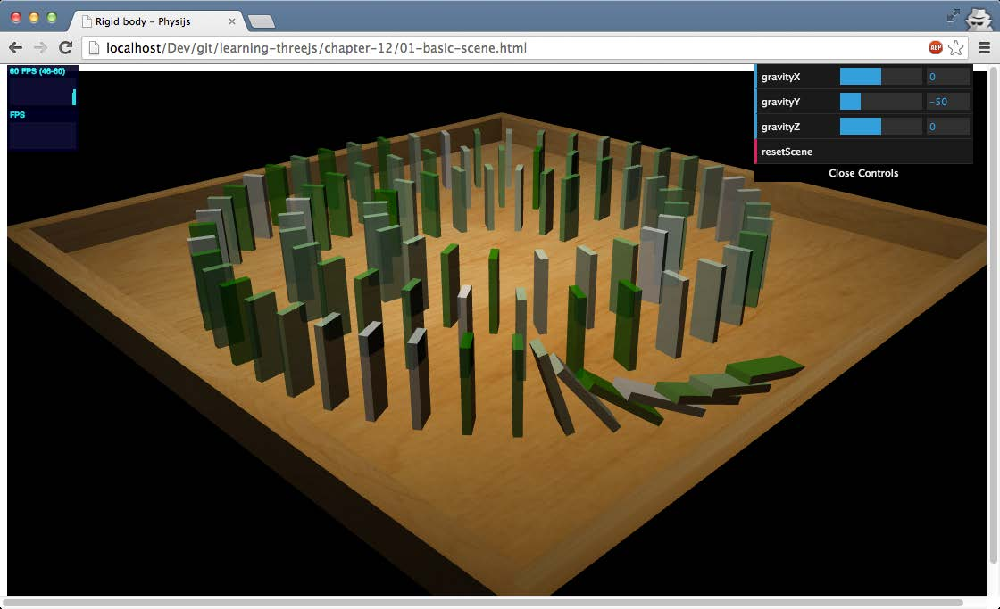

如果在浏览器中打开 01-basic-scene.html 示例，你会看到一组多米诺骨牌，场景一加载，它们就开始倒下。第一块会撞倒第二块，依此类推。这个场景的全部物理效果都由 Physijs 管理。为了启动这个动画，我们所做的唯一事情就是推倒第一块多米诺骨牌。创建这个场景其实非常简单，只需以下几个步骤：

1.	 定义一个 Physijs 场景。

2.	 定义承载骨牌的地面区域。

3.	 放置骨牌。

4.	 推倒第一块骨牌。

<!-- pdf-page: 376 -->
第一步已经介绍过，因此这里将其跳过，直接进入第二步，定义容纳所有骨牌的沙箱。这个沙箱由组合在一起的几个盒子构成。以下是完成此操作所需的代码：

```javascript
function createGround() {
  var ground_material = Physijs.createMaterial(new
    THREE.MeshPhongMaterial({ map: THREE.ImageUtils.loadTexture(
    '../assets/textures/general/wood-2.jpg' )}),0.9,0.3);
```

```javascript
  var ground = new Physijs.BoxMesh(new THREE.BoxGeometry(60, 1,
    60), ground_material, 0);
```

```javascript
  var borderLeft = new Physijs.BoxMesh(new THREE.BoxGeometry (2,
    3, 60), ground_material, 0);
  borderLeft.position.x=-31;
  borderLeft.position.y=2;
  ground.add(borderLeft);
```

```javascript
  var borderRight = new Physijs.BoxMesh(new THREE. BoxGeometry (2,
    3, 60), ground_material, 0);
  borderRight.position.x=31;
  borderRight.position.y=2;
  ground.add(borderRight);
```

```javascript
  var borderBottom = new Physijs.BoxMesh(new THREE. BoxGeometry
    (64, 3, 2), ground_material, 0);
  borderBottom.position.z=30;
  borderBottom.position.y=2;
  ground.add(borderBottom);
```

```javascript
  var borderTop = new Physijs.BoxMesh(new THREE.BoxGeometry (64,
    3, 2), ground_material, 0);
  borderTop.position.z=-30;
  borderTop.position.y=2;
  ground.add(borderTop);
```

```text
  scene.add(ground);
}
```

<!-- pdf-page: 377 -->
为场景添加物理效果与声音

这段代码并不十分复杂。首先，我们创建一个简单的盒子作为地面，然后添加几条边界，防止对象从地面上掉落。我们将这些边界添加到地面对象，以创建一个复合对象（compound object）。Physijs 会将这个对象视为单个对象。这段代码中还有其他一些新内容，我们将在后面几节中更深入地解释。第一个新内容是我们创建的 ground\_material。我们使用 Physijs.createMaterial 函数来创建这种材质。该函数封装标准的 Three.js 材质，同时允许我们设置材质的摩擦力和恢复系数（弹性）。下一节将对此作进一步介绍。另一个新点是我们添加到 Physijs.BoxMesh 构造函数的最后一个参数。对于本节创建的所有 BoxMesh 对象，我们都将 0 添加为最后一个参数。通过这个参数，我们设置对象的质量（mass）。这样做是为了防止地面受到场景中重力的影响，使其不会向下坠落。

有了地面之后，我们就可以放置多米诺骨牌了。为此，我们创建简单的 THREE.BoxGeometry 实例，将它们封装在 BoxMesh 中，并放置在地面网格顶部的特定位置，如下所示：

```javascript
var stoneGeom = new THREE.BoxGeometry(0.6,6,2);
var stone = new Physijs.BoxMesh(stoneGeom,
  Physijs.createMaterial(new THREE.MeshPhongMaterial(color:
  scale(Math.random()).hex(),transparent:true, opacity:0.8})));
stone.position.copy(point);
stone.lookAt(scene.position);
stone.__dirtyRotation = true;
stone.position.y=3.5;
scene.add(stone);
```

这里没有展示计算每块多米诺骨牌位置的代码（相关内容请参阅示例源代码中的 getPoints() 函数）；这段代码只展示如何定位多米诺骨牌。你可以看到，我们再次创建了封装 THREE.BoxGeometry 的 BoxMesh。为了确保多米诺骨牌正确对齐，我们使用 lookAt 函数设置正确的旋转。如果不这样做，它们就都会朝向同一个方向，并且不会倒下。手动更新 Physijs 封装对象的旋转（或位置）后，我们必须确保告知 Physijs 已有内容发生变化，以便 Physijs 更新其自身对场景中所有对象的内部表示。对于旋转，可以使用内部 \_\_dirtyRotation 属性来完成；对于位置，则将 \_\_dirtyPosition 设置为 true。

<!-- pdf-page: 378 -->
现在剩下要做的只有推倒第一块多米诺骨牌。为此，只需将其 x 轴上的旋转设置为 0.2，让它稍微倾斜。场景中的重力会完成剩下的工作，将第一块多米诺骨牌完全推倒。以下是推倒第一块多米诺骨牌的方法：

```text
stones[0].rotation.x=0.2;
stones[0].__dirtyRotation = true;
```

至此，第一个示例就完成了，它已经展示了 Physijs 的许多功能。如果想尝试不同的重力，可以通过右上角的菜单进行更改。按下 resetScene 按钮时，对重力的更改就会应用：

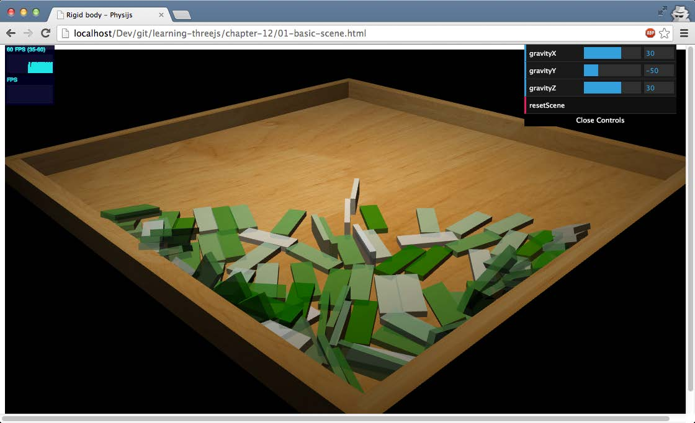

下一节将更仔细地介绍 Physijs 材质属性如何影响对象。

<!-- pdf-page: 379 -->
为场景添加物理效果与声音

## 材质属性

首先解释一下这个示例。打开 02-material-properties.html 示例时，你会看到一个与上一个示例有些相似的空盒子。这个盒子围绕其 x 轴上下转动。在右上角的菜单中，有几个滑块可用于更改 Physijs 的一些材质属性。这些属性会应用于通过 addCubes 和 addSpheres 按钮添加的立方体和球体。按下 addSpheres 按钮时，会向场景中添加五个球体；按下 addCubes 按钮时，会添加五个立方体。下面是一个演示摩擦力和恢复系数的示例：

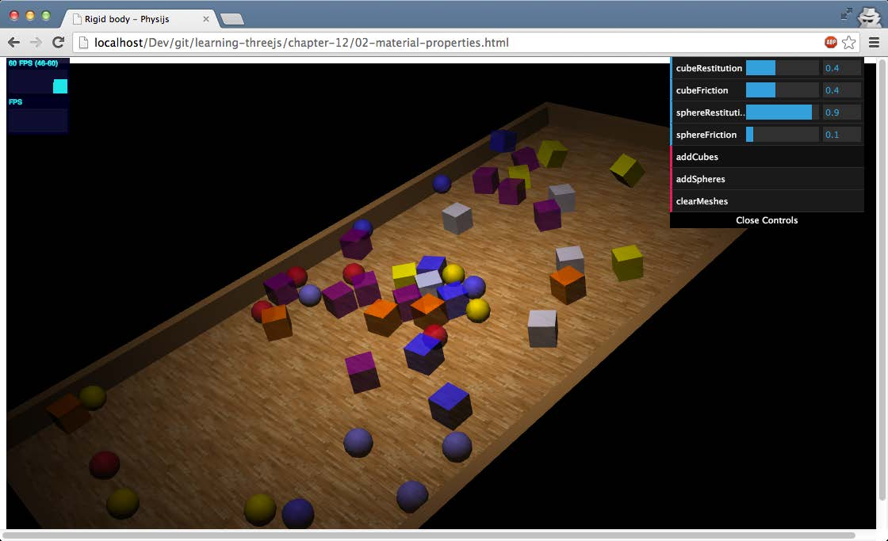

这个示例允许你试验创建 Physijs 材质时可以设置的恢复系数（弹性）和摩擦力属性。例如，如果将 cubeFriction 一直调到 1，然后添加一些立方体，你会看到，即使地面正在移动，立方体也几乎不动。如果将 cubeFriction 设置为 0，你会注意到，地面一旦不再水平，立方体就会四处滑动。下面的屏幕截图显示，高摩擦力可以让立方体抵抗重力：

<!-- pdf-page: 380 -->
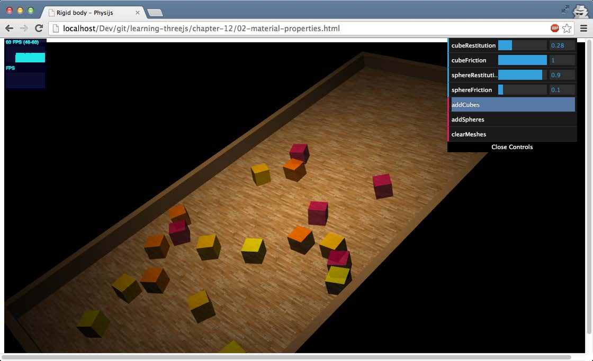

在这个示例中，可以设置的另一个属性是 restitution 属性。restitution 属性定义对象在碰撞时会恢复多少自身拥有的能量。换句话说，高恢复系数会产生富有弹性的对象，而低恢复系数会使对象在撞到另一个对象时立即停止。

使用物理引擎时，通常不必担心碰撞检测，引擎会负责处理。不过，有时在两个对象发生碰撞时收到通知也非常有用。例如，你可能想要创建一种音效，或者在制作游戏时扣除一条生命。

使用 Physijs，可以向 Physijs 网格添加事件监听器，如下面的代码所示：

```javascript
mesh.addEventListener( 'collision', function(
  other_object, relative_velocity, relative_rotation,
  contact_normal ) {
```

```text
});
```

这样，每当这个网格与 Physijs 管理的另一个网格发生碰撞时，你都会收到通知。

<!-- pdf-page: 381 -->
为场景添加物理效果与声音

演示这一点的一个好方法，是使用球体，将恢复系数设置为 1，然后点击 addSpheres 按钮几次。这会创建若干四处弹跳的球体。

在进入下一节之前，先看看本示例中使用的一段代码：

```javascript
sphere = new Physijs.SphereMesh(new THREE.SphereGeometry( 2, 20 ),
  Physijs.createMaterial(new THREE.MeshPhongMaterial({color:
  colorSphere, opacity: 0.8, transparent: true}),
  controls.sphereFriction, controls.sphereRestitution));
box.position.set(Math.random() * 50 -25, 20 + Math.random() * 5,
  Math.random() * 50 -25);
scene.add( sphere );
```

这是向场景中添加球体时执行的代码。这一次，我们使用了另一种 Physijs 网格：Physijs.SphereMesh。我们创建的是 THREE.SphereGeometry，因此，从提供的网格集合来看，最合乎逻辑的匹配自然是 Physijs.SphereMesh（下一节会进一步介绍）。创建 Physijs.SphereMesh 时，我们传入几何体，并使用 Physijs.createMaterial 创建 Physijs 专用的材质。这样做是为了能够设置该对象的摩擦力和恢复系数。

到目前为止，我们已经见过 BoxMesh 和 SphereMesh。下一节将解释并展示 Physijs 提供的不同类型的网格，你可以用它们封装自己的几何体。

## 支持的基本形状

Physijs 提供了许多形状，可用于封装几何体。在本节中，我们将逐一介绍所有可用的 Physijs 网格，并通过一个示例演示这些网格。请记住，要使用这些网格，只需将 THREE.Mesh 构造函数替换为其中之一即可。

下表概述了 Physijs 中可用的网格：

| 名称 | 描述 |
| --- | --- |
| Physijs.PlaneMesh | 此网格可用于创建零厚度的平面。你也可以将 BoxMesh 与高度较小的 THREE.BoxGeometry 结合使用来实现这一点。 |
| Physijs.BoxMesh | 如果几何体看起来像立方体，请使用此网格。例如，它非常适合 THREE.BoxGeometry。 |
| Physijs.SphereMesh | 对于球体形状，请使用此网格。此网格非常适合 THREE.SphereGeometry。 |

<!-- pdf-page: 382 -->
| 名称 | 描述 |
| --- | --- |
| Physijs.CylinderMesh | 使用 THREE.Cylinder，可以创建各种类似圆柱体的形状。Physijs 会根据圆柱体的形状提供多种网格。对于顶部半径和底部半径相同的普通圆柱体，应使用 Physijs.CylinderMesh。 |
| Physijs.ConeMesh | 如果将顶部半径指定为 0，并为底部半径使用正值，就可以使用 THREE.Cylinder 创建圆锥体。如果要为这样的对象应用物理效果，Physijs 中最合适的是 ConeMesh。 |
| Physijs.CapsuleMesh | 胶囊体与 THREE.Cylinder 类似，但顶部和底部都是圆角。本节稍后会介绍如何在 Three.js 中创建胶囊体。 |
| Physijs.ConvexMesh | Physijs.ConvexMesh 是一种可用于较复杂对象的粗略形状。它会像 THREE.ConvexGeometry 一样创建凸包（convex hull），以逼近复杂对象的形状。 |
| Physijs.ConcaveMesh | ConvexMesh 是一种粗略形状，而 ConcaveMesh 则是复杂几何体更精细的表示。请注意，使用 ConcaveMesh 的性能开销非常高。通常，更好的做法是创建各自具有特定 Physijs 网格的独立几何体，或者将它们组合在一起（就像我们在前面的示例中处理地板那样）。 |
| Physijs.HeightfieldMesh | 这个网格非常专门化。使用此网格，可以根据 THREE.PlaneGeometry 创建高度场。有关此网格，请查看 03-shapes.html 示例。 |

我们将以 03-shapes.html 为参考，快速介绍这些形状。Physijs.ConcaveMesh 的用途非常有限，因此不再进一步解释。

在查看示例之前，先快速看看 Physijs.PlaneMesh。这个网格根据 THREE.PlaneGeometry 创建一个简单的平面，如下所示：

```javascript
var plane = new Physijs.PlaneMesh(new THREE.
  PlaneGeometry(5,5,10,10), material);
```

```text
scene.add( plane );
```

<!-- pdf-page: 383 -->
为场景添加物理效果与声音

在这个函数中，你可以看到，我们只需传入一个简单的 THREE.PlaneGeometry 就能创建这个网格。如果将它添加到场景中，你会注意到一些奇怪的现象：刚刚创建的网格不会对重力作出反应。原因是 Physijs.PlaneMesh 的质量固定为 0，因此它不会对重力作出反应，也不会因与其他对象碰撞而移动。除了这个网格，其他所有网格都会如你所预期的那样对重力和碰撞作出反应。下面的屏幕截图展示了一个高度场，各种受支持的形状都可以落到它上面：

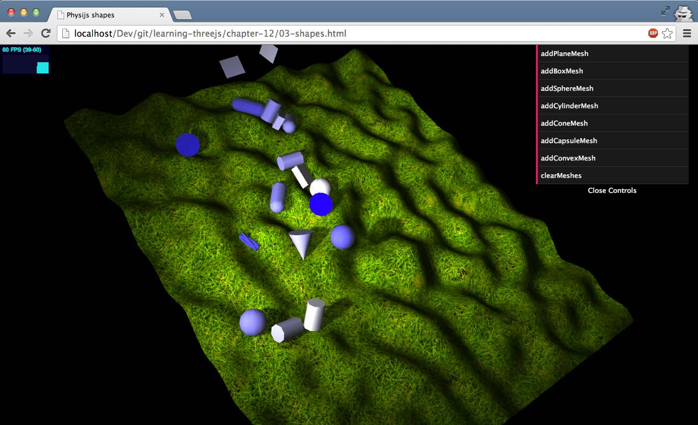

前一幅图像展示的是 03-shapes.html 示例。在这个示例中，我们创建了一个随机高度场（稍后详细介绍），并在右上角提供了一个菜单，你可以用它让各种形状的对象落下。如果亲自尝试这个示例，你会看到不同形状对高度图的反应有何不同，以及它们与其他对象碰撞时的反应有何不同。

<!-- pdf-page: 384 -->
让我们看看其中一些形状的构造方式：

```javascript
new Physijs.SphereMesh(new THREE.SphereGeometry(3,20),mat);
new Physijs.BoxMesh(new THREE.BoxGeometry(4,2,6),mat);
new Physijs.CylinderMesh(new THREE.CylinderGeometry(2,2,6),mat);
new Physijs.ConeMesh(new THREE.CylinderGeometry(0,3,7,20,10),mat);
```

这里没有什么特别之处；我们创建一个几何体，再使用 Physijs 中最匹配的网格来创建要添加到场景中的对象。不过，如果想使用 Physijs.CapsuleMesh 该怎么办？Three.js 不包含类似胶囊体的几何体，因此必须自己创建一个。以下是用于此目的的代码：

```javascript
var merged = new THREE.Geometry();
var cyl = new THREE.CylinderGeometry(2, 2, 6);
var top = new THREE.SphereGeometry(2);
var bot = new THREE.SphereGeometry(2);
```

```javascript
var matrix = new THREE.Matrix4();
matrix.makeTranslation(0, 3, 0);
top.applyMatrix(matrix);
```

```javascript
var matrix = new THREE.Matrix4();
matrix.makeTranslation(0, -3, 0);
bot.applyMatrix(matrix);
```

```text
// merge to create a capsule
merged.merge(top);
merged.merge(bot);
merged.merge(cyl);
```

```javascript
// create a physijs capsule mesh
var capsule = new Physijs.CapsuleMesh(merged, getMaterial());
```

<!-- pdf-page: 385 -->
为场景添加物理效果与声音

Physijs.CapsuleMesh 看起来像圆柱体，但顶部和底部都是圆角。在 Three.js 中，只需创建一个圆柱体（cyl）和两个球体（top 和 bot），再使用 merge() 函数将它们合并在一起，就能轻松重现这种形状。下面的屏幕截图展示了若干胶囊体沿高度图滚下：

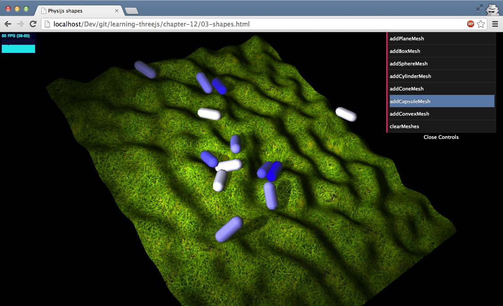

在介绍高度图之前，先来看看可以添加到此示例中的最后一种形状 Physijs.ConvexMesh。凸包是包裹几何体所有顶点的最小形状。所得形状只包含小于 180 度的角。对于圆环结等复杂形状，可以使用这个网格，如下面的代码所示：

```javascript
var convex = new Physijs.ConvexMesh(new
  THREE.TorusKnotGeometry(0.5,0.3,64,8,2,3,10), material);
```

在这种情况下，物理模拟和碰撞检测将使用圆环结的凸包。这是一种为复杂对象应用物理效果和检测碰撞的好方法，同时还能尽量降低性能影响。

<!-- pdf-page: 386 -->
要讨论的最后一个 Physijs 网格是 Physijs.HeightfieldMesh。下面的屏幕截图展示了使用 Physijs 创建的高度图：

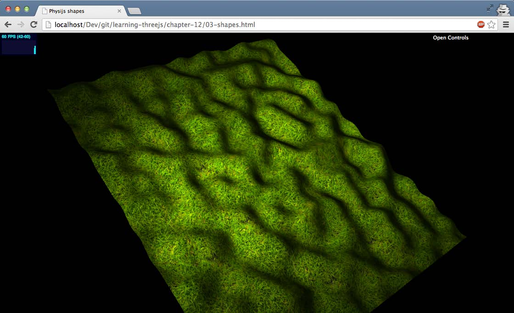

使用高度图，可以非常轻松地创建包含凸起和凹陷的地形。通过 Physijs.HeightfieldMesh，我们可以确保所有对象都能正确响应这个地形的高度差。让我们看看实现这一点所需的代码：

```javascript
var date = new Date();
var pn = new Perlin('rnd' + date.getTime());
```

```javascript
function createHeightMap(pn) {
```

```javascript
  var ground_material = Physijs.createMaterial(
    new THREE.MeshLambertMaterial({
      map: THREE.ImageUtils.loadTexture('../assets/textures
        /ground/grasslight-big.jpg')
    }),
    0.3, // high friction
    0.8 // low restitution
  );
```

<!-- pdf-page: 387 -->
为场景添加物理效果与声音

```javascript
  var ground_geometry = new THREE.PlaneGeometry(120, 100, 100,
    100);
  for (var i = 0; i < ground_geometry.vertices.length; i++) {
    var vertex = ground_geometry.vertices[i];
    var value = pn.noise(vertex.x / 10, vertex.y / 10, 0);
    vertex.z = value * 10;
  }
  ground_geometry.computeFaceNormals();
  ground_geometry.computeVertexNormals();
```

```javascript
  var ground = new Physijs.HeightfieldMesh(
    ground_geometry,
    ground_material,
    0, // mass
    100,
    100
  );
  ground.rotation.x = Math.PI / -2;
  ground.rotation.y = 0.4;
  ground.receiveShadow = true;
```

```text
  return ground;
}
```

在这个代码片段中，我们通过几个步骤创建示例中可以看到的高度图。首先，创建 Physijs 材质和一个简单的 PlaneGeometry 对象。要根据 PlaneGeometry 创建崎岖地形，我们会遍历这个几何体的每个顶点，并随机设置 z 属性。为此，我们使用柏林噪声生成器（Perlin noise generator）创建凹凸贴图，就像在第 10 章“加载和使用纹理”的“将画布用作凹凸贴图”一节中所做的那样。我们需要调用 computeFaceNormals 和 computeVertexNormals，以确保纹理、光照和阴影得到正确渲染。此时，我们拥有了包含正确高度信息的 PlaneGeometry。使用 PlaneGeometry，就可以创建 Physijs.HeightfieldMesh。构造函数的最后两个参数接受 PlaneGeometry 的水平和垂直分段数，应与构造 PlaneGeometry 时使用的最后两个属性一致。最后，我们将 HeightfieldMesh 旋转到所需位置并添加到场景中。现在，所有其他 Physijs 对象都会与这个高度图正确交互。

<!-- pdf-page: 388 -->
## 使用约束限制对象的移动

到目前为止，我们已经看到了一些基本物理效果的实际表现。我们了解了各种形状如何响应重力、摩擦力和恢复系数，以及它们如何影响碰撞。Physijs 还提供了高级构造，允许你限制对象的移动。在 Physijs 中，这些对象称为约束。下表概述了 Physijs 中可用的约束：

| 约束 | 描述 |
| --- | --- |
| PointConstraint | 这允许你将一个对象的位置固定到另一个对象的位置。如果一个对象移动，另一个对象也会随之移动，同时保持它们之间的距离和方向不变。 |
| HingeConstraint | HingeConstraint 允许你限制对象的移动，就像它安装在门之类的铰链上一样。 |
| SliderConstraint | 顾名思义，这个约束允许你将对象的移动限制在单个轴上，例如滑动门。 |
| ConeTwistConstraint | 使用这个约束，可以限制一个对象相对于另一个对象的旋转和移动。这个约束的工作方式类似球窝关节（ball-and-socket joint），例如手臂在肩窝中的运动方式。 |
| DOFConstraint | DOFConstraint 允许你指定绕三个轴中任意一个轴的移动限制，还允许你设置所允许的最小角度和最大角度。它是可用约束中功能最灵活的一种。 |

<!-- pdf-page: 389 -->
为场景添加物理效果与声音

理解这些约束最简单的方法，就是观察它们的实际效果并亲自操作。为此，我们提供了一个同时使用所有这些约束的示例 04-physijs-constraints.js。下面的屏幕截图展示了这个示例：

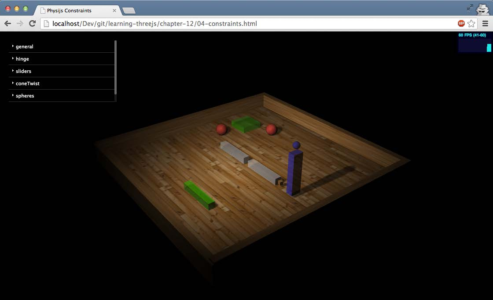

我们将基于这个示例介绍这五种约束中的四种。对于 DOFConstraint，我们单独创建了一个示例。首先来看 PointConstraint。

### 使用 PointConstraint 限制两点之间的移动

打开示例后，你会看到两个红色球体。这两个球体使用 PointConstraint 相互连接。通过左上角的菜单，可以移动绿色滑块。一旦其中一个滑块撞到某个红色球体，你就会看到两个球体以相同的方式移动，同时保持它们之间的距离不变，并且仍受质量、重力、摩擦力及其他物理因素的影响。

<!-- pdf-page: 390 -->
本示例中的 PointConstraint 是按如下方式创建的：

```javascript
function createPointToPoint() {
  var obj1 = new THREE.SphereGeometry(2);
  var obj2 = new THREE.SphereGeometry(2);
```

```javascript
  var objectOne = new Physijs.SphereMesh(obj1, Physijs.
    createMaterial(new THREE.MeshPhongMaterial({color: 0xff4444,
    transparent: true, opacity:0.7}),0,0));
```

```text
  objectOne.position.x = -10;
  objectOne.position.y = 2;
  objectOne.position.z = -18;
```

```text
  scene.add(objectOne);
```

```javascript
  var objectTwo = new Physijs.SphereMesh(obj2,Physijs.
    createMaterial(new THREE.MeshPhongMaterial({color: 0xff4444,
    transparent: true, opacity:0.7}),0,0));
```

```text
  objectTwo.position.x = -20;
  objectTwo.position.y = 2;
  objectTwo.position.z = -5;
```

```text
  scene.add(objectTwo);
```

```javascript
  var constraint = new Physijs.PointConstraint(objectOne,
    objectTwo, objectTwo.position);
  scene.addConstraint(constraint);
}
```

在这里，你可以看到，我们使用 Physijs 专用的网格（本例中为 SphereMesh）创建对象，并将它们添加到场景中。我们使用 Physijs.PointConstraint 构造函数创建约束。这个约束接受三个参数：

- 前两个参数定义要将哪些对象相互连接。在这个示例中，我们将两个球体相互连接。

- 第三个参数定义约束绑定到哪个位置。例如，如果将第一个对象绑定到一个非常大的对象，就可以将这个位置设置为该对象的右侧等位置。通常，如果只是想让两个对象相互连接，一个很好的选择就是将它设置为第二个对象的位置。

<!-- pdf-page: 391 -->
为场景添加物理效果与声音

如果不想将一个对象固定到另一个对象，而是固定到场景中的静态位置，可以省略第二个参数。在这种情况下，第一个对象会与你指定的位置保持相同距离，当然，同时仍会遵循重力和物理效果的其他方面。

创建约束后，可以使用 addConstraint 函数将它添加到场景中，从而启用它。开始试验约束时，你可能会遇到一些奇怪的问题。为了便于调试，可以向 addConstraint 函数传入 true。这样做后，约束点和方向就会显示在场景中。这可以帮助你正确设置约束的旋转和位置。

### 使用 HingeConstraint 创建类似门的约束

顾名思义，HingeConstraint 允许你创建行为类似铰链的对象。它绕特定轴旋转，将移动限制在指定角度内。在我们的示例中，HingeConstraint 由场景中央的两个白色挡板展示。这些挡板被约束到棕色小立方体上，可以绕它们旋转。如果想尝试这些铰链，可以在 hinge 菜单中勾选 enableMotor 复选框来启用它们。这会将挡板加速到 general 菜单中指定的速度。负速度会使铰链向下移动，正速度则会使它们向上移动。下面的屏幕截图展示了铰链处于向上和向下位置时的情形：

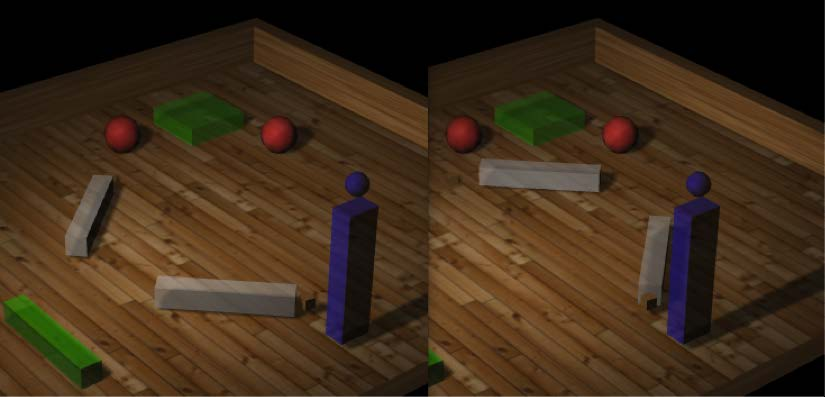

<!-- pdf-page: 392 -->
让我们更仔细地看看其中一个挡板是如何创建的：

```javascript
var constraint = new Physijs.HingeConstraint(flipperLeft,
  flipperLeftPivot, flipperLeftPivot.position, new
  THREE.Vector3(0,1,0));
scene.addConstraint(constraint);
constraint.setLimits(-2.2, -0.6, 0.1, 0);
```

这个约束接受四个参数。让我们稍微详细地看看每一个参数：

| 参数 | 描述 |
| --- | --- |
| mesh\_a | 传入函数的第一个对象是要约束的对象。在这个示例中，第一个对象是用作挡板的白色立方体。它的移动会受到约束。 |
| mesh\_b | 第二个对象定义 mesh\_a 被约束到哪个对象。在这个示例中，mesh\_a 被约束到棕色小立方体。如果移动这个网格，mesh\_a 也会随之移动，同时仍保持 HingeConstraint 的位置。你会看到，所有约束都有这个选项。例如，如果你创建了一辆可以四处移动的汽车，并希望创建用于打开车门的约束，就可以使用这个选项。如果省略第二个参数，铰链将被约束到场景（并且永远无法四处移动）。 |
| position | 这是应用约束的点。在这个示例中，它是 mesh\_a 围绕其旋转的铰链点。如果指定了 mesh\_b，这个铰链点会随着 mesh\_b 的位置和旋转而移动。 |
| axis | 这是铰链应围绕其旋转的轴。在这个示例中，我们将铰链设置为水平方向（0,1,0）。 |

将 HingeConstraint 添加到场景的方式与我们使用 PointConstraint 时看到的方式相同。使用 addConstraint 方法，指定要添加的约束，并可选择添加 true，以显示约束的确切位置和方向，方便调试。不过，对于 HingeConstraint，我们还需要定义允许的移动范围。为此，我们使用 setLimits 函数。

这个函数接受以下四个参数：

| 参数 | 描述 |
| --- | --- |
| low | 这是运动的最小角度，以弧度表示。 |
| high | 这是运动的最大角度，以弧度表示。 |

<!-- pdf-page: 393 -->
为场景添加物理效果与声音

| 参数 | 描述 |
| --- | --- |
| bias\_factor | 此属性定义约束在位置出现误差后进行自我纠正的速率。例如，当铰链被另一个对象推离其约束范围时，它会将自身移动回正确位置。该值越高，位置纠正得越快。最好将它保持在 0.5 以下。 |
| relaxation\_factor | 这定义约束改变速度的速率。如果设置为高值，对象会在达到最小或最大运动角度时发生弹跳。 |

如果愿意，可以在运行时更改这些属性。如果使用这些属性添加 HingeConstraint，你不会看到太多移动。网格只有在被另一个对象撞击时或在重力作用下才会移动。不过，与许多其他约束一样，这个约束也可以通过内部电机来移动。在示例的 hinge 子菜单中勾选 enableMotor 复选框时，看到的就是这种效果。以下代码用于启用这个电机：

```text
constraint.enableAngularMotor( controls.velocity,
  controls.acceleration );
```

这会使用所提供的加速度，将网格（本例中为挡板）加速到指定速度。如果想让挡板向另一个方向移动，只需指定负速度。如果没有任何限制，只要电机持续运行，挡板就会一直旋转。要禁用电机，只需调用以下代码：

```text
flipperLeftConstraint.disableMotor();
```

现在，网格会根据摩擦力、碰撞、重力和物理效果的其他方面逐渐减速。

### 使用 SliderConstraint 将移动限制在单个轴上

下一个约束是 SliderConstraint。使用这个约束，可以将对象的移动限制到它的任意一个轴上。04-constraints.html 示例中的绿色滑块可以通过 sliders 子菜单控制。下面的屏幕截图展示了这个示例：

<!-- pdf-page: 394 -->
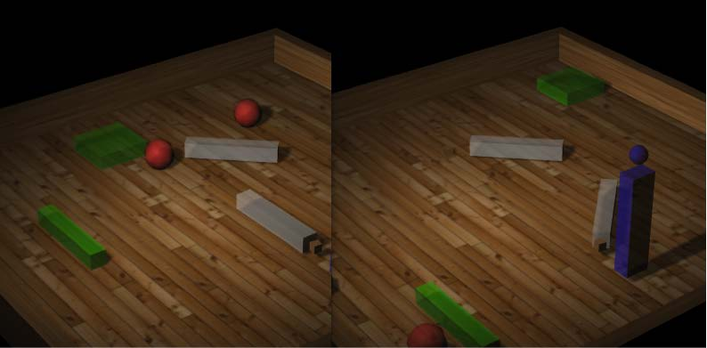

使用 SlidersLeft 按钮，滑块会移动到左侧（它们的下限）；使用 SlidersRight 按钮，它们会移动到右侧（它们的上限）。通过代码创建这些约束非常容易：

```javascript
var constraint = new Physijs.SliderConstraint(sliderMesh, new
  THREE.Vector3(0, 2, 0), new THREE.Vector3(0, 1, 0));
```

```text
scene.addConstraint(constraint);
constraint.setLimits(-10, 10, 0, 0);
constraint.setRestitution(0.1, 0.1);
```

从代码中可以看出，这个约束接受三个参数（如果想将一个对象约束到另一个对象，则接受四个参数）。下表解释了这个约束的参数：

| 参数 | 描述 |
| --- | --- |
| mesh\_a | 传入函数的第一个对象是要约束的对象。在这个示例中，第一个对象是用作滑块的绿色立方体。它的移动会受到约束。 |
| mesh\_b | 这是第二个对象，定义 mesh\_a 被约束到哪个对象。这是一个可选参数，本示例中将其省略。如果省略，网格将被约束到场景。如果指定了它，当这个网格四处移动或其方向发生变化时，滑块也会随之四处移动。 |

<!-- pdf-page: 395 -->
为场景添加物理效果与声音

| 参数 | 描述 |
| --- | --- |
| position | 这是应用约束的点。当将 mesh\_a 约束到 mesh\_b 时，这一点尤其重要。 |
| axis | 这是 mesh\_a 将在其上滑动的轴。请注意，如果指定了 mesh\_b，则这是相对于 mesh\_b 的方向而言的。在当前版本的 Physijs 中，将线性电机与线性限制一起使用时，这个轴似乎会出现一个奇怪的偏移。如果想沿以下轴滑动，以下设置适用于这个版本： |

- x 轴：new THREE.Vector3(0,1,0)

- y 轴：new THREE.Vector3(0,0,Math.PI/2)

- z 轴：new THREE.Vector3(Math.PI/2,0,0)

创建约束并使用 scene. addConstraint 将其添加到场景后，可以为此约束设置 constraint.setLimits(-10, 10, 0, 0) 限制，以指定滑块可以滑动多远。可以在 SliderConstraint 上设置以下限制：

| 参数 | 描述 |
| --- | --- |
| linear\_lower | 这是对象的线性下限 |
| linear\_upper | 这是对象的线性上限 |
| angular\_lower | 这是对象的角度下限 |
| angular\_higher | 这是对象的角度上限 |

最后，可以设置碰到其中一个限制时会发生的恢复系数（弹性）。为此，使用 constraint.setRestitution(res\_linear, res\_angular)，其中第一个参数设置碰到线性限制时的弹跳量，第二个参数设置碰到角度限制时的弹跳量。

现在，整个约束已经配置完成，我们可以等待发生碰撞，让对象四处滑动，也可以使用电机。对于 SliderConstraint，我们有两种选择：可以使用角电机，按照所设置的角度限制，沿指定轴加速；也可以使用线性电机，按照所设置的线性限制，沿指定轴加速。在这个示例中，我们使用了线性电机。有关角电机的使用，请查看本章稍后介绍的 DOFConstraint。

<!-- pdf-page: 396 -->
### 使用 ConeTwistConstraint 创建类似球窝关节的约束

使用 ConeTwistConstraint，可以创建将移动限制在一组角度内的约束。我们可以针对 x、y 和 z 轴，指定一个对象相对于另一个对象的最小角度和最大角度。下面的屏幕截图显示，ConeTwistConstraint 允许你以特定角度绕参考点移动对象：

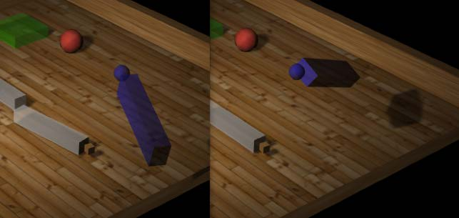

理解 ConeTwistConstraint 最简单的方法，是查看创建一个约束所需的代码。实现这一点所需的代码如下：

```javascript
var baseMesh = new THREE.SphereGeometry(1);
var armMesh = new THREE.BoxGeometry(2, 12, 3);
```

```javascript
var objectOne = new Physijs.BoxMesh(baseMesh,
  Physijs.createMaterial(new THREE.MeshPhongMaterial({color:
  0x4444ff, transparent: true, opacity:0.7}), 0, 0), 0);
objectOne.position.z = 0;
objectOne.position.x = 20;
objectOne.position.y = 15.5;
objectOne.castShadow = true;
scene.add(objectOne);
```

<!-- pdf-page: 397 -->
为场景添加物理效果与声音

```javascript
var objectTwo = new Physijs.SphereMesh
  (armMesh,Physijs.createMaterial(new THREE.MeshPhong
  Material({color: 0x4444ff, transparent: true, opacity:0.7}), 0,
  0), 10);
objectTwo.position.z = 0;
objectTwo.position.x = 20;
objectTwo.position.y = 7.5;
scene.add(objectTwo);
objectTwo.castShadow = true;
```

```javascript
var constraint = new Physijs.ConeTwistConstraint(objectOne,
  objectTwo, objectOne.position);
```

```text
scene.addConstraint(constraint);
```

```javascript
constraint.setLimit(0.5*Math.PI, 0.5*Math.PI, 0.5*Math.PI);
constraint.setMaxMotorImpulse(1);
constraint.setMotorTarget(new THREE.Vector3(0, 0, 0));
```

在这段 JavaScript 中，你可能已经认出了前面讨论过的一些概念。我们首先创建要通过约束相互连接的对象：objectOne（一个球体）和 objectTwo（一个盒子）。我们对这些对象进行定位，使 objectTwo 悬挂在 objectOne 下方。现在就可以创建 ConeTwistConstraint 了。如果已经看过其他约束，这个约束接受的参数并不陌生。第一个参数是要约束的对象，第二个参数是第一个对象要约束到的对象，最后一个参数是构造约束的位置（本例中为 objectOne 围绕其旋转的点）。将约束添加到场景后，可以使用 setLimit 函数设置其限制。这个函数接受三个弧度值，分别指定每个轴的最大角度。

与大多数其他约束一样，我们可以使用约束提供的电机来移动 objectOne。对于 ConeTwistConstraint，我们通过 setMaxMotorImpulse 设置电机可施加的最大冲量，并设置电机应将 objectOne 移动到的目标角度。在这个示例中，我们将它移动到球体正下方的静止位置。你可以通过设置这个目标值来尝试这个示例，如下面的屏幕截图所示：

<!-- pdf-page: 398 -->
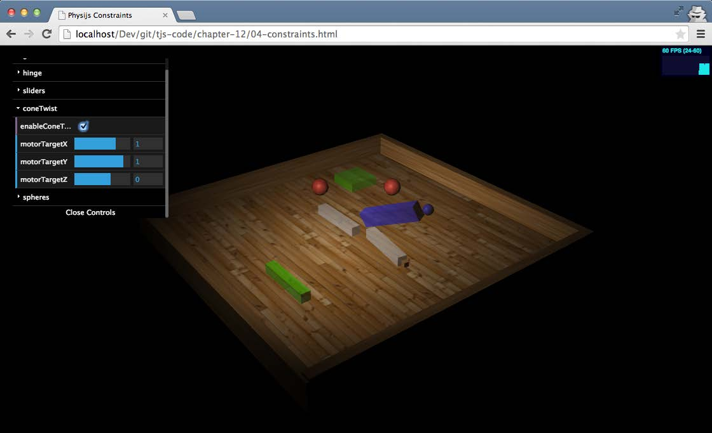

我们要看的最后一个约束，也是功能最灵活的约束——DOFConstraint。

### 使用 DOFConstraint 实现精细控制

DOFConstraint 也称为自由度约束，允许你精确控制对象的线性和角度运动。我们将通过一个示例展示如何使用这个约束，在示例中，你可以驾驶一个简单的类似汽车的形状四处移动。这个形状由一个用作车身的矩形和四个用作车轮的圆柱体组成。让我们先创建车轮：

```javascript
function createWheel(position) {
  var wheel_material = Physijs.createMaterial(
   new THREE.MeshLambertMaterial({
     color: 0x444444,
     opacity: 0.9,
     transparent: true
    }),
    1.0, // high friction
    0.5 // medium restitution
  );
```

<!-- pdf-page: 399 -->
为场景添加物理效果与声音

```javascript
  var wheel_geometry = new THREE.CylinderGeometry(4, 4, 2, 10);
  var wheel = new Physijs.CylinderMesh(
    wheel_geometry,
    wheel_material,
    100
  );
```

```text
  wheel.rotation.x = Math.PI / 2;
  wheel.castShadow = true;
  wheel.position = position;
  return wheel;
}
```

在这段代码中，我们只创建了简单的 CylinderGeometry 和 CylinderMesh 对象，它们可以用作汽车的车轮。下面的屏幕截图描绘了上述代码的结果：

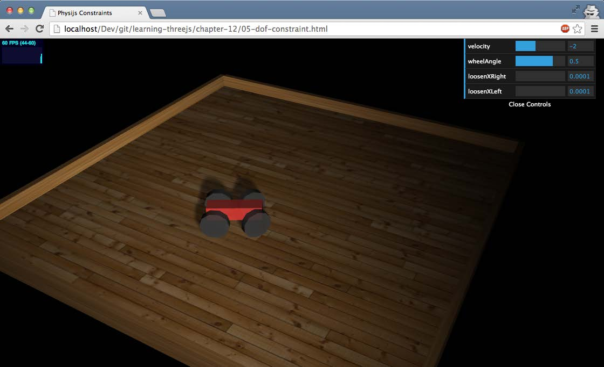

接下来，我们需要创建车身，并将所有内容添加到场景中：

```javascript
var car = {};
var car_material = Physijs.createMaterial(new THREE.
  MeshLambertMaterial({
    color: 0xff4444,
```

<!-- pdf-page: 400 -->
```text
    opacity: 0.9,  transparent: true
  }),   0.5, 0.5
);
```

```javascript
var geom = new THREE.BoxGeometry(15, 4, 4);
var body = new Physijs.BoxMesh(geom, car_material, 500);
body.position.set(5, 5, 5);
body.castShadow = true;
scene.add(body);
```

```javascript
var fr = createWheel(new THREE.Vector3(0, 4, 10));
var fl = createWheel(new THREE.Vector3(0, 4, 0));
var rr = createWheel(new THREE.Vector3(10, 4, 10));
var rl = createWheel(new THREE.Vector3(10, 4, 0));
```

```text
scene.add(fr);
scene.add(fl);
scene.add(rr);
scene.add(rl);
```

到目前为止，我们只是创建了将组成汽车的各个独立组件。为了将所有部分连接在一起，我们将创建约束。每个车轮都会被约束到 body。这些约束按如下方式创建：

```javascript
var frConstraint = new Physijs.DOFConstraint(fr,body, new
  THREE.Vector3(0,4,8));
scene.addConstraint(frConstraint);
var flConstraint = new Physijs.DOFConstraint (fl,body, new
  THREE.Vector3(0,4,2));
scene.addConstraint(flConstraint);
var rrConstraint = new Physijs.DOFConstraint (rr,body, new
  THREE.Vector3(10,4,8));
scene.addConstraint(rrConstraint);
var rlConstraint = new Physijs.DOFConstraint (rl,body, new
  THREE.Vector3(10,4,2));
scene.addConstraint(rlConstraint);
```

每个车轮（第一个参数）都有自己的约束，第二个参数指定车身，最后一个参数则指定车轮连接到车身的位置。如果使用这个配置运行，我们会看到四个车轮支撑着车身。要让汽车移动，还需要做两件事：需要为车轮设置约束（它们可以沿哪个轴移动），还需要配置正确的电机。首先，我们为两个前轮设置约束；对于这些前轮，我们希望它们只能绕 z 轴旋转，以便为汽车提供动力，而不应允许它们沿其他轴移动。

<!-- pdf-page: 401 -->
为场景添加物理效果与声音

实现这一点所需的代码如下：

```text
frConstraint.setAngularLowerLimit({ x: 0, y: 0, z: 0 });
frConstraint.setAngularUpperLimit({ x: 0, y: 0, z: 0 });
flConstraint.setAngularLowerLimit({ x: 0, y: 0, z: 0 });
flConstraint.setAngularUpperLimit({ x: 0, y: 0, z: 0 });
```

乍看之下，这可能有些奇怪。通过将下限和上限设置为相同的值，我们确保无法沿指定方向旋转。这也意味着车轮无法绕其 z 轴旋转。我们之所以这样指定，是因为为特定轴启用电机时，这些限制会被忽略。因此，此时在 z 轴上设置限制不会对我们的前轮产生任何影响。

我们将用后轮进行转向，为了确保它们不会翻倒，需要固定 x 轴。使用以下代码，我们固定 x 轴（将上限和下限都设置为 0），固定 y 轴，使这些车轮在初始时就已经转向，并禁用 z 轴上的任何限制：

```text
rrConstraint.setAngularLowerLimit({ x: 0, y: 0.5, z: 0.1 });
rrConstraint.setAngularUpperLimit({ x: 0, y: 0.5, z: 0 });
rlConstraint.setAngularLowerLimit({ x: 0, y: 0.5, z: 0.1 });
rlConstraint.setAngularUpperLimit({ x: 0, y: 0.5, z: 0 });
```

如你所见，要禁用限制，必须将特定轴的下限设置为高于上限。这将允许绕该轴自由旋转。如果不对 z 轴这样设置，这两个车轮就只会被拖着走。在这种情况下，由于与地面的摩擦，它们会与其他车轮一起转动。

剩下要做的只有为前轮设置电机，可以按如下方式完成：

```text
flConstraint.configureAngularMotor(2, 0.1, 0, -2, 1500);
frConstraint.conAngularMotor(2, 0.1, 0, -2, 1500);
```

由于有三个轴可以创建电机，我们需要指定电机工作的轴：0 表示 x 轴，1 表示 y 轴，2 表示 z 轴。第二个和第三个参数定义电机的角度限制。在这里，我们再次将下限（0.1）设置为高于上限（0），以允许自由旋转。第四个参数指定我们希望达到的速度，最后一个参数指定这个电机可以施加的力。如果最后一个值太小，汽车就不会移动；如果太大，后轮就会离开地面。

使用以下代码启用它们：

```text
flConstraint.enableAngularMotor(2);
frConstraint.enableAngularMotor(2);
```

<!-- pdf-page: 402 -->
如果打开 05-dof-constraint.html 示例，就可以尝试各种约束和电机，并驾驶汽车四处移动。下面的屏幕截图展示了这个示例：

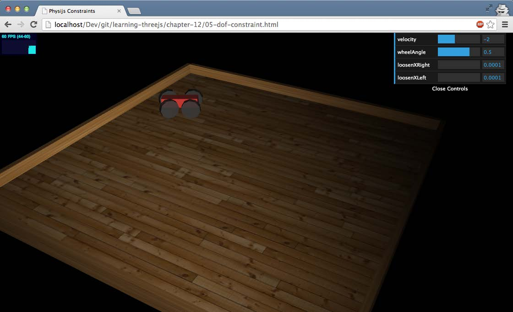

下一节将介绍本书要讨论的最后一个主题，即如何为 Three.js 场景添加声音。

### 为场景添加声源

利用到目前为止讨论的主题，我们已经具备了许多要素，可以创建精美的场景、游戏和其他 3D 可视化内容。不过，我们还没有展示如何为 Three.js 场景添加声音。在本节中，我们将介绍两个允许你为场景添加声源的 Three.js 对象。这一点尤其有趣，因为这些声源会对相机的位置作出响应：

- 声源与相机之间的距离决定声源的音量。

- 声源相对于相机的左右位置，分别决定左侧扬声器和右侧扬声器的音量。

<!-- pdf-page: 403 -->
为场景添加物理效果与声音

解释这一点最好的方式就是观察实际效果。在浏览器中打开 06-audio.html 示例，你会看到三个印有动物图片的立方体。下面的屏幕截图展示了这个示例：

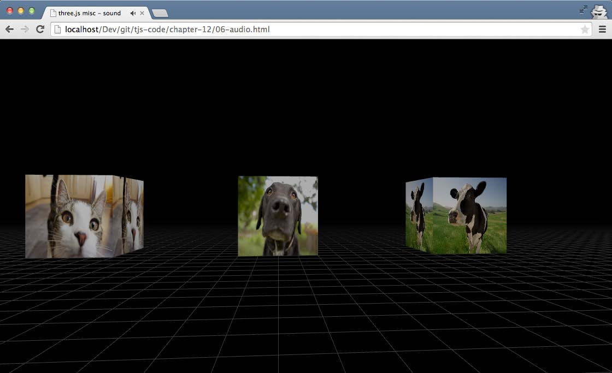

这个示例使用了我们在第 9 章“动画与移动相机”中见过的第一人称控制器，因此可以结合方向键和鼠标在场景中四处移动。你会发现，离某个特定立方体越近，对应动物的声音就越响。如果将相机置于狗和牛之间，你会从右侧听到牛的声音，从左侧听到狗的声音。

在这个示例中，我们使用了 Three.js 的一个特定辅助对象 THREE.GridHelper 来创建立方体下方的网格：

```javascript
var helper = new THREE.GridHelper( 500, 10 );
```

```text
helper.color1.setHex( 0x444444 );
```

```text
helper.color2.setHex( 0x444444 );
```

```text
scene.add( helper );
```

要创建网格，需要指定网格的大小（本例中为 500）和各个网格元素的大小（这里使用了 10）。如果愿意，还可以通过指定 color1 和 color2 属性来设置水平线的颜色。

<!-- pdf-page: 404 -->
实现这一点只需少量代码。我们需要做的第一件事是定义 THREE.AudioListener，并将它添加到 THREE.PerspectiveCamera，如下所示：

var listener1 = new THREE.AudioListener(); camera.add( listener1 ); 接下来，我们需要创建 THREE.Mesh，并向该网格添加一个 THREE.Audio 对象，如下所示：

```javascript
var cube = new THREE.BoxGeometry(40, 40, 40);
```

```javascript
var material_1 = new THREE.MeshBasicMaterial({
  color: 0xffffff,
  map: THREE.ImageUtils.loadTexture("../assets/textures/
    animals/cow.png")
});
```

```javascript
var mesh1 = new THREE.Mesh(cube, material_1);
mesh1.position.set(0, 20, 100);
```

```javascript
var sound1 = new THREE.Audio(listener1);
sound1.load('../assets/audio/cow.ogg');
sound1.setRefDistance(20);
sound1.setLoop(true);
sound1.setRolloffFactor(2);
```

```text
mesh1.add(sound1);
```

从这个代码片段中可以看出，我们首先创建一个标准的 THREE.Mesh 实例。接下来，创建一个 THREE.Audio 对象，并将它连接到之前创建的 THREE.AudioListener 对象。最后，将 THREE.Audio 对象添加到创建的网格中，工作就完成了。

我们可以在 THREE.Audio 对象上设置几个属性来配置其行为：

- load：这允许我们加载要播放的音频文件。

- setRefDistance：这决定从距离对象多远的位置开始降低音量。

- setLoop：默认情况下，声音只播放一次。将此属性设置为 true，声音就会循环播放。

- setRolloffFactor：这决定远离声源时音量降低的速度。

<!-- pdf-page: 405 -->
为场景添加物理效果与声音

在内部，Three.js 使用 Web Audio API（http://webaudio.github.io/webaudio-api/）播放声音并确定正确的音量。并非所有浏览器都支持该规范。目前支持最好的是 Chrome 和 Firefox。

## 小结

在这最后一章中，我们探讨了如何通过添加物理效果来扩展 Three.js 的基本 3D 功能。为此，我们使用了 Physijs 库，它允许你添加重力、碰撞、约束等许多功能。我们还展示了如何使用 THREE.Audio 和 THREE.AudioListener 对象为场景添加空间定位音频。介绍完这些主题，我们也就来到了这本 Three.js 图书的结尾。在这些章节中，我们涵盖了许多不同的主题，几乎探讨了 Three.js 所提供的一切。在最初几章中，我们解释了 Three.js 背后的核心概念和思路；之后，我们介绍了可用的光源，以及材质如何影响对象的渲染方式。掌握基础知识后，我们探索了 Three.js 提供的各种几何体，以及如何组合几何体来创建新的几何体。

在本书的第二部分，我们介绍了几个更高级的主题。你学习了如何创建粒子系统、如何从外部来源加载模型，以及如何创建动画。最后，在这最后几章中，我们介绍了可在蒙皮中使用的高级纹理，以及场景渲染后可以应用的后期处理效果。我们以本章的物理效果内容结束本书；本章除了说明如何为 Three.js 场景添加物理效果，还展示了围绕 Three.js 的活跃项目社区，你可以利用这些项目为一个已经非常出色的库添加更多功能。

希望你喜欢阅读这本书并尝试其中的示例，就像我喜欢撰写这本书一样！

